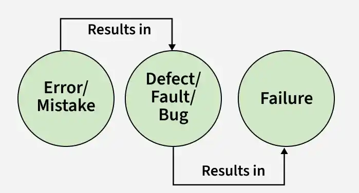

# 7 Nguyên lý Kiểm thử Phần mềm (7 Testing Principles — ISTQB CTFL v4.0)

> **Nguồn tham khảo:** ISTQB CTFL Syllabus v4.0.1 (Section 1.3), `Week1_Further_Reading.pdf`, `Week_01.pdf`, *Agile Testing* (Lisa Crispin & Janet Gregory).

7 nguyên lý kiểm thử cơ bản của ISTQB là kim chỉ nam áp dụng cho **mọi loại kiểm thử, mọi cấp độ kiểm thử và mọi mô hình phát triển phần mềm** (Waterfall, Agile, DevOps). Trước khi đi sâu vào từng nguyên lý, cần nắm chuỗi nhân quả cốt lõi:

*Hình: Chuỗi nhân quả cốt lõi — `Error / Mistake` (con người) → `Defect / Fault / Bug` (trong code/tài liệu) → `Failure` (sự cố khi thực thi). Nguồn ảnh: GeeksforGeeks.*

---

## Tổng quan 7 nguyên lý

| STT | Tên nguyên lý (ISTQB) | Ý nghĩa cốt lõi | Hệ quả thực tế cho Tester |
| :---: | :--- | :--- | :--- |
| **1** | **Testing shows the presence, not the absence, of defects** | Kiểm thử chứng minh phần mềm *có* lỗi, không thể chứng minh phần mềm *100% không có lỗi*. | Dù 100% test case Pass, luôn nêu rõ phạm vi đã test và rủi ro còn lại (*residual risk*). |
| **2** | **Exhaustive testing is impossible** | Không thể test vét cạn mọi tổ hợp đầu vào và trạng thái. | Dùng **phân tích rủi ro**, **độ ưu tiên** và **test techniques** (EP, BVA...) thay vì thử bừa. |
| **3** | **Early testing saves time and money** | Kiểm thử càng sớm (Shift-Left), chi phí sửa lỗi càng rẻ. | Tham gia review yêu cầu, thiết kế và tiêu chí nghiệm thu ngay từ đầu sprint/dự án. |
| **4** | **Defects cluster together** | Lỗi thường tập trung ở một số ít module (quy luật Pareto 80/20). | Theo dõi lịch sử lỗi để dồn lực test kỹ các vùng phức tạp, nhưng không bỏ quên vùng khác. |
| **5** | **Tests wear out (Pesticide Paradox)** | Chạy mãi một bộ test cũ sẽ không còn tìm ra lỗi mới. | Định kỳ rà soát, cập nhật, bổ sung test case và dữ liệu test mới. |
| **6** | **Testing is context dependent** | Chiến lược kiểm thử phụ thuộc vào ngữ cảnh sản phẩm. | Không áp dụng y nguyên cách test của app demo cho hệ thống ngân hàng hay y tế. |
| **7** | **Absence-of-defects fallacy** | Sửa hết bug kỹ thuật không đảm bảo sản phẩm thành công nếu không đáp ứng nhu cầu người dùng. | Kết hợp **Verification** (đúng đặc tả) với **Validation** (đúng nhu cầu thực tế). |

---

## Phân tích chi tiết từng nguyên lý

### 1. Testing shows the presence, not the absence, of defects
*(Kiểm thử chỉ ra sự hiện diện của lỗi, không chứng minh sự vắng mặt của lỗi)*

- **Giải thích:** Một test case thất bại chứng minh chắc chắn hệ thống có defect. Ngược lại, ngay cả khi hàng trăm hoặc hàng nghìn test case đều Pass, bạn vẫn chỉ chứng minh được hệ thống chạy đúng **trong các điều kiện đã kiểm tra**, hoàn toàn không thể kết luận phần mềm sạch 100% lỗi.
- **Ví dụ thực tế (Lab 01 — Course Registration):** Bộ 8 test case chuẩn (`TC01`–`TC08`) tập trung vào số nguyên dương và checkbox. Dù cả 8 ca đều Pass sau khi sửa lỗi biên, hệ thống vẫn có thể bị lỗi nếu người dùng nhập số âm, chữ cái, số thập phân hoặc nhiều sinh viên bấm đăng ký đồng thời (*concurrency*).
- **Ứng dụng vào TechStore / CRM:** Khi báo cáo kết quả test, không viết *"Hệ thống không còn lỗi"*. Hãy ghi rõ: *"Đã thực thi X test cases cho phạm vi A, B; đạt Y Pass, Z Fail; các vùng C, D chưa nằm trong phạm vi kiểm thử đợt này."*

### 2. Exhaustive testing is impossible
*(Kiểm thử vét cạn là bất khả thi)*

- **Giải thích:** Ngoại trừ các chương trình cực kỳ đơn giản, không gian đầu vào, trạng thái hệ thống, trình duyệt, thiết bị và thứ tự thao tác là vô hạn. Thử mọi tổ hợp khả dĩ sẽ tốn thời gian và chi phí vô hạn.
- **Ví dụ thực tế:** Form đăng ký môn học chỉ có 3 trường (`Credits` số nguyên, `Enrollment` số nguyên, `Prerequisite` boolean). Nếu thử mọi số nguyên 32-bit kết hợp với trạng thái checkbox, số tổ hợp lên tới hàng tỷ tỷ trường hợp. Thay vào đó, ta dùng **Equivalence Partitioning (EP)** và **Boundary Value Analysis (BVA)** để rút gọn còn 8–12 ca đại diện có xác suất bắt lỗi cao nhất.
- **Ứng dụng:** Phân bổ thời gian theo **Risk-based Testing**: kiểm tra kỹ các luồng nghiệp vụ lõi (thanh toán, tính tiền, phân quyền, giới hạn biên) trước các chi tiết giao diện phụ.

### 3. Early testing saves time and money
*(Kiểm thử sớm giúp tiết kiệm thời gian và chi phí)*

- **Giải thích:** Đây là nền tảng của tư duy **Shift-Left Testing**. Một lỗi nằm ở tài liệu yêu cầu nếu được phát hiện bằng review chỉ mất vài phút sửa câu chữ; nếu lọt xuống giai đoạn code, test, hoặc production, chi phí sửa lỗi tăng theo cấp số nhân (thường minh họa bằng tỷ lệ đòn bẩy `1 : 10 : 100`).
- **Ví dụ thực tế:** Nếu ở khâu viết đặc tả đã hỏi rõ *"Sĩ số tối đa là `< 40` (tức 0–39) hay `<= 40`?"* trước khi lập trình viên viết code, sẽ không tốn công code sai, viết test sai, log bug rồi sửa lại và retest.
- **Ứng dụng:** Tham gia buổi **Three Amigos** (PO/BA – Dev – Tester) trước khi bắt đầu code sprint trên TechStore/CRM để chốt acceptance criteria và các edge case.

### 4. Defects cluster together
*(Lỗi thường tập trung thành cụm)*

- **Giải thích:** Tương ứng với **nguyên lý Pareto (80/20)** trong kiểm thử: khoảng 80% lỗi thường tập trung ở khoảng 20% module — thường là các module có logic nghiệp vụ phức tạp, nhiều điều kiện rẽ nhánh, tích hợp nhiều bên thứ ba, thay đổi liên tục hoặc do nhiều người cùng sửa.
- **Ví dụ thực tế:** Trong hệ thống thương mại điện tử (như TechStore), module **áp dụng voucher + tính giảm giá + tồn kho khi checkout** thường chứa mật độ lỗi cao hơn nhiều so với trang giới thiệu tĩnh (*About Us*).
- **Ứng dụng:** Dùng lịch sử bug từ các sprint trước để tăng cường test vào những "điểm nóng", nhưng **không bỏ qua hoàn toàn** các module khác (vì vẫn có rủi ro hồi quy).

### 5. Tests wear out *(trước đây gọi là Pesticide Paradox — Nghịch lý thuốc trừ sâu)*
*(Các ca kiểm thử sẽ bị "mòn" hiệu lực theo thời gian)*

- **Giải thích:** Giống như sâu bọ dần kháng cùng một loại thuốc trừ sâu, nếu bạn lặp đi lặp lại đúng một bộ test case cố định với dữ liệu cũ, cuối cùng bộ test đó sẽ không còn phát hiện ra lỗi mới nữa (vì các lỗi mà bộ test đó bắt được đều đã được sửa).
- **Lưu ý quan trọng:** Bộ test cũ vẫn cần được giữ lại cho **Regression Testing** (để đảm bảo tính năng cũ không bị hỏng lại), nhưng **không đủ** để tìm lỗi mới khi phần mềm tiến hóa.
- **Ứng dụng:** Định kỳ làm mới dữ liệu test, bổ sung kịch bản cho tính năng mới (ví dụ thêm danh sách chờ *Waitlist*, thêm hình thức thanh toán mới trên TechStore), và kết hợp **Exploratory Testing**.

### 6. Testing is context dependent
*(Kiểm thử phụ thuộc vào ngữ cảnh)*

- **Giải thích:** Không có một công thức kiểm thử duy nhất cho mọi dự án. Cách chọn kỹ thuật, mức độ tài liệu, độ bao phủ, tỷ lệ automation và tiêu chí nghiệm thu phụ thuộc vào lĩnh vực (*domain*), mức độ rủi ro, quy mô đội ngũ, công nghệ và ngân sách.
- **Ví dụ đối chiếu:**
  - *Phần mềm y tế / hàng không / ngân hàng:* Đòi hỏi formal inspection, 3-value BVA, kiểm thử an toàn/bảo mật nghiêm ngặt, tài liệu truy vết đầy đủ.
  - *App nội bộ / MVP startup / đồ án:* Ưu tiên rủi ro chính, test tự động các API lõi, kết hợp exploratory testing linh hoạt để ra mắt nhanh.

### 7. Absence-of-defects fallacy
*(Ngụy tưởng về sự vắng bóng của lỗi — cập nhật từ "Absence-of-errors fallacy" trong ISTQB v4.0)*

- **Giải thích:** Một hệ thống chạy mượt mà, không crash, khớp 100% đặc tả kỹ thuật (Pass Verification) vẫn là **một sản phẩm thất bại** nếu nó giải quyết sai bài toán, quá khó dùng, hoặc không đáp ứng được nhu cầu thực tế của người dùng và mục tiêu kinh doanh (Fail Validation).
- **Ví dụ thực tế:** Hệ thống đăng ký môn học chạy không có lỗi code nào với giới hạn 24 tín chỉ, nhưng thực tế nhà trường cho phép sinh viên năm cuối đăng ký vượt mức 27 tín chỉ, hoặc nút "Xác nhận" bị ẩn khiến sinh viên không thao tác được.
- **Ứng dụng:** Luôn kiểm tra tính hữu dụng (*usability*), giá trị nghiệp vụ và đối chiếu lại với nhu cầu thực của người dùng cuối (PO/khách hàng) chứ không chỉ bám máy móc vào tài liệu kỹ thuật cũ.

---

## Bài học lịch sử minh họa cho các nguyên lý

1. **Ariane 5 (1996):** Tên lửa nổ sau 37 giây phóng do tràn số khi tái sử dụng module phần mềm từ Ariane 4 mà không thẩm định lại giả định phạm vi dữ liệu *(Nguyên lý 2, 6)*.
2. **Therac-25 (1985–1987):** Máy xạ trị gây quá liều bức xạ do lỗi tương tranh (*race condition*) giữa giao diện và phần cứng — minh họa tầm quan trọng của kiểm thử theo ngữ cảnh an toàn cao *(Nguyên lý 6)*.
3. **Knight Capital (2012):** Thiệt hại 440 triệu USD trong 45 phút do triển khai thiếu mã nguồn mới lên 1 trong 8 server và không kiểm soát cấu hình/hồi quy toàn diện *(Nguyên lý 3, 5)*.

---

## Câu hỏi tự kiểm tra (Phỏng vấn & Ôn tập)

1. *Tại sao một bộ test case pass 100% vẫn không chứng minh được phần mềm hết lỗi?* → Nguyên lý 1 & 2.
2. *Nếu chỉ có thời gian ngắn trước release, bạn chọn test như thế nào?* → Nguyên lý 2 (risk-based) & Nguyên lý 4 (defect clustering).
3. *Sự khác nhau giữa việc giữ lại bộ regression test cũ và Nguyên lý 5 (Tests wear out) là gì?* → Regression test để ngăn lỗi cũ quay lại; muốn tìm lỗi mới phải cập nhật/bổ sung test mới.
