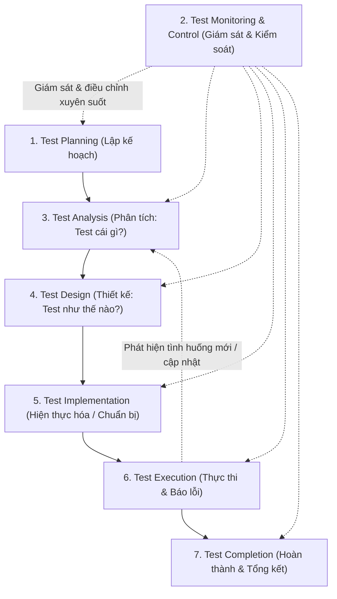

# Quy trình Kiểm thử chuẩn ISTQB (Test Process)

> **Nguồn tham khảo:** ISTQB CTFL Syllabus v4.0.1 (Section 1.4), `Week1_Further_Reading.pdf`, `Week_01.pdf`, `Dynamic_testing.pdf`.

Kiểm thử không chỉ là *"chạy app và bấm nút"*. Theo chuẩn **ISTQB CTFL v4.0**, quy trình kiểm thử là một tập hợp các hoạt động liên kết chặt chẽ với nhau — mang tính **lặp (iterative)** và **thích ứng theo SDLC** (trong Agile các hoạt động này diễn ra liên tục trong mỗi sprint thay vì nối đuôi nhau cứng nhắc như Waterfall).

---

## Sơ đồ tổng quan 7 hoạt động (ISTQB CTFL v4.0)

> **Lưu ý về tên gọi:** Trong roadmap có thể viết gọn 6 bước tuần tự (`planning → analysis → design → implementation → execution → completion`), còn trong chuẩn ISTQB đầy đủ có thêm **Test Monitoring & Control** chạy song song xuyên suốt để theo dõi tiến độ và điều chỉnh kịp thời.

---

## Chi tiết từng hoạt động & Sản phẩm đầu ra (Testware)

### 1. Test Planning *(Lập kế hoạch kiểm thử)*
- **Câu hỏi trọng tâm:** *Chúng ta sẽ test những gì, vì mục tiêu gì, trong phạm vi nào và với nguồn lực ra sao?*
- **Hoạt động chính:**
  - Xác định **mục tiêu kiểm thử** (*test objectives*) và **phạm vi** (*in-scope* / *out-of-scope*).
  - Đánh giá rủi ro sản phẩm để ưu tiên vùng cần test kỹ.
  - Chọn **chiến lược / tiếp cận kiểm thử** (*test approach*), cấp độ test, kỹ thuật thiết kế test.
  - Ước lượng công sức (*effort*), lên lịch trình (*schedule*), phân công nhân sự, xác định **Entry Criteria** (tiêu chí bắt đầu) và **Exit Criteria** / Definition of Done (tiêu chí kết thúc).
- **Testware đầu ra:** Test Plan, Test Schedule, Risk Register, Test Estimates.
- **Ví dụ thực tế:** Trước khi test **TechStore**, xác định phạm vi tuần này là module Đăng ký & Giỏ hàng (API + UI trên Chrome), bỏ qua thanh toán thật, mục tiêu tìm lỗi logic trước khi demo.

### 2. Test Monitoring and Control *(Giám sát và Kiểm soát)*
- **Câu hỏi trọng tâm:** *Tiến độ thực tế đang ở đâu so với kế hoạch? Có cần điều chỉnh gì không?*
- **Hoạt động chính:**
  - **Monitoring (Giám sát):** Thu thập số liệu (*test metrics*) như tỷ lệ test case đã chạy, số bug mở/đóng theo mức độ, độ bao phủ yêu cầu so với kế hoạch ban đầu.
  - **Control (Kiểm soát):** Đưa ra hành động khắc phục khi có độ lệch — ví dụ: tái phân bổ người test vào module nhiều lỗi, ưu tiên chạy các ca rủi ro cao trước khi trễ deadline, cập nhật lại Entry/Exit criteria.
- **Testware đầu ra:** Test Progress Reports, Dashboard metrics, Corrective Action Logs.

### 3. Test Analysis *(Phân tích kiểm thử — "Test cái gì?")*
- **Câu hỏi trọng tâm:** *Dựa vào tài liệu đầu vào, có những điều kiện nào cần kiểm thử và có lỗ hổng nào trong yêu cầu không?*
- **Hoạt động chính:**
  - Phân tích **Test Basis** (tài liệu yêu cầu SRS, User Stories, Acceptance Criteria, thiết kế kiến trúc, luật nghiệp vụ).
  - Phát hiện các điểm mơ hồ, thiếu sót hoặc mâu thuẫn ngay từ tài liệu (kết hợp **Static Testing**).
  - Xác định và ưu tiên các **Test Conditions** (*điều kiện kiểm thử* — mỗi khía cạnh/tình huống có thể kiểm chứng được).
  - Thiết lập **truy vết hai chiều** (*bidirectional traceability*) giữa Test Basis và Test Conditions.
- **Testware đầu ra:** Danh sách Test Conditions, Defect reports cho tài liệu yêu cầu (nếu phát hiện mâu thuẫn).
- **Ví dụ (Lab 01):** Từ quy tắc R1 (*"Credits từ 1 đến 24"*), trích xuất các Test Conditions: dưới biên dưới (`< 1`), tại biên dưới (`1`), trong khoảng hợp lệ (`2–23`), tại biên trên (`24`), trên biên trên (`> 24`).

### 4. Test Design *(Thiết kế kiểm thử — "Test như thế nào?")*
- **Câu hỏi trọng tâm:** *Làm thế nào để kiểm tra các Test Conditions đã xác định?*
- **Hoạt động chính:**
  - Chuyển hóa các Test Conditions thành **Test Cases** (mức cao hoặc chi tiết) bằng các kỹ thuật thiết kế test (EP, BVA, Decision Table, State Transition, Statement/Branch coverage...).
  - Xác định dữ liệu đầu vào (**Test Data**), điều kiện tiên quyết (**Preconditions**) và kết quả mong đợi (**Expected Results** dựa trên **Test Oracle**).
  - Thiết kế yêu cầu về môi trường kiểm thử (**Test Environment**) và công cụ hỗ trợ.
  - Cập nhật traceability giữa Test Conditions ↔ Test Cases.
- **Testware đầu ra:** Test Cases, Test Data requirements, Test Environment requirements.

### 5. Test Implementation *(Hiện thực hóa kiểm thử — "Chuẩn bị sẵn sàng để chạy")*
- **Câu hỏi trọng tâm:** *Dữ liệu, môi trường và kịch bản đã sẵn sàng để bấm chạy chưa?*
- **Hoạt động chính:**
  - Sắp xếp các Test Cases thành các **Test Procedures** (kịch bản chạy theo trình tự) và gom nhóm thành **Test Suites** (ví dụ: Smoke Suite, Regression Suite).
  - Viết hoặc hoàn thiện **Automated Test Scripts** (JUnit, REST Assured, Selenium/Playwright...).
  - Chuẩn bị dữ liệu test thực tế (tài khoản mẫu, DB seed, mock data).
  - Dựng và kiểm tra nhanh môi trường test (staging, Docker container, trình duyệt) đảm bảo sẵn sàng trước giờ thực thi.
  - Lên **Test Execution Schedule** (thứ tự chạy bộ test nào trước, bộ nào sau).
- **Testware đầu ra:** Test Procedures, Test Suites, Automated Test Scripts, Test Data, Configured Test Environment.

### 6. Test Execution *(Thực thi kiểm thử)*
- **Câu hỏi trọng tâm:** *Hệ thống thực tế hành xử ra sao so với mong đợi?*
- **Hoạt động chính:**
  - Thực thi các Test Suites theo lịch trình (chạy tay hoặc chạy tự động).
  - Ghi nhận ID, phiên bản phần mềm (*build/version*) và môi trường thực thi.
  - So sánh **Actual Result** với **Expected Result**:
    - Khớp hoàn toàn → **Pass**
    - Sai lệch → **Fail** (hoặc **Blocked** nếu môi trường/tính năng phụ thuộc bị lỗi không chạy tiếp được).
  - Phân tích sự cố để loại trừ lỗi do dữ liệu/môi trường test trước khi kết luận lỗi sản phẩm.
  - Lập **Defect Report (Bug Report)** kèm bằng chứng (screenshot, log, video).
  - Sau khi Dev sửa lỗi, thực hiện **Confirmation Testing (Retesting)** cho ca từng Fail và **Regression Testing** cho các vùng liên quan.
- **Testware đầu ra:** Test Execution Logs, Test Results, Defect Reports.

### 7. Test Completion *(Hoàn thành kiểm thử)*
- **Câu hỏi trọng tâm:** *Chúng ta đã đạt tiêu chí dừng chưa, học được gì và còn rủi ro nào?*
- **Hoạt động chính:**
  - Đối chiếu kết quả thực tế với **Exit Criteria / DoD**.
  - Đảm bảo mọi bug nghiêm trọng đã được xử lý hoặc có kế hoạch theo dõi (*deferred/known issues*) được stakeholder chấp nhận.
  - Lập **Test Summary Report** gửi các bên liên quan (nêu rõ những gì đã test, kết quả Pass/Fail, bug tồn đọng và **residual risk**).
  - Lưu trữ (*archive*) testware (test suites, test data, scripts, cấu hình môi trường) để tái sử dụng cho lần release sau.
  - Tổ chức **Retrospective / Lessons Learned** để cải tiến quy trình cho sprint hoặc dự án tiếp theo.
- **Testware đầu ra:** Test Summary Report, Archived Testware, Change Requests / Improvement Actions.

---

## Bảng tóm tắt nhanh để tra cứu

| Giai đoạn | Câu hỏi cốt lõi | Đầu ra chính (Testware) |
| :--- | :--- | :--- |
| **1. Planning** | Test gì, tại sao, nguồn lực nào? | Test Plan, Scope, Schedule |
| **2. Monitoring & Control** | Tiến độ có đúng kế hoạch không? | Progress Report, Corrective Actions |
| **3. Analysis** | *Test cái gì?* | Test Conditions, Traceability |
| **4. Design** | *Test như thế nào?* | Test Cases, Test Data specs |
| **5. Implementation** | *Đã đủ đồ nghề để chạy chưa?* | Test Suites, Procedures, Scripts, Env |
| **6. Execution** | *Hệ thống thực tế chạy ra sao?* | Test Logs, Pass/Fail, Bug Reports |
| **7. Completion** | *Đạt chuẩn release chưa & rút kinh nghiệm gì?* | Test Summary Report, Lessons Learned |

---

## Truy vết ngữ cảnh (Traceability) — Tại sao rất quan trọng?

ISTQB nhấn mạnh việc giữ mạch liên kết xuyên suốt:

`Test Basis (Yêu cầu R1)` ↔ `Test Condition` ↔ `Test Case (TC02)` ↔ `Test Execution (Fail)` ↔ `Defect Report (BUG-01)`

Nhờ chuỗi truy vết này, khi một yêu cầu thay đổi (ví dụ: trường nâng trần tín chỉ từ 24 lên 27), nhóm sẽ biết ngay chính xác những Test Case nào cần sửa và những Bug nào bị ảnh hưởng.
