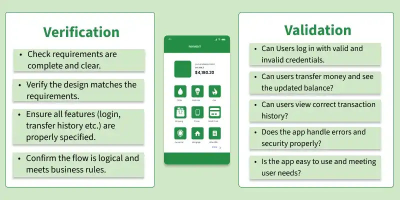
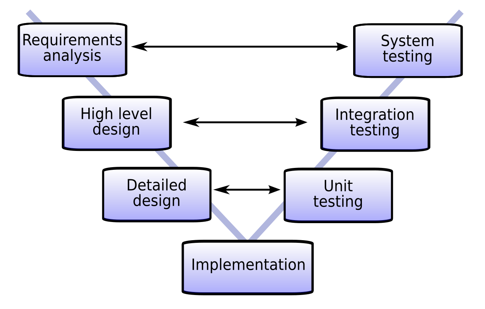

# Verification vs. Validation (Xác minh vs. Xác thực)

> **Nguồn tham khảo:** Ian Sommerville (*Software Engineering*, 8th ed., Chapter 22), IEEE-STD-610 / ISO/IEC/IEEE 29119, ISTQB CTFL v4.0.1, `Verification_v_Validation.pdf`, `Week2_Further_Reading.pdf`.

---

## 1. Định nghĩa cốt lõi (Câu hỏi kinh điển của Barry Boehm)

| Khái niệm | Câu hỏi kim chỉ nam (Barry Boehm) | Bản chất |
| :--- | :--- | :--- |
| **Verification** *(Xác minh)* | **"Are we building the product right?"** *(Chúng ta có đang xây dựng sản phẩm đúng cách không?)* | Kiểm tra sản phẩm/tài liệu của một giai đoạn có **tuân thủ đúng đặc tả kỹ thuật (SRS), thiết kế, quy chuẩn** đã viết ra hay không. |
| **Validation** *(Xác thực)* | **"Are we building the right product?"** *(Chúng ta có đang xây dựng đúng sản phẩm khách hàng cần không?)* | Kiểm tra sản phẩm thực tế có **đáp ứng đúng nhu cầu nghiệp vụ, mục đích sử dụng (*Fit for purpose*) và kỳ vọng thực tế** của người dùng cuối/stakeholders hay không. |

*Hình: Verification ("Building the product right") kiểm tra tài liệu/thiết kế/code nội bộ; Validation ("Building the right product") kiểm chứng sản phẩm chạy thật theo kỳ vọng người dùng (Nguồn ảnh: GeeksforGeeks).*

### Định nghĩa chuẩn quốc tế & Học thuật
- **Theo IEEE / ISO/IEC/IEEE 29119:**
  - *Verification:* Đánh giá một hệ thống hoặc thành phần để xác định sản phẩm của một giai đoạn phát triển có thỏa mãn các điều kiện được thiết lập từ đầu giai đoạn đó không.
  - *Validation:* Đánh giá một hệ thống hoặc thành phần trong hoặc cuối chu kỳ phát triển để xác định có đáp ứng đầy đủ các yêu cầu nghiệp vụ và mục đích sử dụng thực tế của các bên liên quan không.
- **Theo Ian Sommerville (*Software Engineering*, 8th ed.):** V&V là chu trình kiểm tra và phân tích nhằm thiết lập **mức độ tin cậy (*confidence*)** rằng phần mềm đạt tiêu chuẩn **"Fit for purpose"** — mức độ khắt khe phụ thuộc vào tính chất hệ thống (y tế/hàng không khắt khe hơn web thương mại nhỏ), ngân sách và kỳ vọng thị trường.

---

## 2. Bảng so sánh toàn diện: Verification vs. Validation

| Tiêu chí | Verification (Xác minh) | Validation (Xác thực) |
| :--- | :--- | :--- |
| **Câu hỏi cốt lõi** | *Are we building the product right?* | *Are we building the right product?* |
| **Trọng tâm** | Tuân thủ đặc tả kỹ thuật, thiết kế, coding standards (*Specification conformance*). | Đáp ứng nhu cầu người dùng và giá trị nghiệp vụ thực tế (*User needs & Fitness for purpose*). |
| **Phương pháp chủ đạo** | Chủ yếu là **Static Testing** (Reviews, Walkthroughs, Inspections, Linters) + Unit/Integration tests đối chiếu thiết kế. | Chủ yếu là **Dynamic Testing** (System Testing, UAT, Alpha/Beta Testing, OAT, Usability Testing) + Static Validation (duyệt wireframe/prototype với khách hàng). |
| **Đối tượng kiểm tra** | SRS, User Stories, sơ đồ UML/DB, mã nguồn, test cases. | Bản build thực thi, môi trường staging/production, quy trình sử dụng thật. |
| **Ai thực hiện?** | Developers, Testers, QA. | Khách hàng (Clients), End-users, Product Owners (PO), QA/QC đại diện góc nhìn người dùng. |
| **Thời điểm** | Từ đầu dự án và xuyên suốt từng pha SDLC. | Khi có prototype/build chạy được và lặp lại cuối mỗi sprint / trước nghiệm thu. |
| **Chi phí sửa lỗi** | Phát hiện sớm → Chi phí rất thấp. | Phát hiện muộn → Chi phí cực kỳ tốn kém (có thể phải sửa cả luồng nghiệp vụ). |

---

## 3. Vị trí của V&V trong Mô hình chữ V (V-Model)

Trong mô hình chữ V, nhánh đi xuống (thiết kế phân rã) được **Verify** liên tục bằng Review/Inspection, còn nhánh đi lên là các cấp độ kiểm thử gắn kết chặt chẽ giữa Verification và Validation:

*Hình: Mô hình chữ V cổ điển thể hiện tính đối xứng giữa nhánh thiết kế (trái) và nhánh kiểm thử (phải). Nguồn: [Wikimedia Commons (CC BY-SA)](https://commons.wikimedia.org/wiki/File:V-model.png). Lưu ý: Một số sơ đồ SWE 3 tầng dừng ở `System Testing`; trong ISTQB và bài giảng trường có thêm tầng thứ 4 trên cùng là `Acceptance Testing (UAT)` — xem sơ đồ 4+ tầng V&V và Shift-Left chi tiết tại [concepts/02-v-model-and-vv.md](./concepts/02-v-model-and-vv.md).*

---

## 4. Ma trận 4 kịch bản thực tế: Tại sao cần cả hai?

| | **Verification PASS** | **Verification FAIL** |
| :--- | :--- | :--- |
| **Validation PASS** | **THÀNH CÔNG HOÀN HẢO:** Đúng kỹ thuật + Đúng nhu cầu người dùng. | **TRỚ TRÊU / RỦI RO CAO:** Đúng ý người dùng nhưng code sai đặc tả/nhiều lỗi kỹ thuật tiềm ẩn, dễ sập khi vận hành. |
| **Validation FAIL** | **LÃNG PHÍ VÔ ÍCH:** Chạy cực mượt không bug, đúng 100% tài liệu cũ, nhưng không ai dùng vì sai nghiệp vụ hiện tại. | **THẤT BẠI TOÀN TẬP:** Vừa nhiều lỗi kỹ thuật vừa không giải quyết đúng bài toán người dùng. |

### Hai ví dụ minh họa kinh điển
1. **Hệ thống Đăng ký học phần:**
   - *Lỗi Verification:* SRS ghi *"Tối đa 24 tín chỉ (`<= 24`)"*, code viết `if (credits >= 24) reject` → Chặn nhầm sinh viên đăng ký đúng 24 tín chỉ.
   - *Lỗi Validation:* Code tuân thủ 100% SRS (chặn trên 24 tín chỉ), nhưng thực tế Phòng Đào tạo đã đổi quy chế cho phép sinh viên giỏi đăng ký vượt mức 27 tín chỉ nếu có đơn duyệt → Phần mềm **Pass Verification nhưng Fail Validation**.
2. **Thảm họa Mars Climate Orbiter của NASA (1999):**
   - Lockheed Martin tính lực đẩy theo đơn vị Anh (`lbf-s`), NASA kỳ vọng hệ SI (`N-s`). Mỗi đội tự Verify nội bộ code của mình hoàn hảo, nhưng khi tích hợp vận hành thực tế (Validation), sự lệch đơn vị khiến tàu lệch quỹ đạo và bốc cháy (thiệt hại > 300 triệu USD).

---

## 5. Phân biệt liên đới: QA vs. QC và Testing vs. Debugging

Trong thực tế và phỏng vấn, V&V thường được hỏi kèm với **QA vs. QC** và **Testing vs. Debugging**:

### QA (Quality Assurance) vs. QC (Quality Control)

| Tiêu chí | QA (Đảm bảo chất lượng) | QC (Kiểm soát chất lượng) |
| :--- | :--- | :--- |
| **Bản chất** | **Process-oriented** (Hướng quy trình) & **Proactive** (Chủ động phòng ngừa lỗi). | **Product-oriented** (Hướng sản phẩm) & **Reactive** (Phát hiện lỗi đã phát sinh). |
| **Mục tiêu** | Chuẩn hóa và cải tiến quy trình để lỗi ít có cơ hội xuất hiện ngay từ đầu. | Kiểm tra, đo lường sản phẩm cụ thể xem có đạt chuẩn trước khi bàn giao không. |
| **Hoạt động tiêu biểu** | Thiết lập quy trình Scrum/CI-CD, coding conventions, review checklist, đào tạo, audit quy trình. | Thực thi test cases (Testing), Code inspection, đo coverage, viết Bug Report. |

> **Ghi nhớ nhanh:** **Testing là một hoạt động cốt lõi của QC** (không phải toàn bộ QA).

### Testing (Kiểm thử) vs. Debugging (Gỡ lỗi)

| Tiêu chí | Testing (Kiểm thử) | Debugging (Gỡ lỗi) |
| :--- | :--- | :--- |
| **Mục đích** | Tìm **Failure** (triệu chứng sai lệch), tái lập lỗi và báo cáo bằng chứng. | Tìm **Root Cause / Defect** trong mã nguồn và sửa code (*patch/fix*). |
| **Người thực hiện** | Chủ yếu là Tester / QA / QC (hoặc Dev khi viết Unit Test). | Developer (người phát triển phần mềm). |
| **Hoạt động** | Thiết kế test, chạy, đối chiếu Actual vs Expected, giữ bằng chứng. | Đặt breakpoint, đọc stack trace, trace biến, sửa code và test cục bộ. |
| **Sau khi sửa** | Tester chạy **Confirmation Testing (Retest)** và **Regression Testing**. | Bàn giao bản build đã fix cho Tester. |
