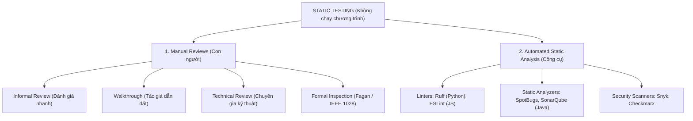

# Static Testing vs. Dynamic Testing (Kiểm thử Tĩnh vs. Kiểm thử Động)

> **Nguồn tham khảo:** ISTQB CTFL Syllabus v4.0.1 (Chapter 3 — Static Testing), IEEE 1028, `Static_Testing.pdf`, `Dynamic_testing.pdf`, `Week2_Further_Reading.pdf`.

Static Testing và Dynamic Testing là **hai nửa bổ trợ cho nhau** chứ không thay thế nhau: Static Testing dọn sạch lỗi câu từ, logic tài liệu và lỗi cú pháp/tiềm ẩn trước khi chạy; Dynamic Testing kiểm chứng hành vi thực tế của phần mềm khi vận hành.

---

## 1. Bảng so sánh toàn diện: Static vs. Dynamic Testing

| Tiêu chí so sánh | Static Testing (Kiểm thử tĩnh) | Dynamic Testing (Kiểm thử động) |
| :--- | :--- | :--- |
| **Thực thi mã nguồn?** | **Không** (*without executing the software*). | **Có** (*bắt buộc biên dịch và chạy phần mềm*). |
| **Đối tượng kiểm tra** | Tài liệu yêu cầu (SRS, User Stories), bản thiết kế (UML, DB Schema, Figma), mã nguồn tĩnh, cấu hình CI/CD, test cases. | Bản build thực thi (`.exe`, `.jar`, `.apk`, web staging), API đang chạy, hệ thống tích hợp. |
| **Phát hiện cái gì?** | Tìm trực tiếp **Defect** (khuyết tật/mâu thuẫn/nguyên nhân gốc) trong sản phẩm công việc. | Phát hiện **Failure** (sự cố/sai lệch hành vi) khi chạy dữ liệu đầu vào cụ thể. |
| **Thời điểm áp dụng** | Ngay từ giai đoạn đầu (Shift-Left), kể cả khi chưa có dòng code nào. | Nửa sau của chu kỳ phát triển (hoặc khi có build/unit chạy được). |
| **Chi phí sửa lỗi** | Rất rẻ (sửa câu văn trong SRS, sửa dòng code trước khi merge). | Cao hơn (tái lập lỗi, debug, sửa code, retest, regression test). |
| **Đo thuộc tính phi chức năng** | Hạn chế (chỉ đo được các chỉ số tĩnh như *Cyclomatic Complexity*, chuẩn coding). | Đo được trực tiếp lúc chạy: thời gian phản hồi (`p95`/`p99`), throughput, memory leak, concurrency, UX. |
| **Công cụ / Kỹ thuật** | Manual Reviews (Informal, Walkthrough, Technical Review, Inspection) & Static Analysis (Ruff, ESLint, SpotBugs, SonarQube). | Black-box, White-box, Experience-based; JUnit, REST Assured, Selenium, Playwright, JMeter. |

---

## 2. Chi tiết về Static Testing (Kiểm thử tĩnh)

Một hiểu lầm phổ biến là *"Static testing chỉ là ngồi đọc code"*. Thực tế, **mọi work product viết ra trên văn bản hoặc mã nguồn** đều có thể kiểm thử tĩnh. Static Testing gồm 2 trụ cột:

### Trụ cột 1: 4 mức độ Review thủ công (từ nhẹ đến khắt khe)

| Hình thức | Cách thực hiện | Vai trò chính | Khi nào dùng? |
| :--- | :--- | :--- | :--- |
| **1. Informal Review** | Trao đổi nhanh giữa đồng nghiệp (*peer check / buddy check*), không cần biên bản chính thức. | Author, Reviewer (1–2 người). | Thay đổi nhỏ hàng ngày, PR nhỏ, bản nháp sớm. |
| **2. Walkthrough** | **Tác giả (Author) chủ trì**, dẫn dắt nhóm đi từng bước qua tài liệu/luồng/code để đặt câu hỏi và tìm thiếu sót. | Author, Reviewers, Recorder (tùy chọn). | Tạo hiểu biết chung trong team, tìm missing flows / edge cases. |
| **3. Technical Review** | Nhóm chuyên gia kỹ thuật đánh giá sâu giải pháp kiến trúc, thuật toán, API contract, bảo mật. | Moderator/Facilitator, Technical Peers (Architect, Tech Lead, Security). | Chốt kiến trúc, thiết kế DB, giải pháp kỹ thuật phức tạp. |
| **4. Formal Inspection** *(Fagan / IEEE 1028)* | Quy trình chuẩn hóa chặt chẽ nhất: có chuẩn bị cá nhân trước, họp rà soát từng dòng theo **checklist**, dùng **metrics** (tốc độ đọc, mật độ lỗi), bắt buộc sửa triệt để và **Entry/Exit criteria**. | **Moderator** (điều phối), **Author**, **Reader** (đọc diễn giải), **Inspectors**, **Recorder** (ghi biên bản). | Hệ thống quan trọng/rủi ro cao (y tế, tài chính, hàng không) hoặc tài liệu nền tảng quan trọng. |

#### Quy trình 5 bước của một buổi Review chuẩn (ISTQB v4.0)
1. **Planning:** Xác định phạm vi, chọn hình thức review, phân vai, chốt Entry Criteria.
2. **Review Initiation:** Phân phát tài liệu (*work product*) và checklist cho người tham gia.
3. **Individual Review:** Từng người tự đọc độc lập, ghi nhận lỗi tiềm ẩn, câu hỏi cần làm rõ.
4. **Communication and Analysis:** Họp phân tích các phát hiện (hoặc trao đổi trên PR), phân loại defect vs. clarification, quyết định hướng xử lý.
5. **Fixing and Reporting:** Tác giả sửa tài liệu/code, Moderator/Reviewer xác nhận lại đã đóng lỗi (*Exit Criteria*) và tổng hợp báo cáo.

### Trụ cột 2: Phân tích tĩnh tự động (Automated Static Analysis)
Dùng công cụ quét mã nguồn hoặc bytecode (ví dụ: **Ruff** cho Python trong Lab 03–04, **SpotBugs / SonarQube** cho Java, **ESLint** cho JS/TS) để phát hiện:
- **Lỗi cú pháp & chuẩn code:** biến/import dư thừa (ví dụ `F401`, `F841` trong Ruff), sai convention.
- **Dead Code / Unreachable Code:** đoạn code sau `return` không bao giờ chạy tới.
- **Potential Bugs:** chia cho 0, truy cập vượt chỉ số, biến có nguy cơ `NullPointerException`, quên đóng tài nguyên (`file.close()`).
- **Độ phức tạp mã nguồn:** cảnh báo hàm có *Cyclomatic Complexity* quá cao (quá nhiều `if-else` / `for` lồng nhau).
- **Lỗi bảo mật sơ đẳng (SAST):** hardcode password/API key, nối chuỗi SQL gây nguy cơ SQL Injection.

> **Cảnh báo quan trọng (Bài học Lab 03–04):** Một linter báo *"All checks passed (0 warnings)"* **KHÔNG chứng minh nghiệp vụ đúng!** Ruff có thể bắt được import thừa, nhưng không thể tự biết `if total >= 24` hay `if total > 24` mới đúng quy chế của trường — điều đó cần review nghiệp vụ và Dynamic Testing.

---

## 3. Chi tiết về Dynamic Testing (Kiểm thử động)

Dynamic Testing bắt buộc phải **chạy chương trình** với dữ liệu đầu vào (*Input Data*), quan sát **Actual Result** và đối chiếu với **Expected Result** (suy ra từ **Test Oracle**).

### 4 mục tiêu chính
1. **Kích hoạt và phát hiện sự cố (*Expose Failures*):** Phát hiện crash, sai thuật toán, sai hiển thị khi vận hành thật.
2. **Kiểm tra sự tích hợp (*Verify Integration*):** Xác nhận Frontend ↔ Backend ↔ Database ↔ Bên thứ ba (cổng thanh toán, email/SMS) giao tiếp trơn tru.
3. **Đo lường thuộc tính phi chức năng:** Tốc độ phản hồi, tải đồng thời (*concurrency*), RAM/CPU, độ ổn định khi chạy lâu.
4. **Tạo lập niềm tin nghiệm thu:** Cung cấp bằng chứng chạy thật cho khách hàng/PO quyết định phát hành.

### 3 nhóm kỹ thuật Dynamic Testing (ISTQB)
1. **Black-box (Hộp đen — dựa trên đặc tả):** Equivalence Partitioning (EP), Boundary Value Analysis (BVA), Decision Table, State Transition, Use Case.
2. **White-box (Hộp trắng — dựa trên cấu trúc code):** Statement Coverage, Branch/Decision Coverage, Path Coverage.
3. **Experience-based (Dựa trên kinh nghiệm):** Error Guessing, Exploratory Testing, Checklist-based Testing.

---

## 4. Ví dụ phối hợp Static + Dynamic trên cùng 1 bài toán

Giả sử kiểm tra chức năng **áp dụng mã giảm giá (Voucher) trên TechStore**:
- **Static Testing phát hiện trước khi code:**
  - *Checklist review SRS:* Tài liệu ghi *"Giảm 20% cho đơn từ 500k"*, nhưng không nói rõ đơn đúng `500.000đ` có được áp dụng không (`>=` hay `>`), và có áp dụng đồng thời 2 voucher không → Tránh dev hiểu một kiểu, tester test một kiểu.
  - *Static Analysis (SonarQube/SpotBugs):* Cảnh báo biến `discountAmount` có thể bị null nếu voucher hết hạn.
- **Dynamic Testing phát hiện lúc chạy:**
  - *Functional API/UI test:* Nhập đơn `500.000đ` với mã giảm giá → Kiểm tra tổng tiền thực tế và bản ghi lưu trong DB.
  - *Performance / Concurrency test:* 2 người dùng bấm dùng cùng 1 mã voucher chỉ còn 1 lượt cùng một thời điểm → Xem có bị trừ thành -1 lượt không (điều mà Static Testing rất khó thấy hết nếu chỉ nhìn từng hàm đơn lẻ).
