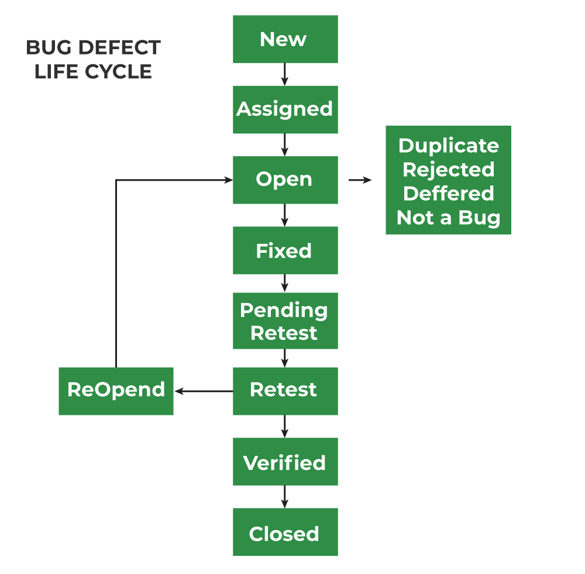

# Viết Bug Report chuẩn (Defect Reporting & Triage)

> **Nguồn tham khảo:** ISO/IEC/IEEE 29119-3, ISTQB CTFL Syllabus v4.0.1 (Section 5.5 — Defect Management), `Week_01.pdf`, `Week1_Further_Reading.pdf`, `Bug_Reports_23110009.csv`.

Một Bug Report tốt không chỉ giúp Developer tái lập và sửa lỗi trong vài phút mà còn tránh tranh cãi qua lại (*"Máy tui chạy bình thường mà!"*). Nhiệm vụ của Tester khi phát hiện lỗi là: **Giữ bằng chứng → Xác định các bước tái lập chắc chắn 100% → Đánh giá mức độ ảnh hưởng → Viết báo cáo khách quan, rõ ràng**.

---

## 1. Cấu trúc chuẩn của một Bug Report (ISO/IEC/IEEE 29119-3 & ISTQB)

| Trường | Vai trò & Cách viết chuẩn | Lưu ý quan trọng |
| :--- | :--- | :--- |
| **Bug ID** | Mã định danh duy nhất (VD: `BUG-01`, `TECH-104`). | Tự động sinh trên Jira hoặc đánh số tăng dần trong CSV. |
| **Title / Summary** | Tóm tắt ngắn gọn theo công thức: **`[Module/Vùng] + Vấn đề xảy ra + Điều kiện/Ngữ cảnh`**. | Rõ nghĩa ngay khi đọc lướt. *Tránh viết:* *"Trang đăng ký bị lỗi"*. |
| **Environment** | OS, trình duyệt + phiên bản, thiết bị, môi trường (`Staging`/`Local`), version/commit build. | Rất quan trọng với lỗi chỉ xuất hiện trên Safari/Mobile hoặc một commit cụ thể. |
| **Requirement / TC Ref** | Mã yêu cầu vi phạm (`R1`) và Test Case Fail (`TC02`). | Giúp truy vết và xác nhận lại khi chạy Confirmation Testing. |
| **Preconditions** | Trạng thái cần thiết trước bước 1 (tài khoản role nào, giỏ hàng có gì, cấu hình nào). | Không có precondition chuẩn thì dev có thể không tái hiện được. |
| **Steps to Reproduce** | Từng bước đánh số `1, 2, 3...` cực kỳ chi tiết và tuyến tính. | Nhấn mạnh tỷ lệ tái lập (*Always / Intermittent*). |
| **Test Data** | Bộ dữ liệu chính xác đã nhập gây lỗi (VD: `Credits=1; Enrollment=25; Prerequisite=Yes`). | Ghi đúng cả khoảng trắng hoặc ký tự đặc biệt nếu có. |
| **Expected Result** | Kết quả đúng theo Test Oracle (SRS/AC). | Trích rõ quy tắc nghiệp vụ làm căn cứ. |
| **Actual Result** | Kết quả sai thực tế xảy ra (thông báo lỗi nguyên văn, HTTP status code, hành vi UI). | Chỉ mô tả sự thật quan sát được; **không tự đoán nguyên nhân code** nếu chưa kiểm tra code. |
| **Severity** | Mức độ nghiêm trọng kỹ thuật/ảnh hưởng hệ thống. | Do **Tester** đề xuất ban đầu. |
| **Priority** | Mức độ khẩn cấp cần sửa theo góc nhìn kinh doanh/release. | Do **PO / PM / Test Lead** chốt khi triage. |
| **Evidence / Attachments** | Ảnh chụp màn hình (khoanh vùng lỗi + thấy rõ input), video quay màn hình, console/network log (HAR), server stack trace. | *"No evidence, no bug"* — bằng chứng rõ ràng giúp giảm 80% thời gian trao đổi. |

---

## 2. Phân biệt Severity vs. Priority (Câu hỏi phỏng vấn kinh điển)

| Tiêu chí | Severity (Mức độ nghiêm trọng) | Priority (Mức độ ưu tiên) |
| :--- | :--- | :--- |
| **Góc nhìn** | **Kỹ thuật & Chức năng** (*Tech/System Impact*). | **Kinh doanh & Tiến độ** (*Business/Schedule Urgency*). |
| **Câu hỏi** | Lỗi này phá hỏng hệ thống hoặc cản trở người dùng nặng tới mức nào? | Cần sửa lỗi này **gấp** tới mức nào trong lịch trình phát hành? |
| **Ai quyết định?** | Chủ yếu là **Tester / QA**. | Chủ yếu là **Product Owner / Project Manager / Team Lead**. |
| **Mức độ phổ biến** | `Critical / Blocker`, `High / Major`, `Medium / Moderate`, `Low / Minor`. | `P1 (High / Urgent)`, `P2 (Medium / Normal)`, `P3 (Low)`. |

### Ma trận Severity × Priority & Ví dụ thực tế

| Severity \ Priority | **P1 — High (Sửa ngay)** | **P2 — Medium (Sửa trong sprint)** | **P3 — Low (Đưa vào backlog)** |
| :--- | :--- | :--- | :--- |
| **Critical / High** | **Fix tức thì / Hotfix:** Lỗi không thể thanh toán trên TechStore; lỗi bảo mật xem được đơn hàng người khác; crash app khi mở. | **Ưu tiên cao:** Lỗi chỉ xảy ra ở luồng quản trị ít dùng nhưng làm sai số liệu báo cáo tháng. | **Hiếm gặp:** Lỗi nặng nhưng chỉ xảy ra trên trình duyệt rất cũ sắp ngừng hỗ trợ và có workaround. |
| **Medium** | **Fix sớm:** Chức năng phụ bị lỗi nhưng liên quan đến chiến dịch khuyến mãi ngày mai. | **Bình thường:** Tính năng phụ sai lệch nhẹ, người dùng vẫn có cách thao tác khác (*workaround*). | **Chờ xếp lịch:** Lỗi biên hiếm gặp ở tính năng nội bộ không gấp. |
| **Low** | **Sửa gấp dù lỗi nhẹ:** Sai chính tả tên công ty / logo ngay trang chủ trước giờ họp báo ra mắt (*Low Severity, High Priority*). | **Dọn dần:** Lệch căn lề nhẹ ở màn hình cài đặt. | **Hoãn / Won't Fix:** Lỗi thẩm mỹ rất nhỏ ở trang ít ai vào. |

> **Hai ví dụ "lệch pha" hay bị hỏi phỏng vấn nhất:**
> - **Low Severity + High Priority:** Sai chính tả tên thương hiệu/logo trên trang chủ trước ngày ra mắt khách hàng lớn (không hỏng chức năng nhưng ảnh hưởng nghiêm trọng hình ảnh doanh nghiệp → sửa gấp).
> - **High Severity + Low Priority:** Crash khi xuất báo cáo PDF ở một trang cấu hình cũ mà chỉ 1 admin dùng mỗi năm 1 lần và đã có nút xuất Excel thay thế (hỏng nặng về kỹ thuật nhưng chưa gấp bằng các tính năng chính sắp demo).

---

## 3. Vòng đời của một Bug (Defect Lifecycle)



*Hình: Vòng đời xử lý Defect tiêu chuẩn từ `New → Assigned → Open → Fixed → Pending Retest → Retest → Verified → Closed` (cùng các nhánh `Rejected / Duplicate / Deferred / Not a Bug` và quay lại `Reopened` nếu Confirmation Testing thất bại). Nguồn ảnh: GeeksforGeeks.*

---

## 4. Ví dụ thực tế từ Lab 01 (`Bug_Reports_23110009.csv`)

### `BUG-01`
- **Title:** `Valid 1-credit registration is rejected`
- **Requirement:** `R1` (`1 <= Credits <= 24`)
- **Preconditions:** App open in browser; prerequisite checked.
- **Steps to Reproduce:**
  1. Enter `Credits = 1`.
  2. Enter `Enrollment = 25`.
  3. Tick `Prerequisite`.
  4. Click `Check Registration`.
- **Test Data:** `Credits=1; Enrollment=25; Prerequisite=Yes`
- **Expected Result:** `ACCEPTED: Registration allowed.`
- **Actual Result:** `REJECTED: Registration not allowed.`
- **Severity:** `Medium` *(chặn nhầm sinh viên đăng ký môn học 1 tín chỉ như Đồ án/Thực tập).*
- **Evidence:** `TC02.jpg`

### `BUG-02`
- **Title:** `Registration accepted when enrollment reaches 40 (exceeds capacity)`
- **Requirement:** `R2` (`0 <= Enrollment <= 39`)
- **Preconditions:** App open in browser; prerequisite checked.
- **Steps to Reproduce:**
  1. Enter `Credits = 12`.
  2. Enter `Enrollment = 40`.
  3. Tick `Prerequisite`.
  4. Click `Check Registration`.
- **Test Data:** `Credits=12; Enrollment=40; Prerequisite=Yes`
- **Expected Result:** `REJECTED: Registration not allowed.`
- **Actual Result:** `ACCEPTED: Registration allowed.`
- **Severity:** `High` *(cho phép vượt sĩ số tối đa 39 của lớp học, gây quá tải cơ sở vật chất và sai quy chế đào tạo).*
- **Evidence:** `TC06.jpg`

> **Lưu ý từ `Week1_Further_Reading.pdf`:** Khi viết Bug Report ban đầu từ góc nhìn Black-box, **tránh khẳng định chắc nịch nguyên nhân trong code** (ví dụ *"Dev viết sai `c > 1`"*), trừ khi bạn đã thực sự kiểm tra mã nguồn (White-box/Code Review). Hãy tập trung vào **hành vi sai lệch, tác động và bằng chứng tái lập**.

---

## 5. Mẫu Bug Report sẵn dùng cho TechStore / CRM

```markdown
### [BUG-XXX] [Tên module] Mô tả ngắn gọn lỗi xảy ra trong điều kiện nào

- **Environment:** Windows 11 | Chrome 130 | Staging (`v1.2.0` / commit `abc1234`)
- **Related Requirement / TC:** `FR-CHK-05` / `TC_TECHSTORE_VOUCHER_002`
- **Severity:** High | **Priority:** P1 (Cần triage)
- **Frequency:** Always (3/3 lần thử)

#### Preconditions
- Đã đăng nhập tài khoản `user01@techstore.vn`.
- Giỏ hàng có sản phẩm trị giá `500.000đ`.

#### Steps to Reproduce
1. Mở trang `/checkout`.
2. Nhập mã `SALE20` vào ô Mã giảm giá.
3. Nhấn `Áp dụng` 2 lần liên tiếp nhanh.

#### Test Data
- `Voucher = SALE20`, `Subtotal = 500000`

#### Expected Result
- Mã giảm giá chỉ được áp dụng 1 lần (`-100.000đ`), tổng thanh toán là `400.000đ`.

#### Actual Result
- Hệ thống trừ giảm giá 2 lần thành `-200.000đ`, tổng thanh toán hiển thị `300.000đ` (API `POST /api/cart/apply-voucher` trả về `200 OK` cả 2 lần).

#### Impact & Evidence
- **Impact:** Thất thoát doanh thu trực tiếp khi người dùng bấm đúp nút áp dụng voucher.
- **Attachments:** `evidence/BUG_voucher_double_apply.png`, `evidence/network_har.json`
```
