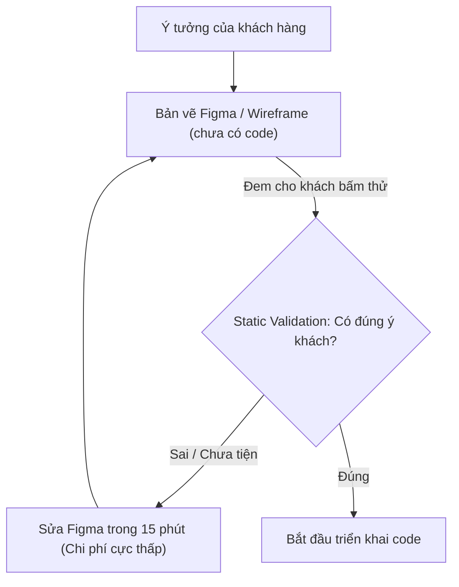
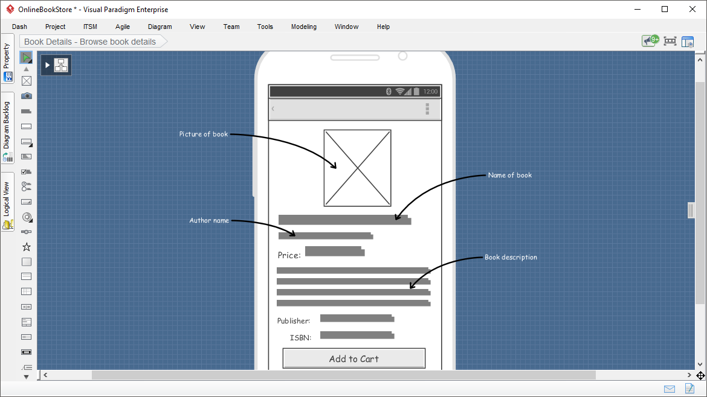

# Static Validation (Xác thực Tĩnh ở Giai đoạn Đầu)

> **Nguồn bài học:** `Static Validation (ở giai đoạn đầu).pdf` *(Ghi chú bổ sung Tuần 1–2 — kết nối trực tiếp với [03-verification-vs-validation.md](../03-verification-vs-validation.md) và [04-static-vs-dynamic-testing.md](../04-static-vs-dynamic-testing.md))*.

---

## 1. Phá bỏ hiểu lầm kinh điển: Static ≠ Chỉ có Verification

Nhiều lập trình viên và người mới học thường mặc định sai rằng:
- *"Static Testing thì chỉ làm **Verification** (soi tài liệu, soi code đúng chuẩn chưa)."*
- *"Muốn làm **Validation** (xác thực với khách hàng) thì bắt buộc phải đợi có phần mềm chạy được (**Dynamic Testing**)."*

**Sự thật chuẩn mực (theo IEEE & Ian Sommerville):**  
**Validation hoàn toàn có thể thực hiện dưới dạng TĨNH (Static Validation)** ngay trước khi viết bất kỳ dòng code backend hay tạo bảng database nào.

### Bản chất của Static Validation
- **Static (Tĩnh):** Chưa chạy mã nguồn, chưa có database thật, chỉ dùng bản mô phỏng tĩnh (wireframe giấy, kịch bản nghiệp vụ, Figma prototype).
- **Validation (Xác thực):** Trả lời câu hỏi của Barry Boehm: *"Are we building the right product?"* — *"Đây có đúng là thứ anh/chị mong muốn và giải quyết được bài toán thực tế không?"*

> [!NOTE]
> **Làm rõ chi phí thực tế:** Trong ghi chú bài giảng có ví von sửa Figma mất *"Chi phí: 0 đồng"* — hiểu chính xác là **chi phí cơ hội/tái chế gần như bằng 0** so với việc code xong 3–5 tháng rồi đập đi làm lại (thực tế vẫn tốn 10–15 phút công thiết kế của UI/UX Designer & thời gian trao đổi với khách hàng).

---

## 2. Tâm lý học khách hàng & Hội chứng IKIWISI

Tại sao không thể chỉ gửi cho khách hàng một file Word đặc tả (SRS) dài 50 trang để họ đọc và ký?

Do **Hội chứng IKIWISI** (*"I'll Know It When I See It"* — *"Chỉ khi nào tận mắt nhìn thấy, tôi mới biết mình thực sự muốn gì"*):
1. Khi đọc tài liệu thuần chữ dài dòng, khách hàng thường đọc lướt rồi gật đầu ký: *"Ừ, cứ làm thế đi."*
2. Nhưng 6 tháng sau khi bàn giao app chạy thật, khách hàng mới thốt lên: *"Tôi không tưởng tượng nó lại trông như thế này! Đây đâu phải thứ tôi muốn!"*

**Cách Static Validation hóa giải IKIWISI:**  
UI/UX Designer dùng Figma / Adobe XD tạo **Clickable Prototype** (chưa có code xử lý hay database, nhưng bấm nút chuyển trang như thật). Khi khách hàng được **"nhìn tận mắt, sờ tận tay"**, phản hồi thật bật ra ngay lập tức:
- *"Sao nút Hủy sát nút Đăng ký thế?"*
- *"Sao không có bộ lọc theo ngày?"*
- *"Thiếu mất nút in hóa đơn rồi!"*

---

## 3. Phân biệt Static Verification vs. Static Validation

Cùng là hoạt động kiểm tra sản phẩm dạng tĩnh (chưa chạy phần mềm), nhưng mục tiêu và người tham gia hoàn toàn khác nhau:

| Tiêu chí | Static Verification (Xác minh tĩnh) | Static Validation (Xác thực tĩnh) |
| :--- | :--- | :--- |
| **Câu hỏi cốt lõi** | *"Tài liệu / Bản vẽ này có tuân thủ quy chuẩn kỹ thuật và nhất quán nội bộ không?"* | *"Tài liệu / Bản mẫu này có đúng thứ khách hàng thật cần và dễ dùng không?"* |
| **Ai tham gia?** | Đội ngũ nội bộ: Dev, QA, Tech Lead, BA | **Khách hàng, Người dùng cuối, Product Owner**, Designer |
| **Đối tượng soi** | Cú pháp, tính mâu thuẫn, tính khả kiểm, chuẩn UML, chuẩn bảo mật | Luồng trải nghiệm người dùng (UX), giá trị nghiệp vụ, tính thuận tiện thực tế |
| **Ví dụ câu hỏi** | *"Mục 2.1 có mâu thuẫn mục 3.4 không?"*, *"Font thiết kế có đúng design system?"* | *"Khi bấm nút 'Duyệt', bảng kết quả hiện ra như vậy có thuận tiện cho việc hàng ngày của anh không?"* |

> **Liên hệ chuẩn ISTQB CTFL v4.0.1:** Trong ISTQB v4.0, các buổi **Static Review** trên prototype/user story do PO/khách hàng tham gia (như Prototype Walkthrough hoặc Three Amigos với màn hình mẫu) cũng là một cách làm Validation cực sớm (Shift-Left).

---

## 4. Ba hình thức Static Validation phổ biến trong thực tế

1. **Paper Prototyping / Wireframe thô:** Vẽ phác thảo trên giấy hoặc bảng trắng các màn hình và mũi tên chuyển luồng để chốt nhanh bố cục với khách hàng.

*Hình: Minh họa một bản Wireframe giao diện di động được dựng sẵn để khách hàng xem bố cục nút bấm và phản hồi trước khi lập trình (Nguồn ảnh: Visual Paradigm).*

2. **Clickable Interactive Prototype (Figma / Adobe XD):** Phổ biến nhất hiện nay; đầy đủ màu sắc, font chữ, luồng chuyển trang bấm thử trực tiếp trên điện thoại hoặc trình duyệt web.
3. **Storyboarding / User Journey Mapping:** Kể câu chuyện theo từng khung cảnh thực tế (*"8h sáng nhân viên mở app, khách mang hàng tới đổi trả..."*) để khách hàng phản biện ngay: *"Ngoài tiệm tôi không làm theo thứ tự đó!"*

---

## 5. Case Study: Hệ thống Đăng ký học phần (Cứu bàn thua trông thấy)

- **Cách làm truyền thống (Không Static Validation):**
  1. BA viết câu chữ chung chung: *"Sinh viên vào web, tick chọn môn, bấm Submit."*
  2. Team code 3 tháng (FE, BE, DB) bản giao diện máy tính bàn.
  3. Tới ngày UAT, Trưởng phòng Đào tạo và sinh viên thử mới báo: *"Sinh viên toàn ngồi trên xe bus đăng ký bằng điện thoại lúc 8h sáng, chữ bé tí trên màn hình cảm ứng thế này sao bấm được!"* → **Vứt bỏ 3 tháng code, trễ deadline.**
- **Cách làm có Static Validation:**
  1. Tuần 1 chưa gõ dòng code nào, Designer dựng bản mockup Figma trên khung màn hình điện thoại.
  2. Đưa điện thoại chạy Figma cho 5 sinh viên và đại diện Phòng Đào tạo bấm thử.
  3. Sinh viên góp ý ngay: *"Nút Submit đặt sát nút Hủy quá, tay to dễ bấm nhầm!"*
  4. Designer mất 10 phút nới khoảng cách và đổi màu cảnh báo → Khách hàng chốt đúng ý trước khi Dev bắt đầu lập trình.

---

## Khẩu quyết cần nhớ

> *"Thà sửa một bản vẽ thiết kế trên Figma trong 15 phút, còn hơn phải đập bỏ một hệ thống phần mềm sau 5 tháng cặm cụi code!"*
