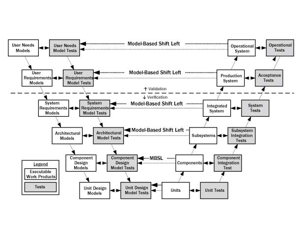
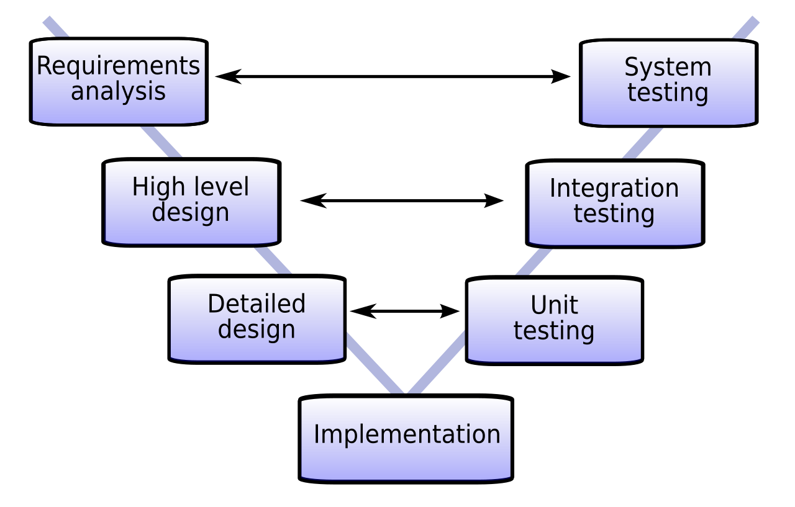

# Vị trí của Verification & Validation trong Mô hình chữ V (V-Model)

> **Nguồn bài học:** `Vị trí của V&V trong Mô hình chữ V (V-Model).pdf` *(Mở rộng sâu sơ đồ trong [03-verification-vs-validation.md](../03-verification-vs-validation.md))*.

---

## 1. Ý nghĩa hình học của chữ V

**V-Model (Verification and Validation Model)** bẻ quy trình Waterfall thẳng đứng thành hình chữ **V** nhằm giải quyết nỗi đau *"code xong hết mới đi test, phát hiện sai yêu cầu thì đã muộn"*:

1. **Nhánh trái đi xuống (Decomposition):** Phân rã từ yêu cầu nghiệp vụ vĩ mô xuống thiết kế kiến trúc và chi tiết kỹ thuật từng hàm.
2. **Đáy chữ V (Implementation / Coding):** Lập trình viên viết mã nguồn, chạy linter và code review.
3. **Nhánh phải đi lên (Integration & Execution Testing):** Tích hợp và kiểm thử động từ từng hàm/class nhỏ lên toàn hệ thống hoàn chỉnh.
4. **Mũi tên ngang đối xứng (`<--->`):** **Nguyên lý quan trọng nhất** — mỗi giai đoạn bên nhánh trái vừa hoàn tất thì **kế hoạch và kịch bản test cho cấp độ tương ứng bên nhánh phải đã phải được thiết kế ngay lập tức**, không đợi tới khi có code chạy.

*Hình: Mô hình chữ V mở rộng thể hiện đường ranh giới ngang **Verification (dưới) vs. Validation (trên)**, kết nối các cấp độ từ `Unit Tests → Integration Tests → System Tests → Acceptance Tests → Operational Tests` cùng tư duy Shift-Left sớm ngay từ nhánh trái (Nguồn: [Wikimedia Commons (Model-Shift-Left)](https://commons.wikimedia.org/wiki/File:Model-Shift-Left.jpg)).*

*Hình: Sơ đồ rút gọn nhấn mạnh 3 cặp đối xứng `Requirements ↔ System Testing`, `High-Level Design ↔ Integration Testing`, `Detailed Design ↔ Unit Testing` quanh đỉnh `Implementation` (Nguồn: Wikimedia Commons).*

---

## 2. Nhánh trái (Tả ngạn): Static Verification diễn ra theo 2 chiều

Khi chưa có một dòng code nào chạy được, hoạt động **Verification** vẫn diễn ra liên tục theo **2 chiều**:

### A. Chiều dọc (Tài liệu sau phải khớp tài liệu trước)
- **Tầng Requirements Analysis (SRS):** Dùng **Checklist Review** phát hiện mâu thuẫn, thiếu sót, mơ hồ.
- **Tầng System Architecture (High-Level Design — HLD):** Dùng **Technical Review** kiểm tra kiến trúc FE/BE/DB/Cloud có đáp ứng đủ yêu cầu trong SRS không.
- **Tầng Module Design (Low-Level Design — LLD):** Dùng **Walkthrough / Inspection** kiểm tra logic hàm, kiểu dữ liệu, sơ đồ UML có chặt chẽ không.

### B. Chiều ngang (Chuẩn bị sẵn testware cho nhánh phải — Shift-Left)
- Viết xong **Requirements** → Tester thiết kế ngay bộ kịch bản **Acceptance Test (UAT)**.
- Vẽ xong **System Architecture** → Tester thiết kế ngay kịch bản **System Test** (bao gồm E2E và NFR).
- Chốt xong **Module Design** → Dev/Tester thiết kế ngay kịch bản **Integration Test** và **Unit Test**.

---

## 3. Đáy chữ V: Coding (Lập trình)

Khi lập trình viên hiện thực hóa `Module Design`:
- Chạy **Static Analysis / Linters** (`Ruff`, `SpotBugs`, `SonarQube`, `ESLint`) để bắt lỗi cú pháp, biến rác, dead code, nguy cơ rò rỉ tài nguyên.
- Thực hiện **Code Review / Formal Inspection** giữa các thành viên trước khi merge.

---

## 4. Nhánh phải (Hữu ngạn): 4 cặp đối xứng V&V từ dưới lên

1. **Cặp 1 (Đáy): Coding ↔ Unit Testing → [VERIFICATION]**
   - Kiểm tra từng hàm/class độc lập có đúng thuật toán trong Module Design không (VD: `tinhTinChi()` cộng đúng tổng tín chỉ chưa).
2. **Cặp 2: Module Design ↔ Integration Testing → [VERIFICATION]**
   - Kiểm tra các module đã qua Unit Test khi ráp với nhau/với DB có khớp **Interface Specification** không (VD: JSON schema trả về giữa module Đăng ký và module Sinh viên).
3. **Cặp 3: System Architecture ↔ System Testing → [GIAO THOA V&V]**
   - Chạy toàn hệ thống tích hợp 100% trên Staging:
     - **Tính Verification:** Đáp ứng các chỉ số kỹ thuật/NFR đặt ra trong Architecture (VD: chịu tải 10.000 req/s, backup tự động đúng thiết kế).
     - **Tính Validation:** Thực thi các luồng người dùng E2E hoàn chỉnh để xem hệ thống vận hành tổng thể có mượt mà và thực tế hay không.
4. **Cặp 4 (Đỉnh): Requirements Analysis ↔ Acceptance Testing (UAT) → [VALIDATION THUẦN TÚY]**
   - Không còn soi cấu trúc code hay API bên trong; Khách hàng / PO / Người dùng cuối đối chiếu trực tiếp với bài toán kinh doanh ban đầu để quyết định **nghiệm thu hay từ chối**.

### Bảng tổng kết 4 tầng V-Model

| Tầng trong V-Model | Nhánh trái (Tạo ra cái gì?) | Nhánh phải (Kiểm tra bằng gì?) | Bản chất V&V | Câu hỏi cốt lõi |
| :--- | :--- | :--- | :--- | :--- |
| **Tầng 4 (Đỉnh)** | Requirements Analysis | Acceptance Testing / UAT *(và OAT, Alpha/Beta)* | **Validation** | *"Có đúng thứ khách hàng cần và sẵn sàng dùng thật không?"* |
| **Tầng 3** | System Architecture (HLD) | System Testing | **Giao thoa V&V** | *"Hệ thống chạy trọn vẹn có đạt SLA kỹ thuật lẫn luồng dùng thực tế không?"* |
| **Tầng 2** | Module Design (LLD) | Integration Testing | **Verification** | *"Các module ráp lại có giao tiếp đúng đặc tả interface không?"* |
| **Tầng 1 (Đáy)** | Coding | Unit Testing & Linters | **Verification** | *"Từng hàm/class có chạy đúng logic thuật toán thiết kế không?"* |

---

## 5. Làm rõ điểm dễ gây hiểu nhầm về V-Model

1. **Giải quyết mâu thuẫn nhãn V&V của `System Testing` giữa các file ghi chú ở trường:**
   - File `System Testing.pdf` (trang 3) và `UAT.pdf` (trang 3) tạm xếp góc nhìn của System Testing là *"Verification"*, trong khi `Verification và Validation.pdf` (trang 3) lại đặt System Testing vào nhóm *Validation*!
   - **Cách hiểu chuẩn nhất chính là phân tích trong V-Model ở đây:** System Testing là **điểm giao thoa V&V** — nó vừa Verify theo System Spec/Architecture (đặc biệt về kiến trúc, NFR, tích hợp toàn cục), vừa Validate các hành trình người dùng E2E trước khi trao cho khách hàng làm UAT.
2. **V-Model có phải lúc nào cũng là Waterfall 6 tháng mới thấy sản phẩm?**
   - Trong tài liệu nhập môn, V-Model thường vẽ cho một chu kỳ dài từ đầu đến cuối dự án.
   - Thực tế khi làm **Agile / Scrum** (Giai đoạn 4), ta vẫn giữ nguyên **tính đối xứng chữ V trong phạm vi từng Sprint (1–2 tuần) hoặc từng User Story**: vừa chốt Acceptance Criteria (nhánh trái) là viết ngay kịch bản Acceptance/Test Cases (nhánh phải), rồi code + Unit + Integration + System + Sprint Review UAT ngay trong Sprint đó!
