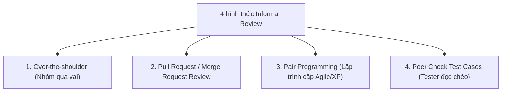
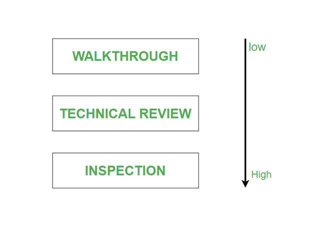

# Informal Review (Đánh giá Không Chính thức / Peer Check)

> **Nguồn bài học:** `Informal Review Đánh giá nhanh giữa các lập trình viên_testers (peer check).pdf` *(Mở rộng mục Review Types trong [04-static-vs-dynamic-testing.md](../04-static-vs-dynamic-testing.md))*.

---

## 1. Bản chất cốt lõi

Theo thang đo 4 cấp độ đánh giá tĩnh của **ISTQB** và **IEEE 1028**, **Informal Review** nằm ở bậc đầu tiên: linh hoạt nhất, tần suất cao nhất (chiếm **80%–90%** hoạt động review hàng ngày trong Agile/Scrum/DevOps) và ít thủ tục giấy tờ nhất.

- **Định nghĩa:** Hoạt động kiểm tra chéo (*Peer check*) giữa hai hoặc vài đồng nghiệp ngang hàng (Dev với Dev, Tester với Tester), tự nguyện, diễn ra nhanh và không cần chủ tọa hay biên bản họp chính thức.
- **Mục tiêu chính:** Bắt nhanh lỗi hiển nhiên (*obvious defects*), lỗi chính tả, thiếu điều kiện biên cơ bản hoặc xin góp ý thiết kế nhanh tại chỗ.

---

## 2. Bốn hình thức Informal Review phổ biến nhất thực tế

1. **Over-the-shoulder Review (*"Nhòm qua vai"*):**
   - Dev A viết xong hàm tính tiền phức tạp, gọi Dev B ngồi bàn cạnh qua nhìn màn hình 5 phút.
   - B chỉ ngay dòng có nguy cơ chia cho `0` (`if count > 0`) → A sửa tại chỗ, tổng thời gian vài phút.
2. **Pull Request (PR) / Merge Request (MR) Review *(Phổ biến nhất hiện nay)*:**
   - Trên GitHub / GitLab / Bitbucket, Dev mở PR và đồng nghiệp xem phần **code diff**, bình luận nhanh (*"Đổi tên biến `x` thành `student_count`"*, *"Hàm chưa đóng connection DB"*), tác giả sửa xong → Approve & merge.
3. **Pair Programming (Lập trình cặp trong Agile / Extreme Programming):**
   - Hai người ngồi chung 1 màn hình (hoặc live-share): **Driver** (gõ phím) và **Navigator** (quan sát logic, bắt lỗi biên, nghĩ edge cases liên tục từng giây).
4. **Peer Check Test Cases (Giữa các Tester):**
   - Tester A viết xong bộ 15 test cases cho luồng *Quên mật khẩu*, gửi nhanh link cho Tester B lướt trong 10 phút → B phát hiện thiếu case *"email hợp lệ nhưng tài khoản chưa kích hoạt"*.

---

## 3. Đặc điểm nhận diện: Cái gì CÓ và KHÔNG CÓ?

| Đặc điểm | Trạng thái | Giải thích |
| :--- | :--- | :--- |
| **Quy trình văn bản định sẵn** | **Không** | Không cần lập kế hoạch/lịch họp chính thức; cần lúc nào review lúc đó. |
| **Chủ tọa điều phối (Moderator)** | **Không** | Không có trọng tài; trao đổi tự do giữa đồng nghiệp. |
| **Biên bản cuộc họp chính thức** | **Không** | Không cần Recorder; kết quả nằm ngay ở comment trên PR hoặc sửa trực tiếp. |
| **Đo lường chỉ số (Metrics)** | **Không** | Không đo tốc độ đọc (dòng/giờ) hay mật độ lỗi/KLOC. |
| **Tính linh hoạt & Tốc độ** | **Cực cao** | Thực hiện mọi lúc, kết thúc trong vài phút, phản hồi tức thì. |
| **Chia sẻ kiến thức (Knowledge Sharing)** | **Rất tốt** | Thành viên mới học trực tiếp kinh nghiệm viết code/test case từ đồng nghiệp. |

---

## 4. Lợi ích vượt trội

1. **Chi phí tổ chức gần như bằng 0:** Không cần đặt phòng họp, không tốn công làm slide, không làm gián đoạn cả nhóm lớn.
2. **Phản hồi tức thì (*Immediate Feedback*):** Chặn lỗi ngay tại máy cá nhân trước khi đẩy lên nhánh chung.
3. **Tâm lý cởi mở, không áp lực:** Đồng nghiệp góp ý nhẹ nhàng giúp tác giả dễ tiếp thu và thừa nhận thiếu sót.

---

## 5. Ba cạm bẫy & mặt trái (Tại sao KHÔNG THỂ chỉ dùng Informal Review?)

1. **Hội chứng `"LGTM"` (*Looks Good To Me* — Bấm duyệt bừa):**
   - Khi đồng nghiệp đang bận hoặc ngại va chạm, gửi PR 500 dòng code họ chỉ cuộn qua loa rồi gõ `LGTM` + bấm `Approve` → bug nghiêm trọng vẫn lọt qua.
2. **Không phát hiện lỗi kiến trúc sâu:**
   - Nhìn lướt 5 phút khó thấy được lỗi thiết kế hệ thống, deadlock khi 10.000 người truy cập hoặc lỗ hổng thiết kế DB dài hạn *(đây là việc của [Technical Review](./06-technical-review.md))*.
3. **Không có dấu vết kiểm toán (*No Audit Trail*):**
   - Các hệ thống sinh tử đòi hỏi tuân thủ pháp lý/chuẩn an toàn cao (y tế, ngân hàng, hàng không) bắt buộc có biên bản ký duyệt và số liệu định lượng → phải dùng **Formal Inspection (Fagan)** hoặc quy trình review có ký xác nhận.

---

## 6. Vị trí trong thang đo Review (Tăng dần độ hình thức)

*Hình: Mức độ trang trọng tăng dần từ `Informal Review` (nhẹ nhất, hàng ngày) → `Walkthrough` → `Technical Review` → `Formal Inspection` (chặt chẽ nhất). Nguồn ảnh: GeeksforGeeks.*
