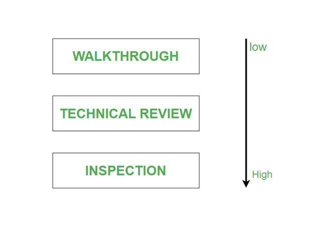
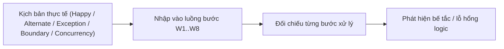

# Walkthrough (Dẫn dắt & Chạy thử Kịch bản Bằng Tư duy)

> **Nguồn bài học:** `Walkthrough Tác giả dẫn dắt nhóm đi qua tài liệu_sơ đồ luồng để phát hiện lỗ hổng logic..pdf` *(Mở rộng mục Review Types trong [04-static-vs-dynamic-testing.md](../04-static-vs-dynamic-testing.md))*.

---

## 1. Bản chất của Walkthrough

Theo chuẩn **IEEE 1028** (*Standard for Software Reviews and Audits*) và **ISTQB CTFL**:

**Walkthrough** là một kỹ thuật đánh giá tĩnh có cấu trúc, trong đó chính **Tác giả (Author)** của sản phẩm công việc (BA, System Designer hoặc Developer) **trực tiếp trình bày và dẫn dắt** các đồng nghiệp (*Reviewers*) đi qua từng bước của tài liệu yêu cầu, sơ đồ luồng (*flowchart*), kiến trúc hoặc mã nguồn.

- **Điểm nhận diện lớn nhất:** **Tác giả là người khởi xướng và dẫn dắt buổi họp** (ngược với *Formal Inspection*, vốn bắt buộc một *Moderator độc lập* chủ trì).
- **Hoàn toàn tĩnh (Static):** Thực hiện qua phân tích logic và phản biện kịch bản trước khi gõ hoặc chạy code.

*Hình: Walkthrough có tính cấu trúc cao hơn Informal Review nhưng vẫn linh hoạt hơn Technical Review và Formal Inspection (Nguồn ảnh: GeeksforGeeks).*

---

## 2. Bốn mục tiêu cốt lõi

1. **Đạt sự thấu hiểu chung (*Shared Understanding*):** Bảo đảm PO, BA, Dev, Tester hiểu giống hệt nhau về cách tính năng vận hành, tránh tình trạng *"mỗi người hiểu một kiểu"*.
2. **Tìm lỗ hổng logic & các trường hợp bỏ sót (*Missing Cases / Gaps*):** Tác giả thường mặc định thiết kế theo **Happy Path**. Nhóm phản biện đặt các câu hỏi thực tế: *"Nếu rớt mạng ở bước này?"*, *"Nếu hai người bấm cùng một giây?"*.
3. **Phát hiện câu chữ mơ hồ (*Ambiguity*):** Chỉ ra ngay chỗ diễn đạt hai nghĩa để làm rõ trước khi code.
4. **Nguyên tắc tâm lý:** **"Critique the product, not the person"** — chỉ góp ý sửa thiết kế/luồng xử lý, tuyệt đối không phán xét năng lực tác giả.

---

## 3. Cơ chế hoạt động: Mental Dry-Run (Chạy thử bằng tư duy)

Không chỉ ngồi nghe tác giả đọc tài liệu, cả nhóm dùng kỹ thuật **Lần vết kịch bản (*Scenario Tracing*)**:

5 nhóm kịch bản Reviewers thường đưa vào để "bắt bài" thiết kế:
- **Happy Path:** Đúng dữ liệu, chạy mượt từ đầu tới cuối.
- **Alternate Path:** Người dùng đổi ý / quay lại chỉnh giữa chừng.
- **Failure / Exception Path:** Input sai, bên thứ ba mất kết nối, vượt giới hạn.
- **Boundary Scenarios:** Chạm đúng biên trên / biên dưới.
- **Concurrency Scenarios:** Nhiều người dùng cùng tranh chấp 1 tài nguyên tại cùng thời điểm.

---

## 4. Bốn vai trò then chốt trong Walkthrough

| Vai trò | Nhiệm vụ chính | Hành vi cần tránh |
| :--- | :--- | :--- |
| **Author (Tác giả)** | Giới thiệu bối cảnh, dẫn dắt từng bước luồng xử lý, trả lời thắc mắc | Tranh cãi bảo thủ, bao biện hoặc độc chiếm thời lượng nói |
| **Facilitator (Điều phối)** | Giữ trật tự, bám sát kịch bản, quản lý thời gian, khuyến khích phản biện *(có thể do Author kiêm nếu nhóm nhỏ)* | Để buổi họp trôi sang tranh luận ngoài lề không hồi kết |
| **Reviewer(s) (Phản biện)** | Đóng vai người dùng/hệ thống chạy *Mental Dry-Run* để phát hiện điểm phi logic | Công kích cá nhân tác giả; hoặc **tự ý bịa quy định mới** khi chưa có xác nhận của Stakeholder |
| **Recorder / Scribe (Thư ký)** | Ghi chép chính xác từng phát hiện (*Finding*), bước bị ảnh hưởng và câu hỏi gửi Stakeholder | Ghi chép mơ hồ kiểu *"chỗ này sai"* thiếu ngữ cảnh |

---

## 5. Ví dụ thực chiến: Walkthrough sơ đồ Đăng ký học phần (`W1 → W8`)

Giả sử System Designer đưa ra bản thảo luồng đăng ký học phần gồm 8 bước:
- **W1:** Sinh viên đăng nhập hệ thống.
- **W2:** Hệ thống hiển thị danh sách môn học và số chỗ còn lại.
- **W3:** Sinh viên chọn môn và bấm `Submit`.
- **W4:** Hệ thống kiểm tra tổng tín chỉ; nếu *"vượt quá 24 tín chỉ"* thì từ chối.
- **W5:** Kiểm tra trùng lịch học; nếu không trùng thì đi tiếp.
- **W6:** Lưu kết quả và trừ số chỗ trống đi `1`.
- **W7:** Thông báo *"Đăng ký thành công"* và gửi email.
- **W8:** Sinh viên có thể quay lại trang để chỉnh sửa môn đã chọn.

Khi Reviewers áp các kịch bản vào *Mental Dry-Run*, **4 lỗ hổng lớn** lộ ra ngay:

1. **Lỗ hổng 1 — Thiếu bước kiểm tra môn tiên quyết (*Prerequisite Gap*) [Kịch bản S3]:**
   - Sinh viên năm 1 đăng ký *"Lập trình nâng cao"* dù chưa học *"Nhập môn lập trình"*. Từ W1–W8 hoàn toàn thiếu bước kiểm tra môn tiên quyết.
2. **Lỗ hổng 2 — Tranh chấp dữ liệu đồng thời (*Concurrency / Race Condition*) [Kịch bản S4]:**
   - Lớp còn `1` chỗ trống cuối; sinh viên A và B cùng thấy `1` chỗ ở W2 và cùng bấm `Submit` ở W3 → ở W6 nếu không có *database row locking* hoặc *atomic transaction*, cả hai cùng pass và lớp bị vượt sĩ số (*Overbooked*).
3. **Lỗ hổng 3 — Điểm mơ hồ tại giá trị biên (*Boundary Ambiguity*) [Kịch bản S2]:**
   - W4 viết *"vượt quá 24 tín chỉ thì từ chối"* nhưng không xác nhận rõ `total = 24` có được nhận không, dễ dẫn tới dev gõ nhầm `total >= 24`.
4. **Lỗ hổng 4 — Lỗ hổng thời hạn chỉnh sửa (*Deadline & Authorization Loophole*) [Kịch bản S6]:**
   - W8 cho phép sinh viên quay lại sửa môn nhưng không kiểm tra cổng đăng ký đã đóng/hết deadline hay chưa.

**Kết quả sau Walkthrough:** Nhóm xuất **Findings Log** gửi Phòng Đào tạo chốt câu hỏi biên, đồng thời chèn thêm `W3.1` (Check môn tiên quyết) và `W3.2` (Check cổng thời gian) + khóa đồng thời ở `W6` **trước khi Dev tốn công viết dòng code sai nào**.

---

## 6. So sánh ngắn: Checklist Review vs. Walkthrough vs. Formal Inspection

| Tiêu chí | Checklist-Based Review | Walkthrough | Formal Inspection (Fagan) |
| :--- | :--- | :--- | :--- |
| **Người chủ trì** | Cá nhân tự rà soát độc lập | **Chính Tác giả (Author)** | **Moderator độc lập** (khác tác giả) |
| **Hình thức** | Soi từng dòng đối chiếu checklist (`Completeness`, `Consistency`, `Clarity`...) | Tác giả trình bày luồng, cả nhóm tương tác chạy *Mental Dry-Run* | Họp chính thức quy trình chuẩn, chuẩn bị trước, đo lường lỗi & tốc độ đọc |
| **Mức độ hình thức** | Thấp → Trung bình | Trung bình | **Rất cao (Very Formal)** |
| **Mục đích chính** | Soát lỗi câu chữ, thiếu sót tiêu chí chuẩn | Thống nhất hiểu biết chung, phát hiện lỗ hổng logic & kịch bản thiếu | Tối đa hóa phát hiện lỗi kỹ thuật, làm cổng kiểm duyệt (*Quality Gate*) |
