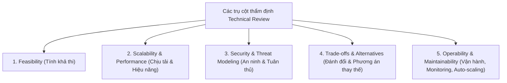

# Technical Review (Đánh giá Kỹ thuật & Hội đồng Kiến trúc ARB)

> **Nguồn bài học:** `Technical Review Đánh giá giải pháp kỹ thuật bởi các chuyên gia kiến trúc_bảo mật..pdf` *(Mở rộng mục Review Types trong [04-static-vs-dynamic-testing.md](../04-static-vs-dynamic-testing.md))*.

---

## 1. Bản chất cốt lõi

**Technical Review** là cuộc họp đánh giá tĩnh có cấu trúc do nhóm kỹ sư có trình độ chuyên môn cao (Software Architects, Principal Engineers, Tech Leads, Security Specialists, Lead DBAs, SREs) thực hiện nhằm **thẩm định tính đúng đắn, tính khả thi, độ an toàn, khả năng chịu tải và sự tối ưu của giải pháp công nghệ** trước khi triển khai quy mô lớn.

- **Đối tượng đánh giá:** Không soi lỗi chính tả hay biến thừa; tập trung vào **Architecture Design**, **Design Doc / RFC (*Request For Comments*)**, mô hình DB phức tạp, thuật toán lõi, hoặc **Security Threat Model**.
- **Tên gọi thực tế ở doanh nghiệp:** **Architecture Review Board (ARB)** hoặc buổi **Design Doc / RFC Review**.

---

## 2. Các trụ cột kỹ thuật được "soi" trong Technical Review

1. **Tính khả thi kỹ thuật (*Feasibility*):** Công nghệ đề xuất có phù hợp với hạ tầng và năng lực team hiện tại không, hay làm tăng nợ kỹ thuật?
2. **Khả năng mở rộng & Hiệu năng (*Scalability & Performance*):** Chạy tốt ở 1.000 users nhưng khi lên 100.000 users đồng thời thì điểm nào là nút thắt cổ chai (*Bottleneck*)? Độ trễ (*Latency*) chuỗi microservices có giữ được dưới ngưỡng SLA (VD: `< 200ms`) không?
3. **An ninh & Mô hình hóa mối đe dọa (*Security & Threat Modeling*):** Dữ liệu nhạy cảm/thẻ thanh toán mã hóa ở đâu, lưu *Private Key* thế nào, chống DDoS / spam bot bằng *Rate Limiting* ra sao?
4. **Sự đánh đổi & Giải pháp thay thế (*Trade-offs & Alternatives*):** Tại sao chọn NoSQL thay RDBMS cho thanh toán? Tại sao dùng Kafka thay RabbitMQ, và chi phí cloud hàng tháng thay đổi ra sao?
5. *(Bổ sung làm rõ cho ghi chú trường)* **Khả năng vận hành & giám sát (*Operability & Maintainability*):** Thiết kế có dễ thu log, monitor, cảnh báo sự cố và auto-scale khi deploy thực tế không *(lý giải tại sao thành phần tham gia có DevOps / SRE Lead!)*.

> [!NOTE]
> **Làm rõ một chi tiết trong PDF trường:** Tài liệu ghi chú tiêu đề mục 2 là *"5 câu hỏi kỹ thuật sống còn"* và tiêu đề sơ đồ là *"5 TRỤ CỘT CỦA TECHNICAL REVIEW"*, nhưng trong sơ đồ và danh sách chi tiết lại chỉ liệt kê **4 mục đánh số `1.` đến `4.`**. Khi gộp góc nhìn của **DevOps/SRE Lead** (được liệt kê ở mục 3 — *Monitoring & Auto-scaling*) hoặc tách **Scalability** và **Performance** thành 2 chiều riêng, ta có đủ **5 trụ cột kỹ thuật hoàn chỉnh**.
> 
> Ngoài ra, PDF mô tả Technical Review *"có chiều sâu chuyên môn công nghệ cao nhất"*, còn Formal Inspection có *"mức độ hình thức quy trình cao nhất"* — hai cụm từ này đo **hai trục khác nhau** (Chiều sâu kỹ thuật vs Độ chặt chẽ thủ tục & thống kê).

---

## 3. Thành phần tham gia (Phải ngang hoặc cao hơn trình độ Tác giả)

1. **Lead Architect / Principal Engineer (Chủ trì):** Có cái nhìn toàn cục hệ thống, điều phối tranh luận kỹ thuật.
2. **Author / Senior Developer (Tác giả):** Trình bày Design Doc/RFC và bảo vệ luận điểm kỹ thuật.
3. **Security Specialist (An ninh mạng):** Đóng vai kẻ tấn công (*Threat Modeling*) tìm lỗ hổng leo thang, DDoS, rò dữ liệu.
4. **Lead DBA / Data Engineer:** Soi thiết kế bảng, index, khóa ngoại, nguy cơ I/O bottleneck và deadlock.
5. **DevOps / SRE Lead:** Đánh giá khả năng *Monitoring*, *Alerting*, *Zero-downtime deploy* và *Auto-scaling*.

---

## 4. Điểm khác biệt "CHÍ MẠNG": Technical Review vs. Formal Inspection

| Đặc điểm | Formal Inspection (Fagan) | Technical Review |
| :--- | :--- | :--- |
| **Có bàn giải pháp sửa đổi ngay trong buổi họp?** | **Cấm tuyệt đối** *(chỉ ghi nhận defect; ai mở lời bàn cách sửa sẽ bị Moderator ngắt)* | **Bắt buộc & Khuyến khích** *(mục đích chính là tranh luận chọn phương án kiến trúc tối ưu)* |
| **Trọng tâm kiểm tra** | **Vi mô:** Soi từng câu chữ tài liệu, từng dòng code tuân thủ checklist/chuẩn | **Vĩ mô:** Đánh giá kiến trúc, thuật toán, độ chịu tải, bảo mật và đánh đổi dài hạn |
| **Người điều phối** | Moderator độc lập *(giữ kỷ luật quy trình là chính)* | **Lead Architect** *(bắt buộc hiểu sâu công nghệ hệ thống)* |

---

## 5. Ví dụ thực chiến: Cứu hệ thống Đăng ký học phần ngay trên bàn họp

- **Đề xuất ban đầu của Senior Dev:** Cho API đăng ký ghi thẳng trực tiếp xuống MySQL; khi đụng 40 sinh viên thì câu SQL tự chặn lại.
- **Phản biện của Hội đồng Technical Review:**
  - **Lead DBA:** *"Đúng 8h sáng mở cổng, 50.000 sinh viên bấm cùng lúc sẽ tạo 50.000 kết nối đập thẳng vào MySQL gây khóa hàng loạt (**Deadlock**) và sập DB trong 30 giây!"*
  - **Lead Architect đề xuất sửa kiến trúc:** Đặt hàng đợi **Redis In-Memory** hoặc **RabbitMQ** phía trước hứng toàn bộ lượng request đột biến rồi xử lý tuần tự/kiểm soát tải xuống MySQL.
  - **Security Specialist bổ sung:** *"Thiếu chống Bot! Sinh viên IT có thể viết script Python bắn 1.000 req/s giành hết slot — bắt buộc gắn thêm **Rate Limiting** và **Captcha**."*
- **Kết quả:** Thiết kế ban đầu bị **Rejected**, tác giả cập nhật bổ sung Queue + Rate Limiting + Captcha → **tránh được thảm họa sập cổng đăng ký ngay từ bản vẽ**, không mất công viết lại toàn bộ backend.
