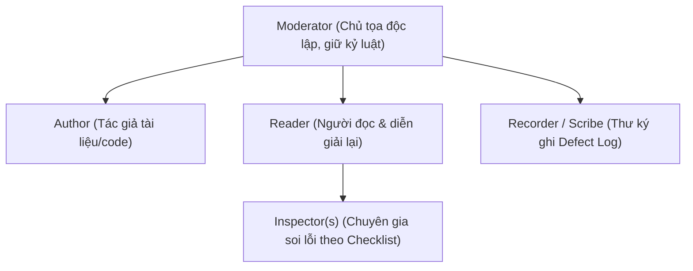
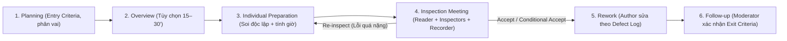

# Formal Inspection (Kiểm tra Chính thức — Fagan Inspection / IEEE 1028)

> **Nguồn bài học:** `Formal Inspection (Fagan Inspection theo chuẩn IEEE 1028) Quy trình kiểm tra chính thức gồm các vai trò nghiêm ngặt (Moderator, Author, Reader, Recorder, Inspector) và checklist định lượng..pdf` *(Hoàn thiện mảnh ghép thứ 4 trong bộ 4 hình thức Review cùng [04-informal-review.md](./04-informal-review.md), [05-walkthrough.md](./05-walkthrough.md) và [06-technical-review.md](./06-technical-review.md))*.

---

## 1. Bản chất cốt lõi: "Phiên tòa kỹ thuật chuyên nghiệp"

**Formal Inspection** (hay **Fagan Inspection**, do *Michael Fagan* tại IBM đề xuất năm 1976 và chuẩn hóa trong **IEEE 1028** / **ISTQB**) là **cấp độ chính thức, khắt khe và quy chuẩn hóa cao nhất** trong tất cả các kỹ thuật đánh giá tĩnh (*Static Review*).

- Thực chất là quy trình **"soi từng dòng chữ hoặc từng dòng code bằng mắt"** dựa trên checklist chuẩn và số liệu định lượng, **không chạy chương trình**.
- Thường áp dụng cho hệ thống an toàn sinh tử (y tế, hàng không, ngân hàng) hoặc các tài liệu/module kiến trúc lõi có rủi ro cao.

### Bốn nguyên tắc tạo nên "kỷ luật thép"
1. **Entry & Exit Criteria rõ ràng:** Nếu tài liệu chưa định dạng hoàn chỉnh hoặc code chưa biên dịch được (không đạt *Entry Criteria*), buổi Inspection **bị hủy ngay**.
2. **Vai trò độc lập & phân định rạch ròi:** Tác giả **không được** làm chủ tọa hay người đọc; buổi họp do **Moderator độc lập** nắm quyền điều hành tuyệt đối.
3. **Bắt buộc chuẩn bị cá nhân định lượng:** Từng thành viên phải tự đọc trước và ghi nhận tổng giờ chuẩn bị; ai chưa chuẩn bị ở nhà không được ngồi phản biện.
4. **Quy tắc vàng:** *"Find defects, don't fix them on the spot"* — **chỉ tìm và ghi nhận lỗi, tuyệt đối cấm tranh luận giải pháp sửa** ngay trong cuộc họp để tránh biến buổi soi lỗi thành tranh cãi thiết kế lan man.

---

## 2. Năm vai trò nghiêm ngặt trong Formal Inspection (3–6 người)

| Vai trò | Trách nhiệm then chốt | Điều cấm kỵ |
| :--- | :--- | :--- |
| **1. Moderator (Chủ tọa / Trọng tài)** | - Là người **độc lập** (không phải tác giả, không phải sếp trực tiếp). - Kiểm tra *Entry Criteria*, giữ kỷ luật thời gian, **ngắt lời ngay** nếu nhóm sa đà bàn cách sửa. - Quyết định nghiệm thu hoặc bắt *Re-inspection*. | Không để tác giả bị công kích cá nhân; không làm thay việc của *Reader* hay *Recorder*. |
| **2. Author (Tác giả)** | - Người viết tài liệu/code; giải đáp câu hỏi kỹ thuật ngắn gọn khi *Moderator* cho phép. - Tiếp nhận *Defect Log* và thực hiện sửa lỗi (*Rework*). | Không bảo thủ thanh minh; **không được kiêm** *Moderator* hoặc *Reader*. |
| **3. Reader (Người đọc / Diễn giải)** | - Đọc từng đoạn tài liệu hoặc **diễn giải lại mã nguồn bằng ngôn từ của mình (*paraphrasing*)**. - Điều hướng nhịp độ đọc qua từng dòng theo tốc độ chuẩn. | Không đọc lướt; không diễn giải suy đoán chủ quan thoát ly câu chữ/code gốc. |
| **4. Recorder / Scribe (Thư ký)** | - Ghi chính xác từng lỗi vào **Defect Log**: dòng/vị trí, loại lỗi, mức độ (*Critical, Major, Minor*). - Đọc chốt danh sách lỗi cuối buổi để nhóm đồng thuận. | Không ghi chung chung kiểu *"đoạn này sai"*; phải gắn rõ lỗi với tiêu chuẩn/checklist vi phạm. |
| **5. Inspector(s) (Người kiểm tra)** | - Gồm Tester, Developer khác, chuyên gia kiến trúc/bảo mật hoặc đại diện nghiệp vụ. - Dùng Checklist để soi từng chi tiết kỹ thuật và chỉ ra lỗi. | **Không đến họp khi chưa chuẩn bị bài trước ở nhà.** |

> **Tại sao vai trò *Reader* lại cực kỳ giá trị?**  
> Khi một người khác (*Reader*) diễn giải đoạn tài liệu/code theo cách họ hiểu, chính *Author* sẽ giật mình nhận ra: *"Ủa, mình viết câu này ý A nhưng người khác đọc lại hiểu sang ý B!"* — khoảnh khắc đó lột trần sự nhập nhằng (*Ambiguity*) ngay lập tức.

> [!NOTE]
> **Làm rõ sự khác biệt giữa 5 vai trò (Fagan Inspection) và 6 vai trò (ISTQB Review tổng quát):**  
> - **Formal Inspection (IEEE 1028 / Fagan)** nhấn mạnh 5 vai trò tham gia trực tiếp quy trình soi lỗi (*Moderator, Author, Reader, Recorder, Inspector*), trong đó **Reader** là vai trò đặc thù của Fagan Inspection.
> - **ISTQB CTFL v4.0.1 (và PDF `Static testing overview`)** liệt kê **6 vai trò Review tổng quát** cho mọi loại review (*Author, Management, Facilitator/Moderator, Review Leader, Reviewers, Scribe/Recorder*) — tách *Management* (cấp ngân sách/quyết định review) và *Review Leader* (quản lý lịch/tổng thể), còn khi áp dụng đúng chuẩn Fagan thì có thêm vai trò *Reader*.

---

## 3. Checklist định lượng & Các chỉ số khắt khe (*Inspection Metrics*)

### A. Defect Checklist theo góc nhìn mã nguồn / thiết kế
1. **Lỗi dữ liệu (*Data faults*):** Biến chưa khởi tạo đã dùng? Nguy cơ tràn mảng (*Array Out of Bounds*)? Chia cho `0`?
2. **Lỗi giao diện / hàm (*Interface faults*):** Số lượng, kiểu và thứ tự tham số truyền giữa các hàm có bị lệch không?
3. **Lỗi điều khiển (*Control faults*):** Vòng lặp `while` có điều kiện dừng chắc chắn không? Nhánh `if-else` đã phủ hết các trường hợp chưa?
4. **Lỗi ngoại lệ & Tài nguyên (*Exception & Resource handling*):** File mở ra có đóng trong `finally` / `context manager`? Kết nối DB có bị *connection leak*?

### B. Ba chỉ số định lượng (IEEE 1028 & Michael Fagan)
- **Tốc độ chuẩn bị (*Preparation Rate*):** Khoảng **`100 – 150 dòng code/giờ`** (hoặc **`3 – 5 trang tài liệu/giờ`**). Đọc quá nhanh → tỷ lệ bỏ sót lỗi tăng vọt.
- **Tốc độ kiểm tra trong họp (*Inspection Rate*):** Khoảng **`90 – 125 dòng code/giờ`** *(tài liệu tóm tắt hay làm tròn `~100 dòng/giờ`)*. Mỗi phiên họp **tuyệt đối không kéo dài quá `2 giờ`** vì sau mốc này độ tập trung suy giảm mạnh.
- **Mật độ khuyết tật (*Defect Density*):** Số lỗi tìm thấy trên `1.000` dòng code (**KLOC**). Nếu một module lớn đi qua buổi Inspection mà ghi nhận `0` lỗi, Moderator có quyền nghi ngờ nhóm chưa chuẩn bị nghiêm túc và hủy buổi họp để làm lại.

---

## 4. Quy trình 6 giai đoạn chuẩn của Fagan Inspection

1. **Planning:** Moderator kiểm tra *Entry Criteria*, phân công vai trò và đặt lịch.
2. **Overview *(tùy chọn)*:** Tác giả trình bày bối cảnh tổng quan `15–30` phút nếu tài liệu phức tạp.
3. **Individual Preparation:** Từng người soi độc lập bằng Checklist và ghi số giờ chuẩn bị.
4. **Inspection Meeting:** Reader diễn giải từng dòng, Inspector báo lỗi, Recorder ghi *Defect Log*. Cuối buổi quyết định 1 trong 3 trạng thái:
   - **Accept:** Đạt chuẩn (không có lỗi hoặc chỉ lỗi nhỏ không cần sửa lại trước khi nghiệm thu).
   - **Conditional Accept:** Chấp nhận có điều kiện — tác giả sửa xong các lỗi ghi nhận thì *Moderator* tự kiểm tra đóng, không cần họp lại cả nhóm.
   - **Re-inspect:** Từ chối — quá nhiều lỗi nghiêm trọng, sau khi sửa bắt buộc họp Inspection lại từ đầu.
5. **Rework:** Tác giả khắc phục toàn bộ lỗi trong *Defect Log*.
6. **Follow-up:** Moderator đối chiếu từng mục đã sửa với *Defect Log*; đạt hết *Exit Criteria* mới ký đóng quy trình.

---

## 5. So sánh nhanh: Walkthrough vs. Formal Inspection

| Tiêu chuẩn | Walkthrough | Formal Inspection (Fagan / IEEE 1028) |
| :--- | :--- | :--- |
| **Người dẫn dắt** | **Author (Tác giả)** | **Moderator độc lập** |
| **Người đọc / diễn giải** | Author tự trình bày ý đồ của mình | **Reader** (người khác) diễn giải lại từng phần |
| **Chuẩn bị trước** | Tùy chọn / nhẹ nhàng | **Bắt buộc**, đo số giờ chuẩn bị |
| **Checklist & Metrics** | Tùy chọn / ít hoặc không đo số liệu | **Bắt buộc**, checklist chuẩn + tốc độ đọc & *Defect Density/KLOC* |
| **Bàn giải pháp sửa?** | **Có** (cùng thống nhất sửa luồng) | **Cấm tuyệt đối** trong buổi họp soi lỗi |
| **Mục tiêu ưu tiên** | Đồng thuận luồng nghiệp vụ, tìm *missing cases* | Tối đa hóa bắt lỗi kỹ thuật & làm cổng nghiệm thu (*Quality Gate*) |
