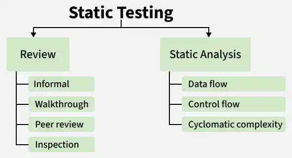
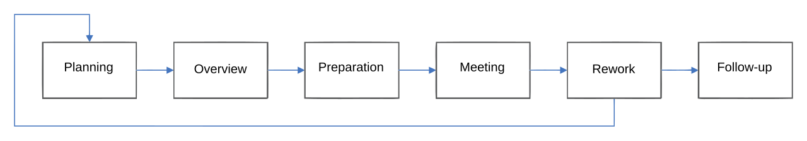

# Mở rộng Static Testing: Kỹ thuật Đọc (PBR), 6 Vai trò & Quy trình 5 vs. 6 bước

> **Nguồn bài học:** Phần nội dung mới chưa có hoặc có sai khác nhỏ từ `Static testing overview + objective + work products + techniques + key concepts + process + benefits + limitations.pdf` *(đối chiếu với [04-static-vs-dynamic-testing.md](../04-static-vs-dynamic-testing.md))*.  
> *Lưu ý:* Định nghĩa Static vs Dynamic, bảng Ruff `F401`/`F841`, SpotBugs, quy tắc `1:10:100` và 10 tiêu chí `C01–C10` đã có sẵn tại `04`, `05` và `03-vv-standards` nên không lặp lại.

---

## 1. Bổ sung Mục tiêu & Đối tượng Work Products từ Note mới

Ngoài các mục đã nêu ở [04-static-vs-dynamic-testing.md](../04-static-vs-dynamic-testing.md):
- **Hai mục tiêu thường bị quên khi giải thích Static Testing:**
  1. **Defect Prevention (*Ngăn chặn lây lan lỗi*):** Chặn lỗi ngay từ tài liệu yêu cầu trước khi nó nhân bản thành thiết kế sai và hàng nghìn dòng code sai.
  2. **Improve Testability (*Tăng khả năng kiểm thử*):** Làm rõ ràng câu chữ, con số biên và cấu trúc module để sau này Tester/Dev dễ viết Test Case và Unit Test.
- **Nhóm Work Products thứ 5:** **Tài liệu người dùng (*User documentation*)** gồm *User Manuals*, *Hướng dẫn cài đặt*, và *Release Notes* — cũng là đối tượng review tĩnh (kiểm tra bước hướng dẫn có mâu thuẫn tính năng thật hay thiếu cảnh báo rủi ro không). Ngoài ra ở nhóm Mã nguồn & Cấu hình còn gồm `.ts`, script `.sql`, `Dockerfile` và **Kubernetes YAML**.

*Hình: Tổng quan hai nhánh Reviews (Informal, Walkthrough, Peer Review, Inspection) và Static Analysis (Nguồn ảnh: GeeksforGeeks).*

---

## 2. Bốn Kỹ thuật Đọc khi Review Tài liệu (*Review Approaches / Reading Techniques*)

Trong **ISTQB CTFL v4.0.1 Section 3.2.4**, ngoài việc phân *loại cuộc họp Review* (Informal / Walkthrough / Technical Review / Inspection), một người Reviewer khi cầm tài liệu đọc cá nhân có thể áp dụng **4 kỹ thuật đọc** sau:

1. **Ad-hoc Review (*Đọc tự do*):** Đọc từ đầu tới cuối theo trực giác và kinh nghiệm cá nhân, không có checklist hay hướng dẫn cố định. Dễ bỏ sót vùng mình không quen.
2. **Checklist-based Review (*Dựa trên bảng kiểm*):** Rà soát có hệ thống từng yêu cầu/đoạn code theo bộ câu hỏi chuẩn hóa (như `C01–C10`).
3. **Scenarios & Dry-runs (*Chạy thử kịch bản*):** Người review đóng vai người dùng, tự lần theo luồng nghiệp vụ với kịch bản *Happy / Alternate / Exception / Concurrency* để tìm chỗ gãy *(cách làm đặc trưng của Walkthrough)*.
4. **Perspective-based Reading — PBR (*Đọc theo đa góc nhìn*):** Đây là kỹ thuật cực kỳ hiệu quả — phân công mỗi Reviewer đóng hẳn **1 vai trò chuyên biệt** khi đọc cùng 1 tài liệu:
   - **Tester** soi *tính khả kiểm (Testability)* & điều kiện biên.
   - **Developer** soi *tính khả thi, cấu trúc dữ liệu, hiệu năng & kiến trúc*.
   - **UX Designer / End-user** soi *tính tiện dụng & luồng thao tác thực tế*.
   - **Security Specialist / Hacker** soi *điểm yếu bảo mật, leo thang quyền*.

---

## 3. Làm rõ 6 Vai trò Review (ISTQB) & Hạn chế "False Positives" của Tool

- **6 vai trò Review tổng quát** (`Static testing overview.pdf` tr.5 — khớp với **ISTQB CTFL v4.0.1 Sec 3.2.2**):
  1. **Author** *(tác giả, chịu trách nhiệm sửa Rework)*
  2. **Management** *(phân bổ ngân sách, thời gian, quyết định tổ chức review)*
  3. **Facilitator / Moderator** *(điều phối cuộc họp, giữ kỷ luật & trung lập)*
  4. **Review Leader** *(chịu trách nhiệm tổng thể việc lập kế hoạch, ai tham gia, khi nào họp)*
  5. **Reviewers / Inspectors** *(người trực tiếp đọc soi tìm lỗi)*
  6. **Scribe / Recorder** *(ghi chép findings vào biên bản/tool)*
- **Hai hạn chế bổ sung cần lưu ý:**
  - **Front-loaded cost (*Chi phí dồn lên đầu*):** Cần nhiều kỹ sư dành thời gian chuẩn bị và họp khi chưa thấy màn hình chạy, dễ bị quản lý thiếu kinh nghiệm đánh giá nhầm là *"tốn thời gian"*.
  - **False Positives (*Báo lỗi giả của công cụ Static Analysis*):** Các công cụ SAST/Linter như SonarQube/Snyk đôi khi gắn cờ nhầm những đoạn code hoàn toàn an toàn/hợp lệ, buộc kỹ sư phải *triage* và cấu hình rule ngoại lệ (`ignore`/`suppress`) có lý giải.

---

## 4. Giải thích Điểm khác biệt: Quy trình Review 5 bước vs. 6 bước

*Hình: Quy trình 6 bước chuẩn IEEE 1028 / Fagan có bước Rework & Follow-up tách riêng (Nguồn: Wikimedia Commons).*

> [!NOTE]
> **Tại sao [04-static-vs-dynamic-testing.md](../04-static-vs-dynamic-testing.md) ghi quy trình Review gồm 5 bước, còn PDF `Static testing overview` (tr.6) lại vẽ 6 bước?**
>
> | Nguồn chuẩn | Các bước trong quy trình Review | Cách đóng gói |
> | :--- | :--- | :--- |
> | **ISTQB CTFL v4.0.1** *(Section 3.2.1)* | `1. Planning` → `2. Review Initiation` → `3. Individual Review` → `4. Communication & Analysis` → **`5. Fixing & Reporting`** | Hợp nhất bước sửa lỗi (*Rework*), kiểm tra đóng lỗi (*Exit Criteria*) và phát hành báo cáo vào bước 5 |
> | **PDF Trường / IEEE 1028 / ISTQB cũ** | `1. Planning` → `2. Review Initiation` → `3. Individual Review` → `4. Communication & Analysis` → `5. Fixing & Reporting` → **`6. Follow-up`** | Tách riêng bước **`6. Follow-up`** (Moderator rà soát xác nhận lại toàn bộ bản sửa của Author trước khi đóng) |
>
> Cả hai mô tả **không hề mâu thuẫn** về hoạt động thực tế — chỉ khác cách gộp hay tách bước theo dõi đóng lỗi (*Follow-up*). Khi đi thi **ISTQB CTFL v4.0.1**, nhớ chuẩn đáp án là **5 hoạt động chính**; còn khi làm theo checklist Fagan/IEEE 1028 trên lớp thì trình bày đủ **6 bước** có *Follow-up* tách biệt.
