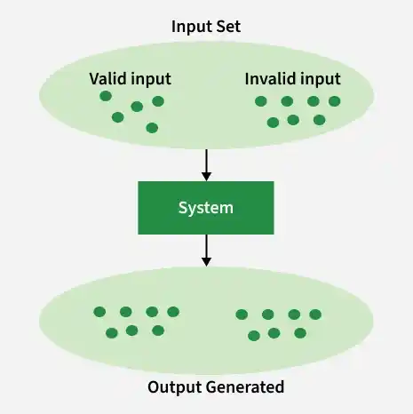

# Equivalence Partitioning — Phân vùng Tương đương (EP)

> **Nguồn tham khảo:** ISTQB CTFL Syllabus v4.0.1 (Section 4.2.1), `Week1_Further_Reading.pdf`, `Dynamic_testing.pdf`, `SRS-SmartQueue.pdf` (`FR-QUE-02`, `BR-10`).

**Equivalence Partitioning (EP)** là kỹ thuật thiết kế test **Black-box** nền tảng nhất, xuất phát trực tiếp từ **Nguyên lý kiểm thử số 2** (*Exhaustive testing is impossible* — không thể test vét cạn mọi giá trị đầu vào).

---

## 1. Bản chất & Nguyên lý hoạt động

- **Định nghĩa (ISTQB v4.0):** Chia tập dữ liệu (đầu vào, đầu ra, giá trị nội bộ, tham số giao diện, giá trị liên quan đến thời gian...) thành các **phân vùng (partitions / equivalence classes)** sao cho mọi phần tử nằm trong cùng một phân vùng được kỳ vọng là sẽ được hệ thống **xử lý theo cùng một logic**.
- **Giả định cốt lõi:** Nếu một giá trị đại diện trong phân vùng phát hiện ra lỗi, mọi giá trị khác trong phân vùng đó cũng sẽ phát hiện cùng lỗi đó (và ngược lại, nếu một giá trị đúng thì cả phân vùng được coi là hành xử tương đương). Do đó, **chỉ cần chọn 1 giá trị đại diện cho mỗi phân vùng**.
- **Hai loại phân vùng bắt buộc phải tìm đủ:**
  1. **Valid Partition (Phân vùng hợp lệ):** Chứa các giá trị hệ thống phải **chấp nhận** và xử lý bình thường.
  2. **Invalid Partition (Phân vùng không hợp lệ):** Chứa các giá trị hệ thống phải **từ chối** hoặc xử lý qua nhánh ngoại lệ/báo lỗi.

> **Lưu ý:** Không chỉ input mới có EP! Bạn có thể chia phân vùng cho **Output** (ví dụ: mức thuế `0%`, `10%`, `20%` hoặc loại vé `VIP`, `Standard`, `Free`), rồi truy ngược xem input nào tạo ra từng output partition đó.

*Hình: Chia không gian đầu vào thành các lớp tương đương Valid / Invalid và chỉ cần chọn giá trị đại diện cho mỗi phân vùng (Nguồn ảnh: GeeksforGeeks).*

---

## 2. Phân loại & Quy tắc chia phân vùng chuẩn

### A. Dữ liệu liên tục / có thứ tự (Ordered / Range)
*Ví dụ 1 (Lab 01):* Số tín chỉ `Credits` là số nguyên từ `1` đến `24`.
- Phân vùng không hợp lệ dưới: `Credits < 1` *(VD chọn `-5` hoặc `0`)*
- Phân vùng hợp lệ: `1 ≤ Credits ≤ 24` *(VD chọn `12`)*
- Phân vùng không hợp lệ trên: `Credits > 24` *(VD chọn `30`)*
- *(Mở rộng kiểu dữ liệu)*: Không phải số nguyên (`12.5`, `"abc"`), để trống (`""`/`null`).

### B. Dữ liệu rời rạc / danh sách liệt kê (Discrete / Enum)
*Ví dụ 2 (TechStore — Phương thức thanh toán):* Chỉ hỗ trợ `COD`, `VNPAY`, `MOMO`.
- Mỗi phương thức hợp lệ xử lý logic khác nhau → **nên tách thành 3 phân vùng hợp lệ riêng** (`{COD}`, `{VNPAY}`, `{MOMO}`), không gộp chung vì code rẽ nhánh `switch/if` khác nhau!
- Phân vùng không hợp lệ: Giá trị ngoài danh sách (`"CRYPTO"`, `""`, `null`).

### C. Dữ liệu chuỗi & định dạng (String / Pattern)
*Ví dụ 3 (SmartQueue `FR-AUTH-15` — Email quên mật khẩu tối đa 254 ký tự):*
- Độ dài hợp lệ: `1–254` ký tự đúng định dạng `local@domain.tld`.
- Độ dài không hợp lệ: rỗng (`0` ký tự), quá dài (`> 254` ký tự).
- Định dạng không hợp lệ: thiếu `@`, thiếu domain (`user@`), chứa khoảng trắng, ký tự đặc biệt sai chuẩn.

### D. Dữ liệu thời gian (Date / Range)
*Ví dụ 4 (SmartQueue `BR-10` — Đặt lịch hẹn từ hôm nay đến 30 ngày tới):*
- Hợp lệ: Ngày trong `[today, today + 30]` **VÀ** thuộc ngày làm việc **VÀ** không nằm trong danh sách ngày loại trừ.
- Không hợp lệ: Ngày trong quá khứ (`< today`), quá xa (`> today + 30`), ngày phòng ban nghỉ/ngày lễ loại trừ.

---

## 3. EP cho nhiều tham số: Each Choice vs. All Combinations

Trong bài tập đơn giản thường chỉ có 1 ô nhập liệu (như `Credits`), nhưng phần mềm thực tế luôn có nhiều ô nhập cùng lúc trên một màn hình (*Form Đăng ký, Tìm kiếm, Đặt hàng...*). Sau khi đã chia phân vùng cho **từng tham số riêng lẻ**, ta cần chọn chiến lược **ghép các phân vùng đó thành từng dòng Test Case**.

Theo chuẩn **ISTQB CTFL v4.0**, có 2 chiến lược cơ bản (từ tiết kiệm đến vét cạn). Để dễ hình dung, hãy xét **cùng một Form Đăng ký thành viên** gồm **2 tham số** (tổng `6` phân vùng = `4 Valid + 2 Invalid`):
- **Tham số `age` (Tuổi):** `V_Age1` (`18–30`), `V_Age2` (`31–60`), `INV_Age` (`< 18` — *Invalid*)
- **Tham số `plan` (Gói):** `V_Plan1` (`"Free"`), `V_Plan2` (`"VIP"`), `INV_Plan` (`""` rỗng — *Invalid*)

---

### 1. Each Choice Coverage *(Phủ từng lựa chọn — Phổ biến nhất)*

- **Tư duy cốt lõi:** *"Mỗi phân vùng của từng tham số chỉ cần xuất hiện **ít nhất 1 lần** trong bộ test — không cần ghép mọi cặp với nhau."* Giống như thử quần áo: bạn chỉ cần mặc sao cho **chiếc áo nào và chiếc quần nào cũng được thử ít nhất 1 lần** (`Áo1 + Quần1`, `Áo2 + Quần2`), không nhất thiết phải mặc đủ mọi bộ đôi (`2 × 2 = 4` bộ).
- **Cạm bẫy Defect Masking (*Che khuất lỗi*) khi ghép Invalid:**
  - Nếu ghép ngây thơ để chỉ tốn đúng $\max(3, 3) = 3$ ca, dòng thứ 3 sẽ bị gộp thành **`(age = 15 [Invalid], plan = "" [Invalid])`**.
  - Khi chạy ca này, code thường kiểm tra từ trên xuống: thấy `age = 15 < 18`, hệ thống lập tức trả lỗi *"Chưa đủ 18 tuổi"* rồi **dừng luôn**. Hàm validate của `plan` phía dưới không hề được thực thi (hoặc lỗi của `plan` bị che mất). Nếu dev quên validate `plan`, bạn sẽ **không bao giờ phát hiện ra**!
- **Quy tắc thực hành chuẩn (*Each Choice an toàn — Cô lập Invalid*):**
  1. **Với các phân vùng Valid:** Ghép song song các giá trị Valid của nhiều trường vào chung một test case → chỉ tốn **$\max(V_1, V_2, \dots, V_k)$ ca** (với `V_i` là số phân vùng Valid của từng tham số).
  2. **Với các phân vùng Invalid:** Mỗi test case **chỉ chứa ĐÚNG 1 giá trị Invalid**, các tham số còn lại giữ giá trị **Valid** chuẩn → tốn thêm **$\sum INV_i$ ca**.

**Ví dụ áp dụng cho Form Đăng ký (Chỉ tốn `2 + 2 = 4` Test Cases):**

| Test ID | `age` | `plan` | Phân vùng được phủ | Kỳ vọng (*Expected*) |
| :---: | :--- | :--- | :--- | :--- |
| `TC_1` | `25` (`V_Age1`) | `"Free"` (`V_Plan1`) | `V_Age1`, `V_Plan1` | Tạo tài khoản thành công |
| `TC_2` | `40` (`V_Age2`) | `"VIP"` (`V_Plan2`) | `V_Age2`, `V_Plan2` | Tạo tài khoản thành công |
| `TC_3` | `15` (`INV_Age`) | `"Free"` (`V_Plan1`) | `INV_Age` *(cô lập)* | Báo lỗi tuổi `< 18` |
| `TC_4` | `25` (`V_Age1`) | `""` (`INV_Plan`) | `INV_Plan` *(cô lập)* | Báo lỗi chưa chọn gói |

→ **Chỉ với `4` Test Cases**, toàn bộ **`6/6` phân vùng (100% EP Coverage)** đều được kiểm tra rõ ràng và không che khuất lỗi của nhau!

> **Giải thích công thức đếm số test case tối thiểu:**
> - **Each Choice thuần túy** *(lý thuyết tối thiểu, chấp nhận rủi ro ghép chung Invalid)*: $\max(\text{tổng phân vùng của từng tham số})$ — ở ví dụ trên là $\max(3, 3) = 3$ ca.
> - **Each Choice an toàn** *(khuyến nghị thực tế — cô lập Invalid)*: **$\max(V_i) + \sum INV_i$** — ở ví dụ trên là $\max(2, 2) + (1 + 1) = 4$ ca. *(Trường hợp đặc biệt mỗi trường chỉ có đúng `1` phân vùng Valid — ví dụ validate định dạng Tên, Email, SĐT — thì $\max(V_i) = 1$, công thức rút gọn thành **`1 (All Valid) + Tổng số Invalid`**).*

---

### 2. All Combinations *(Tất cả tổ hợp — Đầy đủ nhất nhưng tốn kém nhất)*

- **Tư duy cốt lõi:** Nhân chéo **TỪNG** phân vùng của tham số 1 với **TỪNG** phân vùng của tham số 2 (tích Đề-các) để kiểm tra mọi cặp kết hợp có thể xảy ra.
- **Áp dụng cho chính Form Đăng ký trên (`3 × 3 = 9` Test Cases):**

| STT | `age` | `plan` | Đánh giá tổ hợp |
| :---: | :--- | :--- | :--- |
| `1` | `25` (`V_Age1`) | `"Free"` (`V_Plan1`) | Hợp lệ |
| `2` | `25` (`V_Age1`) | `"VIP"` (`V_Plan2`) | Hợp lệ *(Each Choice đã bỏ qua cặp `18–30 + VIP` này)* |
| `3` | `25` (`V_Age1`) | `""` (`INV_Plan`) | Cô lập `INV_Plan` |
| `4` | `40` (`V_Age2`) | `"Free"` (`V_Plan1`) | Hợp lệ *(Each Choice đã bỏ qua cặp `31–60 + Free` này)* |
| `5` | `40` (`V_Age2`) | `"VIP"` (`V_Plan2`) | Hợp lệ |
| `6` | `40` (`V_Age2`) | `""` (`INV_Plan`) | Lặp lại kiểm tra `INV_Plan` |
| `7` | `15` (`INV_Age`) | `"Free"` (`V_Plan1`) | Cô lập `INV_Age` |
| `8` | `15` (`INV_Age`) | `"VIP"` (`V_Plan2`) | Lặp lại kiểm tra `INV_Age` |
| `9` | `15` (`INV_Age`) | `""` (`INV_Plan`) | **Vô ích / Defect Masking:** 2 lỗi gộp chung |

- **Vấn đề bùng nổ tổ hợp (*Combinatorial Explosion*):**
  - Với 2 tham số × 3 phân vùng: tăng từ `4` ca → `9` ca (và sinh ca thừa như dòng 6, 8, 9).
  - Với **3 tham số × 4 phân vùng**: số ca phình lên **$4 \times 4 \times 4 = \mathbf{64}$ ca**.
  - Với **5 tham số × 4 phân vùng**: **$4^5 = \mathbf{1.024}$ ca** — bất khả thi để bảo trì!

### 3. Bảng so sánh & Cách kết hợp khôn ngoan ngoài thực tế

| Chiến lược | Mức độ bao phủ | Số Test Case | Rủi ro bỏ sót tương tác | Khi nào nên dùng? |
| :--- | :--- | :--- | :--- | :--- |
| **Each Choice** *(Cô lập Invalid)* | Mọi phân vùng xuất hiện $\ge 1$ lần | **Ít nhất** ($\max(V_i) + \sum INV_i$) | **Cao** nếu các tham số phụ thuộc chéo (VD: `Age 18–30 + VIP` giảm giá khác `31–60 + VIP`) | Các trường **độc lập nhau** (tên, email, mật khẩu, địa chỉ) hoặc khi cần bộ Smoke test nhanh. |
| **[Pairwise Testing](./06-pairwise-testing.md)** *(Trung gian)* | Mọi **cặp 2 tham số** hợp lệ xuất hiện đủ | **Trung bình** (giảm 70–90% so với All Combinations) | **Thấp** (bắt 70–95% bug tương tác theo NIST) | Form/cấu hình có 3–6 tham số trở lên (*Trình duyệt + OS + Thanh toán + Voucher*). |
| **All Combinations** | Toàn bộ $N_1 \times N_2 \times \dots \times N_k$ | **Cực lớn** (tăng theo cấp số nhân) | **Gần như bằng 0** | Rất ít tham số (2–3 trường) có **nghiệp vụ ràng buộc chặt với nhau** (khi đó thường kết hợp với [Decision Table](./03-decision-table-testing.md)). |

> **Mẹo thực chiến Senior QA:** Không bao giờ chạy `All Combinations` trên các giá trị **Invalid**! Nếu hai tham số có logic tính toán phụ thuộc chéo ở trạng thái hợp lệ (như bảng chiết khấu `total × tier` ở Mục 5 bên dưới), chỉ cần **nhân chéo riêng các phân vùng Valid** ($3 \times 3 = 9$ ca) **cộng thêm** các ca Invalid cô lập ($3$ ca) = `12 ca`, thay vì nhân mù quáng cả Invalid thành `5 × 4 = 20 ca`.

---

## 4. Công thức tính Coverage (Độ bao phủ EP)

$$\text{EP Coverage (\%)} = \left( \frac{\text{Số phân vùng đã được test ít nhất 1 lần}}{\text{Tổng số phân vùng đã xác định (Valid + Invalid)}} \right) \times 100\%$$

Để đạt **100% EP Coverage**, mọi phân vùng hợp lệ **và** không hợp lệ đều phải có ít nhất 1 test case chạm tới.

---

## 5. Ví dụ hoàn chỉnh: Form Giảm giá theo hạng Thành viên (TechStore)

**Đặc tả nghiệp vụ:** Hệ thống TechStore áp dụng mức chiết khấu dựa trên **Tổng giá trị đơn hàng** (`total`, số nguyên VNĐ `>= 0`) và **Hạng thành viên** (`tier`):
- Đơn `< 500.000đ`: Giảm `0%`
- Đơn từ `500.000đ` đến `< 2.000.000đ`: Giảm `5%`
- Đơn `>= 2.000.000đ`: Giảm `10%`
- Hạng thành viên: `Standard`, `Silver`, `Gold` (nhận thêm ưu đãi riêng theo từng nhánh).

### Bước 1: Liệt kê các phân vùng
- **Tham số `total`:**
  - `EP_T_INV1`: `total < 0` *(Không hợp lệ — số âm)*
  - `EP_T_INV2`: Không phải số / rỗng *(Không hợp lệ — sai kiểu)*
  - `EP_T_V1`: `0 <= total < 500.000` *(Hợp lệ — nhóm giảm 0%)*
  - `EP_T_V2`: `500.000 <= total < 2.000.000` *(Hợp lệ — nhóm giảm 5%)*
  - `EP_T_V3`: `total >= 2.000.000` *(Hợp lệ — nhóm giảm 10%)*
- **Tham số `tier`:**
  - `EP_M_V1`: `"Standard"`
  - `EP_M_V2`: `"Silver"`
  - `EP_M_V3`: `"Gold"`
  - `EP_M_INV1`: Giá trị khác / `null` / `""`

### Bước 2: Thiết kế bộ Test Case (Each Choice + Cô lập Invalid)

| Test ID | `total` | `tier` | Phân vùng được phủ | Expected Result |
| :--- | :--- | :--- | :--- | :--- |
| `TC_EP_01` | `200.000` | `Standard` | `EP_T_V1`, `EP_M_V1` | Giảm `0%` |
| `TC_EP_02` | `1.000.000` | `Silver` | `EP_T_V2`, `EP_M_V2` | Áp dụng mức giảm `5%` + ưu đãi `Silver` |
| `TC_EP_03` | `3.500.000` | `Gold` | `EP_T_V3`, `EP_M_V3` | Áp dụng mức giảm `10%` + ưu đãi `Gold` |
| `TC_EP_04` | `-10.000` | `Standard` | `EP_T_INV1` | Báo lỗi: Tổng tiền không hợp lệ (`400`) |
| `TC_EP_05` | `"abc"` | `Standard` | `EP_T_INV2` | Báo lỗi: Định dạng số không hợp lệ (`400`) |
| `TC_EP_06` | `1.000.000` | `"Diamond"` | `EP_M_INV1` | Báo lỗi: Hạng thành viên không tồn tại (`400`) |

→ Chỉ với **6 Test Cases** ($\max(3, 3) + (2 + 1) = 6$ theo chiến lược **Each Choice an toàn** ở Mục 3), ta đã đạt **100% EP Coverage** (`9/9` phân vùng)!  
*(So sánh nhanh: nếu dùng **All Combinations** nhân chéo toàn bộ sẽ phình thành $5 \times 4 = \mathbf{20}$ ca; còn nếu cần kiểm kỹ ma trận chiết khấu giữa 3 mức tiền và 3 hạng thành viên thì chỉ cần nhân chéo phần Valid `3 × 3 = 9` ca + `3` ca Invalid cô lập = **`12` ca**).*

---

## 6. Lỗi thường gặp & Giới hạn của EP

- **Lỗi 1 — Gộp các phân vùng xử lý khác nhau làm một:** Ví dụ gộp `0 <= total < 500k` và `500k <= total < 2M` thành 1 phân vùng "hợp lệ" là sai, vì hành vi/công thức tính giảm giá của chúng khác nhau.
- **Lỗi 2 — Quên các phân vùng Invalid ngầm định:** Quên test `null`, chuỗi rỗng, dấu âm, ký tự chữ cái, sai kiểu dữ liệu.
- **Giới hạn của EP:** EP chỉ chọn giá trị *bên trong* phân vùng (ví dụ `1.000.000`), nên **dễ bỏ sót lỗi tại ranh giới** (ví dụ Dev viết `total > 500000` thay vì `total >= 500000`). Vì vậy EP **luôn phải đi kèm Boundary Value Analysis (BVA)**!
