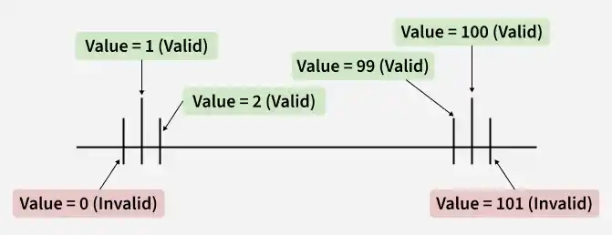

# Boundary Value Analysis — Phân tích Giá trị Biên (BVA)

> **Nguồn tham khảo:** ISTQB CTFL Syllabus v4.0.1 (Section 4.2.2), `Week1_Further_Reading.pdf`, `Dynamic_testing.pdf`, `SRS-SmartQueue.pdf` (`FR-QUE-02`).

**Boundary Value Analysis (BVA)** là phần mở rộng trực tiếp của Equivalence Partitioning, áp dụng cho các phân vùng **có thứ tự** (số nguyên, số thực, độ dài chuỗi, số lượng phần tử mảng, ngày tháng).

---

## 1. Tại sao BVA là kỹ thuật "săn bug" hiệu quả nhất?

Lập trình viên rất hay mắc **lỗi lệch 1 đơn vị (*Off-by-one error*)** khi viết điều kiện rẽ nhánh:
- Nhầm `<` thành `<=` hoặc `>` thành `>=`.
- Nhầm chỉ số mảng bắt đầu từ `0` vs `1` (`i < length` vs `i <= length`).
- Đọc sai đặc tả *"dưới 40"* (`< 40`, tức tối đa `39`) thành *"tối đa 40"* (`<= 40`).

Đây chính là nguyên nhân gây ra cả 2 bug trong **Lab 01** (`credits > 1` thay vì `credits >= 1`, và `enrollment <= 40` thay vì `enrollment <= 39`).

---

## 2. Hai phiên bản chuẩn ISTQB CTFL v4.0: 2-Value vs. 3-Value BVA

Giả sử một phân vùng hợp lệ có biên dưới là $L$ và biên trên là $U$ với bước nhảy nhỏ nhất (*step / precision*) là $\delta$ (với số nguyên $\delta = 1$; với tiền tệ 2 chữ số thập phân $\delta = 0.01$):

### A. 2-Value BVA (Kỹ thuật 2 giá trị biên — Tiêu chuẩn phổ biến)
Tại **mỗi điểm ranh giới**, chọn **2 giá trị**:
1. Giá trị **nằm ngay tại biên** (thuộc phân vùng này).
2. Giá trị **ngay sát kế bên** (thuộc phân vùng kề bên).

*Ví dụ với số nguyên `1 <= credits <= 24`:*
- Tại ranh giới dưới (giữa `<= 0` và `1..24`): chọn `0` (Invalid) và `1` (Valid).
- Tại ranh giới trên (giữa `1..24` và `>= 25`): chọn `24` (Valid) và `25` (Invalid).
- **Tổng tập test 2-value BVA:** `{0, 1, 24, 25}` (4 giá trị).

### B. 3-Value BVA (Kỹ thuật 3 giá trị biên — Độ tin cậy cao)
Tại **mỗi điểm ranh giới**, chọn **3 giá trị**:
1. Giá trị **ngay dưới biên** ($B - \delta$).
2. Giá trị **ngay tại biên** ($B$).
3. Giá trị **ngay trên biên** ($B + \delta$).

*Ví dụ với số nguyên `1 <= credits <= 24`:*
- Cụm biên dưới (`1`): `{0, 1, 2}`
- Cụm biên trên (`24`): `{23, 24, 25}`
- **Tổng tập test 3-value BVA:** `{0, 1, 2, 23, 24, 25}` (6 giá trị).

*Hình: Trực quan hóa kỹ thuật BVA chọn các điểm ngay sát biên (`0, 1, 2` và `99, 100, 101` cho miền hợp lệ `1..100`). Nguồn ảnh: GeeksforGeeks.*

> **Tại sao 3-Value BVA cần thêm `2` và `23`?**  
> Giả sử đặc tả ghi `credits >= 1`, nhưng lập trình viên lại viết nhầm `credits >= 2` (lỗi dịch biên!). Nếu không test `1`? (À test `1` vẫn bắt được lỗi đó). Nhưng nếu dev viết `credits == 1 || credits > 2` (bỏ sót đúng số `2`), hoặc ở logic liên quan 2 điều kiện rời rạc, chỉ 3-value BVA mới phát hiện lỗi ngay sát bên trong biên. Ngoài ra, 3-value BVA rất phổ biến trong hệ thống tài chính, y tế, hàng không và đề thi ISTQB CTFL v4.0!

### Bảng so sánh 2-Value vs. 3-Value BVA

| Tiêu chí | 2-Value BVA | 3-Value BVA |
| :--- | :--- | :--- |
| **Số điểm tại mỗi ranh giới** | `2` (`Boundary`, `Neighbor`) | `3` (`Boundary - δ`, `Boundary`, `Boundary + δ`) |
| **Số ca cho 1 khoảng `[L, U]`** | `4` giá trị | `6` giá trị |
| **Phát hiện lỗi `<` vs `<=`** | Có | Có |
| **Phát hiện lỗi biên dịch chuyển / nhảy cóc sát biên** | Hạn chế | Tốt hơn |
| **Khi nào nên dùng?** | Form thông thường, CRUD, ngân sách thời gian vừa phải. | Thanh toán, tính tiền, y tế, hàng không, module rủi ro cao. |

---

## 3. Công thức tính BVA Coverage (ISTQB v4.0)

$$\text{BVA Coverage (\%)} = \left( \frac{\text{Số giá trị biên đã được kiểm thử}}{\text{Tổng số giá trị biên xác định (theo 2-value hoặc 3-value)}} \right) \times 100\%$$

*(Lưu ý khi thi ISTQB CTFL v4.0: Đọc kỹ đề xem yêu cầu tính theo **2-value BVA** hay **3-value BVA** để đếm mẫu số cho đúng!)*

---

## 4. Các trường hợp biên hay bị bỏ sót trong thực tế

1. **Biên của độ dài chuỗi (String length):**
   - Ví dụ `Password` yêu cầu `8–32` ký tự:
   - 2-value BVA kiểm tra độ dài: `7`, `8`, `32`, `33` (cộng thêm `0` / chuỗi rỗng).
2. **Biên của số lượng phần tử trong danh sách / mảng:**
   - Ví dụ SmartQueue `FR-QUE-02` cho phép chọn từ `1` đến `50` dịch vụ:
   - Test `0` dịch vụ (mảng rỗng `[]`), `1` dịch vụ, `50` dịch vụ, `51` dịch vụ.
3. **Biên số thực / Tiền tệ (Precision / Floating-point):**
   - Ví dụ: Giảm giá áp dụng cho đơn từ `500.000đ` (nếu có lẻ đồng hoặc USD `50.00`):
   - Với VNĐ nguyên: `499.999`, `500.000`, `500.001`.
   - Với USD (`$50.00`): `$49.99`, `$50.00`, `$50.01`.
   - Cẩn thận lỗi làm tròn số thực (`0.1 + 0.2 = 0.30000000000000004`) trong JS/Java `double`!
4. **Biên thời gian & Múi giờ:**
   - Ví dụ SmartQueue `BR-10` & `BR-30`: đặt lịch `0–30` ngày theo múi giờ `Asia/Ho_Chi_Minh`.
   - Biên dưới: `23:59:59` hôm nay vs `00:00:00` ngày mai; biên trên: `today + 30 days` vs `today + 31 days`.
   - Biên giờ mở/đóng cửa (`07:30`, `11:30`): bấm đúng `11:30:00` thì hệ thống coi là mở hay đóng?
5. **Biên hệ thống (Min/Max Integer & Giới hạn DB):**
   - Nhập số lượng sản phẩm trên TechStore: `0`, `-1`, `1`, `stock` (bằng đúng tồn kho), `stock + 1`, và giá trị rất lớn (`9999999999` xem có tràn `INT_MAX = 2,147,483,647` hay không!).

---

## 5. Ví dụ áp dụng đầy đủ cho TechStore

**Bài toán:** Ô nhập **Số lượng mua (`quantity`)** của một sản phẩm có tồn kho `stock = 10`, quy định mua tối thiểu `1` và tối đa `5` sản phẩm/đơn (nếu `stock < 5` thì tối đa bằng `stock`).

### Trường hợp `stock = 10` (Khoảng hợp lệ `[1, 5]`)
- **2-value BVA:** `0` (Reject), `1` (Accept), `5` (Accept), `6` (Reject).
- **3-value BVA:** `0`, `1`, `2`, `4`, `5`, `6`.

### Trường hợp `stock = 2` (Khoảng hợp lệ co lại thành `[1, 2]` — tương tác với điều kiện kho!)
- **2-value BVA:** `0` (Reject), `1` (Accept), `2` (Accept), `3` (Reject — vượt tồn kho dù `<= 5`).

> **Kinh nghiệm thực chiến:** Khi một trường có **biên động** phụ thuộc vào dữ liệu DB (như `stock`, `số dư ví`, `số lượt voucher còn lại`), luôn phải kiểm thử tại biên động đó (`stock = 0`, `stock = 1`, `quantity = stock`, `quantity = stock + 1`).
