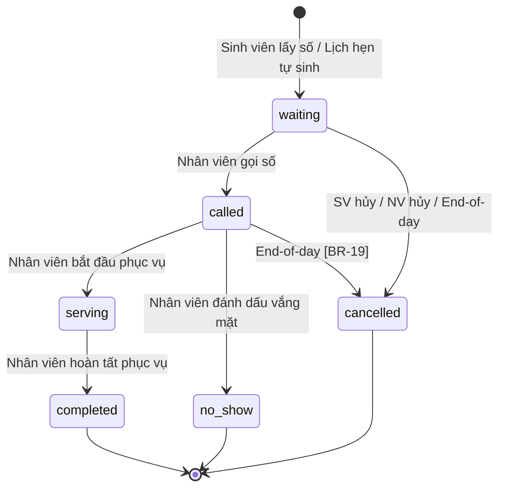

# State Transition Testing — Kiểm thử Chuyển đổi Trạng thái

> **Nguồn tham khảo:** ISTQB CTFL Syllabus v4.0.1 (Section 4.2.4), `Dynamic_testing.pdf`, `SRS-SmartQueue.pdf` (`BR-06`, `BR-07`, `BR-09`, `BR-18`, `BR-19`).

**State Transition Testing** được sử dụng khi hành vi của hệ thống không chỉ phụ thuộc vào input hiện tại, mà còn phụ thuộc vào **trạng thái hiện tại (lịch sử trước đó)** của đối tượng hoặc hệ thống.

---

## 1. Năm thành phần của Mô hình Trạng thái

1. **State (Trạng thái):** Tình trạng ổn định mà hệ thống/đối tượng đang đứng chờ sự kiện (VD: `Pending`, `Paid`, `Waiting`, `Locked`).
2. **Event / Input (Sự kiện):** Tác nhân bên ngoài kích hoạt sự chuyển đổi (VD: *Khách thanh toán*, *Nhấn nút Gọi số*, *Nhập sai mật khẩu*).
3. **Guard Condition (Điều kiện canh — tùy chọn):** Điều kiện phải thỏa mãn để chuyển trạng thái xảy ra, viết trong ngoặc vuông `[...]` (VD: `[số lần sai == 3]`, `[đơn chưa giao]`).
4. **Action (Hành động):** Hệ quả phát sinh khi chuyển trạng thái (VD: *Gửi email xác nhận*, *Giải phóng giới hạn vé*).
5. **Transition (Chuyển đổi):** Mũi tên nối từ trạng thái nguồn → trạng thái đích.

---

## 2. Hai công cụ mô hình hóa: Diagram vs. State Table

### A. State Transition Diagram (Sơ đồ chuyển trạng thái)
- Trực quan, dễ thảo luận với Dev/PO để hiểu các **chuyển đổi hợp lệ (*Valid Transitions*)**.
- Nhược điểm: Dễ bỏ sót các **chuyển đổi bất hợp lệ (*Invalid Transitions*)** (những mũi tên *không tồn tại* trên sơ đồ).

### B. State Table (Bảng trạng thái — Vũ khí tìm Bug!)
- Hàng = Các Trạng thái (`States`), Cột = Các Sự kiện (`Events`).
- Ô giao nhau = `Trạng thái tiếp theo / Action` (nếu hợp lệ), hoặc **`Invalid / Error / No Transition`** (nếu không được phép).
- **Lợi ích cực lớn:** State Table ép Tester kiểm tra cả những thao tác *người dùng không được phép làm* ở từng trạng thái (ví dụ: đã giao hàng xong mà gọi API hủy đơn có bị cho hủy không?).

---

## 3. Các cấp độ phủ (Coverage Criteria — ISTQB v4.0)

Từ yếu đến mạnh:

| Mức độ Coverage | Yêu cầu cần đạt | Ghi chú |
| :--- | :--- | :--- |
| **1. All States** *(Yếu nhất)* | Mỗi trạng thái được ghé thăm ít nhất 1 lần. | Có thể bỏ sót nhiều mũi tên chuyển đổi. |
| **2. All Valid Transitions (0-Switch)** *(Tiêu chuẩn cơ bản)* | Mỗi chuyển đổi **hợp lệ** (từng mũi tên đơn lẻ) được đi qua ít nhất 1 lần. | Đủ cho đa số dự án, tương đương phủ hết các cạnh hợp lệ. |
| **3. N-Switch Coverage (1-Switch, 2-Switch...)** | Kiểm thử chuỗi $N+1$ chuyển đổi liên tiếp hợp lệ (VD `1-switch`: kiểm tra cặp 2 chuyển đổi kế tiếp `A → B → C`). | Phát hiện lỗi trạng thái lưu lại (*side-effect*) sau bước chuyển trước đó. |
| **4. All Transitions (Valid + Invalid)** *(Mạnh nhất)* | Phủ 100% các ô trong **State Table** (bao gồm cả thử mọi thao tác **bất hợp lệ**). | Bắt rất nhiều lỗi phân quyền / race condition / double-submit ở API! |

$$\text{Valid Transition Coverage (\%)} = \left( \frac{\text{Số chuyển đổi hợp lệ đã thực thi}}{\text{Tổng số chuyển đổi hợp lệ}} \right) \times 100\%$$

---

## 4. Ví dụ 1: Vòng đời Vé hàng đợi (`SRS-SmartQueue.pdf` — `BR-06`, `BR-07`, `BR-09`, `BR-19`)

**Trích quy tắc nghiệp vụ (`BR-09`, `BR-06`, `BR-07`, `BR-19`):**
- Vòng đời vé: `waiting → called → serving → completed`, với 2 nhánh kết thúc khác là `cancelled` và `no_show`.
- `BR-06`: Sinh viên chỉ hủy được vé ở trạng thái `waiting`.
- `BR-07`: Chỉ vé ở trạng thái `called` mới có thể bị nhân viên đánh dấu `no_show`.
- `BR-19`: Hết ngày làm việc, vé `waiting` và `called` tự động chuyển `cancelled` (`end_of_day`); vé `serving` vẫn tiếp tục phục vụ đến `completed`.

### State Table (bao gồm cả Invalid Transitions!)

| Trạng thái hiện tại | `Call` (NV gọi) | `Serve` (Bắt đầu) | `Complete` (Xong) | `StudentCancel` | `MarkNoShow` | `EndOfDay` |
| :--- | :--- | :--- | :--- | :--- | :--- | :--- |
| **`waiting`** | `called` | **Invalid** | **Invalid** | `cancelled` | **Invalid** *(BR-07)* | `cancelled` |
| **`called`** | **Invalid** | `serving` | **Invalid** | **Invalid** *(BR-06)* | `no_show` | `cancelled` |
| **`serving`** | **Invalid** | **Invalid** | `completed` | **Invalid** | **Invalid** | `serving` *(tiếp tục)* |
| **`completed`** | **Invalid** | **Invalid** | **Invalid** | **Invalid** | **Invalid** | `completed` |
| **`cancelled`** | **Invalid** | **Invalid** | **Invalid** | **Invalid** | **Invalid** | `cancelled` |
| **`no_show`** | **Invalid** | **Invalid** | **Invalid** | **Invalid** | **Invalid** | `no_show` |

> **Các Test Case vàng rút ra từ State Table trên:**
> - **Valid (0-switch):** `waiting → called → serving → completed`; `waiting → cancelled`; `called → no_show`; `called → cancelled (EndOfDay)`; `serving + EndOfDay → vẫn là serving`.
> - **Invalid (bắt bug API):** Sinh viên gọi API `CANCEL` khi vé đã lên `called` hoặc `serving` → phải bị từ chối (`409 Conflict`); nhân viên đánh dấu `no_show` khi vé đang ở `waiting` → phải bị từ chối!

---

## 5. Ví dụ 2: Vòng đời Đơn hàng & Đăng nhập sai nhiều lần trên TechStore

### A. Khóa tài khoản khi nhập sai mật khẩu (Bài tập ISTQB kinh điển)
- **Quy tắc:** Cho phép sai tối đa 3 lần liên tiếp; nhập đúng ở lần 1, 2, 3 → vào `LoggedIn` (reset bộ đếm); nhập sai lần 3 → khóa tài khoản (`Locked`).
- **Chuỗi 1-switch & edge test quan trọng:**
  - `Sai lần 1 → Sai lần 2 → Đúng ở lần 3` → Phải vào `LoggedIn` (kiểm tra trạng thái `Attempt 2 → LoggedIn`), **và sau đó đăng xuất nhập sai lại phải đếm lại từ 1 chứ không khóa ngay!**
  - `Sai lần 1 → Sai lần 2 → Sai lần 3` → Chuyển sang `Locked`; sau đó dù nhập đúng mật khẩu cũng vẫn phải báo `Account Locked`!

### B. Vòng đời Đơn hàng TechStore
`Created (Chờ thanh toán)` → `Paid (Đã thanh toán)` → `Shipping (Đang giao)` → `Completed (Hoàn tất)` (và các nhánh `Cancelled`, `Refunded`).
- Các ca **Invalid Transition** cực kỳ giá trị để test trên TechStore:
  - Đơn đang `Shipping` hoặc `Completed` mà bấm nút/gọi API `Cancel` → không được cho hủy và hoàn kho sai!
  - Đơn đã `Cancelled` mà cổng thanh toán gửi webhook `PAYMENT_SUCCESS` trễ → phải chặn không cho chuyển lại sang `Paid` hoặc ghi nhận luồng xử lý hoàn tiền ngoại lệ!
