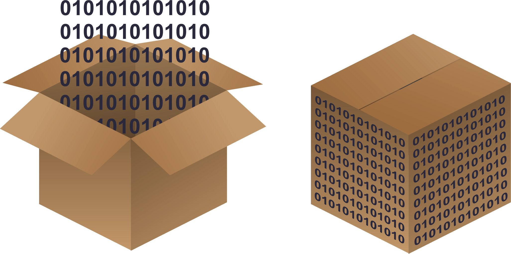
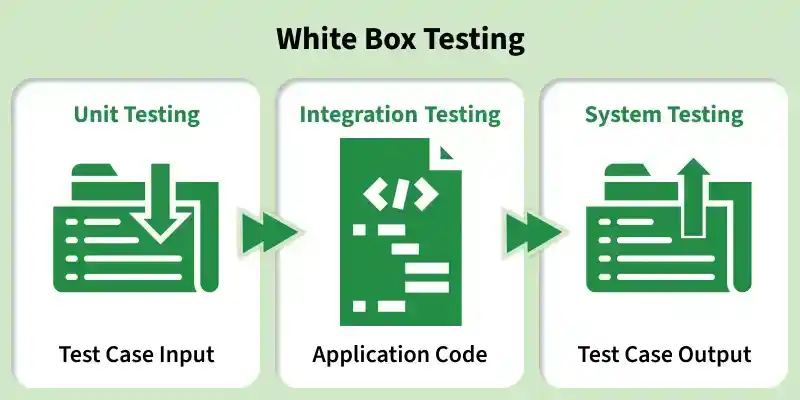
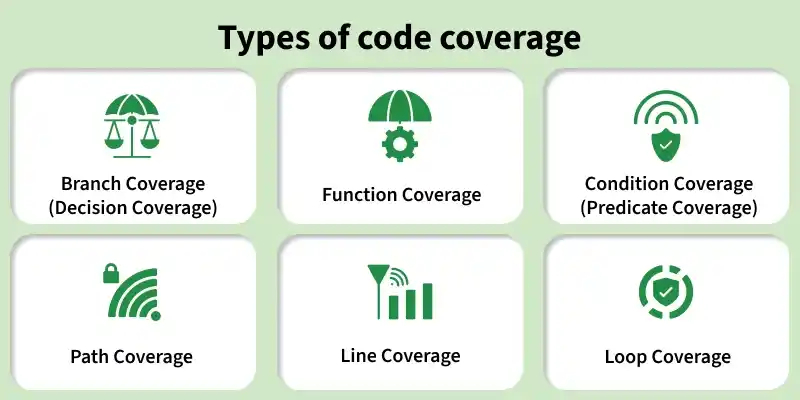

# White-Box Testing: Statement, Branch, Condition, Path Coverage & MC/DC

> **Nguồn tham khảo:** ISTQB CTFL Syllabus v4.0.1 (Section 4.3), ISTQB CTAL-TAE / Structural Coverage Standards, `Dynamic_testing.pdf`.

Đây là mảng **lợi thế lớn của người có nền tảng lập trình (Dev/SDET)**: thay vì chỉ nhìn giao diện/đặc tả (Black-box), **White-box Testing (Structure-based Testing)** đọc trực tiếp **mã nguồn, luồng điều khiển (Control Flow) và luồng dữ liệu** để đo lường xem bộ test đã thực thi được bao nhiêu phần trăm cấu trúc code.



*Hình: Trực quan hóa sự khác biệt giữa White-Box Testing ("Open-box" kiểm tra logic/cấu trúc bên trong) và Black-Box Testing ("Closed-box" kiểm tra đầu vào/ra theo đặc tả). Nguồn: Wikimedia Commons.*

---

## 1. Control Flow Graph (CFG — Đồ thị luồng điều khiển)

Mọi kỹ thuật coverage đều bắt đầu bằng việc chuyển code thành **CFG**:
- **Node (Đỉnh):** Một khối lệnh tuần tự (*basic block*) hoặc một điểm kiểm tra điều kiện (*decision node*).
- **Edge (Cạnh có hướng):** Mũi tên thể hiện luồng chuyển quyền điều khiển giữa các node (nhánh `True`, nhánh `False`, vòng lặp quay lại, thoát hàm).



*Hình: Từ Test Case Input đi xuyên qua cấu trúc Application Code bên trong để kiểm chứng Test Case Output (Nguồn ảnh: GeeksforGeeks).*

---

## 2. Hệ thống phân cấp 5 mức độ Coverage (Từ yếu đến mạnh)



*Hình: Các nhóm đo lường độ bao phủ phổ biến (`Statement/Line`, `Branch/Decision`, `Condition/Predicate`, `Function`, `Loop`, `Path`). Nguồn ảnh: GeeksforGeeks.*

- **Quan hệ bao hàm chuẩn ISTQB:**
  - `100% Branch/Decision Coverage` **⇒ luôn đạt** `100% Statement Coverage` *(nhưng chiều ngược lại KHÔNG đúng)*.
  - `100% Condition Coverage` **KHÔNG đảm bảo** đạt `100% Branch Coverage` *(nếu chưa ép cả biểu thức tổng đạt đủ True và False)*.
  - `Condition/Decision`, `MC/DC` và `Path Coverage` đạt độ bao phủ chặt chẽ hơn theo thứ tự tăng dần.

Hãy dùng **cùng một hàm Java thực tế của TechStore** dưới đây để so sánh trực quan cả 5 kỹ thuật:

```java
// Tính giảm giá: đơn >= 500_000 HOẶC khách là VIP thì giảm 10%;
// nếu khách bị khóa (isBlocked) thì không giảm và ném ngoại lệ nếu đơn < 0.
public int calculateDiscount(int total, boolean isVip, boolean isBlocked) {
    if (total < 0) {                                // D1
        throw new IllegalArgumentException();       // S1
    }
    int discount = 0;                               // S2
    if (!isBlocked && (total >= 500000 || isVip)) { // D2 (gồm 3 điều kiện con: C1=!isBlocked, C2=total>=500000, C3=isVip)
        discount = (int) (total * 0.10);            // S3
    }
    return discount;                                // S4
}
```

---

### Mức 1: Statement Coverage *(Độ bao phủ câu lệnh)*

- **Định nghĩa:** Tỷ lệ phần trăm các câu lệnh thực thi được trong code đã được chạy ít nhất 1 lần.
- **Công thức:**

$$\text{Statement Coverage} = \left( \frac{\text{Số câu lệnh thực thi đã chạy}}{\text{Tổng số câu lệnh thực thi}} \right) \times 100\%$$

- **Phân tích trên ví dụ:**
  - Nếu có 2 ca: `TC1(-1, false, false)` (chạy `D1 → S1`) và `TC2(600000, false, false)` (chạy `D1 → S2 → D2 → S3 → S4`).
  - Tất cả mọi dòng lệnh (`D1, S1, S2, D2, S3, S4`) đều đã chạy ít nhất 1 lần → **100% Statement Coverage!**
- **Điểm yếu chí tử:** Nhánh **`False` của `D2`** (trường hợp không được giảm giá, `discount` giữ nguyên `0`) **CHƯA BAO GIỜ ĐƯỢC TEST!** Nếu Dev viết sai `int discount = 100000;` ở dòng `S2` thay vì `0`, bộ test đạt 100% Statement Coverage vẫn pass mù quáng!

---

### Mức 2: Branch / Decision Coverage *(Độ bao phủ nhánh / quyết định)*

- **Định nghĩa:** Tỷ lệ phần trăm các nhánh rẽ (`True` và `False` của `if`, `while`, `for`, các nhánh `case`/`default` của `switch`, toán tử 3 ngôi `?:`) đã được thực thi ít nhất 1 lần.
- **Công thức:**

$$\text{Branch Coverage} = \left( \frac{\text{Số nhánh đã chạy}}{\text{Tổng số nhánh quyết định}} \right) \times 100\%$$

- **Quan hệ vàng (hay thi ISTQB):** **100% Branch Coverage LUÔN SUY RA 100% Statement Coverage** *(vì mọi câu lệnh đều nằm trên một nhánh nào đó)*, nhưng ngược lại thì KHÔNG.
- **Phân tích trên ví dụ:**
  - `D1` có 2 nhánh (`True` / `False`), `D2` có 2 nhánh (`True` / `False`) → Tổng cộng **4 nhánh**.
  - Để đạt **100% Branch Coverage**, ngoài `TC1` và `TC2` ở trên, bắt buộc thêm `TC3(200000, false, false)` để đi vào nhánh **`False` của `D2`**!
- **Điểm yếu của Branch Coverage:** Với biểu thức ghép `!isBlocked && (total >= 500000 || isVip)`:
  - `TC2(600000, false, false)` làm `D2 = True` (`C1=T, C2=T`, `C3` bị *short-circuit* bỏ qua).
  - `TC3(200000, false, false)` làm `D2 = False` (`C1=T, C2=F, C3=F`).
  - **Cả 2 ca trên chưa bao giờ kiểm tra trường hợp `isBlocked = true` (`C1 = F`) hoặc `isVip = true` (`C3 = T`)!** Nếu Dev viết nhầm `isBlocked` thành `!isBlocked`, 100% Branch Coverage vẫn có thể bỏ sót!

---

### Mức 3: Condition Coverage *(Độ bao phủ điều kiện con)*

- **Định nghĩa:** Đảm bảo **mỗi điều kiện Boolean nguyên tử (atomic condition)** bên trong câu lệnh điều kiện phải nhận cả hai giá trị `True` và `False` ít nhất 1 lần.
- **Phân tích trên ví dụ `if (A || B)` (chứng minh phản ví dụ kinh điển!):**
  - Giả sử chỉ có hàm `if (A || B) { doSomething(); } else { doOther(); }`
  - Chọn 2 test case:
    - `TC_A: (A = True, B = False)` → `A || B` = **True**
    - `TC_B: (A = False, B = True)` → `A || B` = **True**
  - Thử kiểm tra: `A` đã từng nhận `T` và `F`? **Rồi!** `B` đã từng nhận `T` và `F`? **Rồi!** → Đạt **100% Condition Coverage**!
  - **NHƯNG:** Biểu thức tổng `(A || B)` mới chỉ ra **True**, nhánh **False (`else`) CHƯA TỪNG CHẠY!**
  - **Kết luận cực quan trọng (ISTQB):** **100% Condition Coverage KHÔNG đảm bảo 100% Branch Coverage!** *(Lưu ý thêm: trong Java/C#/Python có **Short-Circuit Evaluation** — với `A || B`, nếu `A = True` thì `B` thậm chí không được đánh giá; với `A && B`, nếu `A = False` thì `B` không được đánh giá!).*

---

### Mức 4: Condition/Decision Coverage, Multiple Condition & MC/DC

Để khắc phục nhược điểm của cả Branch lẫn Condition riêng lẻ, người ta nâng lên 3 mức cao hơn:

1. **Condition/Decision Coverage:** Yêu cầu đồng thời đạt **100% Branch Coverage** VÀ **100% Condition Coverage**. (VD với `A || B`: dùng `(T, T)` và `(F, F)` là đủ cả 2!).
2. **Multiple Condition Coverage (MCC):** Thử **mọi tổ hợp chân trị có thể** của $n$ điều kiện con ($2^n$ ca). Rất mạnh nhưng bùng nổ nếu $n$ lớn (VD $n=6 \implies 64$ ca cho 1 câu `if`).
3. **MC/DC (Modified Condition/Decision Coverage):** Tiêu chuẩn bắt buộc trong hàng không (DO-178C) và ô tô (ISO 26262). Yêu cầu:
   - Mỗi quyết định nhận đủ `True` & `False`.
   - Mỗi điều kiện con nhận đủ `True` & `False`.
   - **Quan trọng nhất:** Chứng minh được **mỗi điều kiện con có thể tự mình (độc lập) làm thay đổi kết quả của toàn bộ biểu thức**, bằng cách giữ nguyên giá trị các điều kiện khác và chỉ đảo điều kiện đó.
   - **Số ca tối thiểu:** Chỉ cần **$n + 1$** test case (rất tối ưu so với $2^n$ của MCC!).

---

### Mức 5: Path Coverage *(Độ bao phủ đường đi)*

- **Định nghĩa:** Mọi đường đi khả dĩ khác nhau từ điểm bắt đầu (`Entry`) đến điểm kết thúc (`Exit`) của hàm/chương trình đều phải được thực thi ít nhất 1 lần.
- **Công thức:**

$$\text{Path Coverage} = \left( \frac{\text{Số đường đi độc lập đã thực thi}}{\text{Tổng số đường đi khả dĩ}} \right) \times 100\%$$

- **Phân tích trên ví dụ 2 câu `if` nối tiếp:**
  ```java
  if (A) { x++; } // nhánh T/F
  if (B) { y++; } // nhánh T/F
  ```
  - Để đạt **100% Branch Coverage**, chỉ cần **2 test case**: `(A=T, B=T)` và `(A=F, B=F)`.
  - Nhưng có tới **$2 \times 2 = 4$ đường đi (Paths)**: `(T,T)`, `(T,F)`, `(F,T)`, `(F,F)`. Để đạt **100% Path Coverage** cần cả 4 ca!
- **Giới hạn thực tế:** Nếu hàm có vòng lặp `for/while` chạy $N$ lần phụ thuộc input (hoặc `while (true)`), số đường đi là **hàng tỷ hoặc vô hạn** → **100% Path Coverage thường bất khả thi trong thực tế**, nên người ta dùng **Basis Path Testing** dựa trên **Cyclomatic Complexity** (xem file tiếp theo).

---

## 3. Bảng tổng kết so sánh (Chuẩn ôn thi & Phỏng vấn)

| Mức Coverage | Đối tượng phủ | Số ca cho `k` `if` nối tiếp | Subsumption (Bao hàm) | Thực tế dùng ở Java / JaCoCo |
| :--- | :--- | :---: | :--- | :--- |
| **Statement (Line)** | Câu lệnh thực thi | Thấp (1–2) | Yếu nhất | JaCoCo `LINE` counter |
| **Branch (Decision)** | Nhánh `T`/`F` | Thấp–TB ($\le 2k$) | Mạnh hơn Statement (`100% Branch ⇒ 100% Statement`) | **JaCoCo `BRANCH` counter — Mục tiêu 80% ở GĐ 2!** |
| **Condition** | Từng điều kiện con `T`/`F` | Thấp | **Không** bao hàm Branch! | Cần tự thiết kế test thêm cho `&&`/`\|\|` |
| **MC/DC** | Điều kiện con độc lập | $n + 1$ | Mạnh hơn Branch & Condition | Hàng không, ô tô, tài chính lõi |
| **Path** | Mọi đường đi Entry→Exit | Lên tới $2^k$ hoặc $\infty$ | Mạnh nhất (nếu khả thi) | Thay bằng **Basis Path ($V(G)$)** |

> **Liên hệ Giai đoạn 2 (JaCoCo):** Công cụ **JaCoCo** trong Java đo chủ yếu **Instruction/Line Coverage** và **Branch Coverage** (mỗi điều kiện đơn trong `&&`/`||` ở bytecode đều tạo ra nhánh rẽ riêng!). Vì vậy hiểu rõ sự khác biệt giữa Statement và Branch/Condition sẽ giúp bạn viết JUnit test chất lượng thực sự ở Giai đoạn 2 thay vì chỉ "test lấy số".
