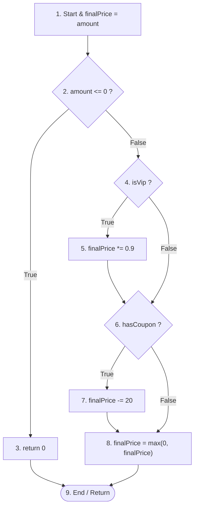

# Cyclomatic Complexity & Basis Path Testing (Độ phức tạp Chu trình McCabe)

> **Nguồn tham khảo:** Thomas J. McCabe (1976), ISTQB CTAL / White-Box Testing, `Static_Testing.pdf`.

**Cyclomatic Complexity** (ký hiệu $V(G)$), do Thomas J. McCabe đề xuất, đo lường **độ phức tạp cấu trúc luồng điều khiển** của một hàm hoặc module dựa trên đồ thị luồng điều khiển (*Control Flow Graph — CFG*). Trong kiểm thử, $V(G)$ cho biết trực tiếp **cận trên của số test case tối thiểu cần thiết để đạt 100% Branch Coverage** và số đường đi độc lập tuyến tính (**Basis Path Testing**).

---

## 1. Ba công thức tính Cyclomatic Complexity $V(G)$

Khi đã vẽ Control Flow Graph $G$ của một hàm (liên thông, 1 điểm vào – 1 điểm ra):

### Công thức 1 (Tổng quát theo đồ thị):
$$V(G) = E - N + 2$$
- $E$ (*Edges*): Tổng số cạnh có hướng.
- $N$ (*Nodes*): Tổng số đỉnh (khối lệnh / nút điều kiện).

### Công thức 2 (Nhanh nhất khi đọc code — theo số điểm quyết định):
$$V(G) = P + 1$$
- $P$ (*Predicate nodes*): Tổng số **điểm quyết định nhị phân** (*decision points*) trong hàm.
- **Quy tắc đếm $P$ trong Java / Python / C#:**
  - Mỗi `if`, `else if` → `+1` *(lưu ý: `else` đơn thuần KHÔNG cộng, vì nó chỉ là nhánh False của `if`!)*.
  - Mỗi vòng lặp `for`, `while`, `do-while` → `+1`.
  - Mỗi nhánh `case` trong `switch` (không tính `default`, hoặc `case` có thân riêng) → `+1`.
  - Mỗi khối `catch` → `+1`.
  - Mỗi toán tử ba ngôi `?:` → `+1`.
  - **Lưu ý quan trọng về `&&` / `||` (Short-circuit predicates):** Nếu tính ở mức **điều kiện nguyên tử / nhánh bytecode** (như SonarQube, JaCoCo, McCabe mở rộng): `if (A && B)` có **2** điều kiện rẽ nhánh (`A` và `B`) nên cộng `+2` (tức mỗi `&&` hoặc `||` cộng thêm `+1`). Khi thi ISTQB, cần xem đề bài quy ước đếm `if` đơn là `+1` hay đếm từng toán tử logic `&&`/`||` là `+1`!

### Công thức 3 (Trực quan trên đồ thị phẳng):
$$V(G) = R$$
- $R$: Tổng số **vùng kín (*bounded regions*)** cộng thêm **1 vùng ngoài cùng** (*unbounded region*) bao quanh đồ thị phẳng.

---

## 2. Ý nghĩa & Ngưỡng đánh giá rủi ro (McCabe Risk Thresholds)

| Giá trị $V(G)$ | Mức độ phức tạp | Đánh giá rủi ro & Khả năng kiểm thử |
| :---: | :--- | :--- |
| **1 – 10** | Đơn giản, cấu trúc tốt | Rủi ro thấp, dễ đọc, dễ viết Unit Test và bảo trì. |
| **11 – 20** | Trung bình – Hơi phức tạp | Rủi ro trung bình, cần test kỹ hơn và cân nhắc tách hàm. |
| **21 – 50** | Phức tạp cao | Rủi ro cao, rất dễ sót bug ở các nhánh ẩn, khó đạt coverage cao. |
| **> 50** | Quá phức tạp (Untestable) | Rủi ro cực cao — hầu như không thể test triệt để; **bắt buộc phải refactor!** |

> **Liên hệ Static Analysis:** Công cụ như **Ruff** (quy tắc `C901` — McCabe complexity), **SonarQube**, **Checkstyle** đều tính $V(G)$ tự động và cảnh báo khi một hàm vượt quá `10` (hoặc `15`).

---

## 3. Ví dụ từng bước: Vẽ CFG, tính $V(G)$ và tìm Basis Paths

Xét hàm Java kiểm tra điều kiện áp dụng giảm giá trên **TechStore**:

```java
public double applyDiscount(double amount, boolean isVip, boolean hasCoupon) {
    double finalPrice = amount;        // Node 1: Entry & khởi tạo
    if (amount <= 0) {                 // Node 2: Quyết định 1
        return 0;                      // Node 3
    }
    if (isVip) {                       // Node 4: Quyết định 2
        finalPrice = finalPrice * 0.9; // Node 5
    }
    if (hasCoupon) {                   // Node 6: Quyết định 3
        finalPrice = finalPrice - 20;  // Node 7
    }
    return Math.max(0, finalPrice);    // Node 8: Exit
}
```
*(Để dễ vẽ đồ thị chuẩn 1 Exit, giả sử Node 3 và Node 8 nối về cùng một nút kết thúc `End` — Node 9).*

### Bước 1: Vẽ Control Flow Graph (CFG)



### Bước 2: Tính $V(G)$ bằng cả 3 công thức để kiểm chéo
1. **Theo $E - N + 2$:**
   - Đếm Nodes: $N = 9$ (`N1` đến `N9`).
   - Đếm Edges: `1→2`, `2→3`, `3→9`, `2→4`, `4→5`, `5→6`, `4→6`, `6→7`, `7→8`, `6→8`, `8→9` → $E = 11$.
   - $V(G) = 11 - 9 + 2 = \mathbf{4}$.
2. **Theo $P + 1$:**
   - Có 3 điểm quyết định (`N2`, `N4`, `N6`) → $P = 3$.
   - $V(G) = 3 + 1 = \mathbf{4}$.
3. **Theo số vùng $R$:**
   - Có 3 vòng khép kín (`4→5→6→4`, `6→7→8→6`, và vòng lớn `2→3→9←8←6←4←2`) + 1 vùng bên ngoài = **4 vùng**.

→ Cả 3 cách đều cho **$V(G) = 4$**! Nghĩa là ta cần **tối đa 4 test case độc lập tuyến tính** để phủ 100% nhánh.

### Bước 3: Liệt kê 4 Basis Paths & Thiết kế Test Cases tương ứng

| Path ID | Đường đi trên CFG | Điều kiện kích hoạt | Bộ Input mẫu | Expected Output |
| :---: | :--- | :--- | :--- | :---: |
| **Path 1** | `1 → 2 → 3 → 9` | `amount <= 0` | `amount = 0, isVip = false, hasCoupon = false` | `0` |
| **Path 2** | `1 → 2 → 4 → 6 → 8 → 9` | `amount > 0`, `!isVip`, `!hasCoupon` | `amount = 100, isVip = false, hasCoupon = false` | `100` |
| **Path 3** | `1 → 2 → 4 → 5 → 6 → 8 → 9` | `amount > 0`, `isVip`, `!hasCoupon` | `amount = 100, isVip = true, hasCoupon = false` | `90` |
| **Path 4** | `1 → 2 → 4 → 6 → 7 → 8 → 9` | `amount > 0`, `!isVip`, `hasCoupon` | `amount = 100, isVip = false, hasCoupon = true` | `80` |

> **Lưu ý quan trọng:** 4 Basis Paths trên đảm bảo **100% Branch Coverage** (mỗi nhánh ở `N2, N4, N6` đều đã chạy cả True và False) và **100% Statement Coverage**, nhưng chưa phủ hết mọi *combination path* (ví dụ đường đi kết hợp cả `isVip = true` VÀ `hasCoupon = true` — đường này cũng rất quan trọng về nghiệp vụ để kiểm tra thứ tự trừ `10%` trước hay trừ `20` trước!). Đó là lý do ở thực tế ta luôn kết hợp **White-box Basis Paths + Black-box Decision Table**.

---

## 4. Làm gì khi một hàm có Cyclomatic Complexity quá cao? (Góc nhìn Dev + SDET)

1. **Áp dụng Early Return (Guard Clauses):** Trả về lỗi ngay đầu hàm thay vì lồng `if-else` sâu 4–5 tầng (giảm độ sâu lồng ghép giúp dễ đọc dù $V(G)$ giữ nguyên hoặc giảm).
2. **Tách hàm theo trách nhiệm đơn (Extract Method):** Tách `validateOrder()`, `calculateVipDiscount()`, `applyCoupon()` thành các hàm nhỏ có $V(G) \le 5$ → mỗi hàm viết Unit Test cực nhanh và rõ ràng.
3. **Thay `if-else if` dài bằng Strategy Pattern / Map lookup:** Khi có 10 loại voucher hay 10 trạng thái, dùng `Map<VoucherType, DiscountStrategy>` giúp giảm mạnh $V(G)$ trong hàm điều phối chính.
