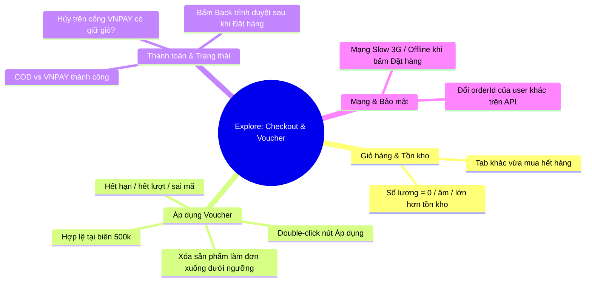

# Experience-Based Testing: Error Guessing & Exploratory Testing

> **Nguồn tham khảo:** ISTQB CTFL Syllabus v4.0.1 (Section 4.4), Elisabeth Hendrickson (*Explore It!*), James Bach (*Session-Based Test Management*), `Dynamic_testing.pdf`.

Khi tài liệu yêu cầu bị thiếu, lỗi thời, không đủ thời gian viết hết kịch bản chi tiết, hoặc bạn muốn săn những lỗi "oái oăm" mà quy trình máy móc bỏ sót, **Experience-Based Testing** (Kiểm thử dựa trên kinh nghiệm, trực giác và kỹ năng) là vũ khí tạo nên sự khác biệt giữa tester giỏi và người chỉ biết làm theo mẫu.

---

## Phần 1: Error Guessing *(Đoán lỗi có hệ thống)*

### 1. Định nghĩa (ISTQB CTFL v4.0)
**Error Guessing** là kỹ thuật thiết kế test dự đoán các lỗi mà lập trình viên có thể mắc phải dựa trên:
- Kinh nghiệm kiểm thử các dự án tương tự trước đây.
- Hiểu biết về cách ứng dụng hoạt động và công nghệ nền (Java/Spring, JS, SQL).
- Lịch sử các bug hay lặp lại trong team (*defect taxonomy / fault attack*).

> **Mẹo phỏng vấn:** Error Guessing không phải là "đoán mò" — đó là **dùng danh sách mẫu lỗi phổ biến (Fault Attack List)** để tấn công đúng vào các điểm yếu kinh điển của lập trình viên!

### 2. Kho mẫu lỗi "Fault Attack" chia theo từng loại dữ liệu & tình huống

| Nhóm mục tiêu | Các input / thao tác hay gây bug | Lỗi điển hình của Developer |
| :--- | :--- | :--- |
| **1. Chuỗi & Ký tự (Strings)** | - Chuỗi toàn khoảng trắng `"   "` - Khoảng trắng đầu/cuối `" admin@gmail.com "` - Tiếng Việt có dấu, emoji `🔥`, ký tự Unicode dài - Ký tự đặc biệt SQL/HTML: `' OR 1=1 --`, `` - Copy-paste chuỗi cực dài (`10.000` ký tự) | Quên `.trim()`, validation `required` cho qua `"   "`, không escape HTML (XSS), tràn cột `VARCHAR(255)` gây lỗi `500 Internal Server Error`. |
| **2. Số & Tiền tệ (Numbers)** | - Số `0`, số âm `-1`, số thập phân `1.5` vào ô số nguyên - `0.1 + 0.2` hoặc chia lấy dư/tỷ lệ phần trăm làm tròn - Số cực lớn `999999999999` (vượt `Integer.MAX_VALUE`) - Nhập `1e5`, `+10`, `-0`, ký tự chữ cái | Parse int không bắt `NumberFormatException`, tính giảm giá ra số âm (`total < 0`), làm tròn tiền sai 1 đồng, nhân số lượng `-2` làm **giảm tổng tiền hoặc tăng tồn kho**! |
| **3. Ngày giờ & Múi giờ** | - Ngày `29/02` năm nhuận & không nhuận - `23:59:59` chuyển giao qua `00:00:00` - Lệch múi giờ client (UTC) vs server (`Asia/Ho_Chi_Minh`) - Ngày kết thúc nhỏ hơn ngày bắt đầu | Dùng `new Date()` UTC thay vì giờ VN (`BR-30` SmartQueue), sai phép so sánh `end <= start`. |
| **4. Trạng thái & Tương tác (Concurrency / UI)** | - **Double-click** nhanh nút *Đặt hàng* / *Áp voucher* / *Thanh toán* - Mở **2 tab trình duyệt** cùng dùng 1 mã giảm giá còn 1 lượt - Nhấn nút **Back** của trình duyệt sau khi vừa submit - Tắt mạng giữa lúc gọi API rồi bật lại | Tạo 2 đơn hàng trùng nhau, trừ tồn kho âm, áp 1 voucher nhiều lần (lỗi *Race Condition* / thiếu *Idempotency Key*). |
| **5. File Upload** | - File `0 byte` (rỗng), file > `10MB` / `50MB` - Đổi đuôi file `.exe` thành `.jpg` - Tên file chứa dấu cách, tiếng Việt, `../../shell.jsp` | Chỉ kiểm tra đuôi file ở Frontend mà quên kiểm tra *Magic Bytes / MIME type* ở Backend; không giới hạn dung lượng gây OOM. |
| **6. Bảo mật & Phân quyền nhanh (IDOR)** | - Đổi ID trên URL/API (`/api/orders/101` → `/api/orders/102`) - Bấm nút/gọi API của Admin bằng token của User thường | Quên kiểm tra quyền sở hữu tài nguyên (*Broken Object Level Authorization / IDOR*). |

---

## Phần 2: Exploratory Testing *(Kiểm thử Thăm dò)*

### 1. Định nghĩa & Phân biệt với Ad-hoc Testing

- **Định nghĩa (ISTQB v4.0):** Exploratory Testing là phương pháp trong đó **học hỏi về hệ thống (learning), thiết kế test (test design) và thực thi test (test execution)** diễn ra **đồng thời** và tương tác liên tục trong một khoảng thời gian có giới hạn.
- **Đừng nhầm với Ad-hoc Testing!**

| Tiêu chí | Ad-hoc Testing *(Test ngẫu hứng)* | Exploratory Testing *(Kiểm thử thăm dò)* |
| :--- | :--- | :--- |
| **Mục tiêu** | Bấm thử lung tung, không có mục tiêu cụ thể. | Có **Charter (hiến chương / mục tiêu rõ ràng)** cho từng phiên. |
| **Tài liệu & Ghi chép** | Hầu như không ghi chép, khó lặp lại. | Có ghi chú phiên test (*Session Notes*), bằng chứng, bug & câu hỏi. |
| **Quản lý thời gian** | Không giới hạn thời gian. | Giới hạn theo **Time-box** (thường `60–90` phút/phiên). |
| **Phương pháp** | Tùy hứng cá nhân. | Dẫn hướng bằng **Heuristics**, **Tours**, và **Mind Map**. |

---

### 2. Session-Based Test Management (SBTM) — Quy trình 4 bước

Để Exploratory Testing kiểm soát được chất lượng và báo cáo được cho PM/Team Lead, ta dùng khung **SBTM** (James & Jon Bach):

1. **Tạo Charter (Test Charter):** Xác định rõ *Test cái gì? Với công cụ/góc nhìn nào? Để tìm rủi ro gì?*  
   > **Mẫu câu Charter chuẩn (Elisabeth Hendrickson):**  
   > **`Explore`** `<phạm vi / tính năng>` **`with`** `<tài nguyên / dữ liệu / công cụ>` **`to discover`** `<loại rủi ro / thông tin cần tìm>`.
   - *Ví dụ cho TechStore:* *"Explore luồng Checkout & Áp dụng Voucher with dữ liệu biên, thao tác double-click và DevTools Network throttling to discover các lỗi tính sai tổng tiền, áp trùng voucher hoặc trừ sai tồn kho."*
2. **Thực thi trong Time-box (60–90 phút):**
   - Chỉ tập trung 100% vào mục tiêu Charter (không lan man sang bug khác nếu không liên quan — ghi chú lại thành *Charter mới* cho phiên sau!).
   - Vừa thao tác vừa quan sát log Console/Network/DB, ghi lại những gì đã thử (*Coverage*), các vấn đề (*Bugs*), và các nghi vấn (*Issues/Questions*).
   - Tỷ lệ phân bổ thời gian tham khảo (TBS metrics): *Session Setup / Test Design & Execution / Bug Investigation & Reporting*.
3. **Ghi nhận Session Sheet (Báo cáo phiên):** Tóm tắt khu vực đã test, bug ID đã log, ghi chú quan trọng, tỷ lệ thời gian.
4. **Debriefing (Trao đổi nhanh 10–15 phút với Lead/PO/Dev):** Chốt lại rủi ro phát hiện được và xem có cần mở thêm phiên exploratory tiếp theo không.

---

### 3. Các Heuristics & "Tours" nổi tiếng giúp không bí ý tưởng khi Explore

#### A. Heuristic **SFDPOT** *(San Francisco Depot — James Bach)*
Dùng để quét toàn diện một tính năng theo 6 góc nhìn:
- **S — Structure:** Giao diện gồm thành phần gì, API/DB nào tham gia?
- **F — Function:** Các chức năng chính/phụ hoạt động thế nào?
- **D — Data:** Input, output, dữ liệu rỗng/lớn/đặc biệt?
- **P — Platform:** Trình duyệt khác nhau, Mobile responsive, mạng chậm?
- **O — Operations:** Người dùng thực tế dùng trong hoàn cảnh nào (vừa mở nhiều tab, mất mạng giữa chừng)?
- **T — Time:** Timeout, hết phiên đăng nhập, cronjob cuối ngày, múi giờ?

#### B. Heuristic **CRUD** & **Zero – One – Many**
- Với mọi thực thể (Sản phẩm, Đơn hàng, Voucher, Lịch hẹn): thử đủ **Create – Read – Update – Delete**.
- Thử với số lượng: **0** (danh sách rỗng), **1** (đúng 1 phần tử), **Many** (100 phần tử / phân trang / cuộn dài).

#### C. Các **Testing Tours** *(James Whittaker)*
- **The Money Tour:** Đi theo các tính năng mang lại doanh thu chính (Checkout, Thanh toán, Voucher).
- **The Antisocial Tour:** Cố tình làm điều ngược đời nhất (bấm Cancel giữa chừng, gửi request thiếu token, nhập số âm, reload giữa khi đang quay loading).
- **The Bad Neighborhood Tour:** Quay lại những module từng có nhiều bug nhất (*Nguyên lý 4: Defects cluster together*).

---

## 4. Kết hợp Mind Map cho Exploratory Testing

Trước khi bắt đầu phiên 60 phút cho **TechStore Checkout**, hãy phác nhanh một **Mind Map** để đảm bảo không bỏ sót nhánh:

