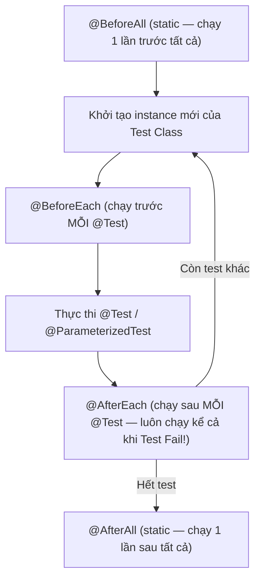

# JUnit 5: Parameterized Test, Lifecycle & Nested Test

> **Nguồn tham khảo:** JUnit 5 (JUnit Jupiter) Official User Guide, *Full Stack Testing* (Chương 2 — Unit Tests & TestNG), `Unit_Testing__Integration_Testing...pdf`, `Dynamic_testing.pdf`.

**JUnit 5** (và dòng kế nhiệm **JUnit 6** áp dụng đánh số phiên bản hợp nhất trên nền Java 17+) là framework kiểm thử đơn vị chuẩn mực trong hệ sinh thái Java / Spring Boot. Trong giáo trình *Full Stack Testing*, ví dụ API/UI sử dụng **TestNG**, còn phần Unit Test sử dụng **JUnit 5** — hai framework có tư duy annotation rất tương đồng nhưng JUnit 5 hiện đại hơn, tách biệt kiến trúc rõ ràng hơn và được Spring Boot tích hợp mặc định.

---

## 1. Kiến trúc JUnit 5 (3 phân hệ)

Khác với JUnit 4 chỉ là một file `.jar` đơn khối, JUnit 5 được thiết kế theo mô-đun:

$$\text{JUnit 5} = \text{JUnit Platform} + \text{JUnit Jupiter} + \text{JUnit Vintage}$$

| Phân hệ | Vai trò |
| :--- | :--- |
| **JUnit Platform** | Nền tảng khởi chạy test trên JVM (*TestEngine API*, tích hợp với IntelliJ, Maven Surefire, Gradle). |
| **JUnit Jupiter** | Mô hình lập trình mới (`@Test`, `@ParameterizedTest`, `@Nested`, `Extension` API) — **nơi bạn viết 100% test mới**. |
| **JUnit Vintage** | Engine tương thích ngược để chạy các test JUnit 3/4 cũ (đã bị loại bỏ ở các dự án Spring Boot 4 / JUnit 6 thuần). |

### Dependency tối thiểu trong Maven (`pom.xml`)
```xml
<!-- Nếu dùng Spring Boot: spring-boot-starter-test đã tự kéo junit-jupiter, mockito, assertj! -->
<dependency>
    <groupId>org.junit.jupiter</groupId>
    <artifactId>junit-jupiter</artifactId>
    <version>5.11.4</version> <!-- hoặc dùng BOM của Spring Boot / JUnit 6.x -->
    <scope>test</scope>
</dependency>
```

---

## 2. Test Lifecycle & Instance Mode (Vòng đời thực thi)

### A. Thứ tự chạy 4 annotation vòng đời


- **`@BeforeAll` / `@AfterAll`:** Mặc định **phải là `static`** vì tại thời điểm chạy, JUnit chưa tạo instance nào của test class (dùng để mở/đóng resource nặng dùng chung như file cấu hình, container, pool).
- **`@BeforeEach` / `@AfterEach`:** Chạy trước và sau **mỗi** phương thức `@Test` (và mỗi lần lặp của `@ParameterizedTest`), dùng để reset dữ liệu về trạng thái sạch (*clean state*) đảm bảo các test **độc lập với nhau**.

### B. `Lifecycle.PER_METHOD` (Mặc định) vs. `Lifecycle.PER_CLASS`

| Tiêu chí | `@TestInstance(Lifecycle.PER_METHOD)` *(Mặc định)* | `@TestInstance(Lifecycle.PER_CLASS)` |
| :--- | :--- | :--- |
| **Số lần tạo object Test Class** | Tạo **instance mới cho mỗi `@Test`** (nếu có 5 `@Test`, tạo 5 object). | Chỉ tạo **1 instance duy nhất** cho cả class. |
| **Cô lập trạng thái (Isolation)** | **Rất cao:** Thuộc tính instance của Test A không thể rò rỉ sang Test B. | **Thấp hơn:** Phải tự reset field trong `@BeforeEach` nếu có state thay đổi. |
| **`@BeforeAll` / `@AfterAll`** | Bắt buộc phải khai báo `static`. | **Không cần `static`** (rất hữu ích trong **`@Nested` class**!). |
| **`@MethodSource`** | Phương thức cung cấp dữ liệu mặc định phải `static`. | Có thể là phương thức non-static. |

```java
@DisplayName("Kiểm tra vòng đời thực thi TechStore Cart")
class CartLifecycleTest {

    private ShoppingCart cart;

    @BeforeAll
    static void initSuite() {
        // Chạy 1 lần duy nhất trước toàn bộ class
    }

    @BeforeEach
    void setUp() {
        // Mỗi @Test nhận 1 giỏ hàng hoàn toàn mới -> không bao giờ bị lẫn dữ liệu
        cart = new ShoppingCart();
    }

    @AfterEach
    void tearDown() {
        cart.clear();
    }

    @AfterAll
    static void cleanUpSuite() {
        // Giải phóng tài nguyên dùng chung sau toàn bộ class
    }

    @Test
    void shouldStartWithEmptyCart() {
        assertTrue(cart.isEmpty());
    }
}
```

> **Lưu ý về `@TempDir`:** JUnit 5 cung cấp sẵn `@TempDir Path tempDir` (trên field hoặc parameter của `@Test`/`@BeforeEach`) để tự động tạo thư mục tạm và dọn sạch sau khi test kết thúc — không bao giờ ghi file rác vào ổ cứng máy dev hay CI.

---

## 3. `@Nested` Tests — Tổ chức Test theo ngữ cảnh BDD (Given / When)

Khi một Service như `OrderService` hay `VoucherService` có hàng chục kịch bản phức tạp (Giỏ trống, Giỏ thường, Giỏ Flash Sale, Khách VIP...), nhét 25 hàm `@Test` phẳng vào 1 file sẽ rất khó đọc. **`@Nested`** cho phép nhóm các test có chung **tiền điều kiện (Precondition)** thành các lớp lồng nhau theo cấu trúc cây.

### Quy tắc vàng của `@Nested`
1. Class lồng nhau là **non-static inner class** (`class WhenVoucherExpired` — không có từ khóa `static`).
2. Inner class có thể có `@BeforeEach` / `@AfterEach` riêng; **thứ tự chạy là từ ngoài vào trong** (`Outer.@BeforeEach` → `Inner.@BeforeEach` → `@Test` → `Inner.@AfterEach` → `Outer.@AfterEach`).
3. Inner class **không thể** khai báo `@BeforeAll`/`@AfterAll` `static` (trừ khi gắn `@TestInstance(Lifecycle.PER_CLASS)` lên inner class hoặc dùng Java 16+ trở lên cho static member trong inner class với `PER_CLASS`).

```java
@DisplayName("VoucherService — Áp dụng mã giảm giá TechStore")
class VoucherServiceNestedTest {

    private VoucherService voucherService;
    private Order standardOrder;

    @BeforeEach
    void initBase() {
        voucherService = new VoucherService(Clock.fixed(Instant.parse("2026-11-25T10:00:00Z"), ZoneOffset.UTC));
        standardOrder = Order.ofSubtotal(500_000);
    }

    @Nested
    @DisplayName("Khi mã giảm giá hợp lệ (SALE20: 20%, tối đa 150k, đơn >= 500k)")
    class WhenVoucherIsValid {

        private Voucher sale20;

        @BeforeEach
        void setUpValidVoucher() {
            sale20 = Voucher.percent("SALE20", 20, 150_000, 500_000,
                    Instant.parse("2026-11-01T00:00:00Z"),
                    Instant.parse("2026-11-30T23:59:59Z"));
        }

        @Test
        @DisplayName("Đơn đúng bằng ngưỡng tối thiểu 500.000đ -> giảm 100.000đ")
        void shouldApply20PercentAtMinOrderBoundary() {
            int discount = voucherService.calculateDiscount(sale20, standardOrder);
            assertEquals(100_000, discount);
        }

        @Test
        @DisplayName("Đơn 1.000.000đ -> chặn đúng trần giảm tối đa 150.000đ")
        void shouldCapDiscountAtMaxLimit() {
            Order bigOrder = Order.ofSubtotal(1_000_000);
            int discount = voucherService.calculateDiscount(sale20, bigOrder);
            assertEquals(150_000, discount);
        }
    }

    @Nested
    @DisplayName("Khi mã giảm giá vi phạm thời gian hoặc điều kiện")
    class WhenVoucherIsInvalid {

        @Test
        @DisplayName("Ném lỗi nếu chưa tới ngày bắt đầu (startDate)")
        void shouldThrowWhenBeforeStartDate() {
            Voucher futureVoucher = Voucher.percent("FUTURE20", 20, 150_000, 500_000,
                    Instant.parse("2026-12-01T00:00:00Z"),
                    Instant.parse("2026-12-31T23:59:59Z"));

            assertThrows(InvalidVoucherException.class,
                    () -> voucherService.calculateDiscount(futureVoucher, standardOrder));
        }
    }
}
```
Khi chạy trong IntelliJ hoặc Gradle/Surefire report, kết quả hiển thị dạng cây cực kỳ dễ đọc như một bản **living specification** (*tài liệu sống* đúng tinh thần *Full Stack Testing*).

---

## 4. `@ParameterizedTest` — Hiện thực hóa EP, BVA & Decision Table bằng Code

Thay vì copy-paste 8 hàm `@Test` giống hệt nhau để test 8 giá trị biên BVA (`499_999`, `500_000`, `750_000`, `1_000_000`...), **`@ParameterizedTest`** chạy cùng 1 logic kiểm thử với nhiều bộ tham số đầu vào.

> **Cần thêm dependency (nếu không dùng `junit-jupiter` aggregator hoặc `spring-boot-starter-test`):** `org.junit.jupiter:junit-jupiter-params`.

### Các nguồn dữ liệu (`ArgumentsProvider`) hay dùng nhất

| Annotation | Dùng khi nào? | Ví dụ điển hình |
| :--- | :--- | :--- |
| **`@ValueSource`** | 1 tham số nguyên thủy (`int`, `long`, `double`, `String`, `Class`). | `@ValueSource(ints = {15, 101})` |
| **`@NullAndEmptySource`** | Kết hợp nhanh các biên `null` và chuỗi/collection rỗng `""`. | Ghép với `@ValueSource(strings = {" ", "\t"})` |
| **`@EnumSource`** | Test toàn bộ hoặc lọc giá trị trong `Enum` (rất hợp State Transition!). | `@EnumSource(value = OrderStatus.class, names = {"SHIPPING", "COMPLETED"})` |
| **`@CsvSource`** | Nhiều cột input + expected result dạng bảng (cực hợp **BVA & Decision Table**!). | `@CsvSource({"499999, 30000", "500000, 0"})` |
| **`@CsvFileSource`** | Bảng dữ liệu lớn (hàng trăm dòng) đặt trong `src/test/resources/*.csv`. | `@CsvFileSource(resources = "/testdata/voucher-bva.csv", numLinesToSkip = 1)` |
| **`@MethodSource`** | Tham số là Object phức tạp (`Order`, `Voucher`, `List<Item>`) hoặc sinh động bằng Java `Stream<Arguments>`. | `@MethodSource("provideCheckoutDecisionTableCases")` |
| **`@ArgumentsSource`** | Tách nguồn dữ liệu ra class riêng để tái sử dụng cho nhiều file test. | `@ArgumentsSource(InvalidEmailProvider.class)` |

### Ví dụ 1: `@CsvSource` + Text Blocks (Java 15+) & Custom `@DisplayName`
```java
@ParameterizedTest(name = "[{index}] subtotal={0}đ, vip={1}, freeshipCode={2} => shipFee={3}đ")
@CsvSource(textBlock = """
    # subtotal, isVip, hasFreeshipCode, expectedShippingFee
      499999,   false, false,           30000
      500000,   false, false,           0
      500001,   false, false,           0
      150000,   true,  false,           0
      150000,   false, true,            0
    """)
void shouldCalculateShippingFeeAccordingToDecisionTable(
        int subtotal, boolean isVip, boolean hasFreeshipCode, int expectedFee) {
    assertEquals(expectedFee, shippingCalculator.calculateFee(subtotal, isVip, hasFreeshipCode));
}
```
*(Chú ý: Nếu không đặt `@ParameterizedTest(name = ...)`, khi 1 dòng fail bạn sẽ khó biết dòng nào lỗi. Format `{index}` và `{0}`, `{1}` hiển thị rõ từng ca trong báo cáo CI!)*

### Ví dụ 2: `@NullAndEmptySource` + `@ValueSource` (Negative Validation)
```java
@ParameterizedTest(name = "Email không hợp lệ: ''{0}''")
@NullAndEmptySource
@ValueSource(strings = {"   ", "plainaddress", "@missinglocal.com", "user@.com", "user@domain"})
void shouldRejectInvalidEmails(String rawEmail) {
    assertThrows(IllegalArgumentException.class, () -> validator.validateEmail(rawEmail));
}
```

### Ví dụ 3: `@EnumSource` (Kiểm tra Invalid Transitions của `OrderStatus`)
```java
@ParameterizedTest
@EnumSource(value = OrderStatus.class, names = {"SHIPPING", "COMPLETED", "CANCELLED"})
void shouldRejectCancelWhenOrderCannotBeCancelled(OrderStatus status) {
    Order order = Order.withStatus(status);
    assertThrows(IllegalStateException.class, () -> order.cancel());
}
```

### Ví dụ 4: `@MethodSource` với `Stream<Arguments>` (Object phức tạp & Arguments)
```java
static Stream<Arguments> voucherScenarios() {
    return Stream.of(
        Arguments.of("Đơn hỗn hợp đủ 500k hàng thường -> giảm 20% trên hàng thường",
                List.of(Item.regular(500_000), Item.flashSale(300_000)), 100_000),
        Arguments.of("Đơn hỗn hợp hàng thường 300k + FlashSale 300k -> lỗi chưa đạt 500k",
                List.of(Item.regular(300_000), Item.flashSale(300_000)), -1)
    );
}

@ParameterizedTest(name = "{0}")
@MethodSource("voucherScenarios")
void shouldHandleFlashSaleExclusion(String caseDesc, List<Item> items, int expectedDiscount) {
    if (expectedDiscount < 0) {
        assertThrows(MinOrderNotMetException.class, () -> voucherService.applySale20(items));
    } else {
        assertEquals(expectedDiscount, voucherService.applySale20(items));
    }
}
```

> **Tính năng mới trong JUnit 5.13 / JUnit 6 — `@ParameterizedClass`:** Nếu trước đây bạn chỉ tham số hóa được 1 method, thì từ JUnit Jupiter 5.13+ và JUnit 6 đã hỗ trợ gắn `@ParameterizedClass` + `@Parameter` ở mức **class** (chạy toàn bộ các `@Test` và `@Nested` bên trong class lặp lại theo từng bộ tham số, rất hữu ích khi chạy cùng một bộ test hành vi cho nhiều chiến lược tính giá hoặc nhiều loại database khác nhau).

---

## 5. Assertions nâng cao, Tagging & Extensions trong JUnit 5

### A. Các assertion hay dùng (và sai lầm thường gặp)
- **`assertAll("nhóm kiểm tra", ...)` (Grouped / Soft Assertions):** Khác với chuỗi `assertEquals` tuần tự (dòng 1 fail là dừng ngay, không biết dòng 2, 3 có lỗi không), `assertAll` chạy **toàn bộ** lambda bên trong rồi báo tất cả lỗi cùng lúc.
  ```java
  assertAll("Thông tin đơn hàng sau checkout",
      () -> assertEquals(OrderStatus.PENDING_PAYMENT, result.getStatus()),
      () -> assertEquals(100_000, result.getDiscountAmount()),
      () -> assertEquals(400_000, result.getFinalTotal())
  );
  ```
- **`assertThrows` vs. `assertThrowsExactly`:**
  - `assertThrows(RuntimeException.class, ...)` pass nếu ném `RuntimeException` **hoặc bất kỳ lớp con nào** (như `NullPointerException`!). **Cảnh báo:** Đừng bao giờ viết `assertThrows(Exception.class, ...)` vì lỡ code bị `NullPointerException` do bug thì test vẫn pass nhầm!
  - Luôn assert đúng **Exception nghiệp vụ cụ thể** (`InsufficientStockException.class`) và kiểm tra cả **message / errorCode** trả về từ `assertThrows`.
- **`assertTimeout` vs. `assertTimeoutPreemptively`:** `assertTimeout` đợi hàm chạy xong mới kiểm tra thời gian; `assertTimeoutPreemptively` ngắt ngang bằng thread khác ngay khi quá timeout (cẩn thận với Spring `@Transactional` vì ThreadLocal transaction không truyền sang thread mới!).

### B. `@Tag` để tách Unit Test khỏi Integration Test
```java
@Tag("unit")       // Chạy trong pha `mvn test` (< 2s)
@Tag("integration") // Chạy trong pha `mvn verify` hoặc profile riêng
```
Cấu hình Maven Surefire / Failsafe lọc tag với `-Dgroups=unit` hoặc `-DexcludedGroups=integration` giúp developer chạy nhanh toàn bộ Unit Test trước khi commit.

### C. Extension Model (`@ExtendWith` / `@RegisterExtension`)
JUnit 5 thay thế `@Rule` và `@RunWith` cứng nhắc của JUnit 4 bằng một cơ chế duy nhất: **Extension API**. Một class test có thể gắn nhiều `@ExtendWith` (hoặc Spring Test sử dụng `@ExtendWith(SpringExtension.class)` tích hợp sẵn trong `@SpringBootTest` / `@WebMvcTest` / `@DataJpaTest`; Mockito dùng `@ExtendWith(MockitoExtension.class)`).

---

## 6. Bảng đối chiếu JUnit 5 vs. TestNG *(Liên hệ giáo trình Full Stack Testing)*

Vì *Full Stack Testing* dùng **TestNG** cho phần khung Selenium/REST Assured và nhắc cả **JUnit** cho phần Unit Test, đây là bảng quy đổi trực tiếp để bạn chuyển đổi linh hoạt giữa hai framework (và trả lời phỏng vấn):

| Tính năng / Mục đích | JUnit 5 (Jupiter) | TestNG (trong *Full Stack Testing*) |
| :--- | :--- | :--- |
| **Đánh dấu phương thức test** | `@Test` (`org.junit.jupiter.api.Test`) | `@Test` (`org.testng.annotations.Test`) |
| **Setup trước mỗi test** | `@BeforeEach` | `@BeforeMethod` |
| **Teardown sau mỗi test** | `@AfterEach` | `@AfterMethod` |
| **Setup 1 lần cho cả class** | `@BeforeAll` *(phải `static` nếu `PER_METHOD`)* | `@BeforeClass` *(không cần `static`)* |
| **Teardown 1 lần cho cả class** | `@AfterAll` | `@AfterClass` |
| **Setup cấp Suite / XML** | Không có sẵn cấp Suite XML (dùng Extension / `@Suite`) | `@BeforeSuite`, `@AfterSuite`, `@BeforeTest` qua `testng.xml` |
| **Tên hiển thị dễ đọc** | `@DisplayName("Mô tả tiếng Việt...")` | `@Test(description = "...")` |
| **Bỏ qua test (Skip)** | `@Disabled("Lý do...")` | `@Test(enabled = false)` |
| **Phân nhóm chạy (Groups/Tags)** | `@Tag("smoke")` | `@Test(groups = {"smoke"})` |
| **Test phụ thuộc thứ tự** | Không khuyến khích; có `@TestMethodOrder` | `@Test(dependsOnMethods = "...")` *(cẩn thận vi phạm tính độc lập!)* |
| **Data-Driven / Parameterized** | `@ParameterizedTest` + `@CsvSource` / `@MethodSource` | `@DataProvider` + `@Test(dataProvider = "...")` |
| **Thứ tự tham số `assertEquals`** | `assertEquals(expected, actual, "msg")` | `assertEquals(actual, expected, "msg")` *(NGƯỢC thứ tự!)* |
| **Chạy song song (Parallel)** | Cấu hình qua `junit-platform.properties` (`@Execution(CONCURRENT)`) | Cấu hình rất mạnh ngay trong `testng.xml` (`parallel="methods"`) |

> **Cảnh báo phỏng vấn kinh điển:** Trong **JUnit**, thứ tự là `assertEquals(expected, actual)` (expected đứng trước). Trong **TestNG**, thứ tự lại là `assertEquals(actual, expected)`! Dùng **AssertJ (`assertThat(actual).isEqualTo(expected)`)** xóa bỏ hoàn toàn sự nhầm lẫn này!
