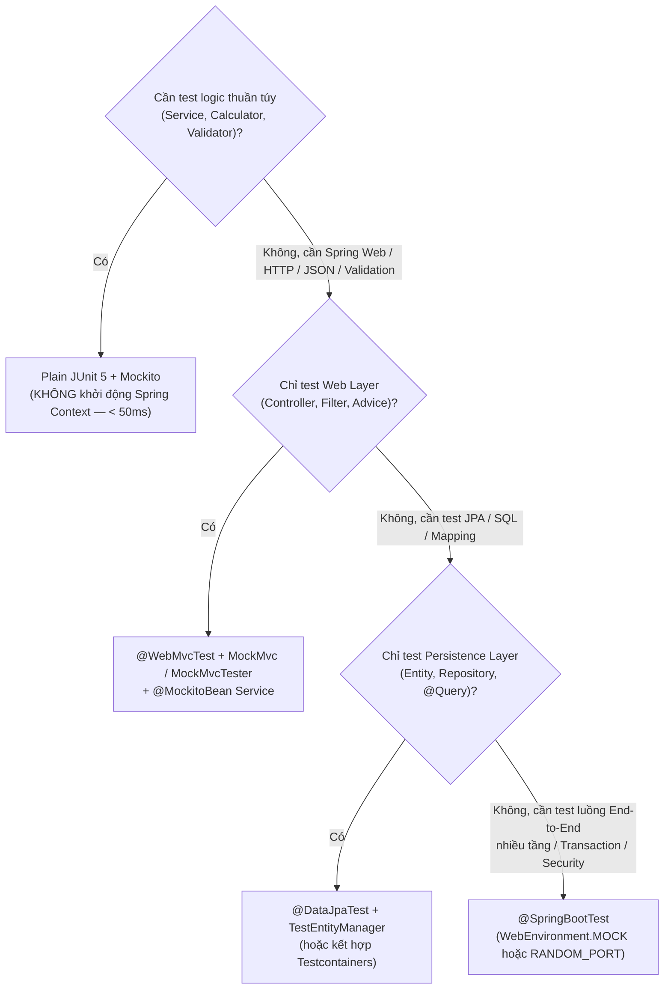

# Spring Boot Test: Test Slices (`@WebMvcTest`, `@DataJpaTest`), `MockMvc`, `MockMvcTester` & `@SpringBootTest`

> **Nguồn tham khảo:** Spring Boot Reference Documentation (Testing — Versions 3.4/3.5 & 4.x), Spring Framework 6.2+/7 TestContext Reference, *Full Stack Testing* (Chương 2 — Integration & Service Tests).

Khi viết test cho ứng dụng **Spring Boot**, sai lầm phổ biến nhất của người mới là gắn `@SpringBootTest` cho **mọi** class test — khiến bộ test phải khởi động toàn bộ Bean, Security, JPA, Kafka, Redis cho từng test nhỏ, kéo thời gian build từ vài giây lên hàng chục phút. Giải pháp chuyên nghiệp là sử dụng **Test Slices** đúng tầng và tận dụng **Spring TestContext Caching**.

---

## 1. Bản đồ lựa chọn Annotation theo từng Tầng (Test Strategy Map)



### Bảng so sánh nhanh 4 công cụ chính

| Annotation / Công cụ | Tầng được nạp vào Spring Context | Tốc độ | Cần DB / Server thật? | Mục đích chính |
| :--- | :--- | :---: | :---: | :--- |
| **Plain Unit Test** (`@ExtendWith(MockitoExtension.class)`) | **Không nạp Spring** (0 bean) | Siêu nhanh (~ms) | Không | Test business logic, EP/BVA, nhánh `if-else`, exception trong Service/Domain. |
| **`@WebMvcTest(OrderController.class)`** | Chỉ Web layer: `@Controller`, `@RestControllerAdvice`, `Filter`, Jackson `ObjectMapper`, Bean Validation (`@Valid`). **Không** nạp `@Service`/`@Repository`. | Nhanh (~1–2s) | Không (`MockMvc` giả lập HTTP) | Test HTTP routing, status code (`200/400/404/409`), JSON serialization, `@Valid`, Spring Security `@PreAuthorize`. |
| **`@DataJpaTest`** | Chỉ JPA layer: `@Entity`, Spring Data `@Repository`, Hibernate, `DataSource`, `TestEntityManager`. **Không** nạp `@Service`/`@Controller`. | Nhanh–TB (~2–4s) | Mặc định thay bằng H2 (hoặc giữ PostgreSQL qua Testcontainers) | Test custom JPQL/Native `@Query`, unique constraint, cascade mapping, pagination, auditing. |
| **`@SpringBootTest`** | **Toàn bộ** ApplicationContext (tất cả Controller, Service, Repository, Config, Security). | Chậm (nhiều giây) | Có thể chạy `MOCK` hoặc `RANDOM_PORT` + DB thật | Test tích hợp đầy đủ Controller → Service → `@Transactional` → DB (kết hợp Testcontainers). |

> **Cập nhật quan trọng cho Spring Boot 3.4+ & 4.x (`@MockitoBean` vs. `@MockBean`):**
> - Từ **Spring Boot 3.4**, `@MockBean` và `@SpyBean` (`org.springframework.boot.test.mock.mockito.*`) đã bị **deprecated**, và bị **xóa bỏ hoàn toàn trong Spring Boot 4.0**.
> - Thay thế chính thức (thuộc Spring Framework core): **`@MockitoBean`** và **`@MockitoSpyBean`** (`org.springframework.test.context.bean.override.mockito.*`), hỗ trợ tốt hơn cho AOT/Native Image và tích hợp sạch với cơ chế Bean Override. *(Nếu dự án bạn làm dùng Spring Boot 3.0–3.3 thì dùng `@MockBean`; từ 3.4+ và 4.x hãy dùng `@MockitoBean`!).*

---

## 2. `@WebMvcTest`: Kiểm thử tầng Web với `MockMvc` & `MockMvcTester`

`@WebMvcTest` kiểm thử hợp đồng HTTP của Controller mà **không cần khởi chạy Tomcat thật** và **không cần kết nối DB**.

### Những thứ `@WebMvcTest` bắt được mà Unit Test thường bỏ sót:
1. Sai URL path, HTTP Method (`POST` vs `PUT`), thiếu `@RequestBody` hoặc `@PathVariable`.
2. Bean Validation (`@NotNull`, `@Min(1)`, `@Email`) không kích hoạt vì quên `@Valid` trên parameter Controller.
3. Jackson serialize/deserialize sai tên trường JSON (`@JsonProperty`), lỗi format `LocalDateTime`, hoặc lộ field nhạy cảm.
4. `@RestControllerAdvice` xử lý sai Exception → trả về `500` thay vì `400` / `409`.
5. Cấu hình Spring Security (401 Unauthorized khi chưa login, 403 Forbidden khi thiếu role `ADMIN`).

### Cách 1: `MockMvc` truyền thống (Phổ biến từ Spring Boot 2.x – 3.x)
```java
@WebMvcTest(CheckoutController.class)
@Import(GlobalExceptionHandler.class) // Nạp thêm advice nếu cần tách riêng
class CheckoutControllerMockMvcTest {

    @Autowired
    private MockMvc mockMvc;

    @Autowired
    private ObjectMapper objectMapper;

    @MockitoBean // (Dùng @MockBean nếu là Spring Boot <= 3.3)
    private CheckoutService checkoutService;

    @Test
    @WithMockUser(username = "buyer@techstore.vn", roles = "CUSTOMER") // Nếu có Spring Security
    void shouldReturn201CreatedWhenCheckoutRequestIsValid() throws Exception {
        CheckoutRequest req = new CheckoutRequest(1L, 2, "SALE20", PaymentMethod.COD);
        OrderResponse resp = new OrderResponse(101L, "PENDING_PAYMENT", 100_000, 400_000);

        given(checkoutService.placeOrder(any(CheckoutRequest.class))).willReturn(resp);

        mockMvc.perform(post("/api/v1/orders/checkout")
                .with(csrf()) // Bắt buộc nếu CSRF protection bật cho session auth
                .contentType(MediaType.APPLICATION_JSON)
                .content(objectMapper.writeValueAsString(req)))
            .andExpect(status().isCreated())
            .andExpect(jsonPath("$.orderId").value(101))
            .andExpect(jsonPath("$.status").value("PENDING_PAYMENT"))
            .andExpect(jsonPath("$.finalTotal").value(400_000));
    }

    @Test
    void shouldReturn400BadRequestWhenQuantityIsZero() throws Exception {
        // Kiểm tra @Valid @Min(1) hoạt động ở tầng Controller
        String invalidJson = """
            {"productId": 1, "quantity": 0, "voucherCode": "SALE20", "paymentMethod": "COD"}
            """;

        mockMvc.perform(post("/api/v1/orders/checkout")
                .contentType(MediaType.APPLICATION_JSON)
                .content(invalidJson))
            .andExpect(status().isBadRequest())
            .andExpect(jsonPath("$.errors.quantity").exists());

        // Đảm bảo request sai định dạng KHÔNG đi xuống Service!
        verifyNoInteractions(checkoutService);
    }
}
```

### Cách 2: `MockMvcTester` (Hiện đại — Spring Framework 6.2+ / Spring Boot 3.4+ & 4.x)
`MockMvcTester` kết hợp trực tiếp `MockMvc` với **AssertJ** — không phải `throws Exception`, không phải nhớ static import `MockMvcResultMatchers`, và thông báo lỗi cực kỳ rõ nét:

```java
@WebMvcTest(CheckoutController.class)
class CheckoutControllerModernTest {

    @Autowired
    private MockMvcTester mvc; // Auto-configured từ Spring Boot 3.4+

    @MockitoBean
    private CheckoutService checkoutService;

    @Test
    void shouldReturn409ConflictWhenStockIsInsufficient() {
        given(checkoutService.placeOrder(any()))
                .willThrow(new InsufficientStockException("Sản phẩm A không đủ tồn kho"));

        assertThat(mvc.post().uri("/api/v1/orders/checkout")
                .contentType(MediaType.APPLICATION_JSON)
                .content("""
                    {"productId": 1, "quantity": 6, "paymentMethod": "COD"}
                    """))
            .hasStatus(HttpStatus.CONFLICT)
            .bodyJson()
            .extractingPath("$.message")
            .asString()
            .contains("không đủ tồn kho");
    }
}
```

---

## 3. `@DataJpaTest`: Kiểm thử tầng Persistence & Bẫy `@Transactional`

`@DataJpaTest` chỉ quét các `@Entity` và Spring Data `@Repository`. Mặc định nó thay thế `DataSource` thật bằng database nhúng (H2) và bọc mỗi `@Test` trong một `@Transactional` tự động rollback sau khi kết thúc.

### Ba cạm bẫy kinh điển khi dùng `@DataJpaTest`
1. **Bẫy `Persistence Context Cache` (First-level Cache):**
   - Nếu bạn gọi `orderRepository.save(order)` rồi gọi ngay `orderRepository.findById(order.getId())` trong cùng 1 transaction test, Hibernate **lấy object từ RAM cache chứ chưa hề chạy câu `INSERT`/`SELECT` xuống DB**!
   - **Cách đúng:** Dùng **`TestEntityManager`** (`entityManager.persistAndFlush(...)` rồi `entityManager.clear()`) để ép Hibernate xả SQL thật xuống DB và xóa bộ nhớ đệm trước khi truy vấn lại!
2. **Bẫy H2 giả lập sai cú pháp DB thật:**
   - H2 có thể bỏ qua lỗi kiểu `JSONB`, khóa dòng (`SELECT ... FOR UPDATE`), hoặc phân biệt hoa/thường tên cột khác với PostgreSQL/MySQL.
   - **Cách đúng:** Thêm `@AutoConfigureTestDatabase(replace = AutoConfigureTestDatabase.Replace.NONE)` và nối với **Testcontainers PostgreSQL** (xem bài `04-testcontainers.md`).
3. **Bẫy `@Sql` seed data:** Dùng `@Sql("/testdata/seed-vouchers.sql")` để nạp dữ liệu chuẩn trước test và kiểm tra các query phức tạp như `findActiveVouchersAt(Instant now)`.

```java
@DataJpaTest
@AutoConfigureTestDatabase(replace = AutoConfigureTestDatabase.Replace.NONE) // Dùng DB thật / Testcontainers
class VoucherRepositoryTest extends AbstractPostgresContainerTest {

    @Autowired
    private TestEntityManager entityManager;

    @Autowired
    private VoucherRepository voucherRepository;

    @Test
    void shouldAtomicallyDecrementUsageLimitOnlyWhenRemainingGreaterThanZero() {
        // Arrange: Lưu qua TestEntityManager và flush + clear để ép ghi thật xuống DB
        Voucher sale20 = new Voucher("SALE20", VoucherType.PERCENT, 20, 150_000, 500_000, 1);
        entityManager.persistAndFlush(sale20);
        entityManager.clear();

        // Act: Giả lập atomic UPDATE ... WHERE usage_limit > 0 (trị bug concurrency GĐ 1!)
        int updatedFirst = voucherRepository.decrementUsageIfAvailable("SALE20");
        int updatedSecond = voucherRepository.decrementUsageIfAvailable("SALE20");
        entityManager.clear();

        // Assert
        assertThat(updatedFirst).isEqualTo(1);
        assertThat(updatedSecond).isZero(); // Lần 2 không được phép trừ xuống -1!

        Voucher reloaded = voucherRepository.findByCode("SALE20").orElseThrow();
        assertThat(reloaded.getUsageLimit()).isZero();
    }
}
```

### Các Slice Test chuyên biệt hữu ích khác
- **`@JsonTest`:** Chỉ nạp Jackson `ObjectMapper` / `Gson` + `JacksonTester<T>` để kiểm tra format ngày giờ, `@JsonIgnore`, polymorphism JSON mà không cần cả Web layer.
- **`@RestClientTest(PaymentGatewayClient.class)`:** Chỉ nạp `RestClient` / `RestTemplate` + `MockRestServiceServer` để test client gọi API đối tác (VNPay/MoMo) với HTTP response giả lập (`429`, `504`, timeout, malformed JSON).

---

## 4. `@SpringBootTest`: Full Integration Test & Các chế độ `WebEnvironment`

Khi cần kiểm tra **tính toàn vẹn liên tầng** (ví dụ: `@Transactional` rollback khi trừ kho sản phẩm 1 xong nhưng sản phẩm 2 hết hàng, Filter → Controller → Service → JPA → PostgreSQL):

| `WebEnvironment` Mode | Hành vi Server | Công cụ gọi HTTP | Lưu ý Transaction |
| :--- | :--- | :--- | :--- |
| **`MOCK`** *(Mặc định)* | Không mở port TCP; giả lập Servlet container. | `MockMvc` / `MockMvcTester` | `@Transactional` trên test method **chạy cùng thread** → tự rollback được. |
| **`RANDOM_PORT`** *(Khuyên dùng cho E2E/API)* | Mở Tomcat thật trên port ngẫu nhiên (tránh đụng port CI). | `TestRestTemplate` / `WebTestClient` / REST Assured *(hoặc `RestTestClient` ở Boot 4)* | Server xử lý HTTP ở **thread riêng** → `@Transactional` trên test method **KHÔNG rollback** dữ liệu do HTTP request ghi vào DB! Phải dọn DB thủ công/SQL! |
| **`NONE`** | Không nạp web server (dùng test Service + DB, batch job, listener). | Gọi thẳng bean `@Autowired` | Hỗ trợ rollback nếu test không mở transaction `REQUIRES_NEW`. |

---

## 5. Spring TestContext Caching & "Sát thủ Hiệu năng" `@DirtiesContext`

### A. Cơ chế Context Caching hoạt động thế nào?
Khởi động Spring `ApplicationContext` rất tốn thời gian (1–10 giây). Vì thế Spring TestContext Framework lưu các Context đã khởi tạo vào một **Cache (mặc định tối đa 32 Context, LRU)**.
Spring tạo **Cache Key** dựa trên toàn bộ cấu hình hợp nhất của test class:
1. Danh sách `@ContextConfiguration` / `@SpringBootTest(classes = ...)`
2. `@ActiveProfiles`
3. `@TestPropertySource` & `@DynamicPropertySource`
4. `WebEnvironment`
5. Danh sách **`@MockitoBean` / `@MockBean`** *(rất hay bị quên! Mỗi tổ hợp `@MockitoBean` khác nhau sẽ tạo một Context Key MỚI tinh và khởi động lại Spring!)*.

### B. Quy tắc vàng để bộ Integration Test chạy nhanh gấp 3–5 lần
1. **Chuẩn hóa 1 abstract base class / 1 cấu hình profile chung** (`@ActiveProfiles("test")`) thay vì mỗi file gắn một `@TestPropertySource` khác nhau.
2. **Hạn chế rải `@MockitoBean` khác nhau trên nhiều class `@SpringBootTest`:** Hãy gom `@MockitoBean` (ví dụ `PaymentGatewayClient`) vào lớp cha chung hoặc dùng `@WebMvcTest` cho phần controller.
3. **TUYỆT ĐỐI KHÔNG lạm dụng `@DirtiesContext`!**
   - `@DirtiesContext` ra lệnh cho Spring **hủy hoàn toàn Context và xóa khỏi cache** sau khi test xong. Nếu bạn gắn `@DirtiesContext(classMode = AFTER_EACH_TEST_METHOD)`, mỗi `@Test` sẽ khởi động lại Spring + Hibernate từ con số 0!
   - **Thay thế:** Để làm sạch dữ liệu giữa các test, hãy dùng `@Transactional` (nếu test chạy cùng thread), `@Sql(scripts = "/cleanup.sql", executionPhase = AFTER_TEST_METHOD)`, hoặc gọi `repository.deleteAllInBatch()` trong `@AfterEach`. Chỉ dùng `@DirtiesContext` trong trường hợp bất khả kháng (ví dụ test thực sự sửa đổi cấu hình tĩnh toàn cục của Spring bean hoặc đóng Kafka listener).
