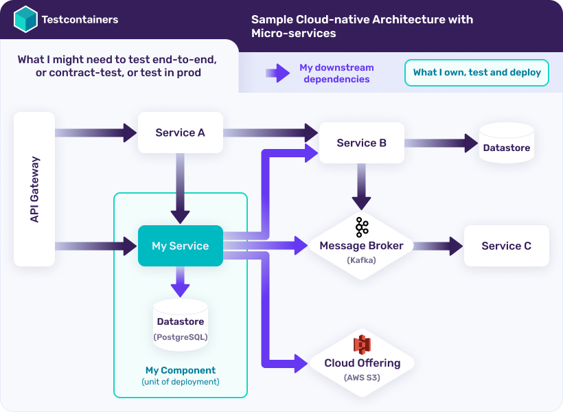
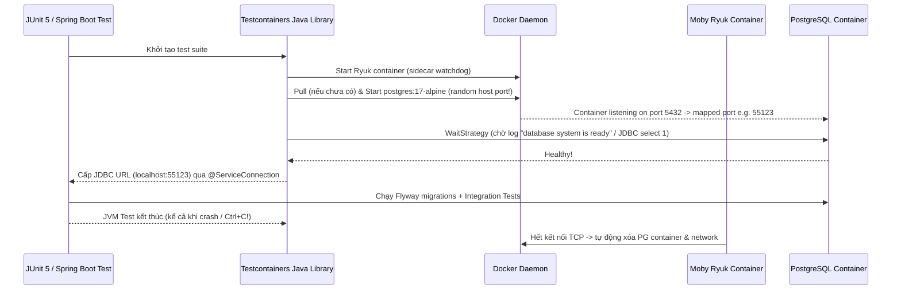

# Testcontainers: Integration Test với Database & Dịch vụ Thật trong Docker

> **Nguồn tham khảo:** Testcontainers Java Official Documentation (1.21.x / 2.x), Spring Boot Reference Documentation (`@ServiceConnection`), AtomicJar / Docker Best Practices.

Một câu hỏi phỏng vấn Java Backend / SDET kinh điển: *"Tại sao không dùng H2 In-Memory Database để chạy Integration Test cho nhanh mà phải dùng Testcontainers?"*. Câu trả lời nằm ở **độ trung thực của kiểm thử (Test Fidelity)**: H2 **không phải** là PostgreSQL hay MySQL! Rất nhiều bug nghiêm trọng chỉ bùng phát khi chạy trên Database thật của production.

---

## 1. Tại sao H2 In-Memory không thể thay thế Testcontainers?

| Khía cạnh | H2 In-Memory Database | Testcontainers (PostgreSQL / MySQL thật trong Docker) |
| :--- | :--- | :--- |
| **Ngôn ngữ SQL & Kiểu dữ liệu** | Không hiểu `JSONB`, `ARRAY`, `ILIKE`, `ON CONFLICT DO UPDATE`, `RETURNING *`, hàm window riêng của Postgres/MySQL. | Chạy **100% engine thật** cùng phiên bản với Production (`postgres:17-alpine`). |
| **Migration (Flyway / Liquibase)** | Phải viết script riêng cho H2 hoặc dùng `MODE=PostgreSQL` nhưng vẫn hay lỗi cú pháp DDL. | Chạy chính xác **100% file migration production** → phát hiện lỗi script migration ngay trong CI! |
| **Locking, Concurrency & Isolation** | Cơ chế khóa bảng/dòng khác hẳn Postgres/InnoDB → không test được race condition (`SELECT FOR UPDATE`). | Test thật `PESSIMISTIC_WRITE`, deadlock, `READ_COMMITTED` vs `SERIALIZABLE`. |
| **Constraint & Case-sensitivity** | So sánh chuỗi hoặc xử lý `NULL` trong `UNIQUE` constraint có thể khác Postgres/MySQL. | Bắt chính xác lỗi `DataIntegrityViolationException`, `PSQLException`. |

> **Châm ngôn Testcontainers:** *"Test against the same database you run in production, without maintaining a shared flaky QA database."*

---

## 2. Kiến trúc Testcontainers & Cơ chế dọn dẹp (`Ryuk`)



*Hình: Testcontainers khởi tạo các dependency thật (PostgreSQL, Kafka, Cloud/S3 mock, microservices) ngay trong container Docker cô lập thay vì dùng DB giả lập (Nguồn ảnh: Testcontainers Official).*



- **Random Host Port:** Testcontainers **không bao giờ** bind cố định cổng `5432` trên máy host (vì dễ đụng với Postgres đang chạy local hoặc chạy song song nhiều job CI). Nó map cổng `5432` trong container ra một **ephemeral port** ngẫu nhiên trên host (VD: `55123`).
- **WaitStrategy:** Container "running" chưa chắc Database bên trong đã sẵn sàng nhận kết nối! `PostgreSQLContainer` tự cấu hình WaitStrategy chờ đến khi Postgres khởi động xong hoàn toàn (không bao giờ cần `Thread.sleep`!). Với custom container (`GenericContainer`), bạn dùng `Wait.forHttp("/health").forStatusCode(200)` hoặc `Wait.forLogMessage(".*Ready to accept connections.*\\n", 1)`.
- **Ryuk (Resource Reaper):** Một container nhỏ chạy kèm giữ socket với tiến trình JVM; ngay khi JVM thoát (dù pass, fail hay bị kill đột ngột), Ryuk chờ vài giây rồi tự động `rm -f` toàn bộ container/volume/network rác.

---

## 3. Cài đặt Dependencies (Maven `pom.xml`)

```xml
<dependencies>
    <!-- BOM quản lý phiên bản đồng bộ Testcontainers (1.21.x hoặc 2.x) -->
    <dependency>
        <groupId>org.springframework.boot</groupId>
        <artifactId>spring-boot-testcontainers</artifactId>
        <scope>test</scope>
    </dependency>
    <dependency>
        <groupId>org.testcontainers</groupId>
        <artifactId>junit-jupiter</artifactId>
        <scope>test</scope>
    </dependency>
    <dependency>
        <groupId>org.testcontainers</groupId>
        <artifactId>postgresql</artifactId>
        <scope>test</scope>
    </dependency>
</dependencies>
```

---

## 4. Ba cách tích hợp Testcontainers trong Spring Boot (Từ cũ tới hiện đại)

### Cách 1: `@Testcontainers` + `@Container` + `@DynamicPropertySource` *(Spring Boot 2.2.6 – 3.0)*
- Dùng `@DynamicPropertySource` để đọc `postgres.getJdbcUrl()` sau khi container lên và nạp vào `spring.datasource.*`.
- **Nhược điểm:** Nhiều boilerplate lặp đi lặp lại nếu dùng nhiều container (Postgres + Redis + Kafka).

### Cách 2: `@ServiceConnection` *(Spring Boot 3.1+ → 4.x — Khuyên dùng)*
Spring Boot tự nhận diện kiểu container (`PostgreSQLContainer`, `MySQLContainer`, `GenericContainer("redis:...")` với `@ServiceConnection(name = "redis")`, `KafkaContainer`...) và **tự động inject toàn bộ connection properties** (`url`, `username`, `password`) vào `Environment` mà **không cần viết một dòng `@DynamicPropertySource` nào**!

```java
@SpringBootTest(webEnvironment = SpringBootTest.WebEnvironment.RANDOM_PORT)
@Testcontainers
class OrderIntegrationTest {

    @Container
    @ServiceConnection // Tự cấu hình spring.datasource.url/username/password!
    static PostgreSQLContainer<?> postgres = new PostgreSQLContainer<>("postgres:17-alpine");

    @Autowired
    private OrderRepository orderRepository;

    @Test
    void shouldPersistOrderToRealPostgres() {
        assertThat(postgres.isRunning()).isTrue();
        // ... test logic ...
    }
}
```
> **Chú ý từ khóa `static` trên `@Container`:**
> - Nếu khai báo **`static`** (`static PostgreSQLContainer<?> postgres`): Container chạy **1 lần cho cả class** (chia sẻ giữa mọi `@Test` trong class).
> - Nếu **KHÔNG có `static`**: Testcontainers tạo lại và xóa container mới cho **MỖI `@Test` method** → cực kỳ chậm!

### Cách 3: Singleton Container Pattern *(Best Practice cho dự án thực tế!)*
Khi dự án có **20 file Integration Test** (`OrderIT`, `VoucherIT`, `ProductIT`...), nếu mỗi file tự khai báo `@Container static`, JVM sẽ khởi động và tắt container **20 lần** (và phá vỡ Spring TestContext Cache nếu mỗi container nhận một port ngẫu nhiên khác nhau!).

**Giải pháp chuẩn công nghiệp — Singleton Container kết hợp `@ServiceConnection` trong `@TestConfiguration`:**

```java
// Đặt tại src/test/java/com/techstore/config/TestcontainersConfig.java
@TestConfiguration(proxyBeanMethods = false)
public class TestcontainersConfig {

    // Khởi tạo duy nhất 1 lần cho toàn bộ JVM; KHÔNG gắn @Container vì tự quản lý lifecycle
    static final PostgreSQLContainer<?> POSTGRES = new PostgreSQLContainer<>("postgres:17-alpine")
            .withDatabaseName("techstore_test")
            .withUsername("test")
            .withPassword("test");

    static {
        POSTGRES.start(); // Start 1 lần duy nhất! Ryuk sẽ tự dọn khi JVM kết thúc
    }

    @Bean
    @ServiceConnection
    PostgreSQLContainer<?> postgresContainer() {
        return POSTGRES;
    }
}
```
Sau đó các class Integration Test kế thừa hoặc `@Import(TestcontainersConfig.class)`:
```java
@SpringBootTest(webEnvironment = SpringBootTest.WebEnvironment.RANDOM_PORT)
@Import(TestcontainersConfig.class)
@ActiveProfiles("test")
public abstract class AbstractIntegrationTest {
    // Mọi subclass dùng CHUNG 1 PostgreSQL container VÀ CHUNG 1 Spring ApplicationContext Cache!
}
```
> **Kết quả:** 20 class Integration Test chỉ tốn **1 lần start Postgres (~2s)** và **1 lần start Spring Context**, tốc độ nhanh hơn 5–10 lần so với tạo container theo từng class!

---

## 5. Tính năng Reusable Containers (`.withReuse(true)`) — Cẩn thận khi dùng trên CI!

Khi lập trình local, chạy lại test liên tục mất 2–3 giây chờ Docker khởi động lại Postgres có thể gây khó chịu. Testcontainers cho phép giữ container **sống xuyên qua các lần chạy JVM**:
1. Trong code: `.withReuse(true)` (lưu ý: **không** dùng chung với `@Container` của JUnit extension vì `@Container` luôn gọi `stop()` khi xong!).
2. Trên máy dev, thêm vào file `~/.testcontainers.properties`: `testcontainers.reuse.enable=true`.

**Quy tắc an toàn:**
- **Chỉ bật ở máy Local** để tăng tốc TDD/debug.
- **Tắt trên CI/CD** (GitHub Actions / Jenkins): Trên CI cần môi trường sạch 100% (*ephemeral & reproducible*); tái sử dụng container cũ dễ để lại dữ liệu rác hoặc schema lệch từ build trước.

---

## 6. Kiểm soát Dữ liệu Giữa các Test (Database State Pollution)

Vì Singleton Container giữ nguyên dữ liệu giữa Test A và Test B, bạn **bắt buộc phải dọn sạch dữ liệu** để không vi phạm nguyên lý **Independent (F.I.R.S.T.)**:

| Chiến lược | Khi nào hoạt động tốt? | Lưu ý / Cạm bẫy |
| :--- | :--- | :--- |
| **`@Transactional` trên `@Test`** | `@DataJpaTest` hoặc `@SpringBootTest(webEnvironment = MOCK / NONE)` | **CẠM BẪY LỚN:** Với `@SpringBootTest(RANDOM_PORT)` khi gọi HTTP qua `TestRestTemplate`/`WebTestClient`/REST Assured, HTTP request chạy trên **thread khác** nên **KHÔNG nằm trong transaction của test method** → không rollback được! Đồng thời trong test `@Transactional`, Hibernate đôi khi trì hoãn `flush()` nên không test được hành vi commit thật (ví dụ constraint `DEFERRED` hoặc transaction boundary `REQUIRES_NEW`). |
| **`@Sql` cleanup / `deleteAllInBatch()`** | Mọi loại Integration Test, đặc biệt `RANDOM_PORT`. | Chạy `TRUNCATE TABLE order_items, orders, vouchers, products RESTART IDENTITY CASCADE;` hoặc `repository.deleteAllInBatch()` trong `@BeforeEach`/`@AfterEach` để mỗi test bắt đầu trên bảng trống tinh tươm (chú ý thứ tự khóa ngoại hoặc dùng `CASCADE`). |
| **Flyway / Liquibase** | Tự động chạy khi Spring Context khởi động lần đầu vào Singleton Postgres. | Đảm bảo test chạy trên **cùng schema y hệt Production**; không dùng `spring.jpa.hibernate.ddl-auto=create-drop` nếu dự án thật dùng Flyway! |

---

## 7. Mở rộng: Tích hợp Dịch vụ Ngoài & Hệ sinh thái

- **Redis / Kafka / RabbitMQ:** Dùng `GenericContainer<>("redis:7-alpine").withExposedPorts(6379)` kèm `@ServiceConnection(name = "redis")`, hoặc `KafkaContainer`.
- **External REST API (VNPay, MoMo, GHN):** Kết hợp Testcontainers với **WireMock** (`WireMockContainer` hoặc `wiremock-standalone`) để giả lập HTTP timeout, lỗi `500`, chữ ký webhook giả lập mà không bao giờ gọi vào sandbox thật ngoài Internet.

---

## 8. Câu hỏi Phỏng vấn Java / SDET hay gặp về Testcontainers

1. *"Testcontainers chạy chậm không? Làm sao tối ưu tốc độ?"*
   → Trả lời: Dùng **Singleton Container Pattern** (start 1 lần mỗi JVM) + **Spring `@ServiceConnection`** + giữ **Spring Context Cache** đồng nhất, chỉ dùng Testcontainers cho Integration/Repository Test (tầng giữa Pyramid), còn logic nghiệp vụ chạy bằng Unit Test thuần (`mvn test` không đụng Docker). Local dev có thể bật `.withReuse(true)`.
2. *"Tại sao dùng `@SpringBootTest(RANDOM_PORT)` + `@Transactional` thì DB vẫn bị bẩn sau khi test xong?"*
   → Trả lời: Vì request HTTP tới embedded Tomcat chạy ở **worker thread khác**, tách biệt với transaction của JUnit test thread, nên server commit trực tiếp vào Postgres và rollback của JUnit không tác động tới nó. Phải clean up bằng `@BeforeEach`/`@AfterEach` (`TRUNCATE`/`deleteAllInBatch`) hoặc `@Sql`.
3. *"Làm sao chạy Testcontainers trên GitHub Actions CI?"*
   → Trả lời: Runner Linux của GitHub Actions (`ubuntu-latest`) có cài sẵn Docker Daemon nên Testcontainers chạy out-of-the-box không cần cấu hình thêm; nếu dùng Jenkins bên trong Docker cần mount Docker socket (`/var/run/docker.sock`) hoặc Docker-in-Docker (DinD).
