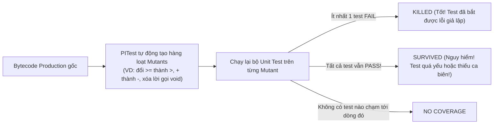

# JaCoCo & Mutation Testing (PITest): Đo Coverage Đúng Cách & Tránh "Test Lấy Số"

> **Nguồn tham khảo:** JaCoCo Official Documentation, PITest (`pitest.org`), *Full Stack Testing* (Chương 2 — *Code Coverage and Mutation Testing*, trang 82), `01-test-design/07-white-box-coverage.md`.

**JaCoCo (Java Code Coverage)** là công cụ chuẩn công nghiệp trong hệ sinh thái Java để đo lường xem bộ test đã thực thi bao nhiêu phần trăm mã nguồn. Tuy nhiên, một hiểu lầm chết người trong nhiều dự án là biến `80% coverage` thành con số KPI mù quáng: **Coverage cao chỉ chứng minh code ĐÃ ĐƯỢC CHẠY QUA, chứ KHÔNG chứng minh code ĐÃ ĐƯỢC KIỂM CHỨNG ĐÚNG!**

---

## 1. Cơ chế Bytecode Instrumentation & 6 Bộ đếm của JaCoCo

Khác với các công cụ phân tích tĩnh, JaCoCo hoạt động lúc chạy (*on-the-fly instrumentation* qua Java Agent) bằng cách chèn các điểm dò (*probes*) trực tiếp vào **Java Bytecode (`.class`)** khi chạy `mvn test`.

Trong báo cáo HTML (`target/site/jacoco/index.html`), JaCoCo tính toán **6 loại chỉ số (Counters)**:

| Bộ đếm JaCoCo | Ý nghĩa kỹ thuật | Mức độ tin cậy |
| :--- | :--- | :---: |
| **1. `INSTRUCTION` (`C0`)** | Số chỉ thị bytecode JVM nhỏ nhất đã chạy. | Thấp–TB |
| **2. `BRANCH` (`C1`)** | Tổng số nhánh rẽ của mọi câu lệnh điều kiện (`if`, `switch`, `?:`, vòng lặp `for/while`, và **từng toán tử short-circuit `&&` / `||` ở mức bytecode!**). | **Cao — Tiêu chuẩn Quality Gate GĐ 2!** |
| **3. `LINE`** | Một dòng code được tính là phủ nếu ít nhất 1 bytecode instruction của dòng đó đã chạy. | Thấp *(1 dòng `a && b` dài có thể xanh một nửa)* |
| **4. `CXTY`** | **Cyclomatic Complexity ($V(G)$)** — số đường đi tuyến tính độc lập tối thiểu cần thiết để phủ hết nhánh. *(Liên hệ GĐ 1: `08-cyclomatic-complexity.md`!)* | Chỉ số định hướng số lượng test |
| **5. `METHOD`** | Phương thức được tính là phủ nếu có ít nhất 1 instruction bên trong được thực thi. | Cơ bản |
| **6. `CLASS`** | Class được tính là phủ nếu có ít nhất 1 method trong class được chạy. | Cơ bản |

### Cách đọc màu sắc trong JaCoCo HTML Report
- **Xanh lá (Green):** Mọi nhánh/chỉ thị trên dòng đó đã được phủ 100%.
- **Vàng (Yellow):** Phủ một phần (*Partially covered*) — ví dụ dòng `if (a > 0 && b > 0)` mới chạy nhánh `True` của `a > 0` nhưng chưa từng test `a <= 0`, hoặc nhánh `False` của `b > 0` chưa chạy!
- **Đỏ (Red):** Chưa từng được thực thi lần nào (`Missed`).

> **Điểm cực hay của JaCoCo `BRANCH`:** Với câu lệnh `if (v == null || !v.isActive() || now.isAfter(v.getEndDate()))`, dù chỉ viết trên 1 dòng (`1 LINE`), trình biên dịch Java sinh ra **6 nhánh rẽ bytecode** (`3` điều kiện × `2` chiều T/F). JaCoCo bắt bạn phải kiểm tra đủ cả các nhánh short-circuit đó để đạt `100% BRANCH` trên dòng này!

---

## 2. Cấu hình Maven chuẩn cho JaCoCo (Report + Quality Gate + Exclusions)

### A. Cấu hình `pom.xml` (Maven Plugin)
```xml
<properties>
    <jacoco.version>0.8.12</jacoco.version>
</properties>

<build>
    <plugins>
        <plugin>
            <groupId>org.jacoco</groupId>
            <artifactId>jacoco-maven-plugin</artifactId>
            <version>${jacoco.version}</version>
            <executions>
                <!-- 1. Gắn Java Agent trước pha test để thu thập file target/jacoco.exec -->
                <execution>
                    <id>prepare-agent</id>
                    <goals>
                        <goal>prepare-agent</goal>
                    </goals>
                </execution>

                <!-- 2. Sinh báo cáo HTML / XML / CSV sau khi test chạy xong -->
                <execution>
                    <id>report</id>
                    <phase>verify</phase>
                    <goals>
                        <goal>report</goal>
                    </goals>
                </execution>

                <!-- 3. Quality Gate: Tự động FAIL build nếu Branch Coverage < 80% -->
                <execution>
                    <id>jacoco-check</id>
                    <phase>verify</phase>
                    <goals>
                        <goal>check</goal>
                    </goals>
                    <configuration>
                        <rules>
                            <rule>
                                <element>BUNDLE</element>
                                <limits>
                                    <limit>
                                        <counter>BRANCH</counter>
                                        <value>COVEREDRATIO</value>
                                        <minimum>0.80</minimum>
                                    </limit>
                                    <limit>
                                        <counter>LINE</counter>
                                        <value>COVEREDRATIO</value>
                                        <minimum>0.80</minimum>
                                    </limit>
                                </limits>
                            </rule>
                        </rules>
                        <excludes>
                            <!-- Loại trừ class không chứa business logic để không bóp méo chỉ số -->
                            <exclude>**/TechStoreApplication.class</exclude>
                            <exclude>**/config/**</exclude>
                            <exclude>**/dto/**</exclude>
                            <exclude>**/entity/**</exclude>
                        </excludes>
                    </configuration>
                </execution>
            </executions>
        </plugin>
    </plugins>
</build>
```

> **Mẹo thực chiến với Lombok:** Code sinh tự động từ Lombok (`@Data`, `@Builder`, `@EqualsAndHashCode`) tạo ra hàng chục nhánh `if` so sánh `null` làm tụt Branch Coverage thê thảm. Hãy tạo file `lombok.config` ở thư mục gốc dự án chứa dòng:
> ```properties
> lombok.addLombokGeneratedAnnotation = true
> ```
> Từ JaCoCo 0.8.0+, mọi phương thức/class mang `@lombok.Generated` (hay bất kỳ annotation tên chứa `Generated` có retention `CLASS`/`RUNTIME`) sẽ **tự động được JaCoCo bỏ qua** hoàn toàn hợp lệ!

### B. Chạy JaCoCo cho cả Unit Test & Integration Test (Surefire + Failsafe)
Mặc định `mvn test` (Maven Surefire) chạy Unit Test (`*Test.java`), còn `mvn verify` (Maven Failsafe) chạy Integration Test (`*IT.java` — dùng Testcontainers). Để gom coverage của **cả 2 pha**:
- Dùng `prepare-agent` (cho Surefire) và `prepare-agent-integration` (cho Failsafe) rồi `merge` hoặc trỏ chung `destFile` + `report-integration`, chạy `mvn clean verify`.

---

## 3. Vì sao Coverage 100% vẫn có thể là "Bộ Test Vô Dụng"? (*Goodhart's Law*)

> **Định luật Goodhart:** *"Khi một thước đo trở thành mục tiêu bị ép buộc (KPI), nó không còn là thước đo tốt nữa."*

Hãy xem phản ví dụ kinh điển trên module giảm giá của **TechStore**:

```java
// Production code — CỐ TÌNH CÓ 2 BUG NGHIỆP VỤ:
// Bug 1: Dùng > 500_000 thay vì >= 500_000 (sai biên!)
// Bug 2: Quên giới hạn maxDiscount 150_000đ!
public int calculateSale20Discount(int subtotal) {
    if (subtotal > 500_000) { // BUG 1: Đáng lẽ >= 500_000
        return (int) (subtotal * 0.20); // BUG 2: Quên Math.min(..., 150_000)
    }
    return 0;
}
```

Bây giờ xem một developer viết test "chống chế" để đạt **100% Line & Branch Coverage**:
```java
@Test
void fakeCoverageTest() {
    // Chạy qua nhánh True và False nhưng KHÔNG assert kết quả đúng, chỉ assertNotNull / >= 0!
    int d1 = calculator.calculateSale20Discount(1_000_000);
    int d2 = calculator.calculateSale20Discount(100_000);

    assertTrue(d1 >= 0); // Trả về 200.000đ (SAI cap 150k!) vẫn PASS!
    assertTrue(d2 >= 0); // Không kiểm tra mốc 500.000đ!
}
```
- **JaCoCo báo:** `100% Instruction`, `100% Line`, `100% Branch Coverage` — Xanh mướt toàn tập!
- **Giá trị thực tế:** **BẰNG 0!** Ngay cả khi bạn đổi công thức thành `return 1;` hay xóa sạch phép nhân `0.20`, bộ test này vẫn xanh!

### 4 nguyên nhân khiến Coverage cao nhưng Test vẫn dở
1. **Assertion-free / Weak Assertions:** Test chỉ gọi hàm để không ném Exception hoặc chỉ `assertNotNull(res)` mà không kiểm tra giá trị tính toán, trạng thái DB, hay side-effect.
2. **Thiếu Boundary Values (BVA):** Chỉ test `100_000` và `1_000_000` cũng phủ 100% nhánh của `subtotal >= 500_000`, nhưng không test `499_999` và `500_000` nên không bao giờ phát hiện lỗi `>` vs `>=`.
3. **Thiếu Requirements (Missing Logic):** Code **quên viết** câu lệnh `if (now.isBefore(startDate))` (như bài toán Voucher GĐ 1). Vì dòng code đó *không tồn tại*, JaCoCo vẫn chấm **100% coverage**!
4. **Test những thứ không cần test:** Viết test cho getter/setter, constructor đơn giản để kéo tổng phần trăm dự án lên thay vì tập trung vào luồng nghiệp vụ rủi ro cao.

---

## 4. Mutation Testing với PITest (`pitest.org`) — "Kẻ gác đền" của Chất lượng Test

Như giáo trình *Full Stack Testing* (Chương 2, trang 82) đã nhấn mạnh: để biết bộ Unit Test có thực sự "biết cắn" khi code bị lỗi hay không, ta dùng **Mutation Testing** (kiểm thử đột biến) với công cụ **PITest (PIT)**.

### Cơ chế hoạt động của PITest ("Who tests the tests?")


$$\text{Mutation Score} = \left( \frac{\text{Số Mutant bị Killed}}{\text{Tổng số Mutant (trừ Equivalent)}} \right) \times 100\%$$

### Các Mutator phổ biến của PITest (nhóm `DEFAULTS` & `STRONGER`)
- **Conditionals Boundary Mutator:** Đổi `<` thành `<=`, `>=` thành `>` *(trị trực tiếp lỗi thiếu BVA!)*.
- **Negate Conditionals:** Đổi `==` thành `!=`, `>` thành `<=`.
- **Math Mutator:** Đổi `+` thành `-`, `*` thành `/`.
- **Void Method Calls:** Xóa bỏ luôn một lệnh gọi hàm `void` (VD: xóa `emailService.send(...)` hoặc `product.decreaseStock(...)` — nếu test quên `verify(...)` thì mutant này **SURVIVED**!).
- **Return Values Mutator:** Đổi `return true` thành `return false`, đổi `return obj` thành `return null` hoặc `0`.

### Cấu hình PITest trong Maven (`pom.xml`)
```xml
<plugin>
    <groupId>org.pitest</groupId>
    <artifactId>pitest-maven</artifactId>
    <version>1.17.1</version>
    <dependencies>
        <dependency>
            <groupId>org.pitest</groupId>
            <artifactId>pitest-junit5-plugin</artifactId>
            <version>1.2.1</version>
        </dependency>
    </dependencies>
    <configuration>
        <targetClasses>
            <param>com.techstore.checkout.service.*</param>
            <param>com.techstore.checkout.domain.*</param>
        </targetClasses>
        <targetTests>
            <param>com.techstore.checkout.*Test</param>
        </targetTests>
        <mutators>
            <mutator>STRONGER</mutator>
        </mutators>
        <mutationThreshold>80</mutationThreshold>
        <withHistory>true</withHistory> <!-- Cache kết quả để chạy lại cực nhanh -->
    </configuration>
</plugin>
```
Chạy lệnh: `mvn test-compile pitest:mutationCoverage` → mở `target/pit-reports/index.html`.

### Chiến lược kết hợp JaCoCo + PITest thực tế
1. **JaCoCo chạy nhanh** (vài giây): Dùng làm **Quality Gate trên mỗi PR** (`BRANCH >= 80%`) để phát hiện nhanh các nhánh code chưa được test chạm tới.
2. **PITest chạy sâu** (tốn CPU hơn vì chạy lại test nhiều lần): Tập trung nhắm vào các **package chứa logic nghiệp vụ lõi** (`service`, `domain`, `pricing`, `voucher`) chạy định kỳ hoặc trước khi chốt release để đảm bảo **không chỉ đủ coverage mà assertions cũng sắc bén**.
3. **Mục tiêu lành mạnh:** Khoảng **80%–85% Branch Coverage có ý nghĩa** trên nghiệp vụ lõi luôn giá trị hơn nhiều so với 100% coverage giả tạo trên getter/setter/DTO!
