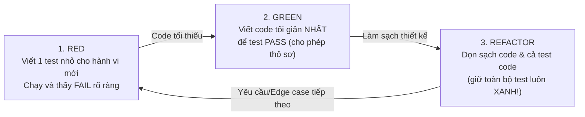

# TDD (Test-Driven Development): Chu trình Red → Green → Refactor

> **Nguồn tham khảo:** *Test Driven Development: By Example* (Kent Beck), *Clean Code* (Robert C. Martin — F.I.R.S.T. Principles), *Agile Testing* (Chương 7 & Chương 14), *Full Stack Testing* (Chương 2 — Unit Tests & Characteristics of Good Tests).

**Test-Driven Development (TDD)** **không phải** là kỹ thuật viết test sau khi code xong — đó là một **kỷ luật thiết kế phần mềm (software design discipline)**, nơi các ca kiểm thử được viết **trước** mã nguồn chức năng để dẫn dắt kiến trúc trở nên đơn giản, tách bạch (*decoupled*) và luôn có lưới an toàn hồi quy (*regression safety net*).

---

## 1. Chu trình Red → Green → Refactor & 3 Định luật TDD



### Ba Định luật Vàng của TDD (Uncle Bob — Robert C. Martin)
1. **Định luật 1:** Bạn **không được phép** viết bất kỳ dòng production code nào cho tới khi bạn có một unit test đang bị FAIL.
2. **Định luật 2:** Bạn **không được phép** viết nhiều code trong unit test hơn mức vừa đủ để làm nó FAIL (lỗi biên dịch cũng tính là FAIL).
3. **Định luật 3:** Bạn **không được phép** viết nhiều production code hơn mức vừa đủ để làm cho test đang FAIL chuyển sang PASS.

> **Tại sao bước `RED` bắt buộc phải chạy và thấy FAIL?**
> Để chứng minh bài test thực sự đang kiểm tra đúng điều kiện và **không phải là một test bị lỗi luôn luôn xanh (*false positive*)** (ví dụ quên gọi hàm cần test hoặc assert nhầm biến).

---

## 2. Nguyên tắc chất lượng Test: F.I.R.S.T. & Cấu trúc AAA

Để bộ test TDD không trở thành gánh nặng bảo trì, mọi unit test phải tuân thủ **F.I.R.S.T.** (kết hợp *Characteristics of Good Tests* trong *Full Stack Testing*, trang 68):

| Chữ cái | Nguyên tắc | Ý nghĩa thực hành trong Java / JUnit 5 |
| :---: | :--- | :--- |
| **F** | **Fast** *(Nhanh)* | Chạy hàng nghìn test trong vài giây (~1–10ms/test) — không chạm DB, mạng, đĩa cứng. |
| **I** | **Independent / Isolated** *(Độc lập)* | Test A không phụ thuộc kết quả hay thứ tự chạy của Test B; chạy đơn lẻ hay chạy song song đều pass. |
| **R** | **Repeatable** *(Lặp lại ổn định)* | Chạy trên laptop Windows, macOS hay GitHub Actions Linux, lúc 2 giờ sáng hay 12 giờ trưa đều cho cùng 1 kết quả (inject `Clock`, tránh `LocalDateTime.now()`, `Math.random()`). |
| **S** | **Self-Validating** *(Tự xác thực)* | Chỉ trả về **Pass (Xanh)** hoặc **Fail (Đỏ)** — tuyệt đối không `System.out.println(result)` để mắt người tự kiểm tra! |
| **T** | **Timely** *(Kịp thời — viết trước)* | Viết *trước* production code trong TDD để ép API hàm dễ gọi, ít phụ thuộc chéo (*testability*). |

### Cấu trúc chuẩn AAA / Given–When–Then trong mỗi `@Test`
```java
@Test
void shouldCalculate20PercentDiscountForStandardOrder() {
    // Arrange (Given): Chuẩn bị dữ liệu và collaborator
    Voucher sale20 = Voucher.percent("SALE20", 20, 150_000, 500_000);
    int eligibleSubtotal = 600_000;

    // Act (When): Gọi đúng 1 hành vi duy nhất cần test
    int discount = calculator.calculateDiscount(sale20, eligibleSubtotal);

    // Assert (Then): Kiểm tra kết quả mong đợi
    assertThat(discount).isEqualTo(120_000);
}
```
*(Nếu phần `Act` của bạn dài hơn 1–2 dòng hoặc phải `Assert` xen kẽ giữa 2 lần `Act`, đó là dấu hiệu bạn đang nhồi 2 test case vào 1 hàm!)*

---

## 3. So sánh 2 trường phái TDD: Classicist (Detroit) vs. London (Mockist)

Đây là chủ đề thường xuyên xuất hiện trong các buổi phỏng vấn Senior QA / SDET / Java Backend:

| Tiêu chí | Classicist School *(Detroit / Chicago — Kent Beck)* | London School *(Mockist / Outside-In — Freeman & Pryce)* |
| :--- | :--- | :--- |
| **Định nghĩa "Unit"** | Một **đơn vị hành vi (unit of behavior)** — có thể gồm nhiều class/domain object phối hợp thật với nhau miễn không đụng DB/mạng. | Một **đơn vị mã nguồn (unit of code)** — cô lập tuyệt đối đúng 1 class duy nhất. |
| **Xử lý Dependencies** | Dùng **object thật** cho các collaborator trong bộ nhớ; chỉ dùng Test Double ở **biên hệ thống** (DB, Payment API, Email, Clock). | Dùng **Mockito `@Mock`** cho **mọi** collaborator truyền vào constructor. |
| **Hướng thiết kế** | **Inside-Out:** Xây dựng từ Domain Model cốt lõi (`Order`, `Money`, `VoucherRule`) đi ra ngoài Service/Controller. | **Outside-In (Double-Loop TDD):** Bắt đầu từ Acceptance Test ở Controller/UseCase rồi mock dần các tầng bên dưới. |
| **Trọng tâm kiểm tra** | **State-based:** Kiểm tra đầu ra và trạng thái sau khi chạy. | **Interaction-based:** Kiểm tra class A có gọi `methodX()` của mock B không (`verify`). |
| **Ưu & Nhược điểm** | **Ưu:** Test **bền vững khi refactor** cấu trúc nội bộ; độ tin cậy tích hợp cao.<br>**Nhược:** Lỗi có thể lan qua 2–3 class domain nên cần khoanh vùng. | **Ưu:** Chỉ đích danh class lỗi; phát hiện thiết kế coupling chặt ngay.<br>**Nhược:** Dễ viết **test giòn (brittle)** gắn chặt vào chi tiết cài đặt (đổi tên hàm nội bộ là test gãy!). |

> **Lời khuyên thực chiến cho Spring Boot:** Áp dụng **Hybrid thông minh**:
> - Với **Domain Logic thuần** (`VoucherCalculator`, `OrderPricing`, `Order` state machine): dùng **Classicist** (object thật, không mock!).
> - Với **Orchestration Service** (`CheckoutService` điều phối `ProductRepository`, `PaymentGateway`, `EmailService`): dùng **London/Mockist** ở biên để mock Repository/Gateway bên ngoài!

---

## 4. Walkthrough thực tế 4 vòng Red → Green → Refactor trên TechStore

Bài toán: Xây dựng `VoucherDiscountCalculator.calculate(Voucher v, int eligibleSubtotal, Instant now)` cho `FR-VCH-01`.

### Vòng 1: Happy Path cơ bản (Giảm 20%)
1. **RED:** Viết test đầu tiên: đơn `500_000đ` với mã giảm `20%` → trả về `100_000đ`. Chạy test → **FAIL** (chưa có class `VoucherDiscountCalculator`).
2. **GREEN:** Tạo class và viết code tối thiểu (thậm chí *Fake It* hoặc công thức thẳng):
   ```java
   public int calculate(Voucher v, int subtotal, Instant now) {
       return (int) (subtotal * v.getValue() / 100.0);
   }
   ```
   Chạy test → **PASS (Xanh)**.
3. **REFACTOR:** Chưa có gì trùng lặp, giữ gọn.

### Vòng 2: Triangulation — Áp dụng Trần giảm tối đa (`maxDiscount = 150.000đ`)
1. **RED:** Thêm test đơn `1.000.000đ` với `SALE20` (`maxDiscount = 150_000`) → kỳ vọng `150_000` (chứ không phải `200_000`). Chạy → **FAIL** (thực tế ra `200_000`).
2. **GREEN:** Bổ sung logic chặn trần:
   ```java
   int discount = (int) (subtotal * v.getValue() / 100.0);
   return v.getMaxDiscount() > 0 ? Math.min(discount, v.getMaxDiscount()) : discount;
   ```
   Chạy cả 2 test → **PASS**.

### Vòng 3: Biên đơn tối thiểu & Hiệu lực thời gian (`startDate`, `endDate`)
1. **RED:** Chuyển sang `@ParameterizedTest` với `@CsvSource` cho `499_999` (ném `MinOrderNotMetException`) và `500_000` (OK), đồng thời viết test `now = startDate.minusSeconds(1)` (ném `VoucherNotStartedException`) và `now = endDate.plusSeconds(1)` (ném `VoucherExpiredException`). Chạy → **FAIL**.
2. **GREEN:** Thêm guard clauses đầu hàm cho `minOrder`, `startDate`, `endDate`. Chạy toàn bộ → **PASS**.

### Vòng 4: REFACTOR (Dọn sạch cả Production Code & Test Code)
- Tách hàm `validateEligibility(v, subtotal, now)` để giữ `Cyclomatic Complexity` của mỗi hàm `<= 5`.
- Chuyển phép tính phần trăm dùng `BigDecimal` (hoặc `Math.multiplyExact`) tránh lỗi làm tròn số thực dấu phẩy động (`double`) với tiền tệ!
- Rút helper tạo dữ liệu mẫu (`VoucherTestFactory.sale20()`) trong test code cho gọn → chạy lại toàn bộ suite → **XANH 100%**!

---

## 5. Khi nào KHÔNG nên ép TDD & Cách trị Legacy Code

### Khi nào nên linh hoạt?
- **Exploratory Spike / Prototype:** Khi bạn chưa biết API thư viện mới (VD: thử nghiệm tích hợp SDK VNPay lần đầu) — hãy viết prototype chạy thử trước để hiểu, sau đó **xóa prototype và code lại bằng TDD** hoặc viết test bọc chặt ngay lập tức.
- **UI Layout / CSS / Animation thuần túy:** Nên kiểm tra bằng mắt/Visual test thay vì TDD Unit Test.

### Làm sao test Legacy Code vốn không viết theo TDD? (*Agile Testing* Chương 14)
Theo *Agile Testing* (tr. 288) trích dẫn Michael Feathers (*Working Effectively with Legacy Code*):
1. **Tìm Seam (Đường ghép):** Đưa `Clock`, HTTP Client, hoặc Repository vào qua Constructor injection thay vì gọi `new` hoặc `static` cứng bên trong hàm.
2. **Characterization Test:** Viết test ghi lại hành vi hiện tại của code cũ trước khi sửa, tạo lưới an toàn rồi mới refactor.
3. **Strangler Fig Pattern:** Mọi tính năng mới hoặc bug vừa được sửa bắt buộc viết theo **TDD** trong module/class mới sạch sẽ, bóp nghẹt dần phần code cũ không có test.
