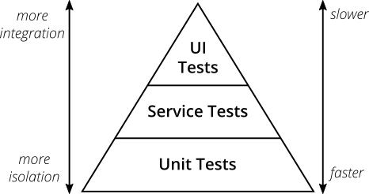
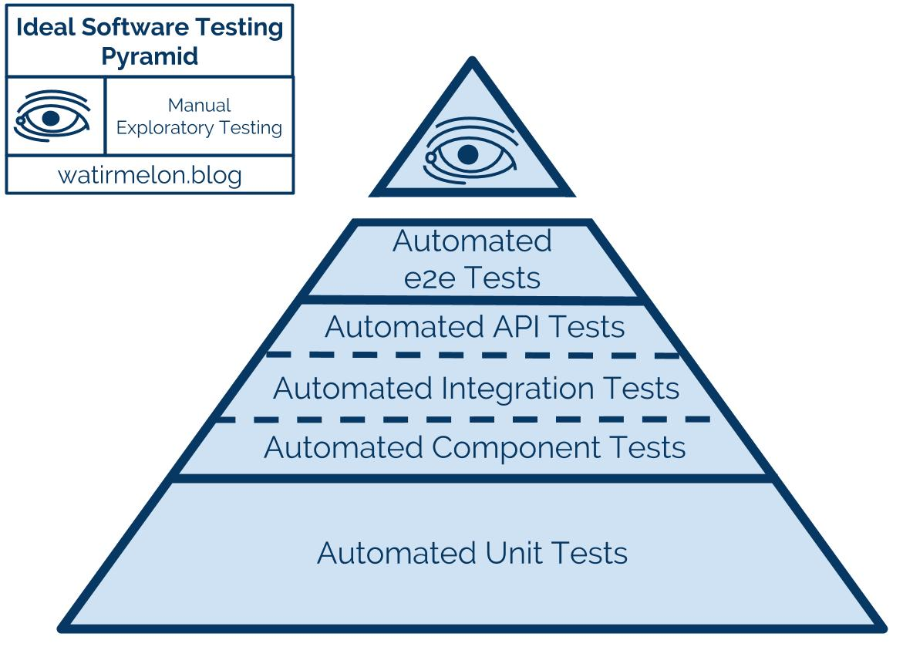
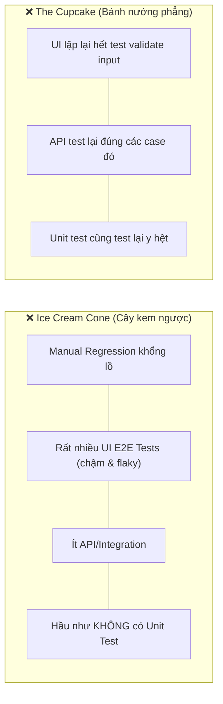

# Chiến lược Kiểm thử Tự động & Test Pyramid

> **Nguồn tham khảo:** *Agile Testing* (Lisa Crispin & Janet Gregory — Chương 14: *An Agile Test Automation Strategy*, trang 273–325 & Chương 7), *Full Stack Testing* (Gayathri Mohan — Chương 2: *Automated Functional Testing Strategy*, trang 22–85), Mike Cohn (*Succeeding with Agile*, 2009), Martin Fowler (*The Practical Test Pyramid*).

Sở hữu công cụ mạnh (JUnit, Mockito, Selenium, Playwright) mà không có **chiến lược phân tầng kiểm thử**, đội dự án rất dễ rơi vào cảnh có hàng trăm test chạy mất 8 tiếng mỗi đêm và hỏng vặt liên tục. Bài học quan trọng nhất từ cả hai giáo trình *Agile Testing* và *Full Stack Testing* là: **Đặt đúng loại test vào đúng tầng của ứng dụng để nhận phản hồi nhanh nhất với chi phí bảo trì thấp nhất.**

---

## 1. Bức tranh toàn cảnh: Micro Tests vs. Macro Tests (*Full Stack Testing* Ch. 2)

Gayathri Mohan phân loại kiểm thử chức năng tự động thành **6 tầng** (chia làm 2 nhóm Micro và Macro) dựa trên **4 đặc tính cốt lõi**:
1. **Scope (Phạm vi kiểm tra)**
2. **Speed (Tốc độ thực thi / phản hồi)**
3. **Isolation / Dependencies (Độ cô lập & phụ thuộc hạ tầng)**
4. **Cost & Fragility (Chi phí viết, bảo trì & độ mong manh)**

*Hình: Practical Test Pyramid của Ham Vocke / Martin Fowler — càng xuống đáy test càng nhanh và cô lập cao; càng lên đỉnh test càng tích hợp rộng và chậm hơn (Nguồn: `martinfowler.com`).*

*Hình: Mô hình kim tự tháp mở rộng với đỉnh là Manual Exploratory Testing bằng góc nhìn con người (`alisterscott.github.io` / WatirMelon).*

### So sánh chi tiết 6 tầng kiểm thử trên kiến trúc TechStore

| Nhóm | Tầng kiểm thử | Phạm vi trên TechStore | Công cụ (Java Stack) | Ai viết? | Tỷ trọng gợi ý |
| :--- | :--- | :--- | :--- | :--- | :---: |
| **Micro** | **1. Unit Tests** | 1 hàm / class cô lập (tính giảm giá `SALE20`, validate tuổi/email, state `Order.cancel()`). | JUnit 5, Mockito, AssertJ | **Dev / SDET** | **Rất lớn (~60–70%)** |
| **Micro** | **2. Integration Tests** | Tương tác giữa Code ↔ PostgreSQL thật, Redis, Repository JPA, Transaction rollback. | Spring Boot Test (`@DataJpaTest`, `@WebMvcTest`), Testcontainers | **Dev / SDET** | **Trung bình (~15–20%)** |
| **Micro** | **3. Contract Tests** | Kiểm tra hợp đồng JSON Schema giữa `OrderService` (Consumer) và `InventoryService` / `PaymentService` (Provider) khi phát triển song song. | Pact, Spring Cloud Contract | **Dev + QA** | **Nhỏ (~5%)** |
| **Macro** | **4. Service / API Tests** | Test nghiệp vụ end-to-end của 1 microservice qua HTTP API (không qua UI): login → tạo giỏ → checkout → check DB. | REST Assured, MockMvc, Postman/Newman, Karate | **QA / SDET** | **Khá (~15%)** |
| **Macro** | **5. UI Functional Tests** | Giả lập trình duyệt thật kiểm tra luồng nghiệp vụ quan trọng từ góc nhìn user (tìm SP → thêm giỏ → đặt hàng). | Selenium, Playwright | **QA Automation** | **Ít (~5–10%)** |
| **Macro** | **6. End-to-End (E2E) Tests** | Toàn bộ hệ thống nối với hệ thống hạ lưu (Kho, Giao hàng, Thanh toán giả lập). | Playwright / Selenium + API + DB | **QA Automation** | **Tối thiểu (Critical Flows)** |

---

## 2. Tư duy Cốt lõi từ Chương 14 *Agile Testing*

### A. Kết hợp Agile Testing Quadrants (Q1–Q4) với Test Pyramid
- **Q1 (Technology-Facing, Supporting the Team):** Unit & Component Tests → **Tầng đáy Pyramid**. Nên làm theo TDD, chạy tự động trong CI mỗi lần commit.
- **Q2 (Business-Facing, Supporting the Team):** Acceptance Tests / API Tests "behind the GUI" → **Tầng giữa Pyramid**. Kiểm tra *Build the right thing* mà không phụ thuộc vào HTML/CSS hay thay đổi.
- **Q3 (Business-Facing, Critiquing the Product):** Manual Exploratory Testing, Usability, UAT → **Đám mây trên đỉnh Pyramid**. Automation giải phóng thời gian regression để con người tập trung vào Q3!
- **Q4 (Technology-Facing, Critiquing the Product):** Performance (JMeter/k6), Security (OWASP ZAP), Scalability → Chạy bằng tool chuyên dụng (GĐ 5).

### B. Ẩn dụ "Ba chú heo con" (*Three Little Pigs* — Patrick Wilson-Welsh, *Agile Testing* tr. 278)
- **Tầng đáy = Nhà gạch (Bricks):** Unit Tests — cực kỳ kiên cố, chạy mili-giây, không bị "Sói già" (đổi giao diện, lag mạng, môi trường test chết) thổi bay.
- **Tầng giữa = Nhà gỗ (Sticks):** API / Integration Tests — chắc chắn hơn UI, cần cập nhật khi hợp đồng API/DB thay đổi.
- **Tầng đỉnh = Nhà rơm (Straw):** UI Tests — rất dễ vỡ (*brittle*) chỉ vì đổi một `id` hay `class` CSS, chạy chậm hàng giờ. Nếu xây cả tháp bằng rơm, đội QA sẽ mất toàn bộ thời gian chỉ để sửa test gãy!

### C. Cái gì NÊN tự động hóa và cái gì KHÔNG NÊN? (*Agile Testing* tr. 279–287)

| NÊN tự động hóa | KHÔNG NÊN (hoặc hạn chế) tự động hóa |
| :--- | :--- |
| - **CI/Build/Deploy** & **Unit/Component Tests** (ưu tiên số 1 — ROI cao nhất!). - **API / Behind-the-GUI Tests** (test các bảng dữ liệu tổ hợp lớn — Decision Table, Pairwise). - **Data Creation / Seeding** (tạo dữ liệu test lặp đi lặp lại). - **UI Smoke Tests** cho các luồng tạo doanh thu sống còn (Đăng nhập, Checkout). | - **Exploratory Testing** (đòi hỏi óc quan sát & học hỏi của con người). - **Usability / Visual UX** (tool không cảm nhận được giao diện khó dùng hay phản cảm). - **One-off Tests** (test chạy đúng 1 lần rồi bỏ). - **Tests that will never fail** (chi phí viết & duy trì cao hơn hẳn rủi ro). |

> **Quy tắc vàng từ *Full Stack Testing* (trang 29):**
> *"Every time you think of adding a UI functional test, first question the intent of the test (e.g., input validation, discount calculation, business rules) and see if you can write lower-level tests (Unit / Integration / API) to cover the intent!"*
> **Ví dụ:** Không bao giờ dùng Selenium mở trình duyệt 20 lần chỉ để test biên độ dài mật khẩu `7, 8, 32, 33` ký tự hoặc biên `499.999đ / 500.000đ` của Voucher! Việc đó thuộc về **JUnit 5 `@ParameterizedTest`** chạy trong **0.05 giây**!

---

## 3. Hai Anti-Patterns chết người cần nhận diện sớm

### 1. Ice Cream Cone / Inverted Pyramid (Cây kem lộn ngược)
- **Nguyên nhân:** Team không vượt qua được *"Hump of Pain"* (đường cong học tập ban đầu của TDD/Unit Test), nên dồn hết sang quay/viết UI automation ở đỉnh và test tay.
- **Triệu chứng (*Full Stack Testing* tr. 80):**
  - Chạy bộ test mất **nhiều giờ** (VD: 200 UI test chạy mất 8 tiếng rồi fail giữa chừng vì flaky!).
  - Phát hiện bug quá muộn (chỉ khi sắp release).
  - Dù có automation nhưng vẫn phải test tay lại rất nhiều vì không tin tưởng kết quả đỏ của UI suite.

### 2. The Cupcake Antipattern (Fabio Pereira / *Full Stack Testing* tr. 80–81)
- **Nguyên nhân:** Dev và QA làm việc **tách rời (siloed)**: Dev viết Unit test cho mọi ca validate input; QA không biết hoặc không tin nên lại viết y hệt 30 ca validate input đó ở tầng API và Selenium UI!
- **Hậu quả:** Tốc độ phát hành chậm chạp dù là tính năng nhỏ; khi sửa 1 rule (VD: đổi trần `500.000đ` thành `600.000đ`), phải sửa test ở cả 3 tầng; dễ xảy ra đổ lỗi qua lại (*blame game*).
- **Cách phòng tránh:** Họp **Three Amigos / Story Kick-off** thống nhất ngay trên ticket xem case nào phủ ở Unit, case nào ở Integration/API, và chỉ giữ 1–2 luồng chính ở UI!

---

## 4. Các biến thể hiện đại: Test Pyramid vs. Testing Trophy vs. Honeycomb

Trong Note trang 32 của *Full Stack Testing*, tác giả lưu ý các hình khối khác ngoài Pyramid — **hình khối thay đổi tùy kiến trúc hệ thống**:

| Mô hình | Ai đề xuất / Hợp với kiến trúc nào? | Trọng tâm lớn nhất nằm ở đâu? |
| :--- | :--- | :--- |
| **Test Pyramid** *(Mike Cohn)* | Ứng dụng nghiệp vụ phức tạp, Domain-rich Backend (Java/Spring Boot Monolith hoặc Modular). | **Unit Tests** làm nền tảng dày nhất, kế đến Integration/API, ít nhất là UI. |
| **Testing Trophy** *(Kent C. Dodds)* | Ứng dụng **Frontend (React/Vue)** hoặc CRUD mỏng ít logic tính toán. | **Static Analysis** (TypeScript/ESLint) ở đáy + **Integration Tests** (React Testing Library) chiếm phần phình to nhất ở giữa, vì mock quá sâu ở Frontend làm test xa thực tế. |
| **Testing Honeycomb** *(Spotify)* | Hệ thống **Microservices phân tán**, ít logic nội tại trong từng service nhưng giao tiếp nhiều qua HTTP/Kafka/DB. | **Integration & Contract Tests** chiếm diện tích lớn nhất ở giữa, giảm bớt Unit test đơn lẻ chỉ toàn mock. |

---

## 5. Áp dụng Test Pyramid vào Module `Checkout & Voucher` của TechStore

Để chuẩn bị cho bài Thực hành & Deliverable GĐ 2, ta phân bổ các Test Condition từ GĐ 1 đúng tầng theo Test Pyramid:

| Test Case / Logic từ GĐ 1 | Tầng đặt Test (GĐ 2 / GĐ 3) | Lý do |
| :--- | :--- | :--- |
| Phí ship (`499.999đ` vs `500.000đ`, VIP, `FREESHIP`), Tính giảm giá `SALE20` (min `500k`, cap `150k`, loại trừ Flash Sale, check `startDate`/`endDate`), Giới hạn `COD <= 5M` | **Tầng 1: Unit Test (JUnit 5 + Mockito + AssertJ)** | 100% là business rules & tính toán thuần → chạy dưới `50ms`, phủ được hàng chục giá trị biên BVA & Decision Table bằng `@ParameterizedTest`! |
| Điều phối `CheckoutService` (tính tiền, trừ tồn kho, lưu đơn, hoàn tác khi lỗi) | **Tầng 1: Unit Test (`Mockito`)** | Cô lập logic điều phối khỏi hạ tầng. |
| Validation HTTP (`@Valid`, JSON body, status `400`/`409`/`201`) | **Tầng 2a: Web Slice (`@WebMvcTest` + `MockMvcTester`)** | Kiểm tra HTTP contract nhanh mà không cần DB thật. |
| Atomic trừ lượt dùng voucher (`usage_limit > 0`) & trừ tồn kho an toàn đồng thời (`stock >= quantity`) + Transaction Rollback | **Tầng 2b: Persistence / Full Integration (`@DataJpaTest` / `@SpringBootTest` + Testcontainers Postgres)** | H2 và Mockito **không thể** test thật transaction rollback, SQL constraint và lock đồng thời trên DB thật! |
| Người dùng bấm đặt hàng trên trình duyệt, chuyển hướng cổng thanh toán | **Tầng 3: UI E2E (Playwright/Selenium — GĐ 3)** | Chỉ giữ **1–2 Happy Path + Critical Checkout flow**, không lặp lại 30 ca biên! |
