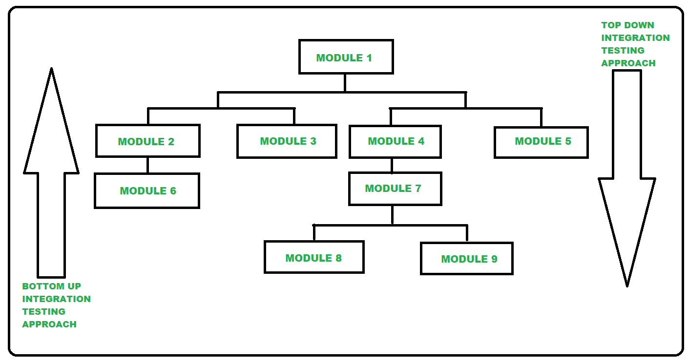
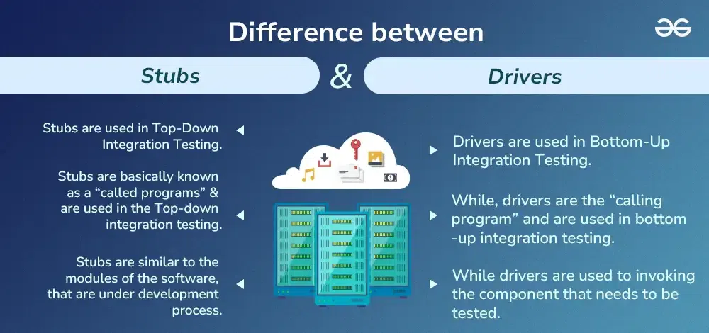
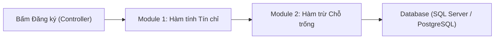

# Nguyên lý Nền tảng: Unit Testing & Integration Testing (Chiến lược Tích hợp)

> **Nguồn bài học:** `Unit Testing & Integration Testing Chạy mã để verify các hàm, module, API nội bộ hoạt động đúng theo đặc tả thiết kế kỹ thuật..pdf` *(Bổ sung phần nền tảng & chiến lược tích hợp chưa trùng lặp với bài thực hành Java tại [01-junit5-parameterized-lifecycle-nested.md](../01-junit5-parameterized-lifecycle-nested.md) .. [03-spring-boot-test.md](../03-spring-boot-test.md))*.  
> *Lưu ý lọc trùng lặp:* Phân biệt 5 loại **Test Doubles** (`Dummy, Stub, Fake, Spy, Mock`) và `when().thenReturn()` vs `verify()` đã có chi tiết tại [02-mockito-assertj.md](../02-mockito-assertj.md) nên không lặp lại.

---

## 1. Hình ảnh trực quan: Xe đạp điện & Viên gạch

- **Unit Testing** *(tầng đáy Test Pyramid, nhiều nhất & nhanh nhất)*: Tháo rời từng bộ phận của chiếc xe đạp điện đặt lên bàn kiểm tra riêng: pin có xả đúng `48V` không, tay ga vặn mượt không, bóng đèn có sáng không. Giống như kiểm tra **từng viên gạch** đúc ra có vuông vắn, không nứt vỡ.
- **Integration Testing** *(tầng giữa)*: Nối dây cục pin vào tay ga, tay ga vào động cơ xem vặn ga điện có truyền xuống làm quay bánh xe không. Giống như **trát vữa ghép các viên gạch** tạo thành bức tường kín gió và ăn khớp.

### Tại sao Unit Test Pass 100% nhưng hệ thống ghép lại vẫn SẬP?
Vì **lỗi nằm ở "mối nối" (*Interface Contract*)** chứ không nằm ở thuật toán bên trong từng hàm:
- Hàm A trả về chuỗi `"24"` nhưng Hàm B mong đợi số nguyên `24`.
- Bảng DB lưu cột `student_id` nhưng API Payload gửi lên lại đặt tên `userId`.
- Thiếu xử lý transaction rollback hoặc khóa dòng (*Deadlock*) khi nhiều hàm cùng ghi vào SQL Server / PostgreSQL thật.

---

## 2. Minh họa Unit Test tối giản (Python `pytest` vs. Java JUnit 5)

```python
# Code chức năng (System Under Test)
def is_valid_credits(credits: int) -> bool:
    if credits <= 0 or credits > 24:
        return False
    return True

# Unit Test (cô lập hoàn toàn khỏi DB/mạng, chạy trong vài mili-giây)
def test_is_valid_credits():
    assert is_valid_credits(15) is True   # Hợp lệ
    assert is_valid_credits(0) is False   # Biên dưới không hợp lệ
    assert is_valid_credits(24) is True   # Biên trên hợp lệ
    assert is_valid_credits(25) is False  # Vượt biên trên
```

*(Với Java Spring Boot ở Giai đoạn 2, bài test tương ứng viết bằng JUnit 5 `@ParameterizedTest` + `@CsvSource({"15,true", "0,false", "24,true", "25,false"})` cho phép chạy hàng nghìn assertion chỉ trong chưa tới 1 giây).*

---

## 3. Ba chiến lược Tích hợp Kinh điển (*Integration Strategies*)

Khi ghép nối theo chiều dọc kiến trúc (`[Module A: Controller] → [Module B: Business Logic] → [Module C: Database]`), kỹ sư phần mềm có 3 cách tiếp cận chính:



*Hình: Chiều tích hợp Top-Down (từ module đỉnh xuống dưới) đối lập với Bottom-Up (từ module lá đi lên đỉnh). Nguồn ảnh: GeeksforGeeks.*



*Hình: Phân biệt vai trò `Stub` (giả lập hàm/module cấp dưới chưa xong) và `Driver` (hàm mồi cấp trên gọi thử module cấp dưới). Nguồn ảnh: GeeksforGeeks.*

| Chiến lược | Cách thực hiện | Công cụ giả lập đi kèm | Ưu & Nhược điểm thực tế |
| :--- | :--- | :--- | :--- |
| **1. Big Bang** *("Nước đến chân mới nhảy")* | Đợi dev viết xong **tất cả** module rồi đùng một cái ráp tất cả vào nhau mới chạy test | Không hoặc rất ít | **Cực kỳ nguy hiểm:** Khi test sập rất khó khoanh vùng xem lỗi từ module nào trong "đống bòng bong"; bug ẩn tới tận cuối mới lộ. |
| **2. Top-Down** *(Từ trên xuống dưới)* | Tích hợp từ tầng giao diện/Controller (`A`) đi dần xuống (`B`, `C`) | Dùng **Stub** *(giả lập tầng dưới chưa viết xong)* | Kiểm thử được luồng nghiệp vụ chính & giao diện sớm; nhưng các tầng lõi/DB ở dưới được kiểm chứng muộn và phải viết nhiều Stub. |
| **3. Bottom-Up** *(Từ dưới lên trên)* | Tích hợp từ tầng DB/hàm tiện ích thấp nhất (`C`) đi ngược lên (`B` → `A`) | Dùng **Driver** *(chương trình mồi thay tầng trên gọi xuống)* | Kiểm thử tầng lõi & DB rất chắc từ sớm; nhưng người dùng/PO chậm thấy giao diện hoàn chỉnh cho tới bước cuối. |

*(Ghi chú thực tế: Dự án hiện đại thường dùng cách lai **Sandwich / Hybrid Integration** hoặc **Continuous Integration theo từng Vertical Slice** — viết từng API đi xuyên qua Controller → Service → Testcontainers PostgreSQL rồi test ngay qua `MockMvc` / REST Assured trong CI).*

---

## 4. Giải thích hai điểm dễ nhầm từ bài học

### 1. Phân biệt **`Stub` trong Integration (Top-Down)** vs **`Stub`/`Mock` trong Unit Test**, và **`Driver`** là gì?
- Trong **Unit Test** (*Test Doubles*): `Stub` trả dữ liệu giả định cứng (`when(...).thenReturn(...)`), còn `Mock` kiểm chứng hành vi gọi hàm (`verify(...)`).
- Trong **Integration Testing cổ điển**:
  - **Stub** đóng vai *module cấp dưới bị gọi* (VD: giả lập `PaymentGateway` khi Controller/Service đã xong nhưng cổng thanh toán chưa code xong).
  - **Driver** đóng vai *module cấp trên đi gọi* (VD: viết một hàm `main()` hoặc JUnit runner gọi thẳng vào `OrderRepository` khi tầng Controller/UI chưa tồn tại).

### 2. Case xuyên suốt "Đăng ký học phần" & Lưu ý biến ngược chiều với Lab 01



- **Unit Test:** Test riêng `Module 1` với mảng `[3, 4, 3]` → kết quả đúng `10` (không quan tâm sĩ số lớp); test riêng `Module 2` với `remaining = 1` → trả về `0` (không quan tâm tín chỉ).
- **Integration Test:** Gửi yêu cầu đăng ký môn `3` tín chỉ chạy xuyên `Module 1 → Module 2 → DB thật`:
  - Kiểm tra `Module 1` xong có gọi đúng hợp đồng sang `Module 2` không.
  - Kiểm tra bảng trong DB có thực sự giảm `remaining` từ `40` xuống `39` và chèn thêm `1` dòng đăng ký sinh viên không; hoặc nếu DB bị *Deadlock* / sai kiểu dữ liệu → **Integration Defect**.

> [!NOTE]
> **Tránh nhầm tên biến với Lab 01:** Ở bài Lab 01 (`CourseRegistration_Buggy.html`), biến `enrollment` là **số sinh viên đã đăng ký** (`0 → 39`, chạm `40` là quá tải). Còn trong ví dụ `Module 2` của tài liệu này, biến **`remaining`** là **số chỗ còn trống** nên khi có sinh viên đăng ký thành công thì giảm từ `40` xuống `39` *(hai cách biểu diễn ngược chiều nhau cho cùng một quy định sĩ số tối đa 40 chỗ)*.
>
> *(Ghi chú định dạng: Bản gốc PDF trang 4 bảng so sánh có 1 dòng ký tự lỗi font `"Ầ Ế Ố"` ở sát mép dưới trang; đã được lược bỏ hoàn toàn khi chuyển sang Markdown).*
