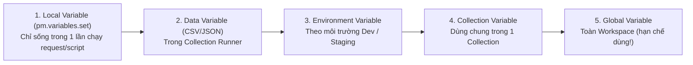

# Postman: Collection, Environment, Pre-request & Test Scripts + Newman CI

> **Nguồn tham khảo:** Postman Learning Center (Scripts, Variables, Ajv JSON Schema, Newman CLI), *Full Stack Testing* (Chương 2 — Service Tests).

**Postman** là công cụ phổ biến nhất để khám phá, kiểm thử thủ công và xây dựng bộ hồi quy API nhanh chóng trước khi chuyển sang code (REST Assured). Điểm phân biệt giữa một người chỉ biết "bấm Send" trên Postman với một **QA Automation / SDET** là khả năng sử dụng **Variables, Pre-request Script, Test Script (Chai/Ajv), Data-Driven Runner và Newman CLI**.

---

## 1. Cấu trúc Tổ chức & Phạm vi Biến (Variable Scopes)

### A. Kiến trúc chuẩn của một Postman Project cho TechStore
- **Workspace:** Không gian làm việc theo dự án (`TechStore QA Workspace`).
- **Collection:** Tập hợp các request được chia theo thư mục nghiệp vụ (`01-Auth`, `02-Products`, `03-Cart-Checkout`, `04-Negative-Security`).
- **Environment:** Lưu cấu hình thay đổi theo môi trường (`Local`, `Dev`, `Staging`), ví dụ `base_url`, `auth_email`, `jwt_token`.

### B. Thứ tự ưu tiên 5 tầng Biến (Variable Precedence — Hay hỏi phỏng vấn!)
Khi bạn viết `{{base_url}}` hoặc `{{jwt_token}}`, Postman tìm giá trị theo thứ tự **từ hẹp đến rộng** (tầng hẹp hơn sẽ ghi đè tầng rộng hơn):



> **Quy tắc bảo mật cực quan trọng:**
> - **Initial Value** được đồng bộ lên Postman Cloud / Git export; **Current Value** chỉ lưu ở máy cục bộ.
> - Tuyệt đối **không** gán `password`, `API_KEY`, `JWT secret` vào *Initial Value* khi export Collection đưa lên GitHub! Hãy để trống *Initial Value* hoặc truyền qua biến môi trường CI (`--env-var`).

---

## 2. Pre-request Script — Chuẩn bị Dữ liệu & Auth Trước Khi Gửi Request

**Pre-request Script** chạy bằng JavaScript (Node.js sandbox) **ngay trước khi HTTP request rời máy**. Có thể gắn ở cấp **Collection** (chạy cho mọi request bên trong), **Folder**, hoặc từng **Request**.

### Các tác vụ thực chiến hay dùng nhất trong Pre-request Script

1. **Sinh dữ liệu test động (Dynamic Data) tránh lỗi trùng lặp:**
   ```javascript
   // Sinh email và mã đơn duy nhất mỗi lần chạy
   const ts = Date.now();
   pm.variables.set("unique_email", `buyer_${ts}@techstore.vn`);
   pm.variables.set("idempotency_key", pm.variables.replaceIn("{{$guid}}"));
   ```
2. **Tự động kiểm tra & làm mới JWT Token (Auto-Refresh Token):**
   Thay vì copy-paste token tay mỗi 15 phút, gắn script sau ở **cấp Collection**:
   ```javascript
   const token = pm.environment.get("jwt_token");
   const expiresAt = Number(pm.environment.get("jwt_expires_at") || 0);

   // Nếu chưa có token hoặc sắp hết hạn trong 30 giây -> tự gọi API login!
   if (!token || Date.now() >= expiresAt - 30000) {
       pm.sendRequest({
           url: `${pm.environment.get("base_url")}/api/v1/auth/login`,
           method: "POST",
           header: { "Content-Type": "application/json" },
           body: {
               mode: "raw",
               raw: JSON.stringify({
                   email: pm.environment.get("buyer_email"),
                   password: pm.environment.get("buyer_password")
               })
           }
       }, (err, res) => {
           if (!err && res.code === 200) {
               const json = res.json();
               pm.environment.set("jwt_token", json.accessToken);
               pm.environment.set("jwt_expires_at", Date.now() + (json.expiresInSeconds * 1000));
           } else {
               console.error("Auto-login failed:", err || res.text());
           }
       });
   }
   ```
3. **Khai báo JSON Schema dùng chung ở Collection Pre-request** (stringified JSON trong `pm.collectionVariables`) để mọi request bên trong tái sử dụng mà không lặp code.

---

## 3. Post-response / Test Script — Kiểm chứng Hành vi & Chuỗi API (Chaining)

*(Lưu ý: Từ các phiên bản Postman mới, tab "Tests" được đổi tên thành **Scripts → Post-response**, sử dụng thư viện assertion **ChaiJS BDD**).*

### Mẫu Test Script chuẩn cho `POST /api/v1/checkout` trên TechStore
```javascript
// 1. Kiểm tra Status Code & Thời gian phản hồi (SLA cơ bản)
pm.test("Status code is 201 Created", () => {
    pm.response.to.have.status(201);
});

pm.test("Response time is under 500ms", () => {
    pm.expect(pm.response.responseTime).to.be.below(500);
});

// 2. Kiểm tra Header & Parse JSON an toàn
pm.test("Content-Type is application/json", () => {
    pm.response.to.have.header("Content-Type");
    pm.expect(pm.response.headers.get("Content-Type")).to.include("application/json");
});

const body = pm.response.json();

// 3. Kiểm tra nghiệp vụ giảm giá SALE20 (FR-VCH-01) & Shipping (FR-CHK-02)
pm.test("Order pricing matches business rules", () => {
    pm.expect(body.orderId).to.be.a("number").and.above(0);
    pm.expect(body.status).to.eql("PENDING_PAYMENT");
    pm.expect(body.subtotal).to.eql(500000);
    pm.expect(body.discountAmount).to.eql(100000);
    pm.expect(body.shippingFee).to.eql(30000);
    pm.expect(body.finalTotal).to.eql(430000);
});

// 4. Lưu orderId cho request tiếp theo (GET /api/v1/orders/{{created_order_id}})
pm.environment.set("created_order_id", body.orderId);

// 5. Validate JSON Schema bằng Ajv (tích hợp sẵn trong Postman!)
const orderSchema = {
    type: "object",
    required: ["orderId", "status", "subtotal", "discountAmount", "shippingFee", "finalTotal"],
    additionalProperties: false,
    properties: {
        orderId: { type: "integer", minimum: 1 },
        status: { type: "string", enum: ["PENDING_PAYMENT", "CONFIRMED", "PAID"] },
        subtotal: { type: "integer", minimum: 0 },
        discountAmount: { type: "integer", minimum: 0 },
        shippingFee: { type: "integer", minimum: 0 },
        finalTotal: { type: "integer", minimum: 0 }
    }
};

pm.test("Response strictly conforms to OrderResponse JSON Schema", () => {
    const Ajv = require("ajv");
    const ajv = new Ajv({ allErrors: true });
    const validate = ajv.compile(orderSchema);
    const valid = validate(body);
    pm.expect(valid, ajv.errorsText(validate.errors)).to.be.true;
});
```

---

## 4. Data-Driven Testing & Điều hướng Luồng (`setNextRequest`)

### A. Chạy Collection theo file CSV / JSON
Chuẩn bị file `voucher-bva.csv`:
```csv
subtotal,voucherCode,expectedDiscount,expectedStatus
499999,SALE20,0,400
500000,SALE20,100000,201
1000000,SALE20,150000,201
```
Trong request, tham chiếu bằng `{{subtotal}}` hoặc đọc trong script qua `pm.iterationData.get("expectedStatus")`:
```javascript
const expectedStatus = Number(pm.iterationData.get("expectedStatus"));
pm.test(`Returns expected status ${expectedStatus}`, () => {
    pm.response.to.have.status(expectedStatus);
});
```

### B. Điều hướng có điều kiện (`pm.execution.setNextRequest`)
*(Lưu ý: `pm.execution.setNextRequest(...)` là API mới thay thế `postman.setNextRequest(...)` cũ).*
- Dùng để rẽ nhánh workflow hoặc dừng ngay collection khi Login fail:
  ```javascript
  if (pm.response.code !== 200) {
      pm.execution.setNextRequest(null); // Dừng luôn chuỗi test nếu đăng nhập thất bại!
  }
  ```

---

## 5. Chạy Tự động trên Terminal & CI/CD với Newman CLI

**Newman** là CLI runner chính thức của Postman chạy trên Node.js, biến Postman Collection thành bước kiểm thử tự động trong GitHub Actions / Jenkins.

```bash
# Cài đặt Newman và bộ xuất báo cáo HTML đẹp (htmlextra)
npm install -g newman newman-reporter-htmlextra

# Chạy Collection kèm Environment, Data CSV, xuất cả CLI + JUnit XML + HTML Report
newman run collections/techstore-api.postman_collection.json \
  -e environments/staging.postman_environment.json \
  -d testdata/voucher-bva.csv \
  --env-var "buyer_password=$TECHSTORE_TEST_PWD" \
  --reporters cli,junit,htmlextra \
  --reporter-junit-export reports/newman-junit.xml \
  --reporter-htmlextra-export reports/newman-report.html
```

| Điểm mạnh của Postman + Newman | Giới hạn so với REST Assured (Java) |
| :--- | :--- |
| Khởi tạo nhanh, trực quan cho cả QA Manual lẫn Dev, dễ chia sẻ Collection. | Khó tái sử dụng logic phức tạp, khó code review file JSON khổng lồ trên Git diff, khó debug sâu như Java IDE. |
| **Vai trò tốt nhất:** Khám phá API mới, test nhanh khi Dev vừa xong endpoint, chia sẻ tài liệu API sống. | **Vai trò của REST Assured:** Bộ API regression framework dài hạn, tích hợp chặt CI, OOP, Allure, test đa tầng với DB. |
