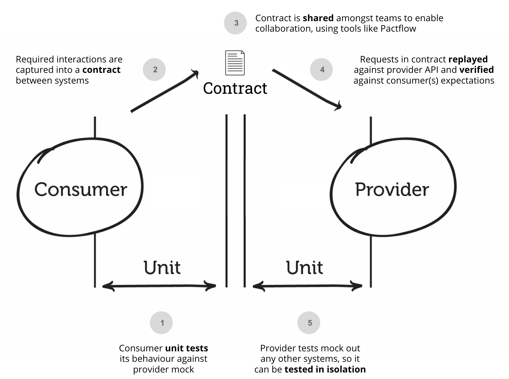

# Contract Testing với Pact (Consumer-Driven Contract Testing)

> **Nguồn tham khảo:** *Full Stack Testing* (Gayathri Mohan — Chương 2: *Contract Tests & Pact*, trang 26–27 & 69–74), Pact Docs (`docs.pact.io`).

*(Ghi chú Roadmap GĐ 3a: Với Contract Testing bằng Pact, ở mức Junior/Mid QA Automation bạn cần **hiểu đúng bản chất, đọc hiểu được code Consumer/Provider Test và biết khi nào dùng**, chưa cần triển khai Pact Broker phức tạp).*

---

## 1. Vấn đề thực tế trong Microservices khiến Contract Testing ra đời

Hãy quay lại ví dụ thực tế trong *Full Stack Testing* (Chương 2, trang 69):
- Hệ thống E-Commerce có **`OrderService`** (gọi API để lấy thông tin sản phẩm) và **`PIMService`** (Product Information Management — cung cấp `GET /items`).
- Hai team phát triển **độc lập và song song**. Khi viết Unit/Component Test cho `OrderService`, ta phải **mock/stub** `PIMService`.
- **Bi kịch xảy ra khi lên Staging:** Team `PIMService` tự ý đổi tên trường JSON từ `"sku"` thành `"itemCode"`, hoặc xóa trường `"size"` để phục vụ team khác! Toàn bộ Unit Test của cả hai bên đều **XANH 100%**, nhưng khi ghép vào nhau trên môi trường thật thì hệ thống **SẬP**!
- Nếu viết Full E2E Integration Test nối cả 2 service thật liên tục thì **rất chậm, đắt đỏ, hay gãy do môi trường và khóa chân hai team phải chờ nhau**.

---

## 2. Consumer-Driven Contract Testing (CDCT) với Pact hoạt động thế nào?

**Pact** giải quyết bài toán bằng cách tách việc kiểm tra tích hợp thành **2 bước độc lập, chạy siêu nhanh trong CI của từng service**:



*Hình: Kiến trúc Pact 5 bước — Consumer test chạy nhanh với Mock Provider để sinh file Pact Contract → đẩy lên Pact Broker → Provider CI tải Contract về phát lại (*replay*) vào Provider thật để phát hiện sai lệch Schema tức thì (Nguồn: `docs.pact.io`).*

### Đặc điểm "Consumer-Driven" cực kỳ thông minh
- `OrderService` chỉ assert đúng **3 trường nó cần dùng** (`SKU`, `Color`, `Size`). Nếu `PIMService` thêm trường mới `manufacturerAddress` hoặc sửa trường khác mà `OrderService` không đụng tới → **Contract Test vẫn PASS!**
- Nhưng ngay giây phút `PIMService` đổi tên `SKU` thành `itemCode` hoặc đổi kiểu dữ liệu → **Provider Pact Test FAIL ngay trong CI của `PIMService`** trước khi code kịp lên môi trường Staging!

---

## 3. Đọc hiểu Code Pact Test trong Java (*Full Stack Testing* trang 72–74)

### A. Phía Consumer (`ItemsPactConsumerTest.java`)
Consumer định nghĩa **hợp đồng kỳ vọng** bằng `@Pact`, sau đó chạy hàm test `@Test` (gắn `@PactTestFor`) gọi `RestTemplate` thật vào `MockServer` do Pact dựng lên:

```java
@ExtendWith(PactConsumerTestExt.class)
public class ItemsPactConsumerTest {

    // 1. Định nghĩa hợp đồng: Khi Provider ở trạng thái "items are available",
    //    nếu Consumer gọi GET /items -> phải trả 200 JSON chứa ít nhất các trường SKU, Color, Size
    @Pact(consumer = "OrderService", provider = "PIMService")
    public V4Pact getAvailableItemDetails(PactDslWithProvider builder) {
        return builder
            .given("items are available") // Tên trạng thái sẽ truyền cho Provider chuẩn bị data!
            .uponReceiving("get item details")
                .path("/items")
                .method("GET")
            .willRespondWith()
                .status(200)
                .headers(Map.of("Content-Type", "application/json"))
                .body(LambdaDsl.newJsonArrayMinLike(2, array -> array.object(o -> {
                    o.stringType("SKU", "A091897654");
                    o.stringType("Color", "Green");
                    o.stringType("Size", "S");
                })).build())
            .toPact(V4Pact.class);
    }

    // 2. Chạy Client code thật gọi vào Pact MockServer -> Pass thì tự xuất file pacts/OrderService-PIMService.json
    @Test
    @PactTestFor(pactMethod = "getAvailableItemDetails")
    void getItemDetailsWhenItemsAreAvailable(MockServer mockServer) {
        RestTemplate restTemplate = new RestTemplateBuilder()
                .rootUri(mockServer.getUrl())
                .build();

        List<Item> items = new PIMClient(restTemplate).getAvailableItemDetails();
        assertThat(items).hasSizeGreaterThanOrEqualTo(2);
    }
}
```
*(Chú ý: Consumer dùng `stringType(...)` nghĩa là chỉ kiểm tra **kiểu `String` và tên field**, không ép cứng giá trị `"Green"` phải cố định mãi mãi ở phía Provider!)*

### B. Phía Provider (`ItemsPactProviderTest.java`)
Provider đọc file Pact từ `@PactBroker` (hoặc thư mục `@PactFolder("pacts")`), dựng state tương ứng qua `@State`, rồi để Pact tự gọi HTTP vào ứng dụng Spring Boot của Provider:

```java
@Provider("PIMService")
@PactFolder("pacts") // Hoặc @PactBroker(url = "https://broker.techstore.internal")
@SpringBootTest(webEnvironment = SpringBootTest.WebEnvironment.RANDOM_PORT)
class ItemsPactProviderTest {

    @LocalServerPort
    int port;

    @MockitoBean
    private ItemRepository itemRepository;

    @BeforeEach
    void setUp(PactVerificationContext context) {
        context.setTarget(new HttpTestTarget("localhost", port));
    }

    // Pact tự sinh 1 test case cho MỖI interaction trong file Pact!
    @TestTemplate
    @ExtendWith(PactVerificationInvocationContextProvider.class)
    void verifyPact(PactVerificationContext context) {
        context.verifyInteraction();
    }

    // Chuẩn bị dữ liệu đúng với chuỗi .given("items are available") từ Consumer!
    @State("items are available")
    void setItemsAvailableState() {
        given(itemRepository.getItems()).willReturn(List.of(
            new Item("A091897654", "Green", "S"),
            new Item("B091897655", "Blue", "M")
        ));
    }
}
```

---

## 4. Phân biệt Contract Testing vs. Schema Testing vs. Integration Testing

*(Câu hỏi phỏng vấn phân biệt rất hay gặp ở vị trí SDET)*

| Tiêu chí | JSON Schema Testing | Contract Testing (Pact) | Integration / Service Testing |
| :--- | :--- | :--- | :--- |
| **Kiểm tra cái gì?** | Cấu trúc JSON response so với file `.schema.json` tĩnh. | **Cả Request lẫn Response** giữa **Consumer cụ thể** và **Provider cụ thể**, xác minh Provider có phá vỡ kỳ vọng của Consumer không. | Logic nghiệp vụ thực tế, DB, giao tiếp mạng end-to-end. |
| **Cần 2 service chạy cùng lúc?** | Không. | **Không!** (Consumer chạy với Pact Mock, Provider tự xác minh qua file Pact). | Có (hoặc cần Testcontainers / Staging). |
| **Phát hiện Breaking Change liên team?** | Khó (Consumer có thể đang dùng schema cũ khác Provider mà không hay). | **Cực tốt** (Pact Broker đối chiếu chéo hai bên tự động + lệnh `can-i-deploy`). | Phát hiện được nhưng **chậm và muộn**. |
| **Khi nào KHÔNG cần Pact?** | — | Monolith chỉ có 1 app, hoặc API Public phục vụ hàng nghìn khách hàng ẩn danh (nên dùng OpenAPI Schema + Versioning). | — |
