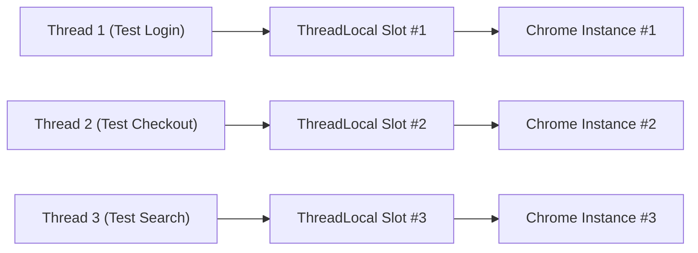

# Kiến trúc & Vận hành UI Framework: Page Object Model (POM), Data-Driven & Chạy Parallel

> **Nguồn tham khảo:** *Full Stack Testing* (Chương 2 — *Page Object Model* tr. 41–48 & TestNG Parallel), Selenium Best Practices (`selenium.dev`), TestNG Documentation (`testng.org`).

Viết được 1 file test Selenium chạy qua login rất dễ; nhưng khi dự án lên tới 30–50 kịch bản UI, nếu bạn viết `driver.findElement(...)` rải rác trong từng test và dùng biến `static WebDriver driver`, bộ test sẽ **vỡ hàng loạt khi UI thay đổi** và **đâm sầm vào nhau khi chạy song song**. Chương này trình bày 3 trụ cột kiến trúc giúp UI Framework đạt chuẩn production.

---

## 1. Page Object Model (POM) Chuẩn Công Nghiệp

### A. 4 Nguyên tắc Thiết kế POM
1. **Tách biệt Logic Test khỏi Chi tiết Giao diện:** Mỗi trang web (hoặc Component tái sử dụng như `HeaderNav`, `CartDrawer`) tương ứng 1 class Java chứa `By` locators và các hành động nghiệp vụ cấp cao (VD: `applyVoucher("SALE20")`, `placeOrder()`).
2. **Đóng gói Wait vào bên trong `BasePage`:** Test script chỉ gọi `checkoutPage.applyVoucher("SALE20")` mà **không bao giờ** tự viết `WebDriverWait` hay `By.id(...)` ở tầng Test!
3. **Fluent Page Chaining (*Full Stack Testing* tr. 46):** Khi một hành động chuyển sang trang khác (VD: `loginPage.loginAs(email, pass)`), hàm đó trả về **`new HomePage(driver)`** giúp viết test cực kỳ mạch lạc.
4. **TUYỆT ĐỐI KHÔNG đặt `Assert.*` bên trong Page Object!** *(Trích nguyên văn Full Stack Testing tr. 46: "Also remember, not to add assertions in your page classes.")*
   - *Tại sao?* Một Page Object có thể được dùng cho cả **Positive Test** (login đúng → vào HomePage) lẫn **Negative Test** (login sai → kỳ vọng ở lại LoginPage hiện thông báo lỗi). Page Object chỉ cung cấp *trạng thái/dữ liệu* (`getErrorMessage()`, `getFinalTotalText()`), còn việc **Assert đúng/sai là trách nhiệm của class Test**!

### B. `By` Locator + `BasePage` vs. `@FindBy` (`PageFactory`)
Mặc dù nhiều tài liệu cũ dùng `@FindBy` + `PageFactory.initElements(...)`, **đội ngũ Selenium hiện nay khuyên dùng `By` kết hợp `BasePage` tường minh** vì:
- `PageFactory` dùng reflection proxy dễ gặp `StaleElementReferenceException` trong ứng dụng React/Vue/Angular SPA hay re-render DOM.
- `By` truyền thẳng vào `WebDriverWait.until(ExpectedConditions.elementToBeClickable(locator))` cực kỳ ổn định và tường minh.

```java
// pages/BasePage.java — Xử lý toàn bộ Explicit Wait tập trung một chỗ
package com.techstore.ui.pages;

import org.openqa.selenium.*;
import org.openqa.selenium.support.ui.ExpectedConditions;
import org.openqa.selenium.support.ui.WebDriverWait;
import java.time.Duration;

public abstract class BasePage {
    protected final WebDriver driver;
    protected final WebDriverWait wait;

    protected BasePage(WebDriver driver) {
        this.driver = driver;
        this.wait = new WebDriverWait(driver, Duration.ofSeconds(10));
    }

    protected void click(By locator) {
        wait.until(ExpectedConditions.elementToBeClickable(locator)).click();
    }

    protected void type(By locator, String text) {
        WebElement el = wait.until(ExpectedConditions.visibilityOfElementLocated(locator));
        el.clear();
        el.sendKeys(text);
    }

    protected String getText(By locator) {
        return wait.until(ExpectedConditions.visibilityOfElementLocated(locator)).getText().trim();
    }

    protected boolean isVisible(By locator) {
        try {
            return wait.until(ExpectedConditions.visibilityOfElementLocated(locator)).isDisplayed();
        } catch (TimeoutException e) {
            return false;
        }
    }
}
```

```java
// pages/LoginPage.java & CheckoutPage.java
public class LoginPage extends BasePage {
    private final By emailInput = By.cssSelector("[data-testid='login-email']");
    private final By passwordInput = By.cssSelector("[data-testid='login-password']");
    private final By submitBtn = By.cssSelector("[data-testid='login-submit']");
    private final By errorBanner = By.cssSelector("[data-testid='login-error']");

    public LoginPage(WebDriver driver) { super(driver); }

    public HomePage loginSuccess(String email, String password) {
        type(emailInput, email);
        type(passwordInput, password);
        click(submitBtn);
        return new HomePage(driver); // Fluent chaining sang trang mới
    }

    public LoginPage loginExpectingError(String email, String password) {
        type(emailInput, email);
        type(passwordInput, password);
        click(submitBtn);
        return this; // Ở lại LoginPage để Test gọi getErrorMessage()
    }

    public String getErrorMessage() {
        return getText(errorBanner);
    }
}
```

---

## 2. Data-Driven Testing với TestNG `@DataProvider`

Khi một kịch bản UI cần chạy với nhiều bộ dữ liệu khác nhau (ví dụ: test đăng nhập với 3 loại tài khoản `Customer`, `VIP`, `Locked`), dùng `@DataProvider` của TestNG (hỗ trợ cả `parallel = true`!):

### A. `@DataProvider` chuẩn trong Java (Inline & Đọc từ CSV/JSON)
```java
public class LoginDataProviders {

    // Đặt parallel = true nếu mỗi dòng data tự tạo session trình duyệt riêng qua ThreadLocal!
    @DataProvider(name = "invalidLoginData", parallel = true)
    public static Object[][] provideInvalidLogins() {
        return new Object[][] {
            { "not-an-email",          "Buyer@123", "Email không đúng định dạng" },
            { "buyer@techstore.vn",    "WrongPass", "Email hoặc mật khẩu không đúng" },
            { "locked@techstore.vn",   "Buyer@123", "Tài khoản đã bị khóa" }
        };
    }

    // Đọc từ JSON file (src/test/resources/testdata/checkout-cases.json) bằng Jackson
    @DataProvider(name = "jsonCheckoutCases")
    public static Iterator<Object[]> loadFromJson() throws IOException {
        ObjectMapper mapper = new ObjectMapper();
        try (InputStream is = LoginDataProviders.class.getResourceAsStream("/testdata/checkout-cases.json")) {
            List<CheckoutUiCase> cases = mapper.readValue(is, new TypeReference<>() {});
            return cases.stream().map(c -> new Object[]{ c }).iterator();
        }
    }
}
```

Sử dụng trong Test class:
```java
@Test(dataProvider = "invalidLoginData", dataProviderClass = LoginDataProviders.class)
public void shouldShowValidationErrorForInvalidLogin(String email, String password, String expectedMsg) {
    LoginPage loginPage = new LoginPage(DriverManager.getDriver())
            .loginExpectingError(email, password);
    Assert.assertTrue(loginPage.getErrorMessage().contains(expectedMsg));
}
```
> **Lưu ý Test Pyramid:** Không lạm dụng Data-Driven UI cho 40 dòng BVA! Chỉ giữ 2–4 dòng đại diện ở UI; toàn bộ tổ hợp dữ liệu lớn đẩy xuống Unit Test (`@ParameterizedTest`) và REST Assured API Test.

---

## 3. Chạy Parallel (Song song) An toàn với `ThreadLocal<WebDriver>`

### A. Vấn đề nếu dùng `protected static WebDriver driver;`
Nếu khai báo `static WebDriver driver` dùng chung, khi TestNG bật `parallel="methods" thread-count="3"`:
- Thread 1 đang gõ email vào Chrome #1 → Thread 2 tạo Chrome #2 đè mất biến `driver` → Thread 1 bấm nhầm nút trên cửa sổ của Thread 2, hoặc Thread 2 gọi `driver.quit()` giết luôn trình duyệt Thread 1 đang chạy dở!

### B. Giải pháp: `ThreadLocal<WebDriver>` trong `DriverManager`


```java
package com.techstore.ui.driver;

import org.openqa.selenium.WebDriver;
import org.openqa.selenium.chrome.ChromeDriver;
import org.openqa.selenium.chrome.ChromeOptions;
import org.openqa.selenium.firefox.FirefoxDriver;
import org.openqa.selenium.firefox.FirefoxOptions;
import java.time.Duration;

public final class DriverManager {
    private static final ThreadLocal<WebDriver> DRIVER_POOL = new ThreadLocal<>();

    private DriverManager() {}

    public static void initDriver(String browser, boolean headless) {
        WebDriver driver = switch (browser.toLowerCase()) {
            case "firefox" -> {
                FirefoxOptions ff = new FirefoxOptions();
                if (headless) ff.addArguments("-headless");
                yield new FirefoxDriver(ff);
            }
            default -> {
                ChromeOptions chrome = new ChromeOptions();
                if (headless) {
                    chrome.addArguments("--headless=new", "--window-size=1920,1080",
                            "--no-sandbox", "--disable-dev-shm-usage");
                }
                yield new ChromeDriver(chrome);
            }
        };
        driver.manage().timeouts().implicitlyWait(Duration.ofSeconds(0)); // Chỉ dùng Explicit Wait!
        if (!headless) {
            driver.manage().window().maximize();
        }
        DRIVER_POOL.set(driver);
    }

    public static WebDriver getDriver() {
        return DRIVER_POOL.get();
    }

    public static void quitDriver() {
        WebDriver driver = DRIVER_POOL.get();
        if (driver != null) {
            try {
                driver.quit();
            } finally {
                DRIVER_POOL.remove(); // BẮT BUỘC gọi remove() để tránh Memory Leak trong Thread Pool!
            }
        }
    }
}
```

### C. Cấu hình `testng.xml` cho Chạy Parallel & Cross-Browser
```xml
<!DOCTYPE suite SYSTEM "https://testng.org/testng-1.0.dtd">
<!-- parallel="methods": các @Test chạy song song; parallel="tests": chạy song song nhiều browser -->
<suite name="TechStore UI Suite" parallel="tests" thread-count="2">
    <listeners>
        <listener class-name="com.techstore.ui.listeners.ScreenshotFailureListener"/>
    </listeners>

    <test name="Chrome Critical Flows" parallel="methods" thread-count="2">
        <parameter name="browser" value="chrome"/>
        <classes>
            <class name="com.techstore.ui.tests.CheckoutUiCriticalTest"/>
        </classes>
    </test>

    <test name="Firefox Critical Flows" parallel="methods" thread-count="2">
        <parameter name="browser" value="firefox"/>
        <classes>
            <class name="com.techstore.ui.tests.CheckoutUiCriticalTest"/>
        </classes>
    </test>
</suite>
```

### D. Tích hợp Selenium Grid / Docker khi Scale lớn
Khi chạy 10+ trình duyệt song song trên CI, thay `new ChromeDriver()` bằng `new RemoteWebDriver(URI.create(gridUrl).toURL(), chromeOptions)` trỏ vào container `selenium/standalone-chrome` hoặc **Selenium Grid 4** (`hub` + `node-chrome`, `node-firefox`). Vì code test chỉ gọi `DriverManager.getDriver()`, **không phải sửa bất kỳ dòng nào trong Page Object hay Test class**!

### E. 4 Nguyên tắc vàng để Parallel Test không bị đụng Data
1. **Không dùng chung 1 tài khoản buyer có trạng thái thay đổi (VD: chung 1 giỏ hàng!)** cho 2 thread chạy cùng lúc. Thread 1 đang test giỏ hàng rỗng thì Thread 2 lại thêm sản phẩm vào giỏ cùng user đó → Flaky ngay!
2. **Tạo dữ liệu cô lập cho từng test** qua REST API (`AuthApiClient` / `CartApiClient`) trong `@BeforeMethod` trước khi mở trình duyệt!
3. **Không dùng biến `static` lưu state** trong Page Object hay Step Definition.
4. **Luôn dọn `DRIVER_POOL.remove()`** trong khối `finally` của `@AfterMethod`.
