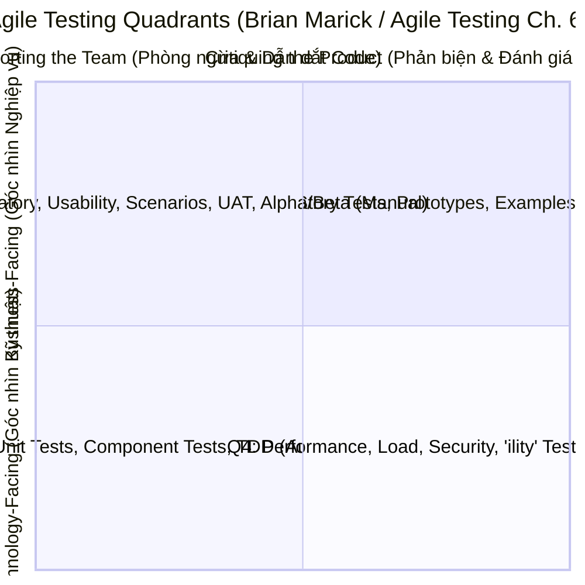
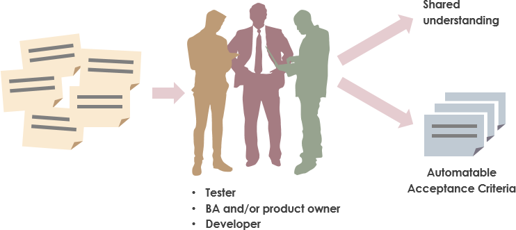

# Agile Testing: Quadrants (Q1–Q4), Vai trò Tester trong Scrum, Three Amigos, AC & DoD

> **Nguồn tham khảo:** *Agile Testing* (Lisa Crispin & Janet Gregory — Chương 1, 6, 17, 18), Scrum Guide (2020), *Full Stack Testing* (Chương 1 — Shift-Left Testing).

Trong mô hình Waterfall truyền thống, QA thường đứng ở cuối dây chuyền ("lính gác cổng"), chờ Dev code xong hết mới test. Trong **Agile / Scrum**, chất lượng không phải trách nhiệm riêng của QA mà là **Whole-Team Approach (Trách nhiệm của cả đội)**. Với lợi thế đang làm **Scrum Master**, bạn có thể áp dụng trực tiếp các thực hành này vào quy trình vận hành hằng ngày của team!

---

## 1. Agile Testing Quadrants (Ma trận 4 Góc phần tư Q1–Q4)

Được khởi xướng bởi **Brian Marick** và hệ thống hóa trong Chương 6 *Agile Testing*, 4 góc phần tư giúp team trả lời câu hỏi: *"Chúng ta cần những loại kiểm thử nào và vì mục đích gì?"*.

> **Lưu ý cực quan trọng từ *Agile Testing* (tr. 98):**
> - Số thứ tự `Q1, Q2, Q3, Q4` **KHÔNG phải là thứ tự thực hiện theo thời gian**! Nhiều team bắt đầu bằng việc viết **Q2** (ví dụ nghiệp vụ từ khách hàng/PO) *trước*, rồi Dev dùng **Q1** (TDD) để viết code, song song kiểm thử **Q4** (Performance/Security) sớm và khám phá **Q3** ngay khi story vừa lên môi trường Test.

| Góc phần tư | Trục định hướng | Mục tiêu chính | Loại kiểm thử & Công cụ tiêu biểu | Ai thực hiện chính? |
| :---: | :--- | :--- | :--- | :--- |
| **Q1** | Technology-Facing · **Support Team** | Đảm bảo **Internal Code Quality**, dẫn dắt thiết kế, chống hồi quy nhanh. | Unit Test, Component Test, TDD (JUnit 5, Mockito, Testcontainers). | **Developer / SDET** (Tự động hóa 100%). |
| **Q2** | Business-Facing · **Support Team** | Xác minh **"Build the right thing"** ngay từ lúc phân tích Story; làm tiêu chí hoàn thành (*Conditions of Satisfaction*). | Story / Acceptance Tests, API Functional Tests, Examples, Wireframe/Prototype (REST Assured, Cucumber, Postman). | **Whole Team** (PO + Dev + QA thảo luận; QA/Dev tự động hóa). |
| **Q3** | Business-Facing · **Critique Product** | Giả lập trải nghiệm người dùng thật để phát hiện lỗ hổng mà kịch bản cứng bỏ sót. | **Exploratory Testing (SBTM)**, Usability Testing, UAT, Alpha/Beta. | **QA / PO / End-Users** (Con người & Tư duy phản biện). |
| **Q4** | Technology-Facing · **Critique Product** | Đánh giá thuộc tính phi chức năng (`"-ility"`): chịu tải, bảo mật, tương thích, tin cậy. | Load/Stress (JMeter, k6), Security (OWASP ZAP, Burp Suite), Accessibility (axe). | **QA Chuyên sâu / DevOps / Security** (Dùng Tool). |

---

## 2. Vai trò của Tester / QA trong Vòng đời một Sprint (Scrum)

Trong Scrum chuẩn, không có khái niệm "Sprint code trước, Sprint sau mới test" (*Mini-Waterfall*)! Tester đồng hành xuyên suốt cả Sprint:

| Sự kiện Scrum | Hoạt động của Tester / QA (Và Scrum Master hỗ trợ) |
| :--- | :--- |
| **1. Backlog Refinement** | Đọc trước User Story, dùng Checklist C1–C10 (GĐ 0) phát hiện điểm mơ hồ, đặt câu hỏi làm rõ Edge Cases và NFR (tốc độ, phân quyền) **trước khi Sprint bắt đầu**. |
| **2. Sprint Planning** | Tham gia ước lượng độ phức tạp (Story Points **phải bao gồm cả công sức test & viết automation**, không chỉ công sức code!). Liệt kê Task kiểm thử cần chuẩn bị. |
| **3. Three Amigos (Đầu Story)** | Chốt Acceptance Criteria, các ví dụ cụ thể (Boundary/Negative cases) và phân tầng kiểm thử (**Case nào viết ở Unit Test, API Test hay UI Test** để tránh *Cupcake Antipattern*). |
| **4. Daily Scrum & Coding/Testing** | Test sớm từng phần nhỏ (*Thin slices*), chạy **Pair Testing** cùng Dev trên máy Dev ngay khi vừa xong logic, thực hiện **Exploratory Testing (Q3)** cho tính năng hoàn chỉnh. |
| **5. Sprint Review (Demo)** | Hỗ trợ PO trình diễn các kịch bản nghiệp vụ & edge cases nổi bật; ghi nhận phản hồi UAT từ Stakeholder. |
| **6. Sprint Retrospective** | Đề xuất cải tiến chất lượng quy trình (VD: *Tại sao bug này lọt sang QA? Thiếu test ở tầng Unit nào? Môi trường staging chậm ra sao?*). |

---

## 3. Three Amigos (Power of Three) — Bắt Bug Trước Khi Gõ Dòng Code Đầu Tiên

Trong Chương 18 *Agile Testing* (tr. 411) gọi thực hành này là **"Power of Three"**: trước khi Dev bắt tay code một User Story phức tạp, **3 góc nhìn** ngồi lại với nhau khoảng **15–20 phút**:

*Hình: Buổi Three Amigos kết hợp góc nhìn Business (PO/BA) – Development (Dev) – Testing (QA) để thống nhất hiểu biết chung và bộ Acceptance Criteria kiểm thử được (Nguồn ảnh: Visual Paradigm).*

### Đầu ra bắt buộc của một buổi Three Amigos
1. Bộ **Acceptance Criteria (AC)** rõ ràng, kiểm thử được (*testable*), không mập mờ.
2. Ít nhất **3–5 ví dụ cụ thể** (Happy Path + Boundary + Negative/Error Path) — nền tảng cho BDD hoặc Parameterized Test.
3. **Thỏa thuận phân tầng Test (Test Pyramid Agreement):** Dev cam kết viết Unit/Testcontainers cho logic X; QA chuẩn bị REST Assured/Postman cho API Y và giữ 1 kịch bản UI Smoke Z.

---

## 4. Acceptance Criteria (AC) vs. Definition of Done (DoD)

*(Câu hỏi rất hay bị nhầm lẫn trong phỏng vấn Agile QA & Scrum Master)*

| Tiêu chí | Acceptance Criteria (AC — Tiêu chí chấp nhận) | Definition of Done (DoD — Định nghĩa hoàn thành) |
| :--- | :--- | :--- |
| **Phạm vi áp dụng** | **Riêng biệt cho TỪNG User Story** / PBI. | **Chung cho TOÀN BỘ Product / Sprint** (mọi Story đều phải qua). |
| **Nội dung mô tả** | Các hành vi chức năng & điều kiện nghiệp vụ cụ thể để PO nghiệm thu tính năng đó. | Các tiêu chuẩn kỹ thuật & chất lượng tối thiểu trước khi coi Increment là *Releasable*. |
| **Ai định nghĩa?** | PO + Three Amigos khi refine từng Story. | Toàn bộ Scrum Team (hoặc chuẩn tổ chức). |

### A. Hai cách viết Acceptance Criteria chuẩn mực
1. **Scenario-Oriented (Given / When / Then — Hợp với luồng trạng thái/tương tác):**
   > **Scenario:** Chuyển đổi Lead đủ điều kiện thành Deal trên CRM  
   > **Given** Sales đang mở Lead ở trạng thái `QUALIFIED` có đầy đủ Email và Số điện thoại  
   > **When** Sales nhấn "Convert to Deal", nhập giá trị dự kiến `100.000.000đ` và xác nhận  
   > **Then** hệ thống tạo mới 1 Customer, 1 Contact và 1 Deal ở stage `PROSPECTING`, đồng thời khóa Lead ở trạng thái `CONVERTED` (không cho convert lần 2).
2. **Rule-Oriented (Checklist gạch đầu dòng — Hợp với quy tắc tính toán/validate):**
   - Chỉ `Owner` của Lead hoặc `Sales Manager` mới có quyền Convert.
   - Không cho phép Convert nếu Lead đã ở trạng thái `CONVERTED` hoặc `DISQUALIFIED` (trả `409 Conflict`).
   - Toàn bộ thao tác tạo `Customer + Contact + Deal + Update Lead` phải nằm trong **1 transaction nguyên tử**.

### B. Mẫu Definition of Done (DoD) thực chiến cho Team Scrum
Một User Story **KHÔNG** được kéo sang cột `Done` nếu thiếu bất kỳ mục nào dưới đây:
- [ ] Code đã qua **Code Review** (ít nhất 1 peer approve) và đạt Static Analysis (SonarQube/Checkstyle không có Blocker/Critical).
- [ ] **Unit Test + Integration Test** đạt ngưỡng thỏa thuận (VD: `>= 80%` Branch Coverage trên nghiệp vụ mới) và chạy XANH 100% trên CI.
- [ ] Tất cả **Acceptance Criteria** đã được kiểm chứng pass trên môi trường Test/Staging (API + UI smoke).
- [ ] Đã thực hiện ít nhất 1 phiên ngắn **Exploratory Testing** kiểm tra edge cases & cross-browser cơ bản.
- [ ] Không còn bug mức `Critical` / `High` đang mở thuộc Story này; bug mức `Low` đã được PO triage đồng ý đưa vào backlog nếu hoãn.
- [ ] Tài liệu API (Swagger/OpenAPI) hoặc hướng dẫn migration DB (Flyway) đã được cập nhật.
