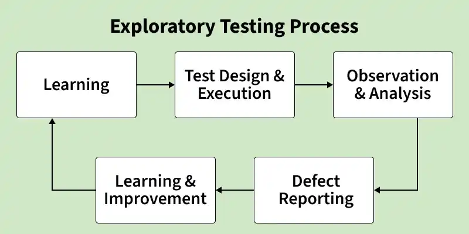
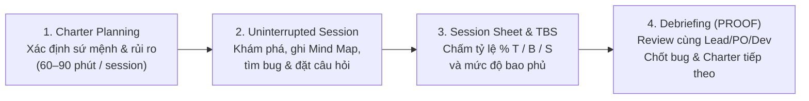
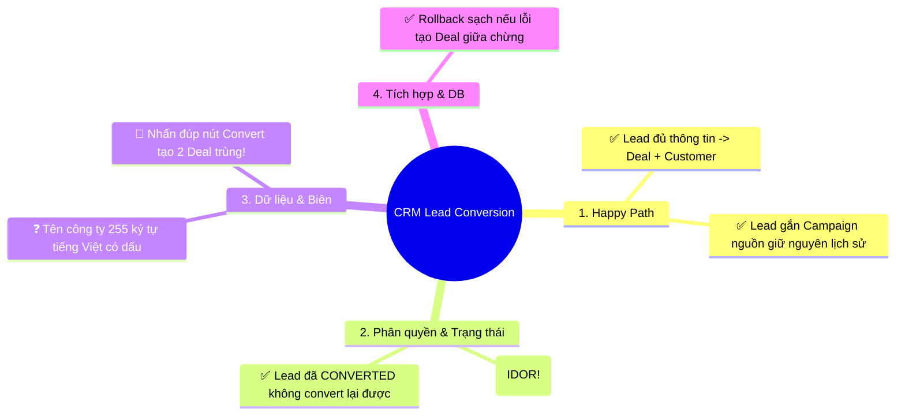

# Exploratory Testing: Session-Based Test Management (SBTM), Charter & Mind Map

> **Nguồn tham khảo:** James Bach & Jon Bach (*Session-Based Test Management*, `satisfice.com`), Elisabeth Hendrickson (*Explore It!*), *Agile Testing* (Chương 10 — *Exploratory Testing & Session-Based Testing*, trang 195–201).

Một hiểu lầm phổ biến là coi **Exploratory Testing (ET)** bằng với "bấm bừa không cần kế hoạch" (*Ad-hoc Testing*). Thực tế, theo James Bach và Chương 10 *Agile Testing*, Exploratory Testing là sự kết hợp đồng thời của **Học tập (Learning) + Thiết kế Test (Test Design) + Thực thi (Test Execution)** dựa trên tư duy phản biện, còn **Session-Based Test Management (SBTM)** là bộ khung quản lý giúp ET **đo lường được, kiểm soát được và giải trình được với PM/Stakeholder**.

---

## 1. Phân biệt Ad-hoc Testing vs. Exploratory Testing vs. Scripted Testing

| Tiêu chí | Scripted Testing | Ad-hoc Testing | Exploratory Testing (với SBTM) |
| :--- | :--- | :--- | :--- |
| **Kịch bản viết trước** | Chi tiết từng bước từ trước khi chạy. | Không có kế hoạch, bấm ngẫu hứng. | Có **Charter (Sứ mệnh)** & Heuristics định hướng, thiết kế test **ngay trong lúc chạy**. |
| **Khả năng phát hiện bug bất ngờ** | Trung bình (chỉ tìm thấy lỗi đã lường trước). | Hên xui, dễ bỏ sót vùng quan trọng. | **Rất cao** (quan sát phản hồi app để đào sâu vào vùng nghi ngờ!). |
| **Đo lường & Báo cáo** | Đếm `% Test Case Pass/Fail`. | Không đo được, không lặp lại được. | Đo qua **Session Sheet**, **TBS Metrics**, và **Mind Map / Debriefing**. |

---

## 2. Cấu trúc của Session-Based Test Management (SBTM)

*Hình: Bản chất vòng lặp đồng thời giữa Learning → Test Design & Execution → Observation & Analysis → Defect Reporting (Nguồn ảnh: GeeksforGeeks).*

### A. Charter (Bản sứ mệnh kiểm thử) — Viết theo công thức Elisabeth Hendrickson
> **Công thức chuẩn:**
> **`Explore [Target / Vùng chức năng]`**
> **`With [Resources / Công cụ, Dữ liệu, Heuristics]`**
> **`To Discover [Risks / Thông tin, Bug cần tìm]`**

*Ví dụ Charter trên TechStore / CRM:*
- **Charter 1:** *"Explore **quy trình Convert Lead sang Deal trên CRM** with **tài khoản Sales không phải Owner, dữ liệu Unicode/biên dài, và 2 tab mở song song** to discover **lỗi phân quyền IDOR, mất dữ liệu khi chuyển đổi, hoặc tạo trùng Deal (Duplicate)**."*
- **Charter 2:** *"Explore **chức năng Import CSV khách hàng hàng loạt** with **file lỗi encoding UTF-8 BOM, 10.000 dòng, email trùng lặp** to discover **treo timeout, nhập sót dòng hoặc lỗi rollback dở dang**."*

### B. Time-Boxing (Khung thời gian tập trung)
- Một Session chuẩn kéo dài **60 – 90 phút** (không họp hành, không check Slack giữa chừng để duy trì luồng tập trung sâu).
- Nếu một vùng lớn chưa khám phá hết sau 90 phút, **kết thúc đúng giờ** và tách thành Charter nối tiếp ở phiên sau.

### C. Bộ chỉ số TBS (Task Breakdown Metrics)
Trong mỗi Session Sheet, Tester ước lượng tỷ lệ `%` thời gian thực sự tiêu tốn cho 3 nhóm việc (tổng = `100%`):

| Thành phần | Ý nghĩa | Dấu hiệu cảnh báo cho Scrum Master / Test Lead |
| :--- | :--- | :--- |
| **T — Testing (Test Design & Execution)** | Thời gian thực sự nghĩ ra ý tưởng test và tương tác tìm lỗi. | Tỷ lệ lành mạnh thường từ **60% – 80%**. |
| **B — Bug Investigation & Reporting** | Thời gian cô lập nguyên nhân tái hiện, chụp ảnh/quay video, viết Bug Report. | Nếu `B > 40%`: chất lượng build đang rất nát hoặc bug khó tái hiện. |
| **S — Session Setup** | Thời gian chuẩn bị dữ liệu giả lập, reset DB, chờ build deploy, dọn môi trường lỗi. | Nếu **`S > 25%`**: môi trường test hoặc seed data đang cản trở nghiêm trọng năng suất team → cần Dev/DevOps cải thiện ngay! |

*(Ngoài ra có thể ghi tách **Opportunity Testing** nếu trong lúc chạy phát hiện bug nằm ngoài phạm vi Charter ban đầu và dành vài phút kiểm tra nhanh).*

### D. Debriefing theo Mô hình **PROOF** (15 phút sau mỗi Session)
Buổi trao đổi nhanh giữa Tester với Test Lead / PO / Dev dựa trên 5 câu hỏi:
- **P — Past (Product):** Đã xảy ra chuyện gì trong phiên vừa rồi? Phát hiện bug/rủi ro nào?
- **R — Results:** Đạt được mục tiêu Charter chưa? Những phần nào đã chạm tới, phần nào chưa?
- **O — Obstacles:** Có rào cản nào (môi trường lag, thiếu tài khoản quyền Admin, spec mâu thuẫn)?
- **O — Outlook:** Bước tiếp theo cần tạo thêm Charter mới nào hoặc cần bổ sung Automated Test gì?
- **F — Feelings:** Cảm nhận trực giác của Tester về độ ổn định/tin cậy của tính năng hiện tại (*"Rất mượt"` vs `"Rất mong manh, không nên release vội"*).

---

## 3. Heuristics & Tours cho Exploratory Testing (Kho vũ khí ý tưởng)

Khi ngồi trước màn hình trống, dùng các **Heuristics** (mẹo gợi ý) sau để không bao giờ cạn ý tưởng:

| Heuristic / Tour | Ý nghĩa & Cách áp dụng |
| :--- | :--- |
| **SFDPOT** *(James Bach)* | Kiểm tra sản phẩm dưới 6 lăng kính: **S**tructure (cấu trúc DB/File), **F**unction (chức năng), **D**ata (biên/null/Unicode), **P**latform (Chrome/Safari/Mobile), **O**perations (người dùng thật thao tác thế nào), **T**ime (hết phiên, múi giờ, cuối tháng/năm). |
| **CRUD** | Mọi đối tượng nghiệp vụ (`Lead`, `Deal`, `Voucher`): thử đủ **C**reate – **R**ead – **U**pdate – **D**elete, đặc biệt là **Update/Delete đối tượng đang được đối tượng khác tham chiếu**! |
| **Zero – One – Many** | Thử danh sách có `0` phần tử (Empty state), `1` phần tử, và `1.000` phần tử (Pagination, scroll, tràn layout). |
| **Goldilocks** | Quá nhỏ (`""`, `-1`), Quá lớn (`5.000 ký tự`, `999.999.999`), và Vừa đúng. |
| **Saboteur / Antisocial Tour** | Cố tình bấm Back trình duyệt, nhấn đúp nút Submit, tắt mạng giữa chừng, mở 2 tab sửa cùng 1 record. |

---

## 4. Sử dụng Mind Map trong Exploratory Testing

Thay vì viết file Word dài dòng trước khi test, **Mind Map** (XMind, Miro, Draw.io hoặc Mermaid) giúp Tester:
1. **Lập bản đồ phạm vi (Scope Map)** theo từng nhánh chức năng/rủi ro trong 10 phút trước khi chạy.
2. **Ghi chú siêu tốc & Đánh dấu trực quan** ngay trong phiên:
   - ✅ Nhánh xanh: Đã kiểm tra xong, ổn định.
   - 🐞 Nhánh đỏ: Phát hiện Bug (gắn mã `BUG-104`).
   - ❓ Nhánh vàng: Nghi vấn nghiệp vụ cần hỏi PO (`Needs Clarification`).
   - ⏳ Nhánh xám: Chưa kịp test → chuyển thành Charter tiếp theo.

