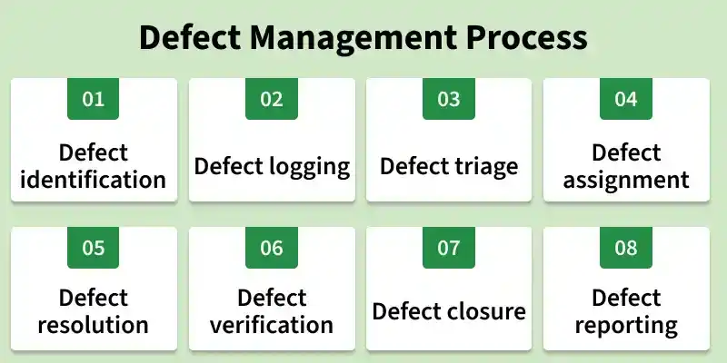
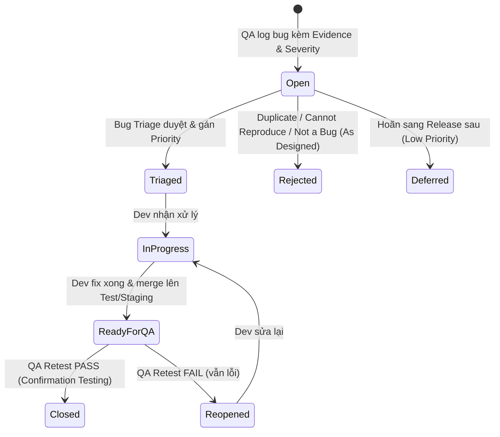

# Defect Management, Triage, Root Cause Analysis & Jira Thực chiến

> **Nguồn tham khảo:** *Agile Testing* (Chương 5 — *Defect Tracking*, tr. 79–86 & Chương 18 — *Dealing with Bugs*, tr. 416–426), Atlassian Jira JQL Reference, ISTQB CTFL Section 5.5.

Quản lý lỗi không chỉ là "mở Jira tạo ticket rồi ngồi chờ". Một QA / Scrum Master giỏi biết cách **phân loại nhanh tại Bug Triage**, **tìm nguyên nhân gốc rễ (RCA)** để lỗi tương tự không lặp lại, và **dùng JQL + Dashboard** để nắm mạch sức khỏe sản phẩm theo thời gian thực.

---

## 1. Khi nào CẦN log Bug lên Jira và khi nào KHÔNG nên? (*Agile Testing* Ch. 5 & 18)

Lisa Crispin & Janet Gregory đưa ra góc nhìn cực kỳ thực tế giúp tránh "rác tồn đọng" trên Jira:
- **KHÔNG cần tạo ticket Jira khi:**
  1. **Unit Test / CI Build fail** ngay khi Dev vừa push code (Dev sửa liền trong vài phút).
  2. Bạn **Pair Testing** cùng Dev trên Story đang làm trong Sprint, phát hiện lỗi và Dev **sửa ngay lập tức tại chỗ** (chỉ cần thêm test tự động bảo vệ để không tái phát!).
- **BẮT BUỘC log Bug lên Jira (Defect Tracking System) khi:**
  1. Bug phát hiện từ Story đã xong hoặc trên môi trường Staging/Production (*Escaped Bug*).
  2. Dev đang bận việc khác không sửa ngay được trong ngày, hoặc **team làm việc phân tán (remote)** cần lịch sử theo dõi, bằng chứng log/HAR/video.
  3. Bug cần đưa ra buổi **Triage** để PO quyết định có sửa ở Sprint này hay hoãn sang release sau (*Deferred*), hoặc cần bằng chứng cho kiểm toán / Release Notes.

---

## 2. Vòng đời Defect chuẩn trên Jira Workflow



*Hình: Quy trình quản lý lỗi tổng quát từ phát hiện, ghi nhận, Triage, phân công, sửa lỗi, xác nhận lại, đóng lỗi và báo cáo (Nguồn ảnh: GeeksforGeeks).*

Ánh xạ vào cấu hình trạng thái tùy biến trên bảng Jira của dự án TechStore / CRM:



> **Quy tắc chuyển trạng thái "Ready for QA":** Khi Dev kéo ticket sang `Ready for QA`, bắt buộc phải điền comment hoặc field: **Fix Version / Build Commit** + **Nguyên nhân lỗi** + **Test đã thêm ở tầng nào** (để QA biết cách retest và kiểm tra hồi quy vùng ảnh hưởng).

---

## 3. Bug Triage Meeting — Nghệ thuật Ra quyết định Nhanh

**Bug Triage** (thường họp 15–30 phút định kỳ 2 lần/tuần hoặc cuối ngày trước Release) gồm **PO + Tech Lead/Dev + QA Lead (+ Scrum Master điều phối)**.

### 4 Quyết định đầu ra của Triage cho mỗi Bug
1. **Fix Now (Blocker / P1):** Ảnh hưởng luồng sống còn (thanh toán, mất dữ liệu, bảo mật) → kéo vào Sprint hiện tại xử lý ngay (hoặc Hotfix nếu ở Production).
2. **Schedule in Next Sprint (P2):** Có ảnh hưởng nhưng có cách xử lý tạm (*workaround*), xếp vào Sprint tới.
3. **Defer / Backlog (P3) hoặc Won't Fix:** Lỗi thẩm mỹ nhỏ, tỷ lệ gặp cực thấp → PO quyết định hoãn hoặc đóng thẳng để giữ backlog sạch (theo *Agile Testing* tr. 423: *"Đừng giữ mở những bug mà bạn biết chắc sẽ không bao giờ sửa!"*).
4. **Convert to User Story:** Khi nhận ra bug thực chất là một **tính năng bị thiếu trong đặc tả gốc** (*Hidden Backlog* — *Agile Testing* tr. 426), chuyển thành Story mới để estimate và làm đàng hoàng!

---

## 4. Root Cause Analysis (RCA) — Chặn Bug Tận Gốc bằng 5 Whys & Fishbone

Mỗi khi có **Escaped Bug** (bug lọt ra UAT/Production) hoặc một cụm bug lặp đi lặp lại ở cùng 1 module, team tổ chức RCA (thường đưa vào **Retrospective**):

### A. Kỹ thuật **5 Whys** (Ví dụ thực tế từ TechStore/CRM)
- **Sự cố:** Khách hàng áp mã `SALE20` cho đơn chưa đến ngày mở bán làm thất thoát doanh thu trên Production.
  1. *Why 1:* Tại sao dùng được mã chưa đến ngày mở? → Vì `VoucherService` chỉ kiểm tra `now.isAfter(endDate)` mà quên `now.isBefore(startDate)`.
  2. *Why 2:* Tại sao lỗi này qua lọt Unit Test? → Vì bộ Unit Test chỉ kiểm tra 1 ngày đang hiệu lực và 1 ngày hết hạn, không test biên `startDate - 1s`.
  3. *Why 3:* Tại sao không viết test cho `startDate`? → Vì User Story không ghi rõ ví dụ biên thời gian mở bán trong Acceptance Criteria.
  4. *Why 4:* Tại sao AC lại thiếu ví dụ biên? → Vì Story chưa đi qua buổi **Three Amigos** và chưa đối chiếu Checklist Boundary (C05) trước khi Dev code.
  5. *Why 5 (Gốc rễ quy trình):* Team chưa có quy tắc bắt buộc kiểm tra **Boundary Checklist** ở Refinement & **PITest Mutation / BVA** trong Definition of Done!
- **Hành động khắc phục (CAPA):**
  - *Immediate:* Vá logic `isBefore(startDate)` + thêm `@ParameterizedTest` 4 mốc biên thời gian.
  - *Systemic:* Bổ sung bước kiểm tra Boundary Cases vào Three Amigos & bật Mutation Testing cho module Pricing/Voucher.

### B. Biểu đồ Xương cá (**Ishikawa / Fishbone**) — 6 nhóm nguyên nhân
Khi phân tích một sự cố lớn có nhiều tác nhân đồng thời, chia nguyên nhân theo 6 nhánh: **Requirements** (Spec mơ hồ), **Code/Design** (Thiếu validation/transaction), **Testing** (Thiếu test data/BVA/Concurrency), **Environment** (Staging khác Production), **Process** (Bỏ qua review/DoD), **Human/Communication** (Hiểu nhầm giữa FE và BE).

---

## 5. Làm chủ Jira cho QA & Scrum Master: JQL Thực chiến & Dashboard

### A. 8 Câu lệnh JQL "Gối đầu giường"

```jql
-- 1. Hàng chờ Triage: Bug mới chưa có Priority/Assignee
project = CRM AND issuetype = Bug AND status = Open AND assignee IS EMPTY ORDER BY created ASC

-- 2. Bug nghiêm trọng đang chặn Sprint hiện tại
project = CRM AND issuetype = Bug AND sprint in openSprints() AND priority in (Highest, High) AND status not in (Closed, Done, Rejected)

-- 3. Danh sách Bug Dev báo đã fix, đang chờ QA Retest ngay!
project = CRM AND issuetype = Bug AND status = "Ready for QA" ORDER BY priority DESC, updated ASC

-- 4. Escaped Bugs (Bug lọt lên Production trong tháng hiện tại)
project = CRM AND issuetype = Bug AND (labels = "escaped-prod" OR environment ~ "prod*") AND created >= startOfMonth()

-- 5. Bug "ngâm giấm" quá 5 ngày chưa cập nhật tiến độ
project = CRM AND issuetype = Bug AND status in (Open, "In Progress") AND updated <= -5d ORDER BY updated ASC

-- 6. Bug bị Reopen nhiều lần (Dấu hiệu Dev fix ẩu hoặc chưa hiểu đúng yêu cầu!)
project = CRM AND issuetype = Bug AND status WAS Reopened AND sprint in openSprints()

-- 7. Tìm Bug phát sinh trong 7 ngày gần nhất bởi chính mình report
reporter = currentUser() AND issuetype = Bug AND created >= -7d

-- 8. Kiểm tra tất cả Story trong Sprint hiện tại nhưng CHƯA có link Test Case / Sub-task Test
project = CRM AND issuetype = Story AND sprint in openSprints() AND issueLinkType != "is tested by"
```

### B. Cấu hình một "QA Quality & Triage Dashboard" trên Jira
Gồm **4 Gadget cốt lõi** nhìn 1 lần là nắm được rủi ro Release:
1. **Filter Results:** Hiển thị danh sách *"Ready for QA"* và *"Open Unassigned Triage Queue"* (giúp QA test & assign ngay trên màn hình).
2. **Two-Dimensional Filter Statistics:** Trục X = `Priority` (`Highest/High/Medium/Low`), Trục Y = `Status` (`Open/In Progress/Ready for QA/Reopened`) → **phát hiện ngay nút thắt cổ chai** (VD: 12 bug High đang kẹt ở `Ready for QA` chưa ai test!).
3. **Created vs. Resolved Chart (30 ngày gần nhất):** Đường màu xanh (Resolved) phải bắt kịp hoặc vượt đường đỏ (Created) trước ngày Release; nếu hai đường doãng rộng ra là dấu hiệu không đủ tiêu chuẩn Go-Live!
4. **Pie Chart (by Component / Root Cause Label):** Nhìn thấy ngay module nào (VD: `Lead-Conversion` chiếm 45% tổng số bug) đang cần **Refactor + tăng Unit/Integration Test**!
