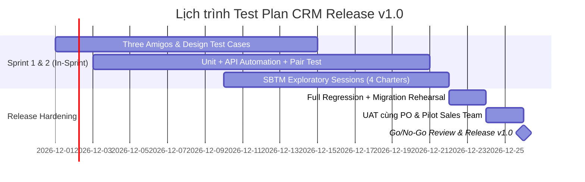

# Deliverable 1 Giai đoạn 4: Test Strategy & Test Plan cho Project CRM

> **Chuẩn áp dụng:** ISO/IEC/IEEE 29119-3 (Test Plan), *Agile Testing* (Chương 5 — *Test Strategy vs. Test Planning* & Chương 15 — *Lightweight Test Plans*).  
> **Đối tượng áp dụng:** Hệ thống **CRM (Customer Relationship Management)** — Quản lý Lead, Customer/Contact, Deal Pipeline, Activities & Sales Dashboard.

---

# PHẦN I — TEST STRATEGY (Chiến lược Kiểm thử Cấp Sản phẩm CRM)

> *Tài liệu tĩnh (Static) dùng chung xuyên suốt mọi Sprint & Release của sản phẩm CRM.*

## 1. Triết lý & Mô hình Kiểm thử (Agile Testing Quadrants + Test Pyramid)
- **Whole-Team Quality:** Chất lượng là trách nhiệm chung của PO, Dev, QA và Scrum Master. Mỗi User Story phức tạp bắt buộc trải qua buổi **Three Amigos** trước khi code.
- **Shift-Left & Test Pyramid:**
  - **Tầng đáy (Q1 — ~65%):** Unit Test (JUnit 5/Mockito hoặc framework backend tương ứng) + Integration Test với PostgreSQL thật (Testcontainers). Ngưỡng bắt buộc: **`>= 80%` Branch Coverage** trên nghiệp vụ lõi (`lead`, `deal`, `permission`).
  - **Tầng giữa (Q2 — ~25%):** API Functional + Contract + Security/RBAC Test (REST Assured / Postman+Newman). Mọi quy tắc EP/BVA, Decision Table, State Transition đều tự động hóa ở tầng này.
  - **Tầng đỉnh (Q3 — ~10% Automation + Exploratory):** UI E2E chỉ giữ **Critical Smoke Flows** (Login → Convert Lead → Move Deal on Kanban). Kết hợp **SBTM Exploratory Testing** hàng Sprint để săn lỗi logic ẩn và UX.
  - **Phi chức năng (Q4):** Kiểm tra bảo mật OWASP Top 10 (đặc biệt **IDOR/BOLA** vì dữ liệu khách hàng CRM cực kỳ nhạy cảm!) và Performance Load test cho màn hình Pipeline/Dashboard trước các đợt Release lớn.

## 2. Quy chuẩn Công cụ & Môi trường
| Hạng mục | Tiêu chuẩn áp dụng cho CRM |
| :--- | :--- |
| **Quản lý Task, Defect & Triage** | **Jira** (Workflow: `Open → Triaged → In Progress → Ready for QA → Closed / Reopened`). |
| **Quản lý Test Case & Regression** | **Zephyr Scale / TestRail** liên kết 2 chiều với Jira Story & Bug. |
| **CI/CD Quality Gates** | Mọi Pull Request phải pass 100% Static Analysis + Unit Tests + API Smoke Tests trước khi merge. |
| **Quy tắc Log Bug** | Bug sửa ngay khi Pair Testing với Dev không cần mở ticket; bug tồn đọng hoặc Escaped Bug bắt buộc log đầy đủ Environment, Steps, Evidence (HAR/Screenshot/SQL) và gắn nhãn gốc rễ. |

---

# PHẦN II — RELEASE TEST PLAN (Kế hoạch Kiểm thử CRM Release v1.0)

> *Tài liệu động (Dynamic) lập riêng cho đợt phát hành **CRM v1.0 (MVP)** gồm 5 module lõi.*

## 1. Thông tin Tài liệu (Document Control)
| Trường | Nội dung |
| :--- | :--- |
| **Mã Test Plan** | `TP-CRM-REL-01` |
| **Phiên bản** | `v1.0` |
| **Phạm vi Release** | CRM MVP: Authentication/RBAC, Lead Management & Conversion, Customer/Contact, Deal Pipeline, Sales Dashboard |
| **Thời gian dự kiến** | 2 Sprints (4 tuần) + 3 ngày Release Hardening & UAT |
| **Người lập & Phê duyệt** | QA Lead / Scrum Master & Product Owner |

---

## 2. Phạm vi Kiểm thử (Scope: In-Scope vs. Out-of-Scope)

### In-Scope (Nằm trong phạm vi kiểm thử v1.0)
1. **Auth & Phân quyền (RBAC):** Roles `ADMIN`, `SALES_MANAGER`, `SALES_REP` (nguyên tắc cô lập dữ liệu: Sales Rep chỉ thấy & thao tác trên Lead/Deal của mình, trừ khi được share).
2. **Lead Lifecycle & Conversion:** Tạo, chỉnh sửa, Import CSV, đổi trạng thái (`NEW → CONTACTED → QUALIFIED → CONVERTED / DISQUALIFIED`), Convert Lead → Customer + Contact + Deal.
3. **Customer & Contact:** CRUD, kiểm tra trùng lặp Email/Số điện thoại, lịch sử tương tác (Notes/Calls/Meetings).
4. **Deal Pipeline (Kanban & List):** Tạo Deal, kéo thả chuyển Stage, tính toán Weighted Forecast (`Amount × Probability`), đóng Deal (`CLOSED_WON` / `CLOSED_LOST` bắt buộc nhập lý do thua).
5. **Database & Migration Integrity:** Kiểm tra script Flyway `V1..V8`, transaction rollback và đối chiếu số liệu Dashboard SQL.

### Out-of-Scope (Không nằm trong v1.0 — hoãn sang v1.1)
- Tích hợp gửi Email 2 chiều qua Gmail/Outlook SMTP thực (v1.0 chỉ mock/log email).
- Mobile App iOS/Android native (v1.0 chỉ hỗ trợ Web Responsive trên Desktop & Tablet).
- Tích hợp tổng đài VoIP ghi âm cuộc gọi.

---

## 3. Đánh giá Rủi ro & Phân bổ Nỗ lực (Risk-Based Testing Matrix)

| ID | Tính năng / Rủi ro | Likelihood | Impact | Risk Level | Chiến lược & Kỹ thuật Test Áp dụng |
| :---: | :--- | :---: | :---: | :---: | :--- |
| **R-01** | **Rò rỉ dữ liệu khách hàng giữa các Sales Rep (BOLA / IDOR)** | High (3) | Critical (3) | **9 (Critical)** | Test phân quyền toàn diện ở API (`REST Assured` cho mọi endpoint `GET/PUT/DELETE` chéo user) + Security Audit. |
| **R-02** | **Lỗi Transaction / Tạo trùng dữ liệu khi Convert Lead** | High (3) | High (3) | **9 (Critical)** | Testcontainers Concurrency test (2 request song song), SQL Integrity check, SBTM Charter chuyên sâu. |
| **R-03** | **Sai công thức tính Doanh thu & Weighted Forecast trên Dashboard** | Med (2) | High (3) | **6 (High)** | Decision Table + BVA (0đ, số lớn, thập phân) + SQL Aggregation đối chiếu trực tiếp với UI Dashboard. |
| **R-04** | **Lỗi Migration Flyway khi nâng cấp dữ liệu thật** | Med (2) | High (3) | **6 (High)** | Diễn tập chạy Flyway `V1..V8` trên bản sao dữ liệu Staging có sẵn 50.000 dòng trước khi lên Production. |
| **R-05** | **Import CSV Lead bị lỗi font tiếng Việt UTF-8 hoặc quá tải** | Med (2) | Med (2) | **4 (Medium)** | EP/BVA kích thước file (`0 dòng`, `1 dòng`, `5.000 dòng`, sai định dạng `.xlsx`, file UTF-8 BOM). |
| **R-06** | **Hiển thị lệch layout nhẹ ở màn hình cài đặt cá nhân** | Low (1) | Low (1) | **1 (Low)** | Kiểm tra nhanh bằng mắt khi chạy Exploratory UI trên Chrome/Edge mới nhất. |

---

## 4. Môi trường, Dữ liệu Test & Lịch trình Thực hiện

### A. Môi trường & Ma trận Tương thích
- **Test/Staging Env:** `https://crm-staging.internal` (Docker Compose: Spring Boot API + PostgreSQL 17 + Redis).
- **Trình duyệt mục tiêu:** Chrome (Latest), Microsoft Edge (Latest), Firefox (Smoke), Safari trên macOS (UAT check).

### B. Chuẩn bị Dữ liệu Test (Test Data Management)
- Script seed chuẩn (`seed_crm_staging.sql`):
  - `1` Admin, `2` Sales Manager, `3` Sales Rep (thuộc 2 team khác nhau để test phân quyền chéo).
  - `50` Leads ở đủ 5 trạng thái, `30` Deals rải đều các Stage, kèm bộ tên tiếng Việt có dấu & ký tự đặc biệt (`"Công ty A & B — <Test>"`).

### C. Lịch trình Kiểm thử Release v1.0

---

## 5. Tiêu chí Bắt đầu, Tiêu chí Kết thúc & Tiêu chí Tạm dừng (Entry / Suspension / Exit Criteria)

### Entry Criteria (Điều kiện đưa bản build vào Test Staging)
- Dev hoàn thành 100% Scope Story, Unit/Integration Test CI xanh (`>= 80%` Branch Coverage), không có lỗi Static Analysis mức Blocker.
- Smoke Test tự động trên pipeline pass 100% sau khi deploy lên Staging.

### Suspension / Resumption Criteria (Tạm dừng & Tiếp tục)
- **Tạm dừng test** nếu phát hiện lỗi Blocker làm sập trang Login, mất kết nối DB, hoặc không convert được Lead (gắn cờ đỏ báo Dev hotfix trước khi tốn công chạy tiếp Regression).

### Exit Criteria (Tiêu chí Nghiệm thu Go-Live v1.0)
- **100%** Test Case mức **Critical & High** đã được thực thi và **Pass**.
- **0** Bug mức `Blocker` / `Critical` / `High` còn mở (chưa `Closed`).
- Tổng số Bug `Medium` còn mở `<= 3` và đều có workaround được PO ký xác nhận đồng ý hoãn sang v1.1.
- Hoàn tất **4/4 SBTM Exploratory Sessions** cho các vùng rủi ro cao (`R-01..R-04`) và đạt 100% SQL Data Integrity check + Flyway Migration rehearsal.
- **Defect Escape Rate** mục tiêu ở giai đoạn UAT/Pilot: `0` lỗi mức High/Critical.

---

## 6. Rủi ro Kế hoạch & Phương án Dự phòng (Test Plan Risks & Contingencies)

| Rủi ro đối với hoạt động Test | Tác động | Phương án dự phòng (Mitigation) |
| :--- | :--- | :--- |
| Dev giao tính năng `Deal Pipeline` trễ ở cuối Sprint 2 | Nén thời gian Regression & Exploratory | Giữ UI test tinh gọn, chạy trước API + SBTM cho các phần đã xong từ Sprint 1; ưu tiên test các vùng `R-01..R-03` trước. |
| Môi trường Staging bị đụng dữ liệu khi nhiều QA test cùng lúc | Flaky test hoặc sai số Dashboard | Mỗi QA dùng bộ tài khoản Sales Rep tách biệt theo prefix (`qa1_sales`, `qa2_sales`); chạy reset seed mỗi sáng 8h00. |
| Chưa có dữ liệu thật để diễn tập Migration | Sót lỗi NULL constraint trên dữ liệu cũ | Viết script sinh 50.000 dòng dữ liệu giả lập (có chứa dữ liệu cũ thiếu cột mới) chạy thử Flyway trong Docker. |
