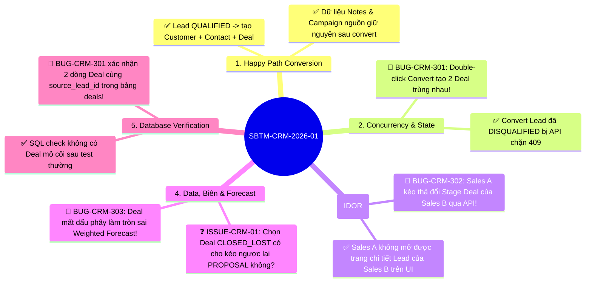

# Deliverable 2 Giai đoạn 4: Exploratory Session Report (SBTM) — CRM Lead Conversion & Deal Pipeline

> **Chuẩn áp dụng:** Session-Based Test Management (SBTM — James & Jon Bach), *Agile Testing* (Chương 10 — *Session-Based Testing*, tr. 200–201).

---

## 1. Thông tin Phiên Kiểm thử (Session Header)

| Trường | Thông tin chi tiết |
| :--- | :--- |
| **Session / Charter ID** | `SBTM-CRM-2026-01` |
| **Charter (Sứ mệnh)** | *Explore **CRM Lead Conversion & Deal Pipeline (Kanban)** with **tài khoản đa quyền (Sales Rep A, Sales Rep B, Manager), dữ liệu tiếng Việt/ký tự đặc biệt, Chrome DevTools Network & 2 tab đồng thời** to discover **lỗi mất dữ liệu khi convert, trùng lặp Deal, sai phân quyền IDOR, và tính sai doanh thu Forecast**.* |
| **Tester** | Nguyễn Đức Duy |
| **Thời gian thực hiện** | 2026-11-25 · `09:00 – 10:30` (**90 phút** — Uninterrupted) |
| **Môi trường & Build** | Staging (`https://crm-staging.internal`) · Build `v1.0.0-rc2` (`commit 9a4f21c`) · Chrome 131 (Windows 11) |
| **Liên kết Yêu cầu / Rủi ro** | `CRM-104` (Lead Conversion), `CRM-108` (Deal Kanban), Risk `R-01`, `R-02`, `R-03` trong Test Plan `TP-CRM-REL-01` |

---

## 2. Phân bổ Thời gian Thực tế (TBS Metrics — Task Breakdown)

| Hạng mục TBS | Thời gian (phút) | Tỷ trọng (%) | Đánh giá sức khỏe phiên |
| :--- | :---: | :---: | :--- |
| **T — Testing (Thiết kế & Thực thi khám phá)** | `60 phút` | **66.7%** | Đạt chuẩn khỏe mạnh (`60–80%`). |
| **B — Bug Investigation & Reporting** | `20 phút` | **22.2%** | Thời gian tái hiện race condition, bắt Network HAR & log 3 bugs. |
| **S — Session Setup** | `10 phút` | **11.1%** | Khởi tạo 3 tài khoản Sales & seed 5 Lead mẫu (`< 25%` là tốt). |
| **Opportunity Testing** *(ngoài Charter)* | `0 phút` | **0%** | Bám sát 100% Charter mục tiêu. |

---

## 3. Mind Map Khám phá & Dấu vết Thực thi (Coverage Map)

---

## 4. Nhật ký Khám phá Chi tiết (Session Execution Log)

| Thời gian | Khu vực & Hành động thử nghiệm (Heuristics) | Quan sát & Kết quả |
| :--- | :--- | :--- |
| `09:00 – 09:10` | **Setup:** Đăng nhập `sales_a@crm.vn` và `sales_b@crm.vn` trên 2 Chrome Profile riêng; chuẩn bị 5 Lead `QUALIFIED` (có tên tiếng Việt `"Công ty TNHH Á Châu & Đối tác"`). | Môi trường sẵn sàng, response nhanh `< 150ms`. |
| `09:10 – 09:28` | **Happy Path + Data Preservation (SFDPOT):** Convert Lead #101. Kiểm tra tên có dấu `&`, đối chiếu bảng `customers`, `contacts`, `deals`, `lead_notes` bằng SQL. | Tên hiển thị đúng (không lỗi HTML encode `&amp;`), Notes được copy sang Customer đầy đủ. |
| `09:28 – 09:50` | **Saboteur Tour — Concurrency & Double Submit:** Mở Lead #102. Trên DevTools bật Network `Slow 3G` để lộ độ trễ, sau đó **bấm đúp nhanh 2 lần** nút `"Xác nhận Convert"`. Mở thêm tab thứ 2 bấm Convert Lead #103 cùng lúc. | **PHÁT HIỆN `BUG-CRM-301`!** Nút không disable sau cú click 1 và Backend thiếu atomic check/unique constraint `source_lead_id` → tạo **2 Deal giống hệt nhau** gắn cùng 1 Lead #102! |
| `09:50 – 10:10` | **Security Tour — RBAC / IDOR trên Deal Kanban:** Dùng tài khoản `sales_a`, lấy token JWT của `sales_a` và thử gửi `PATCH /api/v1/deals/205/stage` (Deal #205 thuộc `sales_b`). | **PHÁT HIỆN `BUG-CRM-302` (Critical)!** UI ẩn Deal #205 khỏi bảng của `sales_a`, nhưng Backend API **không kiểm tra `deal.ownerId == currentUser.id`** → `sales_a` đổi được Stage Deal của `sales_b` sang `CLOSED_LOST`! |
| `10:10 – 10:25` | **Calculation & State Tour (BVA + State):** Tạo Deal `99.500.000đ` ở stage `PROPOSAL` (xác suất `60%`) → kéo sang `NEGOTIATION` (`80%`) và `CLOSED_LOST`. Thử kéo `CLOSED_LOST` quay lại `PROPOSAL`. | **PHÁT HIỆN `BUG-CRM-303`:** Khi kéo nhanh giữa 2 cột Kanban, Frontend cộng dồn sai Weighted Forecast của cột cũ trước khi nhận response mới (lệch khi chuyển nhanh nhiều thẻ). Đồng thời nảy sinh **nghi vấn `ISSUE-CRM-01`** về việc cho phép mở lại Deal `CLOSED_LOST`. |
| `10:25 – 10:30` | **Wrap-up & SQL Audit:** Chạy câu SQL kiểm tra bảng `deals` xác minh `BUG-CRM-301` (`HAVING COUNT(*) > 1`), lưu file HAR + Screenshot, hoàn tất Session Sheet. | Chốt xong 3 Bugs + 1 Clarification Issue. |

---

## 5. Tổng hợp Phát hiện (Findings Summary: Bugs, Issues & Automated Test Ideas)

### A. Danh sách Bug phát hiện trong phiên

| Bug ID | Mức độ (Severity) | Mô tả tóm tắt & Bằng chứng | Đề xuất hướng xử lý |
| :--- | :---: | :--- | :--- |
| **`BUG-CRM-301`** | **High** | **Double-click nút Convert tạo 2 Deal trùng cho cùng 1 Lead.**  *Evidence:* `evidence/bug301_double_convert.har`, SQL `SELECT source_lead_id, COUNT(*) FROM deals GROUP BY source_lead_id HAVING COUNT(*) > 1` trả về `count = 2`. | 1) FE disable nút ngay khi submit; 2) BE thêm `UNIQUE INDEX uq_deals_source_lead ON deals(source_lead_id)` + atomic `UPDATE leads SET status='CONVERTED' WHERE id=:id AND status='QUALIFIED'`. |
| **`BUG-CRM-302`** | **Critical** | **Lỗ hổng IDOR/BOLA ở `PATCH /api/v1/deals/{id}/stage`:** Sales A đổi được trạng thái Deal của Sales B (`200 OK` thay vì `403 Forbidden`).  *Evidence:* `evidence/bug302_idor_patch.png` | Thêm `@PreAuthorize` / kiểm tra ownership ở Service layer cho toàn bộ API Deal & Lead! |
| **`BUG-CRM-303`** | **Medium** | **Weighted Forecast trên header cột Kanban bị cộng sai tạm thời** nếu kéo thả liên tiếp 2 Deal khi mạng chậm (`Slow 3G`).  *Evidence:* `evidence/bug303_kanban_forecast.mp4` | Đồng bộ lại tổng Forecast từ Server response hoặc dùng lock UI ngắn trong lúc request PATCH đang chạy. |

### B. Câu hỏi cần làm rõ với PO (`Needs Clarification`)
- **`ISSUE-CRM-01`:** Khi một Deal đã đóng ở trạng thái `CLOSED_LOST` (hoặc `CLOSED_WON`), hệ thống có cho phép **Sales Rep tự kéo ngược lại** các stage đang mở (`PROPOSAL`/`NEGOTIATION`) hay chỉ **Sales Manager** mới có quyền *Reopen Deal*?

### C. Đề xuất Test Tự động bổ sung vào Bộ Regression (Phản hồi ngược về Q1 & Q2)
1. **Integration Test (GĐ 2 — Testcontainers):** Bổ sung `LeadConversionConcurrencyIT` dùng `CountDownLatch` test 2 request Convert cùng lúc (khóa vĩnh viễn `BUG-CRM-301`).
2. **API Security Test (GĐ 3 — REST Assured):** Bổ sung ca BOLA/IDOR kiểm tra `PATCH /deals/{id}/stage`, `PUT /deals/{id}`, `DELETE /deals/{id}` bằng token của Sales khác (`403 Forbidden`) để khóa vĩnh viễn `BUG-CRM-302`.

---

## 6. Kết luận Buổi Debriefing (PROOF Checklist)

- **Past (Product):** Đã thực hiện đúng Charter, phát hiện 1 lỗ hổng bảo mật nghiêm trọng (`BUG-CRM-302`) và 1 lỗi concurrency dữ liệu (`BUG-CRM-301`).
- **Results:** Phủ `~85%` luồng Lead Conversion & Deal Kanban; phần **Import CSV Lead** và **Export báo cáo Deal** chưa kịp thử trong 90 phút này.
- **Obstacles:** Không có rào cản lớn; việc test nhanh tạo dữ liệu tốn 10 phút đầu (có thể cải thiện bằng script seed API).
- **Outlook (Charter tiếp theo):**
  - `SBTM-CRM-2026-02`: *Explore **tính năng Import CSV Lead & Export Report** with **file 5.000 dòng, lỗi encoding, cột sai thứ tự** to discover **lỗi timeout, cắt ký tự tiếng Việt hoặc lỗi công thức CSV Injection (`=cmd|...`)**.*
  - Khuyến nghị **CHƯA ĐẠT Exit Criteria để Go-Live** cho tới khi `BUG-CRM-301` và `BUG-CRM-302` được sửa, thêm test tự động và retest `Closed`.
- **Feelings:** Luồng Happy Path ổn định, nhưng tầng Backend đang thiếu kiểm tra Ownership ở các API mới viết — cần rà soát lại toàn bộ Controller của CRM theo checklist bảo mật trước khi UAT!
