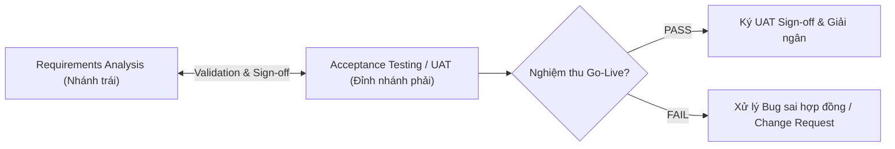

# User Acceptance Testing (UAT — Kiểm thử Chấp nhận Người dùng)

> **Nguồn bài học:** `User Acceptance Testing (UAT) Do chính khách hàng hoặc nhóm đại diện người dùng thực hiện nhằm quyết định có nghiệm thu sản phẩm hay không..pdf` *(Gắn với V-Model đỉnh chữ V và quy trình bàn giao thực tế Giai đoạn 4)*.

---

## 1. Bản chất cốt lõi & Vị trí trong V-Model

Nếu Unit, Integration và System Testing là bài kiểm tra do đội kỹ thuật nội bộ tự chấm, thì **UAT** là **"vạch đích cuối cùng"** — khoảnh khắc khách hàng thật bước vào kiểm chứng để quyết định: **"Có ký biên bản nghiệm thu, trả tiền và đưa vào vận hành hay không?"**.

**UAT là quá trình Validation** do Khách hàng (*Client*), Product Owner (*PO*) hoặc đại diện Người dùng cuối trực tiếp thực thi trên môi trường gần giống thật nhất để trả lời 2 câu hỏi:
1. *"Phần mềm này có giải quyết đúng và đủ bài toán kinh doanh của tôi không?"*
2. *"Hệ thống này đã đủ tin cậy, dễ dùng để đưa vào vận hành hàng ngày chưa?"*

- **Không soi lỗi kỹ thuật vặt:** UAT không đi tìm lỗi cú pháp hay logic cơ bản (QA phải lọc sạch từ System Testing). Trọng tâm của UAT là **Tính phù hợp nghiệp vụ (*Business Suitability*)** và **Trải nghiệm người dùng (*UX*)**.
- **Ý nghĩa thương mại & pháp lý:** Gắn với **Biên bản nghiệm thu (*UAT Sign-off Document*)** để giải ngân hợp đồng và cho phép **Go-Live**.

---

## 2. Ai thực hiện UAT? (Và ai KHÔNG ĐƯỢC làm thay?)

| Đối tượng | Vai trò trong UAT | Hành vi quy định |
| :--- | :--- | :--- |
| **Khách hàng / Doanh nghiệp đặt hàng** | **Người thực hiện chính** | Trực tiếp thao tác, nhập dữ liệu thật theo quy trình công việc của doanh nghiệp |
| **Key Users / Chuyên gia nghiệp vụ (SMEs)** | **Người kiểm tra thực tế** | Kế toán trưởng, thủ kho, bán hàng, giảng viên, sinh viên — những người dùng app mỗi ngày |
| **Đội ngũ QA / Tester dự án** | **Người hỗ trợ (*Support*)** | Chuẩn bị môi trường, hướng dẫn khách dùng kịch bản UAT, ghi nhận lỗi. **Tuyệt đối KHÔNG test thay khách hàng!** |
| **Lập trình viên (Developers)** | **Đứng ngoài quan sát** | Trực hỗ trợ giải thích kỹ thuật và vá lỗi (*hotfix*) nếu có; **không can thiệp hoặc bao biện** khi khách phàn nàn |

---

## 3. Môi trường & Dữ liệu trong UAT

Không bao giờ cho khách UAT trên `localhost` của lập trình viên:
- **Môi trường UAT (`Staging / Pre-production`):** Server độc lập có cấu hình phần cứng, mạng, bảo mật giống **~99%** môi trường Production.
- **Dữ liệu thực tế (*Real Business Data*):** Không dùng dữ liệu thử nghiệm sơ sài kiểu `nguyenvana`, `test123`, `abcxyz`. Phải nạp dữ liệu đại diện thực tế (VD: `1.000` hồ sơ sinh viên thật, mã số thuế thật, số dư tài khoản mô phỏng đúng thực tế) để quy trình bộc lộ đúng nút thắt ngoài đời.

---

## 4. Entry Criteria & Exit Criteria của UAT

### Khi nào UAT được BẮT ĐẦU? (*Entry Criteria*)
1. Giai đoạn **System Testing** đã hoàn tất *(các luồng chính đã được QA kiểm chứng kỹ)*.
2. Không còn bất kỳ lỗi **Critical / Blocker** nào đang mở (app không crash, không mất dữ liệu).
3. Đã bàn giao **User Manual** / tài liệu hướng dẫn cho đại diện người dùng.
4. Môi trường UAT và bộ dữ liệu nghiệp vụ đã sẵn sàng, truy cập ổn định.

### Khi nào UAT KẾT THÚC & THÀNH CÔNG? (*Exit Criteria*)
1. Toàn bộ kịch bản nghiệp vụ cốt lõi (*Core Business Flows*) đạt **PASS**.
2. Các lỗi nhỏ không nghiêm trọng còn tồn đọng (chính tả, căn chỉnh màu sắc nhẹ) được hai bên thống nhất chuyển sang bản cập nhật sau (*Deferred / Known Issues*).
3. Người có thẩm quyền của khách hàng ký **Biên bản nghiệm thu UAT (*UAT Sign-off*)**.

> [!NOTE]
> **Làm rõ điều kiện "System Testing hoàn tất 100%" giữa mô hình truyền thống và Agile:**  
> Tài liệu nhập môn ghi Entry Criterion 1 là *"System Testing đã hoàn tất 100%"* theo tư duy thác nước/tuần tự. Trong dự án **Agile/Scrum** hoặc kiểm thử theo rủi ro (*Risk-Based Testing*), vẫn có thể tồn tại các bug mức **Low/Cosmetic** được PO chấp nhận trước, hoặc PO/Key Users nghiệm thu sớm từng phần (*Iterative UAT / Sprint Review*) miễn không còn lỗi Blocker/High cản trở luồng nghiệp vụ đang demo.

---

## 5. So sánh trực diện: System Testing vs. UAT

| Tiêu chí | System Testing | User Acceptance Testing (UAT) |
| :--- | :--- | :--- |
| **Ai thực hiện?** | Đội ngũ **QA / Testers chuyên nghiệp** | **Khách hàng, PO, Key Users / Người dùng cuối** |
| **Bản chất V&V** | **Giao thoa V&V** *(xác minh đặc tả kiến trúc/SRS & xác thực E2E — đính chính nhãn "Verification" trong PDF)* | **Validation thuần túy** *(nghiệp vụ & giá trị vận hành thực tế)* |
| **Tư duy kiểm thử** | *"Tìm mọi cách bẻ gãy hệ thống, săn bug"* | *"Hệ thống này có giúp tôi làm việc nhanh hơn / vận hành đúng quy trình không?"* |
| **Nguồn kịch bản** | Tài liệu đặc tả kỹ thuật (`SRS`, `AC`, `Architecture`) | Kịch bản ngày làm việc thực tế (*Day-in-the-life Scenarios*) |
| **Đầu ra cuối** | Danh sách Bug Report cho Dev sửa | **Quyết định thương mại:** Ký nghiệm thu trả tiền hoặc Từ chối nhận |

---

## 6. Ví dụ thực tế: "Pass System Test nhưng Fail UAT"

Trong **Hệ thống Đăng ký học phần đại học**:
- **System Testing (QA chạy):** Nhập 24 tín chỉ lưu DB chuẩn, chịu tải 10.000 sinh viên đồng thời không sập → **PASS SYSTEM TESTING**.
- **UAT (Trưởng phòng Đào tạo & Sinh viên ngồi thử):**
  - *Trưởng phòng Đào tạo:* *"Danh sách sinh viên đăng ký môn lại sắp xếp theo giờ bấm thay vì A–B–C! Trường 5.000 sinh viên, sắp vậy sao cô giáo vụ tìm tên nhập điểm?"*
  - *Sinh viên:* *"Bảng chọn lớp không hiện cột Tên Giảng viên, làm sao biết thầy cô nào dạy để chọn?"*
- **Kết luận:** App không crash nhưng **FAIL UAT** vì thiếu thông tin nghiệp vụ thiết yếu của người dùng → buộc phải bổ sung trước khi ký nghiệm thu.

---

## 7. Hai cạm bẫy lớn nhất trong UAT

### Cạm bẫy 1: *"Đây là Bug hay Yêu cầu mới?"* (`Defect vs. Change Request`)
- Khách bấm UAT đòi: *"Bấm nút này phải xuất Excel cơ, sao lại ra PDF? Sửa đi!"*
- Dev đối chiếu: *"Hợp đồng ban đầu anh ký ghi xuất PDF, bọn tôi làm đúng đặc tả!"*
- **Cách xử lý chuẩn:** PM và BA đối chiếu *Baseline Scope / Hợp đồng*:
  - Nếu làm sai cam kết trong hợp đồng → **Defect** (sửa miễn phí).
  - Nếu khách phát sinh mong muốn mới ngoài hợp đồng → **Change Request (CR)** (đàm phán thêm chi phí/thời gian hoặc đưa vào pha sau).

### Cạm bẫy 2: *"Khách hàng lười test, ký duyệt bừa"*
- Vì bận rộn, khách chỉ bấm lướt vài màn hình rồi ký UAT cho xong. Đến khi Go-Live, nhân viên cấp dưới ùa vào dùng mới phát hiện quy trình bất tiện → chi phí sửa trên Production đắt gấp nhiều lần sửa trước khi ký. QA & PM cần thiết kế sẵn **UAT Checklist / Day-in-the-life Scenarios** cô đọng và hẹn buổi UAT có hướng dẫn để ép khách dùng thật.
