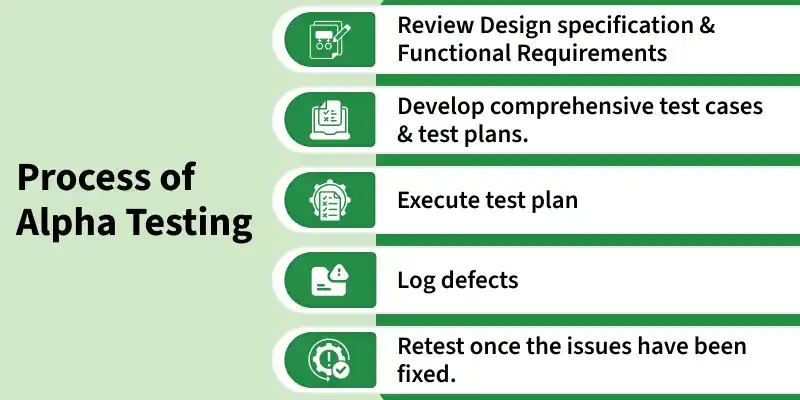
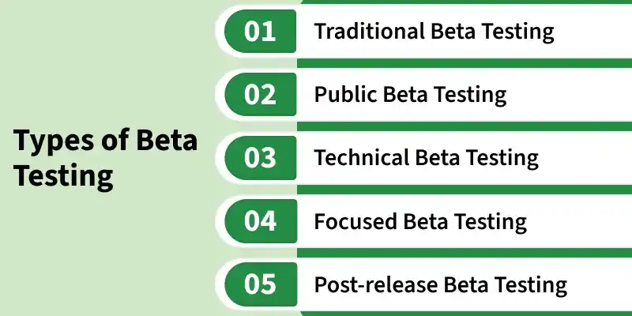

# Alpha Testing & Beta Testing (Kiểm thử Thử nghiệm Thực địa)

> **Nguồn bài học:** `Alpha Testing & Beta Testing Phát hành bản thử nghiệm nội bộ hoặc cho nhóm người dùng thực tế bên ngoài để thu thập phản hồi trong môi trường thật..pdf` *(Hoàn thiện nhánh Kiểm thử Chấp nhận cùng [01-user-acceptance-testing-uat.md](./01-user-acceptance-testing-uat.md))*.

---

## 1. Tại sao cần Alpha & Beta Testing dù QA đã test kỹ?

> *"Dù lập trình viên và QA giỏi đến đâu, phần mềm chạy trong phòng Lab luôn hoàn hảo; nhưng khi bước ra thế giới thực, người dùng thật sẽ sử dụng nó theo những cách không ai trong công ty tưởng tượng nổi!"*

Đội ngũ kỹ thuật thường mắc hội chứng tâm lý **"Lời nguyền của kiến thức" (*Curse of Knowledge*)**: vì tự xây dựng sản phẩm, họ thuộc lòng quy trình nên vô thức luôn thao tác *"đúng chuẩn"*. Alpha và Beta Testing giải quyết 3 câu hỏi sống còn của **Validation**:
1. Phần mềm có sống sót nổi trong *"thế giới thực muôn hình vạn trạng"* về thiết bị, mạng và hành vi?
2. Người dùng thật có tự hiểu cách dùng mà không cần người đứng cạnh hướng dẫn?
3. Đây có đúng là thứ người dùng sẵn sàng bỏ tiền / bỏ thời gian gắn bó? (*"Are we building the right product?"*)

---

## 2. Phân biệt vị trí trong ISTQB: Acceptance Testing vs. Formal UAT vs. Alpha/Beta

> [!NOTE]
> **Làm rõ khái niệm giữa PDF 5 (`Alpha & Beta`) và PDF 10 (`UAT`):**  
> Tài liệu trên lớp viết *"Cả Alpha và Beta Testing đều là các hình thức của UAT"*, trong khi file UAT lại mô tả UAT là bước khách hàng doanh nghiệp ký biên bản nghiệm thu trả tiền (*Sign-off*).  
> Theo chuẩn **ISTQB CTFL v4.0.1 (Section 2.2.1 — Acceptance Testing)**, tên gọi bao trùm đúng nhất ở đỉnh chữ V là **Acceptance Testing**, chia làm 4 nhánh:
> 1. **UAT (User Acceptance Testing):** Xác thực sự phù hợp nghiệp vụ với người dùng/đại diện đặt hàng *(hay gặp ở dự án outsource/enterprise có biên bản Sign-off)*.
> 2. **OAT (Operational Acceptance Testing):** Xác thực vận hành/bảo trì/DR với đội DevOps/SRE *(xem ở Giai đoạn 5)*.
> 3. **Contractual & Regulatory Acceptance Testing:** Nghiệm thu theo điều khoản hợp đồng hoặc chuẩn pháp lý (ngân hàng, y tế).
> 4. **Alpha & Beta Testing:** Dành cho **sản phẩm thương mại / đại chúng (COTS, Mobile App, Game, SaaS)** — khi "khách hàng" là hàng nghìn/hàng triệu người dùng ngoài thị trường chứ không phải 1 giám đốc ký hợp đồng!

---

## 3. Alpha Testing (Thử nghiệm nội bộ — Môi trường có kiểm soát)

*Hình: Các bước thực hiện Alpha Testing trong môi trường kiểm soát nội bộ trước khi mở ra bên ngoài (Nguồn ảnh: GeeksforGeeks).*

- **Nơi diễn ra:** Tại chính công ty phát triển phần mềm (*Developer's site*).
- **Ai thử nghiệm?**
  - Nhân viên nội bộ nhưng **không trực tiếp code/test tính năng đó** (CSKH, Sales, Marketing, Tester từ dự án khác).
  - Đôi khi mời một vài khách hàng thân thiết / đối tác chiến lược tới trực tiếp văn phòng công ty dùng thử dưới sự quan sát của kỹ sư.
- **Môi trường (*Controlled Environment*):** Wifi nội bộ ổn định, thiết bị chuẩn của công ty; khi crash, Dev có thể mở log hoặc debug trực tiếp ngay tại chỗ.
- **Mục đích chính:**
  1. Đóng vai **"bộ lọc sơ bộ"** trước khi người ngoài nhìn thấy sản phẩm.
  2. Kiểm tra luồng nghiệp vụ cốt lõi có thông suốt, loại bỏ hết lỗi hiển nhiên (*obvious bugs*) tránh làm mất uy tín thương hiệu nếu vừa mở app ra ngoài đã văng.
- **Ví dụ thực tế:** Trước khi đưa App Ngân hàng mới lên App Store, công ty phát hành bản Alpha cho toàn bộ `500` nhân viên công ty (nhân sự, kế toán, bảo vệ...) tự dùng chuyển tiền ăn trưa, mua cà phê nội bộ trong 2 tuần để gom hết lỗi cơ bản.

---

## 4. Beta Testing / Field Testing (Thử nghiệm thực địa — Môi trường không kiểm soát)

Sau khi bản Alpha tương đối ổn định, sản phẩm bước vào **Beta Testing (*Field Testing*)**:
- **Nơi diễn ra:** Nhà riêng, nơi làm việc, ngoài đường của **người dùng thật bên ngoài** (*Client's site / Real-world*).
- **Ai thử nghiệm?** Người dùng cuối thật sự, khách hàng tiềm năng bên ngoài công ty.
- **Môi trường (*Uncontrolled Environment*):** Toàn bộ sự "hỗn loạn" ngoài đời thực xuất hiện:
  - Hàng nghìn cấu hình thiết bị khác nhau (Samsung đời cũ, iPhone mới nhất, tablet yếu, máy đã *root/jailbreak*...).
  - Mạng khắc nghiệt (đi thang máy rớt sóng 4G, Wifi quán cafe chập chờn, 3G chậm).
  - Hành vi khó lường (bấm nút liên tục chục lần vì sốt ruột, vừa thanh toán vừa đóng app, xoay màn hình liên tục).

### Hai hình thức phát hành Beta phổ biến
1. **Closed Beta (*Private Beta*):** Giới hạn người tham gia theo lời mời/đăng ký (VD: `1.000` người dùng qua **Apple TestFlight** hoặc file `.apk` riêng).
2. **Open Beta (*Public Beta*):** Mở công khai cho bất kỳ ai tải về trải nghiệm (phổ biến với Game online, Windows/iOS Public Beta).

*Hình: Phân loại các hình thức Beta Testing (Traditional, Public, Technical, Focused, Post-release) khi thử nghiệm với người dùng thật (Nguồn ảnh: GeeksforGeeks).*

### Mục đích chính của Beta Testing
1. Tìm **Edge-case bugs** gắn với phần cứng, hệ điều hành hoặc mạng thực tế mà lab không tái lập được.
2. Thu thập **UX Feedback** (nút có khó bấm không, quy trình thanh toán có gây nản mà bỏ giỏ hàng không?).
3. Đo mức độ đón nhận thị trường (**Market Validation**).

---

## 5. Bảng so sánh toàn diện: Alpha Testing vs. Beta Testing

| Tiêu chí | Alpha Testing | Beta Testing |
| :--- | :--- | :--- |
| **Giai đoạn** | Trước *(Gần cuối pha phát triển)* | Ngay sau Alpha *(Ngay trước ngày phát hành chính thức)* |
| **Người thử nghiệm** | Nhân viên nội bộ không trực tiếp code *(CSKH, Sales, Marketing...)* hoặc khách mời có kiểm soát | **Người dùng thật, khách hàng bên ngoài** |
| **Địa điểm & Môi trường** | Tại công ty (*Developer's site*) — Môi trường lab có kiểm soát | Tại nơi của người dùng (*Client's site*) — Môi trường thật không kiểm soát |
| **Kiểm soát & Gỡ lỗi** | **Dễ gỡ lỗi:** Dev quan sát trực tiếp, lấy log ngay tại chỗ | **Khó gỡ lỗi:** Dựa vào công cụ thu crash tự động (*Firebase Crashlytics, Sentry*) và mô tả user |
| **Trọng tâm kiểm tra** | Tính năng cốt lõi có chạy được, dọn lỗi hiển nhiên (*obvious bugs*) | Độ tin cậy, tương thích phần cứng/OS, hiệu năng mạng thật, trải nghiệm UX |
| **Độ phủ người dùng** | Hẹp *(vài chục đến vài trăm người)* | Rộng *(hàng nghìn đến hàng triệu người)* |
