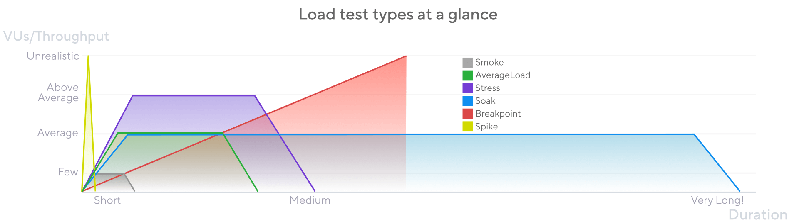

# Performance Testing: JMeter, Grafana k6, Các Loại Hình Test & Đọc Chỉ số `p95` / `p99`

> **Nguồn tham khảo:** *Full Stack Testing* (Chương 6 — *Performance Testing*, tr. 220–245), Grafana k6 Documentation (`grafana.com/docs/k6`), Apache JMeter User Manual.

Theo số liệu từ Google được trích trong *Full Stack Testing* (Bảng 8-1, tr. 222), khi thời gian tải trang tăng từ **1 giây lên 3 giây**, xác suất người dùng bỏ trang (*Bounce rate*) tăng **32%**; lên **5 giây** tăng **90%**! Một hệ thống có chức năng đúng 100% nhưng sập khi Flash Sale mở bán vẫn là một thất bại thảm họa về chất lượng.

---

## 1. Phân biệt 4 Loại hình Performance Testing (Traffic Profiles)



*Hình: So sánh trực quan hồ sơ tải của `Smoke`, `Average Load`, `Stress`, `Soak`, `Breakpoint` và `Spike` testing theo trục VUs/Thời gian (Nguồn ảnh: Grafana k6 Official Documentation).*

| Loại Test | Câu hỏi cần trả lời | Hình dạng tải (*Traffic Shape*) | Lỗi đặc trưng phát hiện được |
| :--- | :--- | :--- | :--- |
| **1. Load Test** | *"Hệ thống có đạt SLA ở mức tải cao điểm bình thường mỗi ngày không?"* | Ramp-up lên mức peak dự kiến → giữ ổn định 15–60 phút → Ramp-down. | Độ trễ vượt ngưỡng SLA, query thiếu index khi bảng lớn. |
| **2. Stress Test** | *"Giới hạn tối đa (Breaking Point) ở đâu, và hệ thống chết êm ái hay chết sập dây chuyền?"* | Tăng tải liên tục **vượt quá ngưỡng thiết kế** cho tới khi Error Rate tăng vọt hoặc Server crash. | Hết thread pool Tomcat, cạn DB connection pool (HikariCP timeout), deadlock. |
| **3. Spike Test** | *"Khi có Flash Sale 00:00 lượng user tăng vọt gấp 10 lần trong 5 giây rồi rút, app có tự hồi phục được không?"* | Từ tải nền thấp phóng thẳng lên đỉnh cực cao trong vài giây rồi tụt về tải nền. | Auto-scaling phản ứng chậm, cold-start container, nghẽn hàng đợi, sập cache Redis. |
| **4. Soak Test** *(Endurance)* | *"Chạy liên tục nhiều giờ/ngày có bị tụt hiệu năng dần không?"* | Giữ tải trung bình-cao ổn định trong **2 – 24+ giờ**. | **Memory Leak** (tràn JVM Heap / OOM), rò rỉ DB connection không đóng, đầy ổ cứng do log. |

---

## 2. Cách Đọc Chỉ số Cốt lõi: Tại sao phải dùng `p95` / `p99` thay vì `Average`?

Giả sử 100 request gọi API `POST /checkout`: 95 request trả về trong `100ms`, nhưng **5 request còn lại** dính DB lock mất `5.000ms` (5 giây):
- **Average (Trung bình cộng):** $(95 \times 100 + 5 \times 5000) / 100 = \mathbf{345\text{ms}}$ → nhìn rất "đẹp" và **che giấu hoàn toàn sự cố**!
- **`p95` (95th Percentile):** `95%` số request nhanh hơn hoặc bằng mốc này (`p95 = 100ms` hoặc `5000ms` tùy điểm cắt) → cho biết trải nghiệm của **đại đa số** người dùng.
- **`p99` (99th Percentile):** `99%` số request nhanh hơn hoặc bằng mốc này (**`p99 = 5.000ms`**!) → lột trần ngay nhóm **5% người dùng xui xẻo nhất** đang bị treo màn hình!

### 4 Chỉ số bắt buộc trong mọi Performance Report
1. **Latency Percentiles (`p90`, `p95`, `p99`, `Max`):** Thời gian phản hồi tính từ lúc gửi request tới lúc nhận xong byte cuối (*ms*).
2. **Throughput (`RPS` / `TPS`):** Số lượng Request/Transaction hệ thống xử lý thành công mỗi giây. *(Cảnh báo: Khi server quá tải, VUs tăng nhưng RPS không tăng nữa hoặc tụt xuống — đó là điểm bão hòa!).*
3. **Error Rate (`%`):** Tỷ lệ HTTP `5xx` / timeout / failed checks (thường yêu cầu `< 1%` hoặc `< 0.1%` với giao dịch tài chính).
4. **System Resource Metrics (Server-side):** CPU %, RAM/JVM Heap & GC pauses, HikariCP active connections, DB CPU & IOPS (chỉ nhìn client k6/JMeter mà không xem server monitor thì **không biết nguyên nhân nghẽn ở đâu**!).

---

## 3. So sánh & Thực hành Grafana k6 vs. Apache JMeter

| Tiêu chí | **Grafana k6** *(Hiện đại, Developer/SDET-first)* | **Apache JMeter** *(Truyền thống, Đa giao thức)* |
| :--- | :--- | :--- |
| **Cách viết kịch bản** | **Test-as-Code (JavaScript ES6)** — dễ review diff trên Git PR như code thật! | File XML `.jmx` dựng bằng giao diện kéo-thả GUI (khó review trên Git). |
| **Hiệu suất sinh tải** | Viết bằng Go + JS runtime siêu nhẹ: 1 máy có thể tạo **hàng chục nghìn VUs**. | Mô hình **1 Thread / 1 User** trên JVM tốn nhiều RAM hơn (cần Master-Worker khi tải lớn). |
| **CI/CD Quality Gate** | Tích hợp **`thresholds`** ngay trong code; vi phạm tự trả **Exit Code `99`** làm FAIL CI ngay! | Chạy CLI `jmeter -n -t ...` kết hợp plugin Taurus/Performance hoặc parse file `.jtl`. |
| **Giao thức hỗ trợ** | HTTP/1.1, HTTP/2, WebSocket, gRPC, Browser (k6 browser). | HTTP, **JDBC (test thẳng SQL DB)**, JMS, FTP, LDAP, SOAP, Kafka (via plugin). |

### A. Script mẫu Grafana k6 chuẩn Production (`checkout-load.js`)
```javascript
import http from 'k6/http';
import { check, sleep } from 'k6';
import { Trend, Rate } from 'k6/metrics';

// Custom metrics riêng cho hành trình Checkout
const checkoutDuration = new Trend('checkout_duration', true);
const checkoutErrors = new Rate('checkout_error_rate');

export const options = {
  stages: [
    { duration: '1m', target: 50 },   // Ramp-up lên 50 VUs
    { duration: '3m', target: 50 },   // Giữ ổn định tải (Load Test)
    { duration: '30s', target: 200 }, // Spike test nhẹ lên 200 VUs!
    { duration: '1m', target: 200 },
    { duration: '30s', target: 0 },   // Ramp-down
  ],
  thresholds: {
    'http_req_failed': ['rate<0.01'],              // Tổng lỗi HTTP < 1%
    'http_req_duration': ['p(95)<400', 'p(99)<900'], // SLA: 95% < 400ms, 99% < 900ms
    'checkout_error_rate': ['rate<0.005'],         // Luồng trả tiền lỗi < 0.5%
    'checks': ['rate>0.99'],
  },
};

// 1. Chạy 1 lần duy nhất trước khi sinh tải để lấy JWT Token (KHÔNG spam endpoint Login trong vòng lặp tải trừ khi muốn stress Login!)
export function setup() {
  const loginRes = http.post(`${__ENV.BASE_URL}/api/v1/auth/login`, JSON.stringify({
    email: 'perf_buyer@techstore.vn',
    password: __ENV.PERF_PASSWORD || 'Buyer@123',
  }), { headers: { 'Content-Type': 'application/json' } });

  check(loginRes, { 'setup login 200': (r) => r.status === 200 });
  return { token: loginRes.json('accessToken') };
}

// 2. Kịch bản chính của từng Virtual User
export default function (data) {
  const params = {
    headers: {
      'Content-Type': 'application/json',
      'Authorization': `Bearer ${data.token}`,
    },
    tags: { name: 'GET /products' }, // Gom tag tránh nổ số lượng metric nếu URL có ID động!
  };

  // Bước 1: Xem danh sách sản phẩm
  const listRes = http.get(`${__ENV.BASE_URL}/api/v1/products?page=0&size=20`, params);
  check(listRes, {
    'GET products status 200': (r) => r.status === 200,
    'has products list': (r) => r.json('content').length > 0,
  });

  sleep(Math.random() * 2 + 1); // Think time thực tế (1–3 giây đọc trang)

  // Bước 2: Gọi API Checkout
  const payload = JSON.stringify({
    userId: 101,
    vip: false,
    hasFreeshipCode: false,
    paymentMethod: 'VNPAY',
    items: [{ productId: 1, quantity: 1 }],
  });
  const chkRes = http.post(`${__ENV.BASE_URL}/api/v1/checkout`, payload, {
    ...params,
    tags: { name: 'POST /checkout' },
  });

  checkoutDuration.add(chkRes.timings.duration);
  checkoutErrors.add(chkRes.status !== 201);

  check(chkRes, { 'POST checkout 201': (r) => r.status === 201 });
  sleep(1);
}
```
Chạy k6 trên terminal:
`k6 run -e BASE_URL=http://localhost:8080 checkout-load.js`

### B. Nguyên tắc chạy Apache JMeter Chuẩn (Không bao giờ chạy tải lớn bằng JMeter GUI!)
- **GUI chỉ dùng để thiết kế và debug 1–2 thread.**
- **Khi chạy đo thật, BẮT BUỘC dùng Non-GUI CLI** (tắt `View Results Tree` vì listener này ngốn sạch RAM!):
  ```bash
  jmeter -n -t techstore-load.jmx -l results/run1.jtl -e -o results/html-dashboard/
  ```
- **Các thành phần JMeter cần nắm:** `Thread Group` (hoặc `Concurrency Thread Group`), `HTTP Request Defaults`, `HTTP Header Manager`, `CSV Data Set Config` (đọc danh sách 1000 user khác nhau), `Timers` (*Uniform Random Timer* giả lập Think Time), `Response Assertion`, và `Backend Listener` (đẩy sang InfluxDB + Grafana).
