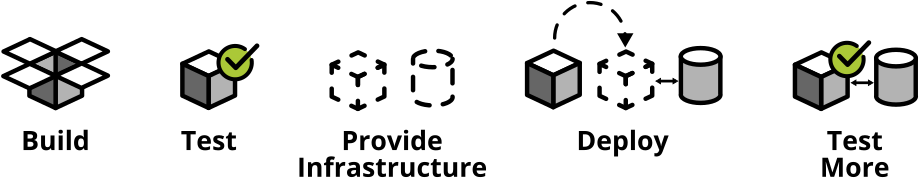
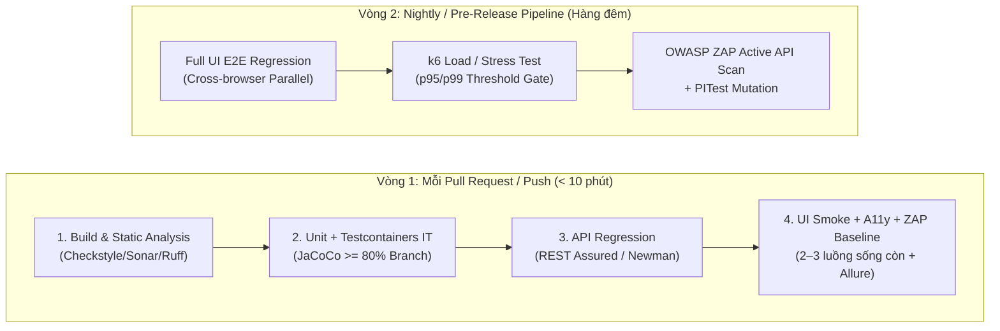
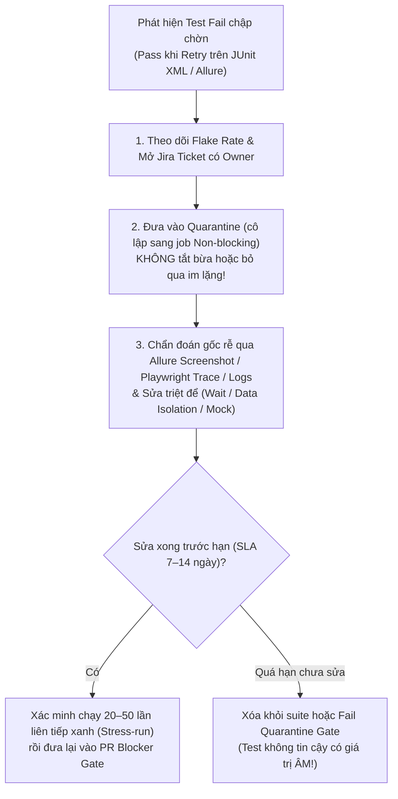

# CI/CD & Continuous Testing: GitHub Actions, Jenkins, Docker, Quality Gates & Quản lý Flaky Test

> **Nguồn tham khảo:** *Full Stack Testing* (Chương 3 — *Continuous Testing*, tr. 86–127), GitHub Actions Docs, Docker Compose Docs, Google Testing Blog (*Flaky Tests*).

Theo Chương 3 *Full Stack Testing*, **Continuous Integration (CI)** dừng lại ở mức build và unit test để tích hợp code; còn **Continuous Testing (CT)** là chạy toàn diện cả kiểm thử chức năng lẫn phi chức năng (API, UI Smoke, Security, Performance, Accessibility) ở mỗi bước trên pipeline để cung cấp phản hồi liên tục (*Continuous Feedback*) và giữ codebase luôn ở trạng thái sẵn sàng phát hành (*Always Releasable*).

---

## 1. Chiến lược Phân tầng Pipeline (Fast Feedback vs. Nightly Regression)



*Hình: Nguyên lý Deployment Pipeline nhiều chặng — kiểm thử nhanh trước khi cấp hạ tầng, deploy lên staging và tiếp tục chạy kiểm thử chuyên sâu (Nguồn ảnh: Martin Fowler / Ham Vocke).*

Không thể nhét toàn bộ 2 tiếng UI E2E + Soak Test + Active Security Scan vào mọi Pull Request vì sẽ làm tắc nghẽn toàn bộ team Dev! Ta chia thành **2 vòng phản hồi (Feedback Loops)** như *Full Stack Testing* (tr. 104–106) mô tả:



---

## 2. GitHub Actions vs. Jenkins (Hai công cụ CI phổ biến nhất)

| Tiêu chí | **GitHub Actions** | **Jenkins (`Jenkinsfile` Declarative)** |
| :--- | :--- | :--- |
| **Lưu trữ & Cấu hình** | File YAML trong `.github/workflows/*.yml`, nằm chung repo. | File Groovy `Jenkinsfile` (Pipeline-as-Code) chạy trên server tự host. |
| **Hạ tầng chạy (Runners)** | Cloud runner sẵn có (`ubuntu-latest` có sẵn Docker, Java, Node!). | Tự cài & bảo trì Agent/Node, quản lý Docker socket / Kubernetes pod. |
| **Hệ sinh thái** | Hàng nghìn Action cộng đồng (`actions/setup-java`, `zaproxy/action-baseline`, `peaceiris/actions-gh-pages`). | Hơn 1.800 plugin (Allure Jenkins Plugin, JUnit, HTML Publisher, Blue Ocean). |
| **Phù hợp với** | Startup, Product team dùng GitHub, Portfolio cá nhân. | Ngân hàng, Enterprise on-premise cần kiểm soát mạng nội bộ chặt chẽ. |

### Đối chiếu nhanh cú pháp `Jenkinsfile` (khi làm việc ở công ty dùng Jenkins)
```groovy
pipeline {
    agent any
    stages {
        stage('Unit & JaCoCo Gate') {
            steps { sh 'mvn clean verify' } // Chạy Unit + Testcontainers + JaCoCo >= 80% check
        }
        stage('API & UI Smoke') {
            steps { sh 'mvn test -f automation/pom.xml -Dheadless=true' }
        }
    }
    post {
        always {
            allure includeProperties: false, results: [[path: 'automation/target/allure-results']]
        }
    }
}
```

---

## 3. Dùng Docker Compose tạo Môi trường Test Tái lập 100%

Nhiều test fail oan trên CI vì thiếu database, thiếu Redis, hoặc script chạy test bắn HTTP khi Backend Spring Boot **chưa kịp boot xong**!

### Quy tắc vàng với `docker-compose.test.yml`
1. **Cô lập mạng & DB sạch:** Dùng network riêng và volume tạm (không dùng chung DB Staging của người khác!).
2. **Bắt buộc dùng `healthcheck` + `condition: service_healthy`:** **Không bao giờ** dùng `sleep 30` một cách mù quáng!
   ```yaml
   services:
     postgres:
       image: postgres:17-alpine
       environment:
         POSTGRES_DB: techstore_ci
         POSTGRES_USER: ci_user
         POSTGRES_PASSWORD: ci_password
       healthcheck:
         test: ["CMD-SHELL", "pg_isready -U ci_user -d techstore_ci"]
         interval: 5s
         timeout: 3s
         retries: 10

     backend:
       build: ./backend
       depends_on:
         postgres:
           condition: service_healthy
       ports:
         - "8080:8080"
       healthcheck:
         test: ["CMD", "curl", "-f", "http://localhost:8080/actuator/health"]
         interval: 5s
         timeout: 3s
         retries: 20
   ```
3. Trong CI step, chạy `docker compose -f docker-compose.test.yml up -d --wait` (lệnh `--wait` của Docker Compose hiện đại tự động chờ **tất cả** service đạt `healthy` rồi mới đi tiếp sang bước chạy REST Assured / Selenium!).

---

## 4. Quality Gates (Cổng Kiểm soát Chất lượng Tự động)

Một Pipeline CI chuyên nghiệp không chỉ "chạy cho có" mà phải biết **từ chối Merge Pull Request** (trả về Exit Code `!= 0`) khi vi phạm bất kỳ tiêu chuẩn nào:

| Tầng kiểm tra | Công cụ thực thi | Ngưỡng Quality Gate mặc định |
| :--- | :--- | :--- |
| **Static Code & SCA** | SonarQube / Checkstyle / Trivy | `0` Critical Security Vulnerabilities; `0` Blocker bugs. |
| **Unit & Integration** | JUnit 5 + JaCoCo (`jacoco:check`) | `100%` tests pass; **`BRANCH >= 80%`** trên module nghiệp vụ. |
| **API & UI Smoke** | REST Assured + Selenium/Playwright | `100%` Smoke & API Contract tests pass (`Allure` xuất report). |
| **Performance Gate** | Grafana k6 `thresholds` | `http_req_failed < 1%`, `p(95) < 400ms`, `p(99) < 1000ms`. |
| **Security & A11y** | OWASP ZAP + `axe-core` / Lighthouse | `0` ZAP High Alerts; `0` Critical/Serious `axe` violations (`LHCI a11y >= 0.90`). |

---

## 5. Quản lý Flaky Test (Kỷ luật thép — Câu hỏi Phỏng vấn SDET Rất Hay Gặp!)

**Flaky Test** là test lúc Pass lúc Fail **trên cùng một commit code không đổi**. Nếu không kiểm soát, team sẽ sinh tâm lý *"Ồ, test đó hay fail vớ vẩn ấy mà, bấm Re-run là xanh!"* → **làm mất hoàn toàn niềm tin vào bộ Automation**.

### A. 4 Nguyên nhân Gốc rễ phổ biến nhất
1. **Async Timing / Race Condition trên UI:** Dùng `Thread.sleep` hoặc quên Explicit Wait / Web-first assertion trước thao tác animation/AJAX.
2. **Dùng chung Test Data khi chạy Parallel:** 2 test sửa cùng 1 giỏ hàng hoặc cùng 1 bản ghi DB.
3. **Thứ tự chạy & Dư chấn State (Order Dependency):** Test A quên dọn dữ liệu làm Test B fail khi chạy ở thứ tự khác.
4. **Phụ thuộc Môi trường Ngoài:** Gọi trực tiếp sandbox thanh toán thật ngoài Internet hoặc dùng `LocalDateTime.now()` qua nửa đêm (`00:00:00`)!

### B. Quy trình 4 Bước Xử lý Flaky Test chuẩn Công nghiệp


- **Quy tắc dùng Retry (`retryAnalyzer` của TestNG hoặc `--retries=1` của Playwright):**
  - Chỉ cho phép tối đa **`1` lần retry** ở tầng UI E2E để **ghi telemetry nhận diện Flaky Test** (Allure hiển thị màu cam ở mục *Retries* để QA phát hiện ngay!).
  - **Cấm dùng Retry để che giấu lỗi mãi mãi** (*"Coat of Paint Anti-pattern"*) và **tuyệt đối không bật retry cho Unit Test** (Unit Test mà flaky thì 100% là bug thiết kế hoặc bug concurrency trong code!).
