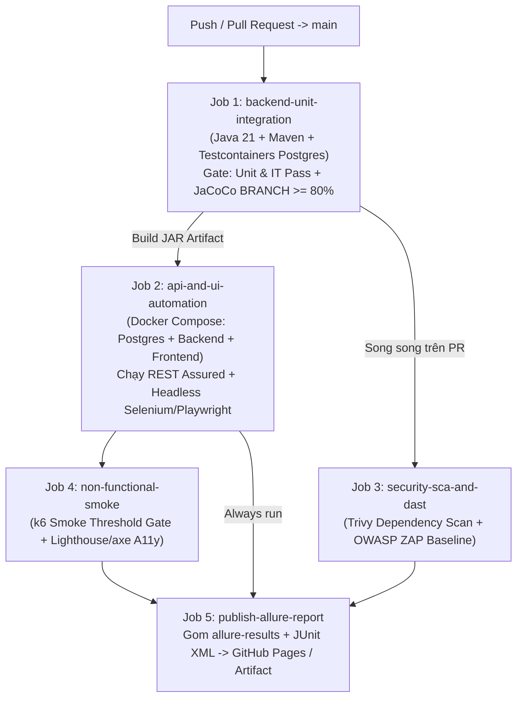

# Deliverable 1 Giai đoạn 5: Pipeline CI Hoàn chỉnh (`Unit + Integration + API + UI + Non-Functional + Allure Report`)

> **Mục tiêu Deliverable (Roadmap GĐ 5):** Xây dựng một CI/CD Continuous Testing Pipeline hoàn chỉnh trên **GitHub Actions** (kèm `docker-compose.test.yml` và `.zap/rules.tsv`) chạy tự động `Unit + Testcontainers + JaCoCo >= 80% + API + Headless UI + Non-Functional Smoke + Allure Report` với Quality Gates chặt chẽ.

---

## 1. Sơ đồ Luồng Pipeline CI/CD/CT cho TechStore



---

## 2. File Cấu hình Môi trường Test (`docker-compose.test.yml`)

Đặt tại gốc repository để cả **GitHub Actions Runner** lẫn máy **Local Dev** khởi chạy cùng một môi trường giống nhau 100%:

```yaml
# docker-compose.test.yml
services:
  postgres:
    image: postgres:17-alpine
    environment:
      POSTGRES_DB: techstore_test
      POSTGRES_USER: test_user
      POSTGRES_PASSWORD: test_password
    ports:
      - "5432:5432"
    healthcheck:
      test: ["CMD-SHELL", "pg_isready -U test_user -d techstore_test"]
      interval: 5s
      timeout: 3s
      retries: 10

  backend:
    build:
      context: ./backend
    environment:
      SPRING_DATASOURCE_URL: jdbc:postgresql://postgres:5432/techstore_test
      SPRING_DATASOURCE_USERNAME: test_user
      SPRING_DATASOURCE_PASSWORD: test_password
      SPRING_PROFILES_ACTIVE: test
    ports:
      - "8080:8080"
    depends_on:
      postgres:
        condition: service_healthy
    healthcheck:
      test: ["CMD-SHELL", "curl -fsS http://localhost:8080/actuator/health || exit 1"]
      interval: 5s
      timeout: 3s
      retries: 20

  frontend:
    build:
      context: ./frontend
    environment:
      VITE_API_BASE_URL: http://localhost:8080
    ports:
      - "3000:3000"
    depends_on:
      backend:
        condition: service_healthy
    healthcheck:
      test: ["CMD-SHELL", "curl -fsS http://localhost:3000/ || exit 1"]
      interval: 5s
      timeout: 3s
      retries: 15
```

---

## 3. GitHub Actions Workflow Hoàn chỉnh (`.github/workflows/ci-quality-gate.yml`)

```yaml
name: TechStore Continuous Testing Pipeline

on:
  pull_request:
    branches: [ main ]
  push:
    branches: [ main ]
  schedule:
    # Chạy Nightly lúc 02:00 sáng (UTC+7 ~ 19:00 UTC) cho Load/Active DAST mở rộng
    - cron: '0 19 * * *'

permissions:
  contents: read
  pages: write
  id-token: write

concurrency:
  group: ci-${{ github.ref }}
  cancel-in-progress: true # Hủy pipeline cũ nếu vừa push commit mới trên cùng PR

jobs:
  # =========================================================================
  # JOB 1: Backend Build + Unit Tests + Testcontainers IT + JaCoCo 80% Gate
  # =========================================================================
  backend-unit-integration:
    name: "1. Unit, Integration & JaCoCo >= 80%"
    runs-on: ubuntu-latest
    steps:
      - name: Checkout repository
        uses: actions/checkout@v4

      - name: Set up JDK 21 (Temurin)
        uses: actions/setup-java@v4
        with:
          java-version: '21'
          distribution: 'temurin'
          cache: 'maven'

      - name: Run Unit, Testcontainers IT & JaCoCo Quality Gate
        working-directory: ./backend
        run: mvn -B clean verify

      - name: Upload JaCoCo Coverage Report
        if: always()
        uses: actions/upload-artifact@v4
        with:
          name: jacoco-coverage-report
          path: backend/target/site/jacoco/

  # =========================================================================
  # JOB 2: Ephemeral Docker Env + API (REST Assured) + Headless UI (Selenium)
  # =========================================================================
  api-and-ui-automation:
    name: "2. API + UI Automation & Allure Results"
    needs: backend-unit-integration
    runs-on: ubuntu-latest
    steps:
      - name: Checkout repository
        uses: actions/checkout@v4

      - name: Set up JDK 21 (Temurin)
        uses: actions/setup-java@v4
        with:
          java-version: '21'
          distribution: 'temurin'
          cache: 'maven'

      - name: Start Ephemeral Test Environment (Postgres + Backend + Frontend)
        run: docker compose -f docker-compose.test.yml up -d --build --wait

      - name: Run API Regression & Headless UI Smoke Suite
        working-directory: ./automation
        env:
          TECHSTORE_BUYER_PWD: ${{ secrets.TEST_BUYER_PASSWORD }}
        run: |
          mvn -B clean test \
            -Dapi.baseUrl=http://localhost:8080 \
            -Dui.baseUrl=http://localhost:3000 \
            -Dheadless=true

      - name: Run Quarantine Flaky Watcher (Non-blocking telemetry)
        if: always()
        continue-on-error: true
        working-directory: ./automation
        run: mvn -B test -Dgroups=quarantine -Dheadless=true

      - name: Dump Container Logs on Failure
        if: failure()
        run: docker compose -f docker-compose.test.yml logs --tail=200 backend

      - name: Upload Raw Allure Results & Screenshots
        if: always()
        uses: actions/upload-artifact@v4
        with:
          name: allure-results-raw
          path: |
            automation/target/allure-results/
            automation/target/screenshots/

      - name: Tear down Test Environment
        if: always()
        run: docker compose -f docker-compose.test.yml down -v

  # =========================================================================
  # JOB 3: Non-Functional Gates (k6 Smoke + OWASP ZAP Baseline + Lighthouse A11y)
  # =========================================================================
  non-functional-gates:
    name: "3. Security (ZAP), Perf Smoke (k6) & A11y (LHCI)"
    needs: backend-unit-integration
    runs-on: ubuntu-latest
    steps:
      - name: Checkout repository
        uses: actions/checkout@v4

      - name: Start Ephemeral Test Environment
        run: docker compose -f docker-compose.test.yml up -d --build --wait

      # 3a. Dependency Vulnerability Scan (OWASP A03:2025 Supply Chain)
      - name: Trivy Filesystem SCA Scan
        uses: aquasecurity/trivy-action@0.28.0
        with:
          scan-type: 'fs'
          scan-ref: './backend'
          severity: 'CRITICAL,HIGH'
          exit-code: '1'

      # 3b. OWASP ZAP Baseline DAST Scan (Fail nếu có High alert)
      - name: OWASP ZAP Baseline Scan
        uses: zaproxy/action-baseline@v0.14.0
        with:
          target: 'http://localhost:3000'
          rules_file_name: '.zap/rules.tsv'
          fail_action: true

      # 3c. Performance Smoke Gate bằng Grafana k6 (20 VUs, 30s -> kiểm tra không tụt SLA!)
      - name: Grafana k6 Performance Smoke Test
        uses: grafana/k6-action@v0.3.1
        with:
          filename: perf/techstore-smoke.js
          flags: -e BASE_URL=http://localhost:8080

      # 3d. Accessibility Gate với Lighthouse CI
      - name: Lighthouse CI Accessibility Audit
        run: |
          npm install -g @lhci/cli
          lhci autorun --config=lighthouserc.json

      - name: Tear down Test Environment
        if: always()
        run: docker compose -f docker-compose.test.yml down -v

  # =========================================================================
  # JOB 4: Tổng hợp & Xuất bản Allure HTML Dashboard
  # =========================================================================
  publish-allure-report:
    name: "4. Publish Allure Report"
    needs: [ api-and-ui-automation ]
    if: always() # Vẫn xuất báo cáo ngay cả khi có test Fail để Dev/QA bấm vào xem ảnh lỗi!
    runs-on: ubuntu-latest
    steps:
      - name: Download Allure Results
        uses: actions/download-artifact@v4
        with:
          name: allure-results-raw
          path: allure-results

      - name: Generate Allure HTML Report (với lịch sử Trend giữa các lần chạy)
        uses: simple-elf/allure-report-action@v1.7
        with:
          allure_results: allure-results
          allure_history: allure-history
          keep_reports: 20

      - name: Upload Allure HTML Artifact
        uses: actions/upload-artifact@v4
        with:
          name: allure-html-dashboard
          path: allure-history/
```

---

## 4. Giải thích Cơ chế Quality Gate & Quản lý Flaky Test trong Pipeline

| Thành phần trong Pipeline | Vai trò cụ thể |
| :--- | :--- |
| **`mvn -B clean verify`** | Chạy cả Surefire (`*Test`) + Failsafe (`*IT`) + `jacoco:check` → **tự động Fail** nếu Branch Coverage `< 80%`. |
| **`docker compose up -d --wait`** | Khởi động Postgres + Backend + Frontend và **đợi healthcheck xanh 100%** trước khi bắn test (triệt tiêu lỗi Race Condition khởi động CI). |
| **`continue-on-error: true` cho `@Tag("quarantine")`** | Tách riêng các test đang bị flaky ra luồng theo dõi không chặn PR, nhưng vẫn chạy lấy log/telemetry để team sửa trước hạn! |
| **`trivy-action` (`exit-code: '1'`)** | Chặn build nếu `pom.xml` kéo vào thư viện chứa lỗ hổng `HIGH`/`CRITICAL` (đáp ứng `A03:2025 Software Supply Chain Failures`). |
| **`zaproxy/action-baseline` + `.zap/rules.tsv`** | Chạy DAST thụ động trên PR, lọc nhiễu bằng `.tsv` và chặn build nếu lòi lỗi bảo mật thực sự. |
| **`grafana/k6-action`** | Nếu `p(95) > 400ms` hoặc `http_req_failed >= 1%`, k6 trả Exit Code `99` → chặn merge PR gây suy giảm hiệu năng! |
| **`if: always()` ở bước `publish-allure-report`** | Luôn xuất bản Allure Report **kể cả khi Job 2 đỏ**, giúp team mở ngay báo cáo xem Screenshot UI & HTTP Request/Response lỗi mà không cần chạy lại trên máy cá nhân. |
