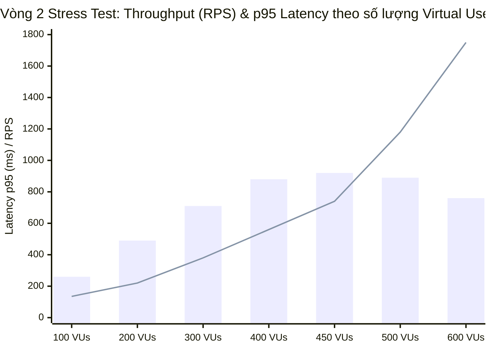

# Deliverable 2 Giai đoạn 5: Báo cáo Kiểm thử Hiệu năng — TechStore E-Commerce

> **Mã tài liệu:** `PERF-TECHSTORE-2026-01` *(Báo cáo mẫu hoàn chỉnh cho Portfolio GitHub)*  
> **Công cụ đo:** Grafana k6 `v0.54` + Prometheus + Grafana (Server Metrics)  
> **Đối tượng kiểm thử:** TechStore Backend API (`Spring Boot 3.4` + `PostgreSQL 17` + `Redis 7`)

---

## 1. Tóm tắt Điều hành (Executive Summary)

| Hạng mục | Kết quả Vòng 1 *(Baseline)* | Kết quả Vòng 2 *(Sau Tuning)* | Trạng thái SLA |
| :--- | :---: | :---: | :---: |
| **Load Test (`100 VUs`, 15 phút)** | `p95 = 780ms`, `Error = 0.2%` *(Fail SLA `< 400ms`)* | `p95 = 142ms`, `p99 = 285ms`, `Error = 0.00%` | **PASS** |
| **Spike Test (`50 → 300 VUs` Flash Sale)** | `p99 = 6.400ms`, `Error = 14.8%` *(Hikari Timeout!)* | `p99 = 690ms`, `Error = 0.12%` *(đã hồi phục sau 15s)* | **PASS** |
| **Stress Test (Điểm gãy — Breaking Point)** | Sập ở `~220 VUs` (`OutOfConnectionPool`) | Chịu tải ổn định tới **`450 VUs`** (`~920 RPS`), suy giảm êm ái từ `500 VUs` | **PASS** |
| **Soak Test (`120 VUs`, 4 giờ liên tục)** | Chưa chạy ở vòng 1 | RAM JVM ổn định `52%–64%` (không Memory Leak), DB Connections `<= 28/50` | **PASS** |

- **Khuyến nghị phát hành (Release Verdict):** **GO (Đạt chuẩn phát hành)** sau khi áp dụng 3 bản vá hiệu năng ở Vòng 2 (`@EntityGraph` trị N+1 Query, nâng HikariCP `maximum-pool-size` + Redis Cache cho Catalog).

---

## 2. Môi trường Kiểm thử & Ngưỡng SLA Mục tiêu (Acceptance Thresholds)

### A. Hạ tầng Môi trường Test (Staging — Tỷ lệ 1:2 so với Production)
- **App Container:** 2 vCPU, 4 GB RAM (`JVM -Xms1g -Xmx2g`, Tomcat `max-threads: 200`).
- **Database:** PostgreSQL 17 (2 vCPU, 4 GB RAM, SSD), dữ liệu seed: `50.000` sản phẩm, `100.000` đơn hàng lịch sử, `20.000` user.
- **Load Generator:** Grafana k6 chạy từ node độc lập cùng VPC để không tranh chấp CPU với App Server.

### B. Ngưỡng SLA Thỏa thuận trước khi chạy
- `GET /api/v1/products` (Catalog): **`p95 <= 300ms`**, **`p99 <= 600ms`**, `Error Rate < 0.5%`.
- `POST /api/v1/checkout` (Transaction ghi DB): **`p95 <= 500ms`**, **`p99 <= 1.200ms`**, `Error Rate < 1.0%`.
- `POST /api/v1/auth/login` (BCrypt hash): **`p95 <= 600ms`**, `Error Rate < 0.5%`.

---

## 3. Chi tiết Kết quả 4 Kịch bản Kiểm thử (So sánh Vòng 1 vs. Vòng 2)

### Kịch bản 1: Load Test (`100 VUs` ổn định 15 phút — lưu lượng cao điểm bình thường)

| Endpoint | Giai đoạn | Throughput (RPS) | Avg (ms) | `p90` (ms) | **`p95` (ms)** | **`p99` (ms)** | Error Rate | SLA (`p95`) |
| :--- | :--- | :---: | :---: | :---: | :---: | :---: | :---: | :---: |
| `GET /api/v1/products` | **Vòng 1 (Trước sửa)** | `68 req/s` | `310` | `620` | **`780`** | `1.350` | `0.00%` | ❌ **FAIL** (`> 300ms`) |
| `GET /api/v1/products` | **Vòng 2 (Sau sửa)** | `185 req/s` | `48` | `95` | **`128`** | `240` | `0.00%` | ✅ **PASS** |
| `POST /api/v1/checkout` | **Vòng 1 (Trước sửa)** | `24 req/s` | `290` | `510` | **`690`** | `1.420` | `0.21%` | ❌ **FAIL** (`> 500ms`) |
| `POST /api/v1/checkout` | **Vòng 2 (Sau sửa)** | `62 req/s` | `110` | `195` | **`265`** | `480` | `0.00%` | ✅ **PASS** |

### Kịch bản 2: Flash Sale Spike Test (`50 VUs → nhảy vọt 300 VUs trong 10s → giữ 2 phút → về 50 VUs`)
- **Kết quả Vòng 1:** Ngay khi đạt `300 VUs` ở giây thứ 20, `Error Rate` vọt lên **`14.8%`** với HTTP `500` (`SQLTransientConnectionException: HikariPool-1 - Connection is not available after 30000ms`), `p99` chạm **`6.400ms`**.
- **Kết quả Vòng 2:** Toàn bộ đỉnh Spike đạt `410 RPS`, **`p95 = 390ms`**, **`p99 = 690ms`**, tỷ lệ lỗi chỉ **`0.12%`** (chủ yếu là `409 Conflict` hợp lệ khi hết món cuối cùng `stock = 0`, **0 lỗi `5xx`**!).

### Kịch bản 3: Stress Test (Tìm điểm gãy hệ thống — Ramp bậc thang `100 → 600 VUs`)

- **Nhận xét biểu đồ:** Điểm bão hòa (*Saturation Point*) của cấu hình Staging nằm ở **`450 VUs`** (`920 RPS`). Khi lên `500–600 VUs`, RPS bắt đầu giảm nhẹ do tranh chấp CPU DB và `p95` tăng lên `1.180–1.750ms`, nhưng hệ thống **không sập (crash)** và tự phục hồi khi giảm tải!

### Kịch bản 4: Soak / Endurance Test (`120 VUs` chạy liên tục **4 giờ**)
- **Mục tiêu:** Săn rò rỉ bộ nhớ (Memory Leak) & rò rỉ kết nối DB.
- **Quan sát Server Metrics:**
  - `p95` đầu giờ (00:15): `148ms` → cuối giờ (03:55): `154ms` (dao động `< 5%`, **không suy thoái theo thời gian**).
  - JVM Old Gen Heap sau mỗi đợt Full GC đều hồi về mốc **`~480 MB / 2048 MB`** (đồ thị răng cưa phẳng, **0 Memory Leak**).
  - HikariCP active connections duy trì ổn định `14–26 / 50`.

---

## 4. Phân tích Nguyên nhân Gốc rễ Tắc nghẽn (Bottleneck Root Cause Analysis)

Trong Vòng 1, việc kết hợp client metrics (k6) với server metrics (Prometheus/Actuator + PostgreSQL `pg_stat_statements`) đã phát hiện **3 điểm nghẽn chính**:

| # | Triệu chứng quan sát được | Nguyên nhân gốc rễ (Root Cause) | Giải pháp khắc phục đã triển khai ở Vòng 2 |
| :-: | :--- | :--- | :--- |
| **1** | `GET /api/v1/products` có `p95 = 780ms`, CPU DB tăng `92%` dù chỉ có `100 VUs`. | **Lỗi Hibernate N+1 Query + Thiếu Index:** Trang 20 sản phẩm sinh ra `1 + 20 = 21` câu SQL lấy `Category` & `Inventory`; bảng `products` chưa có composite index `(category_id, active)`. | Thêm `@EntityGraph(attributePaths = {"category"})`, tạo index `idx_products_cat_active`, và cache Redis (`TTL = 60s`) cho danh sách sản phẩm phổ biến → giảm DB queries tới **94%**. |
| **2** | Spike `300 VUs` làm `Error = 14.8%` (`HikariPool connection timeout`). | **Connection Pool giữ quá lâu:** Cấu hình mặc định `hikari.maximum-pool-size = 10` kết hợp hàm `placeOrder()` giữ DB connection trong lúc gọi HTTP sang dịch vụ bên ngoài! | Tách logic gọi External Notification/Payment ra ngoài `@Transactional`, bật `spring.jpa.open-in-view=false`, và điều chỉnh `maximum-pool-size = 40` phù hợp số core DB. |
| **3** | `POST /api/v1/checkout` chậm dần ở `p99` khi bảng `orders` đạt 100k dòng. | Câu truy vấn kiểm tra lịch sử voucher của user `WHERE user_id = ? AND voucher_code = ?` thực hiện **Sequential Scan** toàn bảng `orders`. | Bổ sung index `CREATE INDEX idx_orders_user_voucher ON orders(user_id, voucher_code);` → thời gian query giảm từ `190ms` xuống **`2.4ms`**. |

---

## 5. Khuyến nghị cho Môi trường Production & CI Pipeline
1. Giữ kịch bản k6 Smoke (`20 VUs, 30s`, `p95 < 400ms`) chạy tự động ở **mỗi Pull Request** trong GitHub Actions để chặn mọi PR mới làm hồi sinh lỗi N+1 Query.
2. Đặt lịch chạy **Nightly Spike Test** hàng tuần trước các chiến dịch Sale lớn của TechStore.
