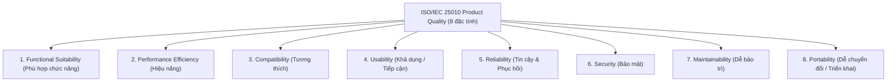

# Mô hình Chất lượng Phần mềm ISO/IEC 25010 (Làm rõ Khung Phi chức năng)

> **Nguồn bài học:** Mở rộng & làm rõ tham chiếu **`ISO/IEC 25010`** trong `Ôn tập.pdf` (trang 8) và 4 nhóm phi chức năng trong `System Testing.pdf` (trang 3).

---

## 1. Tại sao cần bổ sung khung đầy đủ ISO/IEC 25010?

Trong tài liệu ghi chú trên lớp (`Ôn tập.pdf` trang 8), khi nhắc tới **Non-Functional Testing** theo chuẩn **ISO/IEC 25010** (*"Hệ thống hoạt động TỐT NHƯ THẾ NÀO?"*), bài học chỉ liệt kê ví dụ **4 thuộc tính**:
1. Hiệu năng (*Performance/Load/Stress*)
2. Bảo mật (*Security*)
3. Tính khả dụng (*Usability*)
4. Độ tin cậy (*Reliability*)

Còn `System Testing.pdf` (trang 3) nhắc thêm nhóm thứ 5 là **Tính tương thích (*Compatibility*)**, và `OAT.pdf` nhắc sâu **Tính bảo trì (*Maintainability*)**. Để bạn không nhầm rằng Non-Functional Testing chỉ có 4 mục trên, dưới đây là **bức tranh chuẩn hoàn chỉnh 8 nhóm đặc tính chất lượng sản phẩm của ISO/IEC 25010:2011** *(và cập nhật phiên bản 2023)*.

---

## 2. 8 Đặc tính Chất lượng Sản phẩm Phần mềm (`ISO/IEC 25010:2011`)

| # | Đặc tính | Câu hỏi kiểm chứng thực tế | Ánh xạ trong Repo Giai đoạn 5 & Bài học |
| :-: | :--- | :--- | :--- |
| **1** | **Functional Suitability** *(Chức năng)* | Tính năng có đầy đủ, chính xác và phù hợp quy trình nghiệp vụ không? | Thuộc mảng Functional Testing & UAT (*không phải Non-Functional*) |
| **2** | **Performance Efficiency** *(Hiệu năng)* | Tốc độ phản hồi (`p95`/`p99`), thông lượng và tiêu tốn CPU/RAM thế nào khi tải cao? | [01-performance-testing-jmeter-k6.md](../01-performance-testing-jmeter-k6.md) |
| **3** | **Compatibility** *(Tương thích)* | Có sống chung tốt với dịch vụ khác (*Co-existence*) và trao đổi chuẩn qua API (*Interoperability*), chạy ổn trên nhiều trình duyệt/máy (*iPhone/Android*)? | `System Testing.pdf` + Cross-browser UI |
| **4** | **Usability** *(Khả dụng & Truy cập)* | Người dùng mới có tự học, dễ thao tác, tránh nhầm lẫn và hỗ trợ người khuyết tật (*Accessibility*)? | [03-accessibility-wcag-axe-lighthouse.md](../03-accessibility-wcag-axe-lighthouse.md) |
| **5** | **Reliability** *(Độ tin cậy)* | Chạy 24/7 có ổn định (*Availability*), chịu lỗi mạng/rớt server (*Fault Tolerance*) và khôi phục nhanh (*Recoverability*)? | [02-operational-acceptance-testing-oat.md](./02-operational-acceptance-testing-oat.md) |
| **6** | **Security** *(Bảo mật)* | Bảo vệ tính bí mật (*Confidentiality*), toàn vẹn dữ liệu (*Integrity*), chống giả mạo (*Authenticity*) và phân quyền chặt chẽ? | [02-security-testing-owasp-burp-zap.md](../02-security-testing-owasp-burp-zap.md) |
| **7** | **Maintainability** *(Tính bảo trì)* | Kiến trúc tách module tốt, dễ đọc, dễ sửa, dễ viết test (*Testability*), dễ nâng cấp không downtime? | [Static Analysis](../../00-nen-tang/04-static-vs-dynamic-testing.md) & OAT Trụ cột 3 |
| **8** | **Portability** *(Tính khả chuyển)* | Dễ đóng gói cài đặt lên các môi trường khác nhau (Docker, Cloud AWS/GCP, nâng cấp/quay lui)? | [04-cicd-github-actions-docker-flaky-gates.md](../04-cicd-github-actions-docker-flaky-gates.md) |

---

## 3. Lưu ý cập nhật ISO/IEC 25010:2023 (Tránh nhầm lẫn khi đọc tài liệu mới)

- Đa số slide đại học và giáo trình ISTQB CTFL v4.0.1 hiện hành vẫn trích dẫn **8 đặc tính của ISO/IEC 25010:2011** (trong đó **7 đặc tính từ #2 đến #8** là nhóm *Non-Functional Quality*).
- Bản cập nhật **ISO/IEC 25010:2023** có mở rộng lên **9 đặc tính**: đổi tên *Usability* thành **Interaction Capability**, đổi *Portability* thành **Flexibility**, và bổ sung đặc tính thứ 9 là **Safety** *(An toàn vận hành tránh gây hại cho con người/tài sản/môi trường)*.
