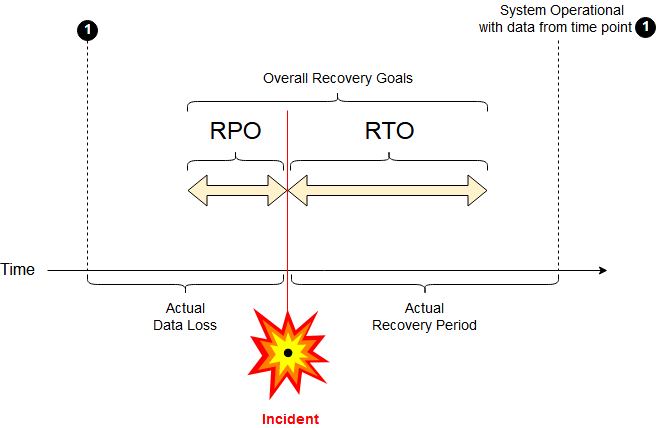

# Operational Acceptance Testing (OAT — Kiểm thử Chấp nhận Vận hành)

> **Nguồn bài học:** `Operational Acceptance Testing (OAT) Xác thực khả năng phục hồi sau thảm họa, sao lưu, bảo trì và hiệu năng thực tế..pdf` *(Cấp độ Acceptance Testing cho đội ngũ DevOps / SRE / SysAdmin, bổ trợ trực tiếp cho Giai đoạn 5 Non-functional & CI/CD)*.

---

## 1. Bản chất cốt lõi: "Chiếc máy bay thương mại" (UAT vs. OAT)

Nếu **UAT** là buổi kiểm tra của Khách hàng (*"App có đúng nghiệp vụ tôi cần và dễ dùng không?"*), thì **OAT** là bài sát hạch sinh tử của **Đội ngũ Vận hành (*System Admins, DevOps, SRE*)** nhằm trả lời:
> *"Hệ thống này khi chạy 24/7 trên Production có dễ nuôi, dễ giám sát, dễ nâng cấp và khi xảy ra thảm họa thì có cứu vãn được dữ liệu & dịch vụ hay không?"*

**Ví dụ ví von chiếc máy bay:**
- **UAT (Phi công & Hành khách):** Ghế êm, điều hòa mát, khoang lái dễ bấm → *Pass UAT*.
- **OAT (Kỹ sư mặt đất & Thợ bảo trì):**
  1. Nếu 1 động cơ bị sét đánh hỏng giữa trời, động cơ dự phòng có tự kích hoạt trong 5 giây không? (*Disaster Recovery*).
  2. Thay nhớt định kỳ có phải tháo tung cả cánh máy bay ra không? (*Maintainability*).
  3. Hộp đen ghi nhật ký có sống sót khi va chạm không? (*Logging & Backup*).
  4. Đồng hồ áp suất có hú còi báo động ngay khi rò rỉ oxy không? (*Monitoring & Alerting*).

Không qua nổi bài kiểm tra của kỹ sư mặt đất thì **tuyệt đối không được phép cất cánh**.

---

## 2. Bốn trụ cột cốt lõi của OAT trong thực tế

Gồm 4 nhóm kiểm chứng chính: **Backup & Restore (RPO)**, **Disaster Recovery & Failover (RTO)**, **Maintainability & Rollback**, và **Auto-scaling & Alerting**:

*Hình: RPO đo khoảng thời gian tối đa chấp nhận mất dữ liệu tính ngược từ lúc sự cố; RTO đo tổng thời gian khôi phục tính xuôi tới khi hệ thống vận hành lại bình thường (Nguồn: Wikimedia Commons).*

### Trụ cột 1: Sao lưu & Khôi phục dữ liệu (*Backup & Restore*)
Nhiều hệ thống tự tin chạy script backup hàng đêm, nhưng tới lúc DB bị xóa/mã hóa mới phát hiện **file backup bị lỗi không giải nén được**.
- **Cách test OAT:** Không chỉ kiểm tra job backup báo xanh, mà **bắt buộc phải lấy file backup thực tế phục hồi (Restore) sang một máy chủ trắng** và kiểm chứng 100% tính toàn vẹn dữ liệu.
- **Chỉ số sống còn — RPO (*Recovery Point Objective*):** Mức độ mất mát dữ liệu tối đa chấp nhận được tính theo thời gian khi gặp sự cố.
  - *Ví dụ:* `RPO = 5 phút` → nếu sập lúc `14:00`, dữ liệu từ `13:55–14:00` có thể bị mất, nhưng toàn bộ giao dịch trước `13:55` bắt buộc phải còn nguyên vẹn.

### Trụ cột 2: Phục hồi sau thảm họa & Chuyển đổi dự phòng (*Disaster Recovery & Failover*)
Khi Data Center chính ở TP.HCM mất điện toàn phần hoặc đứt cáp mạng:
- **Cách test OAT:** Diễn tập sự cố thật (*GameDay / Chaos Engineering*) — chủ động ngắt kết nối **Primary Server** xem hệ thống phản ứng ra sao.
- **Mục tiêu:** **Secondary / Standby Server** tại Hà Nội hoặc Singapore có tự động phát hiện và chuyển hướng truy cập (**Failover**) mượt mà không làm gián đoạn lâu?
- **Chỉ số sống còn — RTO (*Recovery Time Objective*):** Tổng thời gian tối đa từ lúc sập đến khi hệ thống online hoạt động lại bình thường (VD: `RTO < 15 phút`).

### Trụ cột 3: Khả năng bảo trì, Nâng cấp & Quay lui (*Maintainability & Rollback*)
- **Zero-Downtime Deployment:** Có deploy được bản vá lên Production mà không phải treo biển *"bảo trì 0h–4h sáng"* không? (Dùng **Blue-Green Deployment** hoặc **Canary Release**).
- **Kiểm thử Rollback khẩn cấp:** Khi bản `v2.0` vừa lên gây lỗi chí mạng, đội DevOps có bấm quay ngược về `v1.9` trong `< 2 phút` mà không làm hỏng schema database không? *(Liên hệ chặt với migration Flyway/Liquibase ở Giai đoạn 4)*.

### Trụ cột 4: Hiệu năng thực tế, Tự co giãn & Cảnh báo (*Auto-scaling & Monitoring*)
- **Auto-scaling:** Lượng truy cập tăng vọt từ `1.000` lên `50.000` người → cloud (AWS/GCP/Kubernetes) có tự nhân bản server (**Scale Out**) gánh tải và tự thu gọn khi vãn khách (**Scale In**) để tối ưu chi phí không?
- **Alerting & Monitoring:** Khi RAM chạm `95%` hoặc `5xx error rate` tăng vọt, **Grafana / Datadog / PagerDuty** có tự bắn cảnh báo khẩn cho kỹ sư trực đêm (*On-call*) trong vòng `60 giây` không?

---

## 3. Bảng so sánh: UAT vs. OAT

| Tiêu chí | UAT (User Acceptance Testing) | OAT (Operational Acceptance Testing) |
| :--- | :--- | :--- |
| **Góc nhìn thực hiện** | **Người dùng cuối / Khách hàng / PO** | **Kỹ sư vận hành / Quản trị hệ thống (DevOps, SRE, SysAdmin)** |
| **Câu hỏi then chốt** | *"Phần mềm có giải quyết đúng bài toán kinh doanh và dễ dùng không?"* | *"Hệ thống có sống sót, ổn định và vận hành an toàn 24/7 trên hạ tầng thật không?"* |
| **Ví dụ kịch bản test** | Bấm thanh toán thành công; xuất hóa đơn đúng mẫu | Rút nguồn server chính; restore bản backup `500GB`; thử rollback `v2.0 -> v1.9`; kích ngưỡng auto-scale & cảnh báo PagerDuty |
| **Hậu quả nếu bỏ qua** | Khách không chịu xài vì sai nghiệp vụ, khó dùng | Lên Production bị sập không cứu kịp, mất trắng dữ liệu khách hàng, rò rỉ hoặc bảo trì làm chết dịch vụ |

---

## 4. Liên hệ Chuẩn ISTQB & Thực hành Hiện đại

- Theo **ISTQB CTFL v4.0.1 Section 2.2.1**, **OAT** là một trong 4 dạng chính thức của **Acceptance Testing** (cùng với UAT, Contractual/Regulatory AT, Alpha & Beta Testing).
- Trong các đội DevOps/SRE hiện đại, OAT không chỉ chạy 1 lần trước Go-Live mà được lặp lại định kỳ dưới dạng **Chaos Engineering** (dùng *Chaos Mesh*, *Gremlin*) và **DR GameDays** hàng quý để bảo đảm khả năng sống sót (*Resilience*) của hạ tầng luôn đúng như thiết kế.
