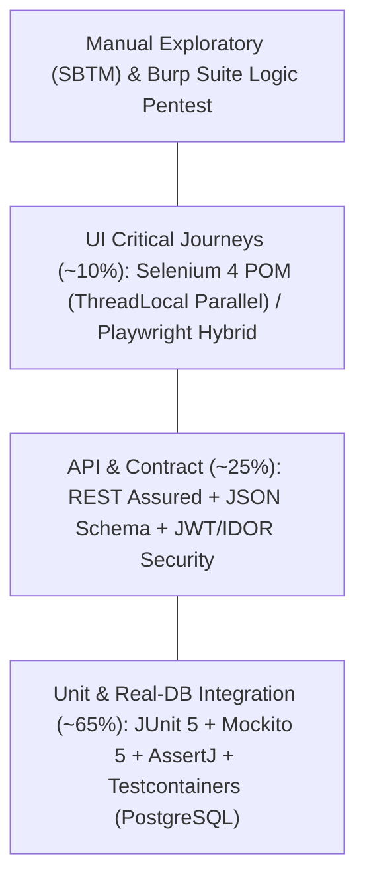

# Deliverable Giai đoạn 6: Bộ Hồ sơ Sẵn sàng Apply (Mẫu README Portfolio + CV Chuẩn ATS + Lộ trình 21 Ngày)

> **Mục tiêu Deliverable (Roadmap GĐ 6):** Cung cấp mẫu `README.md` chuẩn SDET cho GitHub Portfolio, mẫu CV định vị **"Software Engineer với nền tảng QA, Automation & Security"** và Checklist Nghiệm thu Toàn bộ Lộ trình 6 Giai đoạn.

---

# PHẦN I — MẪU `README.md` CHUẨN CHO REPO `techstore-test-suite`

> *Copy trực tiếp khung này vào file `README.md` ở gốc repository Portfolio chính của bạn trên GitHub và gắn ảnh chụp thực tế.*

```markdown
# 🛒 TechStore Full-Stack Test Automation Suite


> **Multi-layered Test Automation & Quality Engineering Suite** for the **TechStore E-Commerce** platform — designed strictly following the **Test Pyramid** with CI/CD Quality Gates (Unit, Testcontainers, REST Assured API, Selenium 4/Playwright UI, k6 Performance Smoke, OWASP ZAP Security, and Accessibility checks).

---

## 🏗️ Test Pyramid Architecture



### Why this architecture?
- **Fast Feedback:** Unit tests execute in `< 2s`; API regression executes in `< 10s`.
- **Zero Fake Mocks on DB:** Concurrency (`stock = 1`, `usageLimit = 1`) and `@Transactional` rollbacks are verified against real **PostgreSQL 17** via **Testcontainers (`@ServiceConnection`)**.
- **Minimal, Reliable UI Layer:** UI automation covers only critical checkout journeys using explicit waits and `ThreadLocal<WebDriver>` parallel safety, bypassing repetitive data setup via API seeding.
- **Proven Test Quality (Not Coverage-for-Numbers):** Enforced `>= 80%` **JaCoCo Branch Coverage** gate validated alongside **PITest Mutation Testing** (`STRONGER` mutators).

---

## 🛠️ Tech Stack

| Layer | Tools & Libraries |
| :--- | :--- |
| **Unit & Integration** | Java 21, JUnit 5, Mockito 5, AssertJ, Spring Boot Test (`@WebMvcTest`, `@DataJpaTest`), Testcontainers (PostgreSQL) |
| **Coverage & Mutation** | JaCoCo (`BRANCH >= 80%` gate), PITest (`pitest-junit5-plugin`) |
| **API Automation** | REST Assured 5, Jackson, JSON Schema Validator, Postman + Newman CLI |
| **UI Automation** | Selenium 4 (Selenium Manager + POM + TestNG Parallel), Playwright Java (`storageState`, Trace Viewer) |
| **Non-Functional & CI** | Grafana k6, OWASP ZAP DAST, Trivy SCA, `axe-core` / Lighthouse CI, Docker Compose, GitHub Actions, Allure Report |

---

## 🚀 Quick Start (Run Locally)

### 1. Start Ephemeral Test Environment
```bash
docker compose -f docker-compose.test.yml up -d --wait
```

### 2. Run Backend Unit + Testcontainers Integration + JaCoCo Gate
```bash
cd backend
mvn -B clean verify
# Open target/site/jacoco/index.html
```

### 3. Run API + UI Automation Suite & Open Allure Dashboard
```bash
cd automation
mvn -B clean test -Denv=staging -Dheadless=true
mvn allure:serve
```

### 4. Run Performance & Security Smoke Checks
```bash
docker run --rm -i --network host -v "${PWD}/perf:/scripts" grafana/k6 run -e BASE_URL=http://localhost:8080 /scripts/techstore-smoke.js
docker run --rm --network host -v "${PWD}/reports:/zap/wrk/:rw" ghcr.io/zaproxy/zaproxy:stable zap-baseline.py -t http://localhost:3000 -r zap-report.html
```

---

## 📊 Sample Results & Defect Highlights
- **Allure Unified Dashboard:** Aggregates JUnit 5 API tests, TestNG parallel UI tests, HTTP Request/Response logs, and automatic failure screenshots. *(Xem `docs/images/allure-overview.png`)*
- **Key Defects Prevented / Caught by Suite:**
  1. Missing `startDate` validation on promotional vouchers (`VoucherServiceTest`).
  2. Flash Sale items mistakenly counted toward minimum order threshold (`VoucherServiceTest`).
  3. Negative stock / voucher over-redemption race condition under concurrent checkout (`CheckoutConcurrencyIT`).
  4. IDOR/BOLA unauthorized access on `/api/v1/orders/{id}` (`SecurityJwtApiTest` & Burp Suite assessment).
  5. Hibernate N+1 query bottleneck on `/api/v1/products` reducing `p95` latency from `780ms` to `128ms` (`PERF-TECHSTORE-2026-01`).
```

---

# PHẦN II — MẪU CV CHUẨN ATS (ĐỊNH VỊ SOFTWARE ENGINEER VỚI NỀN TẢNG QA / AUTOMATION / SECURITY)

```markdown
# NGUYỄN ĐỨC DUY
**Software Engineer — QA Automation / SDET & Security QA**
📍 Ho Chi Minh City, Vietnam | 📧 nguyenducduy25605@gmail.com | 💻 github.com/Duckdiii | 🔗 linkedin.com/in/your-profile

---

## PROFESSIONAL SUMMARY
Software Engineer with a strong foundation in **Java / Spring Boot backend development**, **full-stack Test Automation (Unit, Integration, API, UI)**, **Agile/Scrum delivery (Scrum Master experience)**, and **Web Application Security testing (OWASP Top 10, Burp Suite, OWASP ZAP)**. Experienced in shifting quality left using TDD, Testcontainers, REST Assured, Selenium/Playwright, and CI/CD Quality Gates to deliver reliable, secure, and high-performing software.

---

## TECHNICAL SKILLS
- **Languages & Core:** Java (17/21), Python, SQL (PostgreSQL), JavaScript/TypeScript, HTML/CSS
- **Unit & Integration Testing:** JUnit 5, TestNG, Mockito 5, AssertJ, Spring Boot Test (`@WebMvcTest`, `@DataJpaTest`, `MockMvcTester`), Testcontainers, JaCoCo, PITest, TDD
- **API & UI Automation:** REST Assured, Postman / Newman, JSON Schema Validation, Selenium WebDriver 4 (POM, `ThreadLocal` Parallel), Playwright, Cucumber (BDD), Allure Report
- **Non-Functional & Security:** Grafana k6, Apache JMeter, Burp Suite, OWASP ZAP (DAST), WebGoat / Juice Shop, Trivy (SCA), `axe-core`, Lighthouse CI (WCAG 2.2)
- **Process, Tools & DevOps:** Agile Testing Quadrants, Test Strategy/Plan, SBTM Exploratory Testing, Jira (JQL, Dashboards), Zephyr/TestRail, Docker & Docker Compose, GitHub Actions, Git

---

## FEATURED ENGINEERING & QA PROJECTS

### 1. TechStore E-Commerce — Full-Stack Test Automation & Quality Pipeline
*Tech Stack: Java 21, Spring Boot, PostgreSQL, JUnit 5, Mockito, Testcontainers, REST Assured, Selenium 4, Playwright, k6, OWASP ZAP, GitHub Actions, Allure*
- **Test Design & Traceability:** Authored ISO 29119-aligned Test Design Documentation and a 100% bidirectional Requirements Traceability Matrix (RTM) applying EP, 2/3-Value BVA, Decision Table, State Transition, and Pairwise testing across Registration, Checkout, and Voucher modules.
- **Code-Level Quality & Concurrency:** Built JUnit 5, Mockito 5, and AssertJ unit/slice test suites alongside Testcontainers (PostgreSQL) integration tests, achieving **>80% meaningful JaCoCo branch coverage** (verified via PITest mutation testing) and catching concurrent inventory/voucher race conditions (`CountDownLatch`).
- **API & UI Automation Framework:** Architected a Test Pyramid-aligned automation framework combining REST Assured (JSON Schema + JWT/BOLA negative tests) and Selenium 4 POM (`ThreadLocal` parallel execution + Allure failure screenshots), plus Playwright hybrid API-seeded flows (`storageState`).
- **CI/CD, Performance & Security:** Configured a GitHub Actions pipeline with ephemeral Docker Compose environments, k6 Load/Spike checks (identifying N+1 queries and HikariCP timeouts, reducing `p95` from `780ms` to `128ms`), and OWASP ZAP + Burp Suite security audits resolving critical IDOR and logic flaws.

### 2. CRM Management Platform — Agile QA Process & Scrum Execution *(Role: Scrum Master & QA)*
*Tech Stack: Scrum/Agile, Jira (JQL, Dashboards), PostgreSQL, Flyway, Exploratory Testing (SBTM)*
- Facilitated **Three Amigos** sessions to refine Acceptance Criteria, Definition of Done (DoD), and layer-appropriate test strategies, preventing requirement defects before development started.
- Authored the product-level **Test Strategy** and **Release Test Plan** using Risk-Based Testing (`Likelihood × Impact`), alongside **Session-Based Test Management (SBTM)** charters with Mind Maps and TBS metrics, uncovering critical concurrency and IDOR issues pre-release.
- Executed SQL data integrity audits (`LEFT JOIN` orphan checks, `GROUP BY/HAVING` reconciliation) and Flyway schema migration rehearsals, plus Jira Triage workflows and 5-Whys Root Cause Analysis (RCA).

### 3. Web Security Practice Labs *(Burp Suite, OWASP WebGoat, OWASP Juice Shop)*
- Practiced identifying and exploiting OWASP Top 10 vulnerabilities (Broken Access Control/IDOR, SQL Injection, XSS, CSRF, JWT tampering, Security Misconfigurations) using Burp Suite Proxy, Repeater, and Intruder, translating security PoCs into automated API regression checks.

---

## CERTIFICATIONS & EDUCATION
- **ISTQB® Certified Tester Foundation Level (CTFL v4.0.1)** *(In Progress / Expected [Month Year])*
- **B.S. in Software Engineering / Information Technology** — [Tên Trường Đại học của bạn] *(Expected / Graduated [Year])*
```

---

# PHẦN III — KẾ HOẠCH HÀNH ĐỘNG 21 NGÀY APPLY & CHECKLIST NGHIỆM THU TOÀN LỘ TRÌNH

### Kế hoạch 3 tuần nước rút (Giai đoạn 6)
| Tuần | Mục tiêu chính | Hành động cụ thể |
| :---: | :--- | :--- |
| **Tuần 1** | Hoàn thiện & Đóng gói Portfolio | Tách/dọn sạch 3 repo GitHub (`techstore-test-suite`, `qa-docs-crm-techstore`, `techstore-security-perf-lab`), gắn Badges + Ảnh chụp Allure/JaCoCo/k6/ZAP, tập nói *3-Minute Walkthrough*. |
| **Tuần 2** | Cán đích ISTQB CTFL & Chốt CV | Thi thử đạt `>= 80%` trên 3 đề ISTQB v4.0.1 chính thức, đăng ký lịch thi (nhớ tick **+25% Extra Time**); hoàn thiện bản CV chuẩn cho từng vai trò (`SDET`, `QA Automation`, `Security QA`, `QA Engineer`). |
| **Tuần 3** | Mock Interview & Nộp hồ sơ có chiến lược | Làm trọn 3 bài Mock Interview 45 phút; lọc 15–20 JD chất lượng (Product & Outsource uy tín), tùy biến Summary + gửi kèm link GitHub Portfolio + Notion Docs. |

### Checklist Nghiệm thu Toàn Lộ trình (GĐ 0 → GĐ 6)
- [x] **GĐ 0 (`00-nen-tang/`):** 7 principles, ISTQB Process, V&V, Static vs Dynamic, Review C1–C10, Test Case & Bug Report chuẩn.
- [x] **GĐ 1 (`01-test-design/`):** 9 kỹ thuật Black-box/White-box/Experience-based + So sánh 4 kỹ thuật trên 3 form + Deliverable Test Design Doc & RTM.
- [x] **GĐ 2 (`02-unit-integration-java/`):** JUnit 5, Mockito 5 + AssertJ, Spring Boot Test, Testcontainers, JaCoCo + PITest, TDD, Test Pyramid + Thực hành + Deliverable TechStore `>= 80%` Branch Coverage.
- [x] **GĐ 3 (`03-api-ui-automation/`):** Postman/Newman, REST Assured + JUnit 5, JSON Schema + JWT + Negative, Pact, Selenium 4 + POM + Parallel `ThreadLocal`, Playwright, Cucumber + Thực hành + Deliverable Framework API + UI + Allure.
- [x] **GĐ 4 (`04-quy-trinh-thuc-te/`):** Agile Testing/Three Amigos/DoD, SBTM Exploratory, Defect Management/Jira JQL/RCA, Test Management/Metrics/TestRail-Zephyr, DB SQL/Migration + Thực hành CRM + 2 Deliverables (Test Strategy/Plan & SBTM Report).
- [x] **GĐ 5 (`05-non-functional-cicd/`):** Performance (JMeter/k6), Security (OWASP Top 10:2025, Burp, ZAP), Accessibility (WCAG 2.2, axe, Lighthouse), CI/CD (GitHub Actions, Docker Compose, Flaky test, Quality Gates) + Thực hành + 3 Deliverables (CI Pipeline, Perf Report, Security Report).
- [x] **GĐ 6 (`06-portfolio-chung-chi-apply/`):** GitHub Portfolio Blueprint, ISTQB CTFL v4.0.1 Study Guide, Định vị CV & Role Targeting, Ngân hàng 26+ câu phỏng vấn thực chiến, Thực hành Mock Interview 45' & Deliverable Bộ CV + README hoàn chỉnh.
