# Lộ trình Phát triển Software Tester / QA Automation / SDET

> **Tổng quan:** 6 giai đoạn (GĐ 0 → GĐ 6) · Khoảng **5–6 tháng** · **8–10 giờ/tuần**

---

## Sơ đồ lộ trình

```mermaid
flowchart TD
    OVR(["Lộ trình QA / Automation / SDET: 5–6 tháng | 8–10 giờ/tuần"])

    subgraph P0["GĐ 0: Nền tảng tư duy test | 2 tuần | Syllabus: Tuần 1–2"]
        G0_K["7 principles, ISTQB process, V&V, Static vs Dynamic, Review C1–C6, Test case & Bug report chuẩn"]
        G0_D["Deliverable: Làm lại Lab01 trên TechStore hoặc CRM"]
        G0_K --> G0_D
    end

    subgraph P1["GĐ 1: Test Design | 3 tuần | Syllabus: Tuần 3–4"]
        G1_K["Black-box (EP, BVA, Decision Table, State Transition, Use Case, Pairwise) | White-box (Statement, Branch, Condition, Path, Cyclomatic) | Exploratory"]
        G1_D["Deliverable: Bộ Test Design Doc + Traceability Matrix (form đăng ký, checkout, voucher)"]
        G1_K --> G1_D
    end

    subgraph P2["GĐ 2: Unit & Integration Test với Java | 4 tuần | Syllabus: Tuần 5–6"]
        G2_K["JUnit 5, Mockito, AssertJ, Spring Boot Test (@WebMvcTest, @DataJpaTest, MockMvc), Testcontainers, JaCoCo, TDD, Test Pyramid"]
        G2_D["Deliverable: Module backend TechStore đạt 80% branch coverage có ý nghĩa"]
        G2_K --> G2_D
    end

    subgraph P3["GĐ 3: API + UI Automation | 5 tuần | Syllabus: Tuần 7, 14"]
        G3_A["3a. API (2 tuần): Postman, REST Assured + JUnit, JSON Schema, JWT, Negative test, Pact"]
        G3_B["3b. UI (3 tuần): Selenium + Java + TestNG + Maven, POM, Data-driven, Parallel, Playwright, Cucumber"]
        G3_D["Deliverable: Framework API + UI Automation + Allure Report trên GitHub (giữ UI ở đỉnh pyramid)"]
        G3_A --> G3_D
        G3_B --> G3_D
    end

    subgraph P4["GĐ 4: Quy trình thực tế | 3 tuần | Syllabus: Tuần 9–11"]
        G4_K["Agile Testing (Q1–Q4, Scrum, DoD, AC, Three Amigos) | Session-based Exploratory | Jira (workflow, JQL) | TestRail/Zephyr | SQL & DB Testing"]
        G4_D["Deliverable: Test Plan + Test Strategy (CRM) & Exploratory Session Report"]
        G4_K --> G4_D
    end

    subgraph P5["GĐ 5: Non-functional & CI/CD | 4 tuần | Syllabus: Tuần 12–14"]
        G5_A["Performance (JMeter/k6: load, stress, spike, soak; p95/p99) | Security (OWASP Top 10, Burp Suite, OWASP ZAP) | Accessibility (WCAG, axe, Lighthouse)"]
        G5_B["CI/CD: GitHub Actions / Jenkins mỗi PR, Docker, quản lý flaky test, report, quality gate"]
        G5_D["Deliverable: Pipeline CI (Unit + API + UI + Report) + Performance & Security Reports"]
        G5_A --> G5_B --> G5_D
    end

    subgraph P6["GĐ 6: Portfolio, Chứng chỉ & Apply | 3 tuần | Syllabus: Tuần 15"]
        G6_A["GitHub Portfolio: techstore-test-suite, Test Docs, Security/Perf Report, README chuẩn"]
        G6_B["Chứng chỉ: ISTQB CTFL | Định vị CV: 'Software Engineer với nền tảng QA/Automation'"]
        G6_D["Mục tiêu ứng tuyển: QA/QC Engineer | Automation Tester | SDET | Security QA"]
        G6_A --> G6_B --> G6_D
    end

    OVR --> G0_K
    G0_D --> G1_K
    G1_D --> G2_K
    G2_D --> G3_A
    G2_D --> G3_B
    G3_D --> G4_K
    G4_D --> G5_A
    G5_D --> G6_A

    G1_D -. "Ưu tiên nhanh (nếu thiếu thời gian)" .-> G2_K
    G2_D -. "Ưu tiên nhanh" .-> G3_A
    G3_D -. "Ưu tiên nhanh (CI)" .-> G5_B
```

---

## Bảng tổng hợp các giai đoạn

| GĐ | Nội dung | Thời gian | Bám syllabus |
| :---: | :--- | :---: | :---: |
| **0** | Nền tảng tư duy test | 2 tuần | Tuần 1–2 |
| **1** | Test design (black-box, white-box) | 3 tuần | Tuần 3–4 |
| **2** | Unit/Integration test bằng Java | 4 tuần | Tuần 5–6 |
| **3** | API + UI automation | 5 tuần | Tuần 7, 14 |
| **4** | Quy trình thực tế (Agile, defect, DB) | 3 tuần | Tuần 9–11 |
| **5** | Non-functional + CI/CD | 4 tuần | Tuần 12–14 |
| **6** | Portfolio + chứng chỉ + apply | 3 tuần | Tuần 15 |

---

## Chi tiết từng giai đoạn

### Giai đoạn 0: Nền tảng (Tuần 1–2 · 2 tuần)

Bạn đã làm Lab01–Lab04, nên phần này chủ yếu là củng cố.

- **Kiến thức cần học:**
  - 7 testing principles
  - Test process của ISTQB: `planning → analysis → design → implementation → execution → completion`
  - Verification vs Validation
  - Static vs Dynamic testing
  - Review theo checklist C1–C6
- **Kỹ năng thực hành:**
  - Viết test case chuẩn (ID, precondition, steps, expected)
  - Viết bug report chuẩn (severity vs priority, steps to reproduce, evidence)
- **Tài liệu:** `Week1/Week2_Further_Reading.pdf`, chương đầu *Agile Testing*.
- **Deliverable:** Làm lại Lab01 với một app khác, ví dụ chính project **TechStore** hoặc **CRM** của bạn.

---

### Giai đoạn 1: Test design (Tuần 3–4 · 3 tuần)

Đây là kỹ năng cốt lõi nhất của tester, và nhà tuyển dụng hay hỏi phần này.

- **Black-box testing:**
  - Equivalence Partitioning (EP)
  - Boundary Value Analysis (BVA)
  - Decision Table
  - State Transition
  - Use Case Testing
  - Pairwise
- **White-box testing** *(góc nhìn dev của bạn sẽ là lợi thế ở đây)*:
  - Statement coverage
  - Branch coverage
  - Condition coverage
  - Path coverage
  - Cyclomatic Complexity
- **Experience-based testing:**
  - Error guessing
  - Exploratory testing
- **Luyện tập:** Lấy từng form (đăng ký, checkout, voucher) trong project của bạn, thiết kế test bằng cả 4 kỹ thuật rồi so sánh số lượng test case và bug tìm được.
- **Deliverable:** Một bộ **test design document** có truy vết yêu cầu (**traceability matrix**).

---

### Giai đoạn 2: Test ở tầng code với Java (Tuần 5–6 · 4 tuần)

Đây là điểm bạn mạnh hơn tester thông thường.

- **JUnit 5:** parameterized test, lifecycle, nested test *(cú pháp tương tự TestNG trong giáo trình)*.
- **Mockito & AssertJ:** mock / stub / spy / verify và assertion fluent với AssertJ.
- **Spring Boot Test:** `@WebMvcTest`, `@DataJpaTest`, `@SpringBootTest`, `MockMvc`.
- **Testcontainers:** test với DB thật trong Docker *(kỹ năng được hỏi nhiều ở môi trường Java)*.
- **JaCoCo:** đo coverage, và hiểu rằng coverage cao chưa chắc test tốt.
- **TDD:** thực hành chu trình `red → green → refactor`.
- **Test pyramid:** đọc kỹ chương 14 *Agile Testing* và phần *"Automated Functional Testing Strategy"* trong *Full Stack Testing*.
- **Deliverable:** Đưa một module backend của **TechStore** lên **80% branch coverage**, kèm test có ý nghĩa chứ không phải test để lấy số.

---

### Giai đoạn 3: Automation (Tuần 7 và 14 · 5 tuần)

#### 3a. API testing (2 tuần)
- **Postman:** collection, environment, pre-request script, test script.
- **REST Assured (Java):** kết hợp JUnit.
- **Kỹ thuật cần nắm:** JSON Schema validation, auth (JWT), negative test.
- **Contract testing với Pact:** đọc hiểu là đủ.

#### 3b. UI automation (3 tuần)
- **Selenium + Java + TestNG + Maven:** đúng như chương 2 giáo trình *Full Stack Testing*. Cần nắm locator strategy, explicit wait, và chụp screenshot khi fail.
- **Kiến trúc & vận hành:** Page Object Model (POM), data-driven test, chạy parallel.
- **Playwright (Java hoặc TypeScript):** hiện đại hơn, ít flaky hơn, đang được tuyển nhiều — nên học thêm sau Selenium.
- **BDD với Cucumber:** biết là đủ, chưa cần đào sâu.

> **Nguyên tắc cần nhớ:** Giữ UI test ở mức tối thiểu (đỉnh pyramid). Cả hai giáo trình đều nhấn mạnh điều này.

- **Deliverable:** Một **framework automation hoàn chỉnh (API + UI)** với báo cáo **Allure**, đưa lên GitHub.

---

### Giai đoạn 4: Quy trình thực tế (Tuần 9–11 · 3 tuần)

- **Agile testing:** testing quadrants (Q1–Q4), vai trò tester trong Scrum, Definition of Done (DoD), acceptance criteria, Three Amigos *(bạn đang làm Scrum Master nên có thể áp dụng thẳng vào team)*.
- **Exploratory testing:** session-based, charter, mind map.
- **Defect management:** vòng đời bug, triage, root cause analysis. Dùng **Jira** thành thạo (workflow, JQL, dashboard).
- **Test management:** test plan vs test strategy, risk-based testing, metrics (defect density, escape rate), công cụ như **TestRail** hoặc **Zephyr**.
- **Database testing:** SQL nâng cao (`JOIN`, aggregate), kiểm tra data integrity, transaction/rollback, migration testing.
- **Deliverable:** Một **test plan + test strategy** cho project **CRM**, và một **exploratory session report**.

---

### Giai đoạn 5: Non-functional và CI/CD (Tuần 12–14 · 4 tuần)

- **Performance testing:** JMeter hoặc k6. Phân biệt load, stress, spike, soak test. Đọc kết quả: `p95`/`p99`, throughput, error rate.
- **Security testing:** Bạn đã học Burp Suite, WebGoat và Juice Shop nên đây là điểm khác biệt của bạn. Học thêm **OWASP Top 10** theo góc nhìn tester, và tích hợp DAST (**OWASP ZAP**) vào pipeline.
- **Accessibility & usability:** WCAG cơ bản, axe, Lighthouse.
- **CI/CD:** GitHub Actions hoặc Jenkins chạy test tự động mỗi PR. Dùng Docker cho môi trường test, quản lý flaky test, test report, quality gate.
- **Deliverable:** Pipeline CI chạy `unit + API + UI test + báo cáo`, kèm một **báo cáo performance** và một **báo cáo security**.

---

### Giai đoạn 6: Portfolio, chứng chỉ, apply (Tuần 15 · 3 tuần)

- **Portfolio GitHub** *(quan trọng nhất, hơn cả chứng chỉ)*:
  - `techstore-test-suite`: framework API + UI automation hoàn chỉnh với CI.
  - Tài liệu test (test plan, test cases, bug report mẫu) trên Notion hoặc GitHub.
  - Một repo security/performance test report.
  - `README` rõ ràng: cách chạy, kiến trúc, kết quả.
- **Chứng chỉ:**
  - **ISTQB CTFL (Foundation Level):** nên thi. Giáo trình Week 1–4 của bạn đã phủ phần lớn.
  - Chưa cần Advanced ở giai đoạn này.
- **CV và phỏng vấn:**
  - **Định vị bản thân:** *"Software Engineer với nền tảng QA/Automation"* — hợp lý hơn *"fresher tester"* vì bạn có thể làm cả dev lẫn test.
  - **Câu phỏng vấn hay gặp:** phân biệt severity/priority, thiết kế test cho một chức năng bất kỳ (BVA/EP), flaky test xử lý thế nào, test pyramid, khác nhau giữa smoke/sanity/regression.
  - **Vị trí nên nhắm:** QA/QC Engineer, Automation Tester, SDET, và các vị trí kiểu Security QA.

---

## Gợi ý cách học

- Mỗi kiến thức đều làm trên project thật (**TechStore**, **CRM**). Một repo test tốt có sức nặng hơn mười chứng chỉ.
- **Thứ tự ưu tiên nếu thiếu thời gian:** `GĐ 1 (Test design)` → `GĐ 2 (JUnit/Mockito)` → `GĐ 3 (REST Assured + Selenium/Playwright)` → `CI`. Các phần còn lại có thể học sau.
- Đừng sa vào học tool. Tool đổi liên tục, còn **test design** và **tư duy rủi ro** thì không.

---

## Tài liệu tham khảo

- **Trong project:**
  - *Full Stack Testing* (Java-Selenium, test pyramid, API/DB testing)
  - *Agile Testing* (quadrants, automation strategy)
- **Bên ngoài:**
  - [ISTQB CTFL Syllabus](https://www.istqb.org) *(miễn phí)*
  - Test Automation University *(miễn phí)*
  - Playwright Documentation
  - PortSwigger Web Security Academy *(bạn đã dùng)*
